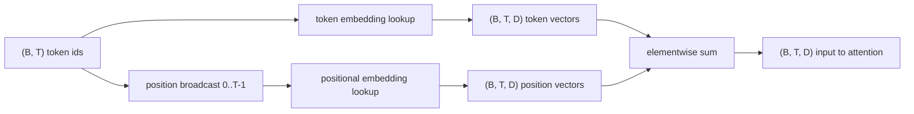
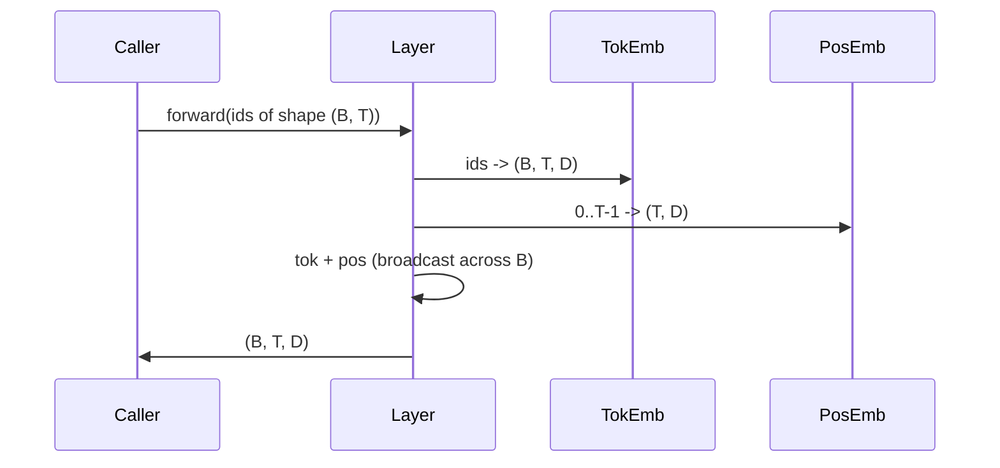

# Token 與位置 Embedding (Token and Positional Embeddings)

> Id 是整數。模型要的是向量。兩張查找表夾在中間，而位置那一張的選擇，會決定模型能學到什麼。

**Type:** Build
**Languages:** Python
**Prerequisites:** Phase 04 lessons, Phase 07 transformer lessons, Lessons 30 and 31 of this phase
**Time:** ~90 分鐘

## 學習目標 (Learning Objectives)
- 建立把詞彙表 id 對應到稠密向量的 token-embedding 查找表。
- 建立以位置為索引的可學習位置 embedding 查找表。
- 建立以位置為索引、沒有參數的固定正弦位置 embedding。
- 將 token 與位置 embedding 組合成 transformer block 的單一輸入。
- 對照可學習與正弦 embedding 在長度泛化與參數量上的差異。

```figure
cc-embedding-lookup
```

## 框架 (The frame)

模型第一次接觸 token id，是在 token-embedding 矩陣中查一列。矩陣每個詞彙表 id 一列、每個模型維度一欄。查找回傳一個向量，模型其餘部分把它當作該 id 的意義。Backprop 會更新前向傳遞中用到的那些列。隨著訓練，這些列的幾何結構學會用方向來編碼相似度。

單靠 token id 沒有順序。模型需要第二個訊號，告訴它位置一和位置十七不同。這個訊號的兩種主流選擇，是可學習的位置 embedding (第二張查找表，每個位置一列)，以及固定的正弦位置 embedding (一個沒有參數的數學公式)。這個選擇有後果。可學習的表是參數，且受限於模型訓練時的最大 context 長度。正弦表在理論上沒有參數，公式可延伸到任何位置，但這堂課的 `SinusoidalPositionalEmbedding` 會在 `max_context_length` 預先計算固定的表，其 `forward` 超過該上限就會拋出例外；因此這裡兩個模組都強制一個最大 context 長度。即使表大到足以索引，模型在超出其訓練長度之後仍然可能表現不佳。

這堂課兩者都建構，並與 token embedding 組合成下一課 attention block 的單一輸入。

## 形狀契約 (The shape contract)

Embedding 階段的輸入是形狀為 `(B, T)` 的 token id batch。輸出是形狀為 `(B, T, D)` 的 tensor，其中 `D` 是模型維度。每個 batch 元素的 context 長度 `T` 都相同。每個位置的向量維度 `D` 都相同。



組合是加總，不是串接。加總讓 `D` 在整個網路中保持不變，並讓模型逐特徵決定在每一層是 token 意義還是位置占主導。

## Token embedding 矩陣 (The token embedding matrix)

Token embedding 是形狀為 `(V, D)` 的參數 tensor，其中 `V` 是詞彙表大小。PyTorch 將它公開為 `nn.Embedding(V, D)`。初始化時，各項從小的 Gaussian 抽取，對 transformer 規模的模型，傳統上平均為零、標準差約 `0.02`。確切的初始化方式，比起它在各次執行間保持一致來得次要。

前向傳遞是一次索引操作。PyTorch 透過收集各列，把 `(B, T)` 的 int64 id 對應到 `(B, T, D)` 的浮點數。反向傳遞只把梯度累積到前向傳遞中被碰到的那些列。從未出現在 batch 中的兩列，在該步驟收到零梯度。

一個細微之處。Token embedding 與模型末端的輸出投影，常常共用權重 (weight tying)。發生這種情況時，每次反向傳遞都會透過輸出端碰到 embedding 的每一列。這堂課把兩者公開為獨立的模組，但在完整模型中，同一個矩陣可以同時扮演兩個角色。

## 可學習的位置 embedding (The learned positional embedding)

可學習的位置 embedding 是第二個形狀為 `(max_context_length, D)` 的 `nn.Embedding`。查找以位置 id `0, 1, 2, ..., T-1` 為鍵。前向傳遞把該位置向量在 batch 維度上廣播。

可學習表的缺點，是如果模型只訓練到位置 `T-1`，就無法在位置 `T` 查詢。那一列根本不存在。使用這種方案的正式 decoder-only 模型，會把最大 context 長度寫進架構，並拒絕處理更長的輸入。

## 正弦位置 embedding (The sinusoidal positional embedding)

正弦位置 embedding 是從位置到向量的函式。位置 `p` 與特徵 `i` 產生

```python
angle = p / (10000 ** (2 * (i // 2) / D))
emb[p, 2k]     = sin(angle)
emb[p, 2k + 1] = cos(angle)
```

這個函式沒有參數。每個位置都有獨特的向量。波長在特徵維度之間以幾何級數變化。較低的維度有最短的波長，編碼細緻的位置。較高的維度有最長的波長，編碼粗略的位置。

從同時選用 `sin` 和 `cos` 得到的特性是：位置 `p + k` 的向量，是位置 `p` 向量的線性函式。這給了 attention 層一條學習相對位置偏移的捷徑。模型不需要另外的參數來表達「往回看五個 token」。

這堂課在建構時一次計算完整的正弦表，並在前向時對它索引。

## 組合 (The composition)

輸入管線依序做三件事。讀取 token id。查找 token 向量。加上位置向量。回傳總和。



加總步驟中的廣播，會沿著 batch 維度複製 `(T, D)` 的位置 tensor。PyTorch 會自動處理，因為位置 tensor 在 unsqueeze 之後的形狀是 `(1, T, D)`。

## 對比分析 (Contrastive analysis)

這堂課在相同輸入上執行兩種變體，並印出兩項診斷。

第一項是參數量。可學習變體在 token embedding 之上增加 `max_context_length * D` 個參數。正弦變體增加零個。

第二項是相鄰位置 embedding 之間的 cosine 相似度。正弦變體有平滑且可預測的衰減，因為函式是連續的。可學習變體在初始化時，相似度近乎隨機，因為各列是獨立抽取的。訓練之後，可學習變體通常會發展出類似的平滑結構，但它必須從資料中發現這個結構。

## 這堂課沒有做的事 (What this lesson does not do)

它不建構旋轉位置編碼 (RoPE) 或 AliBi。這些是正式 transformer 中的現代選擇。它們都遵循與這裡 embedding 相同的形狀契約 (對形狀為 `(B, T, D)` 的向量施加與位置相關的轉換)，但它們作用在 attention 投影步驟，而不是輸入處。下一課建構 attention block，其中一個可選的延伸，是在那裡把 rotary 折進 query-key 投影。

它不訓練 embedding。訓練需要 loss，loss 需要模型輸出，模型輸出需要 attention 和 LM head。那是下一課以及再下一課的內容。

## 如何閱讀程式碼 (How to read the code)

`main.py` 定義三個模組。`TokenEmbedding` 包裝 `nn.Embedding(V, D)`。`LearnedPositionalEmbedding` 包裝 `nn.Embedding(L, D)`。`SinusoidalPositionalEmbedding` 預先計算表，並將它公開為 buffer。`EmbeddingComposer` 將 token embedding 與位置 embedding 綁在一起。底部的 demo 印出形狀、參數量，以及相鄰位置相似度診斷。`code/tests/test_embeddings.py` 中的測試固定了形狀、廣播行為、參數量，以及正弦公式。

執行 demo。然後把模型維度 `D` 從 64 改成 32，觀察正弦波長頻帶如何變化。
