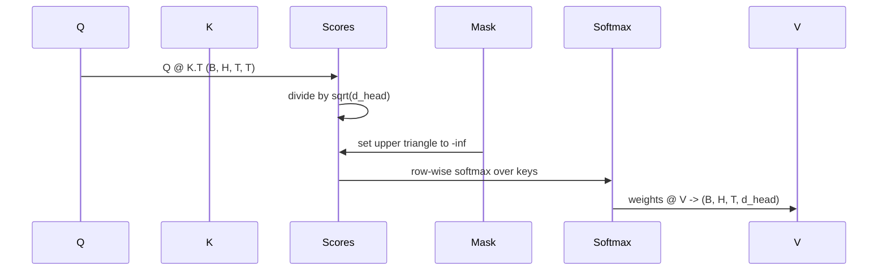

# 多頭自注意力 (Multi-Head Self-Attention)

> 一個線性投影、三種視角、H 個平行的 head、一個 mask。模型實際使用的 attention block。

**Type:** Build
**Languages:** Python
**Prerequisites:** Phase 04 lessons, Phase 07 transformer lessons, Lessons 30 through 32 of this phase
**Time:** ~90 分鐘

## 學習目標 (Learning Objectives)
- 把批次的 Query/Key/Value 投影，實作成切成 H 個 head 的單一線性層。
- 以正確的正規化與 dtype 處理，計算 scaled dot-product attention。
- 套用 causal mask，防止某個位置關注未來的位置。
- 檢視固定輸入下每個 head 的 attention 權重，並推理每個 head 在看什麼。
- 在玩具任務上訓練小型 attention block，並觀察 head 特化時 loss 下降。

```figure
cap-multihead-attention
```

## 框架 (The frame)

Attention 是讓 token 的表示從同一序列中的其他 token 汲取資訊的函式。Self-attention 的意思是 query、key 和 value 都來自同一個輸入。Multi-head 的意思是投影被切成 H 個平行的 attention 問題，其輸出被串接並投影回來。

高效的實作模式是：一個從 `D` 投影到 `3 * D` 的線性層，切成三個視角，再各自重塑成 H 個大小為 `D // H` 的 head。Matmul、softmax 與加權總和都以批次 tensor 運算進行，讓 head 在加速器上平行執行。

這堂課建構這個 block。它也加上 causal mask，讓同樣的程式碼能作為 decoder-only 語言模型中的 attention 層。下一課把這個 block 堆疊成完整的 transformer，再下一課訓練它。

## 形狀契約 (The shape contract)

輸入是 `(B, T, D)`。輸出是 `(B, T, D)`。Mask 是 `(T, T)`，或可廣播到它。Block 內部的中間 tensor 形狀為 `(B, H, T, d_head)`，其中 `d_head = D // H`。限制條件是 `D % H == 0`。

```mermaid
flowchart LR
    A["(B, T, D) input"] --> B[Linear D -> 3D]
    B --> C["split into Q, K, V"]
    C --> D["reshape to (B, H, T, d_head)"]
    D --> E["scores = Q @ K.T / sqrt(d_head)"]
    E --> F[apply causal mask]
    F --> G[softmax over keys]
    G --> H["context = weights @ V"]
    H --> I["reshape to (B, T, D)"]
    I --> J[output Linear D -> D]
    J --> K["(B, T, D) output"]
```



兩個線性層 (QKV 投影與輸出投影) 是 block 中僅有的參數。Mask、softmax、matmul 與 reshape 都沒有參數。

## QKV 切分 (The QKV split)

天真的實作有三個獨立的線性層，分別給 Q、K 和 V。高效的實作則是單一層，輸出 `3 * D` 個特徵並切分結果。兩者在數學上等價，因為三個各自與 `(D, D)` 權重相乘的矩陣乘法，正好就是與由它們堆疊而成的 `(3D, D)` 權重做一次矩陣乘法。

高效版本比較快，因為加速器只啟動一次 matmul，而不是三次。它也比較容易初始化，因為三個子矩陣存在同一個參數 tensor 中，可以一起初始化。

## Head 重塑 (The head reshape)

切分之後，Q、K、V 各自是 `(B, T, D)`。要把它變成 H 個平行的 attention 問題，我們重塑成 `(B, T, H, d_head)`，再轉置成 `(B, H, T, d_head)`。Head 維度現在緊鄰 batch 維度，所以 PyTorch 把每個 head 的 attention 視為跨 `B * H` 個獨立實例的批次運算。

d_head 維度留在最後，讓分數 matmul `Q @ K.transpose(-2, -1)` 對它做縮約。結果是 `(B, H, T, T)` 的每個 head 的 attention 分數。

## 縮放 (Scaling)

分數在 softmax 之前會除以 `sqrt(d_head)`。沒有這個縮放，內積會隨 `d_head` 增大而變大，把 softmax 推入一個狀態：一個項目幾乎占有全部質量，其他項目小到可以忽略。這種狀態下的梯度很小，學習會停滯。除以 `sqrt(d_head)` 讓分數的變異數在不同 head 大小之間大致保持不變。

## Causal mask (The causal mask)

Decoder-only 語言模型在預測下一個 token 時，只能以過去為條件。Mask 強制執行這一點。具體來說，在 softmax 之前，`(T, T)` 分數矩陣對角線以上的每個項目都被換成負無限大。Softmax 之後，這些位置的權重為零。



我們在建構時把 mask 註冊為 buffer，讓它與模型位於同一個裝置上，且不屬於梯度圖。Mask 涵蓋 block 可能看到的最大 context 長度。前向時，我們切出左上角 `(T, T)` 的部分。

## 輸出投影 (The output projection)

得到每個 head 的 context 向量 `(B, H, T, d_head)` 之後，我們轉置回 `(B, T, H, d_head)`，重塑成 `(B, T, D)`，並套用最後的 `(D, D)` 線性投影。輸出投影讓模型混合各個 head。沒有它，H 個 head 只能透過後面的層重新組合，block 會受到人為的限制。

## Attention 權重檢視 (Attention weight inspection)

這堂課在前向傳遞上公開 `return_weights=True` 旗標。設定時，block 會連同輸出一起回傳形狀為 `(B, H, T, T)` 的每個 head 的 attention 權重。Demo 在短輸入上印出某個 head 權重的熱圖，讓你看到 causal 三角形結構與每個位置的聚焦。

在訓練好的模型中，不同的 head 學到不同的模式。有些 head 關注緊鄰的前一個 token。有些 head 關注序列的開頭。有些 head 把 attention 幾乎均勻地散開。檢視 hook 就是這類可解釋性工作的入口。

## 訓練 demo (The training demo)

`main.py` 底部的 demo 把 attention block 接上一個小型 LM head，並在重複任務上訓練整體。輸入的每一列是在 context 中複製的單一隨機 id。目標是輸入位移一位，所以模型必須學到下一個 token 與前一個 token 相同。Loss 是 cross-entropy。在 H=4、D=32、T=12、詞彙表為 64 的情況下，loss 從隨機水準 (約 `log(64) ~ 4.16`) 在 CPU 上三個 epoch 內降到遠低於 `1.0`。

Demo 的重點不是訓練一個有用的模型。重點是確認梯度流過 block 的每個部分，並且 head 在答案顯而易見的問題上學到東西。

## 這堂課沒有做的事 (What this lesson does not do)

它沒有加入 feed-forward block。真實模型中的 transformer 層是 attention，後面接著雙層 MLP，每個外面都有 residual 連接與 layer norm。下一課會加入這些。

它沒有實作 rotary 或 AliBi 位置編碼。兩者都作用在同一個 block 的 QKV 投影步驟，但它們是獨立的教學單元。這裡建構的 block 只要在 matmul 之前轉換 Q 和 K，就能與任一種相容。

它沒有實作推論用的 KV cache。在多次前向傳遞間快取 key 和 value，是讓自迴歸解碼變快的最佳化。它會改變 K 和 V tensor 的形狀契約，但不影響 Q。它屬於推論課程。

## 如何閱讀程式碼 (How to read the code)

`main.py` 定義 `MultiHeadSelfAttention`。這個類別持有兩個線性層與一個已註冊的 mask buffer。前向傳遞依序做投影、重塑、評分、遮罩、softmax、加權、重塑，再投影一次。底部的 demo 建立一個小模型，它把 attention 與 token 和位置 embedding 及 LM head 包在一起，在複製任務上訓練三個 epoch，並印出 loss 曲線與每個 head 的 attention 熱圖。`code/tests/test_attention.py` 中的測試固定了形狀契約、因果性、softmax 特性、head 切分特性，以及梯度流動。

執行 demo。然後把 `n_heads` 從 4 增加到 8 (保持 `d_model=32`，所以 `d_head=4`)，觀察熱圖如何變化。
