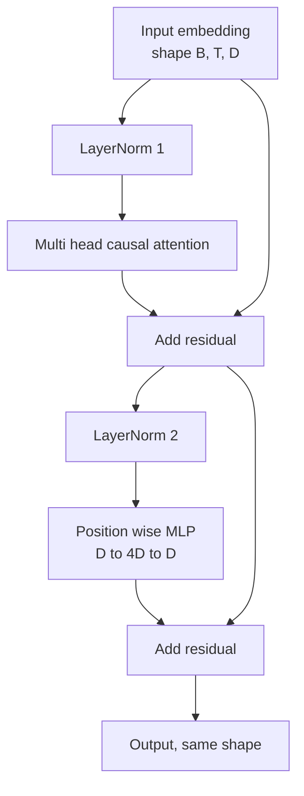
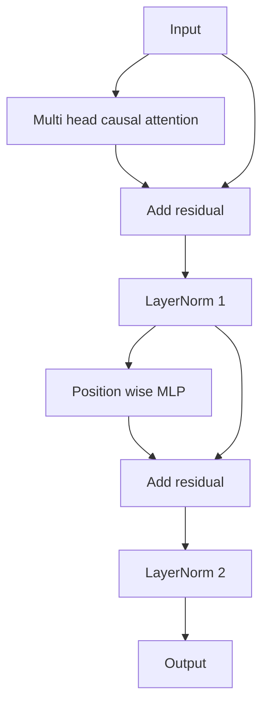

# 從零打造 Transformer Block (Transformer Block from Scratch)

> 一個 block 是每個現代 decoder LLM 的單位。Layer norm、multi head attention、residual、MLP、residual。Pre-LN 變體不用 warmup 也能穩定訓練。Post-LN 變體則是原始論文所採用的。這堂課並排打造兩者，並展示哪一個能在一般學習率下撐過 12 層的堆疊。

**Type:** Build
**Languages:** Python
**Prerequisites:** Phase 19 lessons 30 to 33 (tokenizer, embeddings, attention math, batched data loader)
**Time:** ~90 分鐘

## 學習目標 (Learning Objectives)

- 用四個活動部件在 PyTorch 中建構 transformer block：LayerNorm、multi head causal attention、residual 連接、逐位置 MLP。
- 以兩種配置 (pre-LN 與 post-LN) 放置 LayerNorm，並解釋為什麼其中一種不用 warmup 也能穩定訓練。
- 在 multi head attention 內實作 causal masking，讓 token `i` 看不到 token `j > i`。
- 在 12 層堆疊上追蹤兩種變體的梯度流，並清楚地解讀結果，不含糊帶過。
- 當下一課組裝 124 million 參數的 GPT 時，把這個 block 當作可直接換用的單位重複使用。

## 問題 (The Problem)

Transformer 就是一個 block 的重複。把 block 弄錯一次，再重複十二次，你就會交出一個在第一個 epoch 發散，或之後一路都需要 warmup 權宜之計的模型。這堂課你會看到的兩種失敗模式並不罕見。它們在學習者第一次天真地堆疊 block 時就會出現。一種是 attention 層關注了未來。另一種是 LayerNorm 被放在無法在深度上馴服 residual 訊號的位置。

一旦你看懂，修正就是機械式的。Block 恰好有兩條 residual 路徑與兩個正規化位置。位置選對，堆疊的其餘部分只是記帳。

## 核心概念 (The Concept)

每個 decoder-only transformer block 都是一個函式，接收形狀為 `(batch, sequence, embedding)` 的 tensor，並回傳相同形狀的 tensor。內部由兩個子層做事。



這是 pre-LN 變體。LayerNorm 位於 residual 分支內，在子層之前。Residual 連接把未正規化的訊號往前傳。

Post-LN 變體把 LayerNorm 移到 residual 相加之後。



形狀相同。訓練行為不同。使用 post-LN 時，沿著 residual 路徑回傳的梯度必須通過 LayerNorm。在深度十二、學習率 `3e-4` 時，那個梯度縮小得夠快，以至於需要 warmup 排程。Pre-LN 讓 residual 路徑保持未正規化，所以梯度能乾淨地傳播到 embedding 層。出於這個原因，GPT-2 以後都採用 pre-LN 配置。

### Causal multi head attention

Attention 子層把輸入以三種方式投影成 query、key、value tensor。每個都從 `(B, T, D)` 重塑成 `(B, H, T, D/H)`，其中 `H` 是 head 數。Scaled dot product attention 對每個 head 計算 `softmax(Q K^T / sqrt(d_k))`，把上三角遮成負無限大，透過 softmax 套用 mask，然後乘以 `V`。各 head 被串接回單一個 `(B, T, D)` tensor，再投影一次。Mask 是讓模型具因果性的唯一部件。忘了 mask，你訓練出來的就是會作弊的模型。

### MLP

逐位置 MLP 對每個 token 獨立套用同一個雙層網路。隱藏層寬度是 embedding 寬度的四倍，激活函數是 GELU，第二個線性層之後接 dropout。MLP 內部 token 之間沒有互相溝通。所有 token 的混合都發生在 attention 中。

### Residual 連接做兩件事 (Residual connections do two things)

它們讓梯度路徑在深度上是相加的，使梯度範數在十二層中維持在合理尺度。它們也讓每個 block 學到對執行中表示的加法更新，而不是完整的取代。這兩個效果就是 block 能擴展的原因。

```figure
cc-transformer-block
```

## 動手做 (Build It)

`code/main.py` 實作：

- `class LayerNorm`，具有可學習的縮放與平移、帶偏差的 eps，作用於每個 token 向量。
- `class MultiHeadAttention`，包含 `num_heads`、`head_dim = d_model // num_heads`、融合的 QKV 投影、已註冊的 causal mask，以及 attention 與 residual dropout。
- `class FeedForward`，有兩個線性層、GELU 激活與 dropout。
- `class TransformerBlock`，用 `pre_ln` 旗標切換兩種變體。
- 一個 demo：以相同輸入建立 6 層 pre-LN 堆疊與 6 層 post-LN 堆疊，並印出 (a) 輸出形狀，(b) 一次反向傳遞後 embedding 處的梯度範數。

執行它：

```bash
python3 code/main.py
```

輸出：兩個堆疊的形狀檢查，以及並排的梯度範數。在相同學習率下，pre-LN 堆疊 embedding 處的梯度比 post-LN 堆疊大一個數量級，這是 pre-LN 不用 warmup 就能訓練的經驗訊號。

## 技術堆疊 (Stack)

- 使用 `torch` 做 tensor 運算、autograd 與 `nn.Module` 的管線。
- 沒有 `transformers`，沒有預訓練權重。Block 由基本元件實作。

## 實務中的正式模式 (Production patterns in the wild)

三種模式把教科書上的 block 變成可以出貨的東西。

**融合的 QKV 投影。** 三個獨立的線性層需要三次 kernel 啟動和三次 matmul。一個寬度為 `3 * d_model` 的線性層用一次啟動完成相同的工作，然後沿最後一軸切分輸出。融合路徑在每種加速器上都較快，也符合 GPT-2、LLaMA 和 Mistral 的參考實作所採用的做法。

**已註冊的 causal mask buffer。** Mask 只取決於最大 context 長度。在建構時用 `register_buffer` 配置一次，每次前向傳遞切出有效的視窗，並略過每次呼叫的配置。忘了這點，會讓 mask 在長 context 時變成配置器的熱點。

**Dropout 放在兩個位置，不是三個。** Dropout 屬於 attention softmax 之後 (attention dropout)，以及 MLP 第二個線性層之後 (residual dropout)。在 residual 本身上放 dropout，會破壞讓梯度在深度上流動的加法恆等性。有些早期實作在這點上做錯，付出了訓練脆弱的代價。

## 實際使用 (Use It)

- 這堂課的 block 不需修改，就能直接接進第 35 課的 GPT 組裝。
- Pre-LN 變體是每個現代開放權重 LLM 使用的。Post-LN 變體是 2017 年原始 attention 論文使用的。兩者都懂，就足以閱讀你會遇到的任何 decoder 架構。
- 把 GELU 換成 SiLU，就得到 LLaMA 家族的激活函數。把 LayerNorm 換成 RMSNorm，就得到 LLaMA 家族的正規化。骨架相同。

## 練習 (Exercises)

1. 在 block 中的每個 linear 加上 `bias=False` 旗標。現代開放權重 LLM 的線性層出貨時都不帶 bias。衡量在 12 層、768 維的模型中能省下多少參數。
2. 用手工打造的 RMSNorm 取代 `nn.LayerNorm`，並驗證輸出形狀不變。
3. 加入旗標，把第一個 head 的 attention 權重以 `(B, T, T)` tensor 回傳。繪製上三角，確認 softmax 之後為零。
4. 建立合理性檢查：將 `(2, 16, 384)` 的 tensor 搭配 `H=6` 送過兩種變體，並斷言在權重初始化相同且 dropout 設為零時，前向輸出是不同的 (例如 `not torch.allclose`)。

## 關鍵術語 (Key Terms)

| 術語 | 一般說法 | 實際意義 |
|------|-----------------|------------------------|
| Pre-LN | 「Pre norm」 | LayerNorm 位於 residual 分支內、每個子層之前；residual 攜帶未正規化的訊號 |
| Post-LN | 「Post norm」 | LayerNorm 位於 residual 相加之後；2017 年論文所採用，且需要 warmup |
| Causal mask | 「三角形 mask」 | 將 attention logit 的上三角設為負無限大，讓 token i 在 j 大於 i 時無法讀取 token j |
| Fused QKV | 「合併投影」 | 一個寬度 3D 的 linear，取代三個寬度 D 的 linear；一個 kernel、一次 matmul |
| Residual stream | 「Skip connection」 | 由上到下流經每個 block 的未正規化 tensor；每個 block 都在它上面做加法 |

## 延伸閱讀 (Further Reading)

- Phase 7 lesson 02 (self attention from scratch)：這個 block 底層的 attention 數學。
- Phase 7 lesson 05 (full transformer)：相同骨架的 encoder decoder 版本。
- Phase 10 lesson 04 (pre training mini GPT)：這個 block 所接上的訓練流程。
- Phase 19 lesson 35 (本 track)：把十二個這種 block 堆疊成 GPT 模型。
