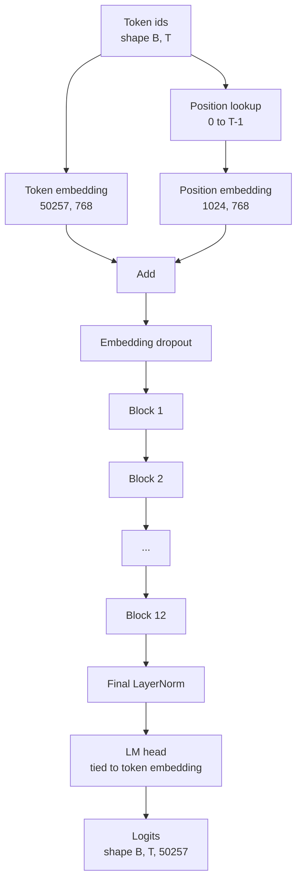
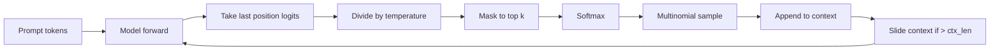

# GPT 模型組裝 (GPT Model Assembly)

> 十二個 block 堆疊、一個 token embedding、一個可學習的位置 embedding、一個最終的 LayerNorm，以及一個權重綁定的語言模型 head。這就是整個 124 million 參數的 GPT 模型。這堂課把這些部件組裝成可運作的類別、計算參數量以確認模型符合 124M 的參考形狀，並以 multinomial sampling、temperature 和 top-k 產生文字。

**Type:** Build
**Languages:** Python
**Prerequisites:** Phase 19 lessons 30 to 34
**Time:** ~90 分鐘

## 學習目標 (Learning Objectives)

- 把第 34 課的 transformer block 組裝成完整的 GPT 模型：token embedding、位置 embedding、N 個 block、最終 LayerNorm、語言模型 head。
- 重現 124 million 參數的配置：vocab 50257、context 1024、embedding 768、十二個 head、十二層。
- 將語言模型 head 的權重綁定到 token embedding，並解釋為什麼在這個規模下能省下約 38 million 個參數。
- 以 multinomial sampling、temperature 縮放與 top-k 截斷，從 prompt 產生文字，並用滑動視窗維持 context 長度。
- 對照 124M 目標，衡量參數量與前向傳遞的成本。

## 問題 (The Problem)

Transformer block 本身什麼都不做。你需要把 token id 轉成向量、混入位置資訊、通過整個堆疊，再投影回詞彙表 logit。這四個步驟少了任何一個，模型要嘛無法前向、要嘛位置資訊漂移，要嘛無法「說話」。

模型的形狀也很重要。參考的 GPT-2 small 在上述配置下恰好是 124 million 個參數。這些數字不是魔法。Vocab 50257 乘以 embedding 768 是 token 表。位置 1024 乘以 768 是位置表。十二個 block，每個約 7 million 個參數，共 84 million。最終的 head 透過權重綁定重用 token 表。把各部分加起來，你就得到 124 million。如果建出來的模型參數量與參考不符，就表示你接錯了什麼。

## 核心概念 (The Concept)



Token id 變成 token 向量。位置 id 變成位置向量。兩者相加後送進堆疊。最終的 LayerNorm 是 block 之外，在每個現代變體中都留存下來的那一個部件。LM head 重用 token embedding 矩陣，這就是權重綁定的意思。

### 權重綁定 (Weight tying)

Token embedding 的形狀是 `(vocab, d_model)`。語言模型 head 需要從 `d_model` 投影回 `vocab`。兩者互為轉置。綁定兩者，意思是字面上使用同一個參數 tensor 兩次。在 vocab 50257 與 d_model 768 時，這個矩陣有 38 million 個參數。不綁定的話，你要付兩次。綁定的話，你只付一次，而且還會得到稍微乾淨一點的梯度訊號，因為 embedding 和 head 一起更新。

### 位置 embedding 是學出來的，不是正弦的 (Position embedding is learned, not sinusoidal)

GPT-2 採用可學習的位置 embedding。位置表是形狀為 `(1024, 768)` 的一個參數 tensor。模型每次前向都查找位置 0 到 T-1，並把查找結果加到 token embedding 上。這是位置方案中最簡單的 (RoPE、ALiBi、T5 相對偏置是替代方案)，也是 124M 參考所使用的。

### 產生：temperature、top-k、multinomial

產生是自迴歸的。每一步，模型都在每個位置回傳涵蓋整個詞彙表的 logit。你只取最後一個位置，除以 temperature，可選地把除了前 k 個之外的 logit 遮成負無限大，softmax 得到機率，並從所得分布中取樣一個 token。



三個旋鈕，三種不同行為。Temperature 接近零時會退化成 greedy。Temperature 為一時符合模型的自然分布。Top-k 為一就是 greedy。Top-k 為四十則過濾長尾。組合很重要；下一課的訓練把產生當作定性評測訊號。

```figure
cc-gpt-assembly
```

## 動手做 (Build It)

`code/main.py` 實作：

- `class GPTConfig` dataclass，帶 124M 預設值：`vocab_size=50257`、`context_length=1024`、`d_model=768`、`num_heads=12`、`num_layers=12`、`mlp_expansion=4`、`dropout=0.1`、`use_bias=True`、`weight_tying=True`。
- `class GPTModel`，包含 token embedding、位置 embedding、embedding dropout、十二個 `TransformerBlock`、最終 LayerNorm，以及在設定旗標時綁定到 token embedding 的 `lm_head`。
- `count_parameters` 輔助函式，回傳唯一參數量 (所以計數會遵循權重綁定)。
- `generate` 函式，處理 temperature、top-k、multinomial 與滑動視窗 context。
- 一個 demo：建立模型、把參數量與參考的 124M 並排印出，並從固定 prompt 產生一小段序列，端到端展示整條管線。

執行它：

```bash
python3 code/main.py
```

輸出：與 124M 參考並列的參數量、從固定 prompt 產生的 token id，以及在綁定開啟時 LM head 與 token embedding 共用儲存空間的確認。

為了讓 demo 保持快速，腳本也端到端執行一個微型配置 (`d_model=64`、`num_layers=2`)，並就地印出產生的 token 序列。124M 配置會被建立，但只執行其參數量與一次前向傳遞。

## 技術堆疊 (Stack)

- 使用 `torch` 做 tensor 運算、autograd 與模組管線。
- `code/main.py` 在本地重新實作第 34 課相同的 block 模式。

## 實務中的正式模式 (Production patterns in the wild)

三種模式決定了能跑的模型與能出貨的模型之間的差別。

**把 residual 投影初始化得小一點。** Attention 的輸出投影與 MLP 的第二個線性層，都直接餵給 residual 相加。如果用與其他每個線性層相同的標準差初始化它們，residual stream 會隨深度成長，並把最終的 LayerNorm 推入過熱的狀態。對這兩個投影，將標準差縮放為 `1 / sqrt(2 * num_layers)`；residual stream 就會在十二層中維持在合理範圍。

**快取位置 id tensor，不要重新計算。** `torch.arange(T)` 每次前向都會配置新的記憶體。在 `__init__` 中針對最大 context 配置一次，每次呼叫切出前 T 項，並略過配置器的往返。

**在參數層級綁定權重，不要只是複製。** 設定 `lm_head.weight = token_embedding.weight` 會共用 tensor；複製則不會。Optimizer 需要更新一個參數，autograd 圖也只需要一次累積。如果你複製，head 會逐漸偏離 embedding，權重綁定就什麼好處都沒有。

## 實際使用 (Use It)

- 這堂課的模型類別，與下一課訓練的模型形狀相同。
- 把可學習的位置 embedding 換成 RoPE，不必動 block 或 head，就得到 LLaMA 家族。
- 把 GELU 換成 SiLU、把 LayerNorm 換成 RMSNorm，就得到 LLaMA 家族其餘的改變。
- 產生函式適用於任何 logit 來源，不只這個模型。你可以在第 37 課從預訓練的 GPT-2 檔案取得 logit，並重用相同的產生迴圈。

## 練習 (Exercises)

1. 解除 LM head 與 token embedding 的綁定並重新計算參數量。驗證差值是 50257 乘以 768 = 38 million。
2. 把可學習的位置 embedding 換成建構時計算的正弦表。確認模型仍可前向，且參數量減少 786,432。
3. 在產生函式加入 `greedy=True` 旗標，略過取樣並挑選 argmax。確認序列在多次執行間是確定的。
4. 加入 `repetition_penalty` 旋鈕，在 softmax 之前，把 prompt 或已產生歷史中任何 token 的 logit 除以一個常數。在固定 prompt 上展示大於一的值能減少輸出中的重複次數。
5. 在 `top_k` 旁邊加入 `top_p` (nucleus) 取樣。用兩行檢查被保留 token 的機率總和超過 `top_p`。

## 關鍵術語 (Key Terms)

| 術語 | 一般說法 | 實際意義 |
|------|-----------------|------------------------|
| Weight tying | 「綁定的 embedding」 | LM head 與 token embedding 共用同一個參數 tensor；省下 vocab 乘以 d_model 個參數，符合 GPT-2 參考 |
| Position embedding | 「學出來的位置」 | 形狀為 (context 長度, d_model) 的獨立表，加到 token 向量上；端到端學習 |
| Sliding window context | 「Context 上限」 | 當 prompt 加上已產生的 token 超過 context 長度時，丟掉最舊的 token，讓有效視窗放得下 |
| Top-k sampling | 「K 截斷」 | 保留數值最高的 K 個 logit，其餘遮成負無限大，對剩餘部分做 softmax |
| Temperature | 「取樣溫度」 | softmax 之前把 logit 除以 T；T 小於 1 使分布變尖，T 等於 1 保持自然分布，T 大於 1 使分布變平 |

## 延伸閱讀 (Further Reading)

- Phase 19 lesson 34：這個模型所堆疊的 block。
- Phase 19 lesson 36：以 cross entropy loss 驅動這個模型的訓練迴圈。
- Phase 19 lesson 37：把預訓練的 GPT-2 權重載入這個完全相同的架構。
- Phase 7 lesson 07 (GPT causal language modeling)：next token prediction 的數學。
- Phase 10 lesson 04 (pre training mini GPT)：在相同架構上的原始訓練流程。
