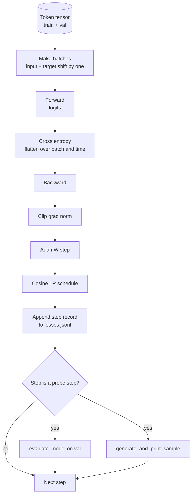

# 訓練迴圈與評測 (Training Loop and Evaluation)

> 不做衡量的迴圈會說謊。這堂課打造驅動 GPT 模型的訓練迴圈：權重衰減分組的 AdamW、warmup 加 cosine 的學習率排程、`calc_loss_batch` 輔助函式、對 held-out 資料的 `evaluate_model`、每 K 步一次的 `generate_and_print_sample` 定性探測，以及事後可以繪圖的 loss JSONL 日誌。同一個骨架可以訓練你將來打造的每一個 decoder LLM。

**Type:** Build
**Languages:** Python
**Prerequisites:** Phase 19 lessons 30 to 35
**Time:** ~90 分鐘

## 學習目標 (Learning Objectives)

- 建立訓練迴圈，以 next token prediction 正確的輸入與目標對齊方式計算 cross entropy loss。
- 設定 AdamW，讓權重衰減套用在權重 tensor，而不套用在 LayerNorm 或 bias tensor。
- 實作帶線性 warmup 與 cosine 衰減的學習率排程，並讀懂 LR 隨時間的變化。
- 用 `evaluate_model` 在 held-out 切分上評測，讓 eval loss 能跨次執行比較。
- 每 K 步以 `generate_and_print_sample` 產生定性樣本，在 loss 曲線反映之前就發現發散。
- 將每一步的 loss 持久化為 JSONL，讓你能重新載入、繪圖，並把訓練日誌當作交付成果。

## 問題 (The Problem)

只印出 loss 卻什麼都不做的訓練腳本，會以三種方式失敗。它無法告訴你 loss 下降是不是出於正確的原因 (模型可能過擬合訓練集，卻什麼都沒學到)。它無法告訴你發散是否正在開始 (loss 可能飆升一步後恢復，或飆升一步後崩潰)。它無法告訴你模型學到了什麼 (loss 是純量；產生的樣本才是一段文字)。除非迴圈有衡量，這三種失敗都會隱藏起來。

這堂課的迴圈以三種方式衡量。每一步的訓練 batch loss。每 K 步在 held-out batch 上的 loss。每 K 步由固定 prompt 產生的續寫。訓練日誌寫成 JSONL，所以產出物就是迴圈的證詞。

## 核心概念 (The Concept)



兩個不明顯的部分是 loss 對齊與 AdamW 的衰減分組。

### Loss 對齊 (Loss alignment)

模型在每個位置預測下一個 token。如果輸入 batch 是 token `[t0, t1, t2, t3]`，目標 batch 必須是 `[t1, t2, t3, t4]`。Cross entropy 在攤平的形狀 `(batch * seq, vocab)` 上，對攤平的目標 `(batch * seq,)` 計算。忘了位移，你就是在訓練模型預測它自己，loss 會收斂到零，卻什麼有用的東西都沒學到。

### AdamW 衰減分組 (AdamW decay split)

權重衰減對權重 tensor 做正則化，但不套用在正規化的縮放或 bias 上。對 LayerNorm 的縮放套用衰減，會慢慢把縮放推向零，破壞正規化。對 bias 套用衰減在數學上無害，但浪費週期。標準的分法是：矩陣形狀的 tensor (線性權重、embedding 表) 套用衰減，任何看起來像縮放或平移的則不套用。

### Warmup 加 cosine 排程 (Warmup plus cosine schedule)

Warmup 在幾百步內把學習率從零爬升到目標，讓 optimizer 狀態有時間累積。Cosine 衰減在剩餘步驟中把學習率降回接近零，讓最後階段以小步長微調權重。這個組合是開放權重 LLM 訓練中最常見的排程，因為它移除了前一千步與最後一千步中大多數脆弱的時刻。

### Held-out 評測 (Held out evaluation)

`evaluate_model` 從驗證切分執行固定數量的 batch、累積 loss、除以 batch 數，然後回傳。沒有梯度。沒有 dropout。在相同 seed 與相同切分下，這個數字可跨次執行重現。把 held-out loss 與訓練 loss 並列回報，是發現過擬合的方法。

### 把定性取樣當作早期訊號 (Qualitative sampling as an early signal)

訓練 loss 降得漂亮、但產生的樣本全是同一個 token 的模型，是壞掉的。Loss 曲線看起來平坦、但產生的樣本逐漸變成連貫字詞的模型，正在學習。定性探測比閱讀完整曲線更快，並能抓到純量錯過的模式。

```figure
cap-training-loop
```

## 動手做 (Build It)

`code/main.py` 實作：

- `make_batches(token_ids, batch_size, context_length)`，把長 token tensor 切成輸入與目標配對。
- `calc_loss_batch(model, inputs, targets)`，前向、攤平並回傳純量 cross entropy。
- `evaluate_model(model, val_loader, max_batches)`，在不計算梯度的情況下迭代固定數量的驗證 batch，並回傳平均 loss。
- `generate_and_print_sample(model, prompt, max_new_tokens)`，對固定 prompt 執行第 35 課的產生函式並印出結果。
- `build_param_groups(model, weight_decay)`，產生兩組的 AdamW 參數清單。
- `cosine_with_warmup(step, warmup_steps, total_steps, max_lr, min_lr)`，回傳指定步驟的 LR。
- `train(...)`，執行迴圈、持久化 `outputs/losses.jsonl`，並每 `eval_every` 步印出 eval loss 與一個樣本。
- 一個 demo：在合成資料上用少量步數訓練微型模型、寫出 JSONL 日誌，並在探測點印出 eval loss 與樣本。Demo 在 CPU 上一分鐘內就能跑完。

執行它：

```bash
python3 code/main.py
```

輸出：每一步的 loss 行、每個探測步驟的 eval loss、每個探測步驟產生的樣本，以及最後一份可逐行以 `json.loads` 載入的 `outputs/losses.jsonl`。

## 技術堆疊 (Stack)

- 使用 `torch` 做 autograd、optimizer 與模組。
- `main.py` 在本地重新實作第 35 課的 `GPTModel` 與輔助模組。

## 實務中的正式模式 (Production patterns in the wild)

三種模式把教科書上的迴圈，變成你可以放著跑一整晚的東西。

**梯度範數裁剪是必須的。** 壞的 batch (異常資料、LR 飆升、數值邊界情況) 會產生巨大的梯度，抹掉數小時的訓練。在 `backward` 之後、`step` 之前執行 `torch.nn.utils.clip_grad_norm_(params, max_norm=1.0)`，讓 optimizer 維持在安全範圍。裁剪值是自由參數；一是撐過大多數設定的預設值。

**可續跑的 JSONL 日誌，而不是 pickle 的狀態。** 以 `{"step": int, "train_loss": float, "lr": float}` 行形式記錄在 JSONL 中的每步 loss 紀錄是持久的：任何當機都會留下可讀的產出物，你可以 grep，可以用三十行 Python 繪圖，也可以讀取最後一步來續跑訓練。Pickle 的狀態會把你綁定到產生該檔案的確切模組佈局，這在重構時很脆弱。

**從固定切片取得 eval batch。** 驗證 token 在腳本開始時就切成 batch，而不是即時切。可重現性取決於 eval batch 在每次執行間都相同；否則比較兩次執行的 eval loss，衡量的既是模型，也是 batch 的 shuffle。

## 實際使用 (Use It)

- 這堂課的迴圈，與在真實資料上訓練 124M 模型的骨架相同。把合成 token tensor 換成 `datasets` 風格的 loader，迴圈不必改動就能執行。
- JSONL 日誌是把訓練執行變成證據的交付物。下一課用其中一份，比較剛訓練好的 checkpoint 與預訓練的 checkpoint。
- 定性樣本探測是純量 loss 無法取代的萬用偵測。

## 練習 (Exercises)

1. 加入 `weight_decay_groups()` 單元測試，確認縮放與 bias 參數落在無衰減組，線性與 embedding 權重落在衰減組。
2. 把合成的隨機 token 換成小型文字檔的位元組，讓 demo 在可讀的東西上訓練。驗證產生的樣本使用該檔案中出現的字元。
3. 對 cosine 排程加上 `max_lr` 的 10% 作為 `min_lr` 下限，並重新繪圖。
4. 除了 JSONL 日誌之外，每 `eval_every` 步儲存一個 checkpoint。加入 `resume_from` 旗標，重新載入模型狀態與 optimizer 狀態。
5. 在 loss 旁記錄每步吞吐量 (每秒 token 數)，並確認它維持在穩定的範圍內。

## 關鍵術語 (Key Terms)

| 術語 | 一般說法 | 實際意義 |
|------|-----------------|------------------------|
| Loss alignment | 「位移一位」 | 輸入 token 在位置 0..T-1，目標 token 在位置 1..T；cross entropy 在攤平的形狀上計算 |
| Decay split | 「兩組」 | AdamW 收到帶權重衰減的矩陣形狀 tensor，以及不帶衰減的縮放或 bias tensor |
| Warmup | 「爬升」 | 學習率在固定步數內從零爬升到目標，讓 optimizer 狀態得以累積 |
| Eval batches | 「Held-out batch」 | 驗證 token tensor 的固定切片，在腳本開始時切一次，每次探測都相同使用 |
| Qualitative probe | 「樣本列印」 | 每 K 步印出由固定 prompt 產生的簡短文字，用來抓出單靠 loss 看不到的失敗模式 |

## 延伸閱讀 (Further Reading)

- Phase 19 lesson 35：迴圈所驅動的模型。
- Phase 19 lesson 37：把預訓練權重載入相同的模型。
- Phase 10 lesson 04 (pre training mini GPT)：在真實資料上的流程。
- Phase 10 lesson 10 (evaluation)：cross entropy loss 之外更廣的評測面向。
