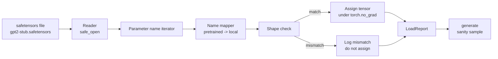

# 載入預訓練權重 (Loading Pretrained Weights)

> 從零訓練 124 million 參數的模型是預算決策；載入已發佈的 checkpoint 只是週二的日常。這堂課把 GPT-2 風格的預訓練權重，從 safetensors 檔載入第 35 課完全相同的架構，逐一走過參數名稱的對應，並透過產生續寫的合理性檢查證明載入成功。沒有網路、沒有第三方 loader、沒有不透明的魔法。

**Type:** Build
**Languages:** Python
**Prerequisites:** Phase 19 lessons 30 to 36
**Time:** ~90 分鐘

## 學習目標 (Learning Objectives)

- 用 `safetensors` Python 函式庫讀取 safetensors 檔，並檢視 tensor 名稱與形狀。
- 把每個預訓練參數名稱對應到第 35 課 GPT 模型內的參數。
- 處理已發佈的 GPT-2 權重與本 track 模型之間不同的兩種命名慣例：`wte/wpe/h.N.attn.c_attn/c_proj` 與 `mlp.c_fc/c_proj`，對上本地命名的 `tok_embed/pos_embed/blocks.N.attn.qkv/out_proj` 與 `mlp.fc1/fc2`。
- 在任何權重指派發生之前，偵測並拒絕形狀不符的情況，並給出清楚的錯誤。
- 以載入的權重產生一小段續寫，確認 token 來自載入的分布，而不是隨機初始化的分布。

## 問題 (The Problem)

已發佈的權重不是為你的架構打包的。它們帶著原始實作所用的名稱。預訓練檔有形狀為 `(2304, 768)` 的 `transformer.h.0.attn.c_attn.weight`；你的模型預期的是形狀 `(2304, 768)` 的 `blocks.0.attn.qkv.weight` (它是同一個矩陣，只是採用不同的版面配置慣例)，或是你的模型使用的 `nn.Linear` 以轉置方式儲存矩陣。同一個參數以三種細微不同的身分出現 (名稱、形狀、位元組版面)，而 loader 必須調和這三者。

盲目複製的 loader 會把正確的 tensor 放到錯誤的位置，你會得到一個產生胡言亂語的模型。形狀不同時拒絕複製、卻什麼都不記錄的 loader，則讓你猜不出哪個 tensor 沒能放進去。這堂課的 loader 是明確的：每次指派都會記錄、每個形狀都會檢查，`LoadReport` 會彙總命中、遺漏與形狀不符，讓你讀得出發生了什麼事。

## 核心概念 (The Concept)



名稱對應器只是從字串到字串的函式。形狀檢查是一個 if。指派發生在 `torch.no_grad()` 內，所以 autograd 不會追蹤載入。報告保存每個名稱的結果。

### GPT-2 命名慣例 (The GPT-2 naming convention)

已發佈的 GPT-2 權重位於這類名稱之下：

| 預訓練名稱 | 形狀 | 意義 |
|-----------------|-------|---------|
| `wte.weight` | (50257, 768) | Token embedding |
| `wpe.weight` | (1024, 768) | 位置 embedding |
| `h.N.ln_1.weight` | (768,) | 第 N 個 block 的 LayerNorm 1 縮放 |
| `h.N.ln_1.bias` | (768,) | 第 N 個 block 的 LayerNorm 1 平移 |
| `h.N.attn.c_attn.weight` | (768, 2304) | 融合 QKV 線性層權重 |
| `h.N.attn.c_attn.bias` | (2304,) | 融合 QKV 線性層 bias |
| `h.N.attn.c_proj.weight` | (768, 768) | Attention 輸出投影 |
| `h.N.attn.c_proj.bias` | (768,) | Attention 輸出投影 bias |
| `h.N.ln_2.weight` | (768,) | LayerNorm 2 縮放 |
| `h.N.ln_2.bias` | (768,) | LayerNorm 2 平移 |
| `h.N.mlp.c_fc.weight` | (768, 3072) | MLP fc1 權重 |
| `h.N.mlp.c_fc.bias` | (3072,) | MLP fc1 bias |
| `h.N.mlp.c_proj.weight` | (3072, 768) | MLP fc2 權重 |
| `h.N.mlp.c_proj.bias` | (768,) | MLP fc2 bias |
| `ln_f.weight` | (768,) | 最終 LayerNorm 縮放 |
| `ln_f.bias` | (768,) | 最終 LayerNorm 平移 |

有兩個意外要先規劃。`c_attn`、`c_proj`、`c_fc` 線性層儲存的矩陣，相對於 `nn.Linear.weight` 預期的是轉置的。Loader 在指派時進行轉置。LM head 完全不在檔案中；模型依賴與 `wte` 的權重綁定，所以 head 是在 `wte` 載入後透過別名設定的。

### 本地命名慣例 (The local naming convention)

本 track 的模型使用描述性名稱：

| 本地名稱 | 意義 |
|------------|---------|
| `tok_embed.weight` | Token embedding |
| `pos_embed.weight` | 位置 embedding |
| `blocks.N.ln1.scale` | 第 N 個 block 的 LayerNorm 1 縮放 |
| `blocks.N.ln1.shift` | LayerNorm 1 平移 |
| `blocks.N.attn.qkv.weight` | 融合 QKV |
| `blocks.N.attn.qkv.bias` | 融合 QKV bias |
| `blocks.N.attn.out_proj.weight` | Attention 輸出投影 |
| `blocks.N.attn.out_proj.bias` | 輸出投影 bias |
| `blocks.N.ln2.scale` | LayerNorm 2 縮放 |
| `blocks.N.ln2.shift` | LayerNorm 2 平移 |
| `blocks.N.mlp.fc1.weight` | MLP fc1 |
| `blocks.N.mlp.fc1.bias` | MLP fc1 bias |
| `blocks.N.mlp.fc2.weight` | MLP fc2 |
| `blocks.N.mlp.fc2.bias` | MLP fc2 bias |
| `final_ln.scale` | 最終 LayerNorm 縮放 |
| `final_ln.shift` | 最終 LayerNorm 平移 |

對應是固定的函式。這堂課把它做成 loader 會迭代的 dict。

### 替身 fixture (The stub fixture)

真實的 GPT-2 權重有 0.5 GB。Demo 不會下載它們；它在第一次執行時產生小型的 safetensors fixture，使用完全相同的 GPT-2 命名慣例，形狀則適合 d_model 192 而不是 768 的 12-block 模型。這個 fixture 的結構正確，足以演練 loader 中的每條程式路徑。把 fixture 換成真實檔案，loader 不必修改就能運作。

```figure
cc-weight-remap
```

## 動手做 (Build It)

`code/main.py` 實作：

- 第 35 課 `GPTModel` 的小型複本，讓這堂課自足。
- `make_pretrained_to_local(num_layers)`，展開每一層的項目。
- `load_safetensors(model, path)`，迭代名稱、對應它們、檢查形狀、轉置 conv1d 風格的權重，並在 `torch.no_grad()` 下指派。回傳 `LoadReport`。
- `make_stub_safetensors(path, cfg)`，產生帶有完全相同預訓練命名慣例的 fixture 檔案。
- 一個 demo：第一次執行時建立 `outputs/gpt2-stub.safetensors`、建立全新的模型、擷取一段來自隨機初始化的產生續寫、載入替身、擷取另一段續寫、兩者都印出，並驗證兩者不同 (載入確實改變了模型)。

執行它：

```bash
python3 code/main.py
```

輸出：fixture 路徑、逐名稱的載入日誌、`LoadReport` 摘要、載入前的續寫、載入後的續寫，以及在 fixture 中注入單一個刻意損壞的 tensor 所造成的形狀不符，用來演練失敗路徑。

## 技術堆疊 (Stack)

- 使用 `safetensors` 處理磁碟上的格式與串流讀取器。
- 使用 `torch` 處理模型與指派運算。
- 沒有 `transformers`，沒有 `huggingface_hub`，沒有網路呼叫。

## 實務中的正式模式 (Production patterns in the wild)

三種模式讓 loader 在遇到你沒有建立的權重時仍然撐得住。

**在任何指派之前，一律先驗證檔案。** 打開檔案，列出每個 tensor 名稱及其 dtype 與形狀，連同形狀檢查執行完整的對應，只有成功時才開始指派。載入到一半的模型是無聲的失敗機器。

**記錄每次指派的來源名稱與目的名稱。** 當事情看起來不對勁時，日誌告訴你哪個 tensor 落在哪裡；替代方案是閱讀 hexdump。這堂課的 `LoadReport` dataclass 追蹤 `loaded`、`missing`、`unexpected` 與 `shape_mismatch` 清單，並在最後印出摘要。

**LM head 是權重綁定的別名，不是獨立的副本。** 載入 `tok_embed` 之後設定 `model.lm_head.weight = model.tok_embed.weight`，是標準做法。把 embedding 矩陣複製到全新的 `lm_head.weight` 參數，會破壞綁定，並悄悄讓你的參數量加倍。

## 實際使用 (Use It)

- Loader 適用於任何使用預訓練命名慣例的 safetensors 檔。真實的 GPT-2 檔案 (small / medium / large / xl) 不需要改程式碼；只有模型設定不同。
- 一旦更新名稱對應，相同的模式也可延伸到 LLaMA、Mistral、Qwen 權重。形狀檢查與報告維持不變。
- 載入後的合理性產生是個快速的關卡：如果載入後的樣本看起來和載入前的樣本一樣，代表載入沒有改變模型，這意味著對應悄悄漏掉了每一個 tensor。

## 練習 (Exercises)

1. 在 loader 加入 `dtype` 引數，指派時把每個 tensor 轉成目標 dtype (`bfloat16`、`float16`、`float32`)。確認 `float32` 模型可以被降為 `bfloat16` 並仍能產生。
2. 加入 `expected_layers` 引數，拒絕載入 `h.N` 索引與模型 `num_layers` 不符的 checkpoint。
3. 把 loader 接上第 35 課的產生函式，並產生兩個並排的樣本：一個來自隨機初始化，一個來自載入的 fixture。
4. 加入匯出路徑：使用預訓練命名慣例，把目前的模型狀態寫入全新的 safetensors 檔。來回測試 loader，並確認報告沒有形狀不符。
5. 擴充 `NAME_MAP` 以處理 LLaMA 命名慣例 (沒有 bias、RMSNorm、融合 qkv 版面)，並對你產生的替身 LLaMA fixture 重新執行 loader。

## 關鍵術語 (Key Terms)

| 術語 | 一般說法 | 實際意義 |
|------|-----------------|------------------------|
| Name map | 「Key 重新對應」 | 從預訓練 tensor 名稱到本地參數名稱的函式；通常是字面的 dict，每個層索引的項目由迴圈展開 |
| Shape mismatch | 「形狀不對」 | 預訓練 tensor 存在於對應後的名稱下，但其維度與本地參數不一致；loader 拒絕指派並記錄該配對 |
| Transpose-on-load | 「Conv1d 版面」 | 已發佈的 GPT-2 以 nn.Linear 預期的轉置方式儲存 attention 與 MLP 投影；loader 在指派時轉置 |
| Weight tying alias | 「共用的 LM head」 | 設定 model.lm_head.weight = model.tok_embed.weight，讓 head 與 embedding 共用儲存空間；因此 head 不在檔案中 |
| Load report | 「涵蓋度摘要」 | 追蹤 loaded、missing、unexpected、shape_mismatch 清單的小型 dataclass；印出它就能知道載入是否成功 |

## 延伸閱讀 (Further Reading)

- Phase 19 lesson 35：接收權重的架構。
- Phase 19 lesson 36：產生相同形狀 checkpoint 的訓練迴圈。
- Phase 10 lesson 11 (quantization)：記憶體吃緊時，如何處理載入的權重。
- Phase 10 lesson 13 (building a complete LLM pipeline)：載入與推論周圍的完整生命週期。
