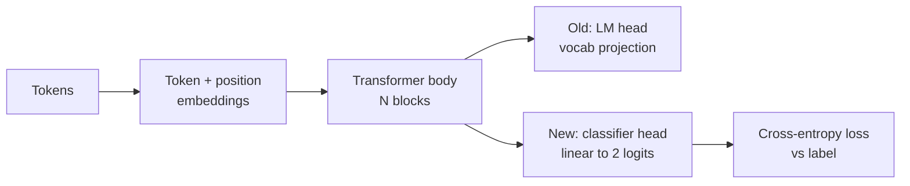
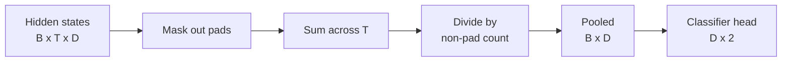
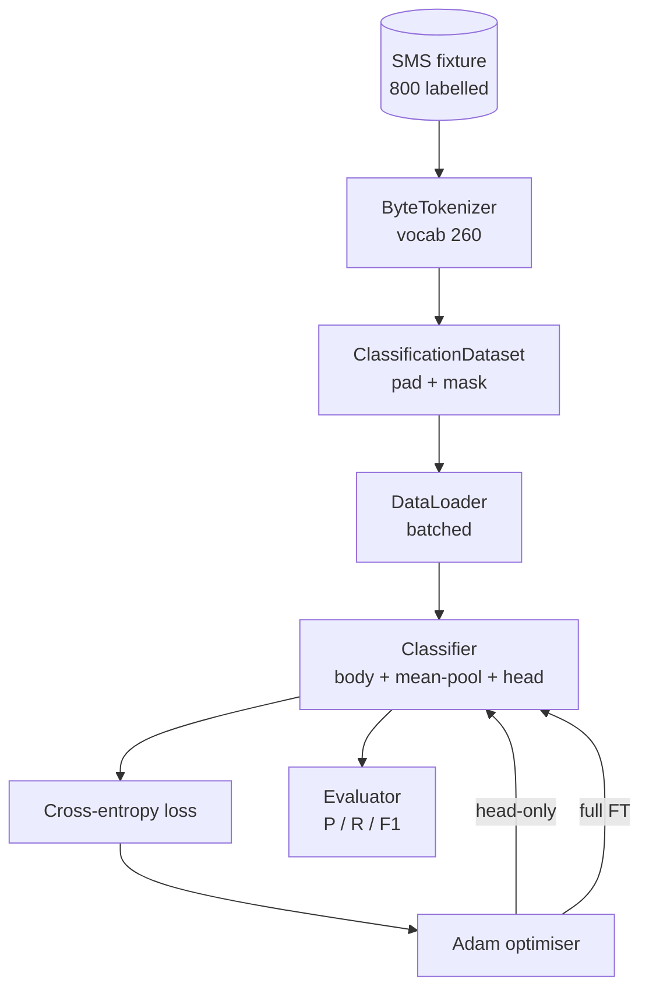

# Capstone 課程 38：以更換 Head 進行分類器 Fine-Tuning (Classifier Fine-Tuning by Head Swap)

> Track B 的第一個 capstone。預訓練語言模型是一疊以 token 預測 head 結尾的 self-attention block。當你想要的是 spam 對 ham，head 是錯的，但主體大致是對的。這堂課把 head 拆掉，在池化後的表示上黏上雙類別的線性層，並以兩種不同方式訓練分類器：只訓練最後一層，以及完整 fine-tuning。評測用 held-out 切分上的 precision、recall 和 F1。你會學到每種策略換來了什麼、又付出了什麼代價。

**Type:** Build
**Languages:** Python (torch, numpy)
**Prerequisites:** Phase 19 lessons 30-37 (NLP LLM track: tokenizer, embedding table, attention block, transformer body, pre-training loop, checkpointing, generation, perplexity)
**Time:** ~90 分鐘

## 學習目標 (Learning Objectives)

- 在不重新初始化主體的情況下，用分類 head 取代語言模型 head。
- 實作兩種訓練模式：凍結主體 (只訓練 head) 與完整 fine-tuning，兩者共用同一個訓練迴圈。
- 建立具 tokeniser 意識的資料管線：padding、遮蔽 padding，並池化 attention 輸出。
- 從原始 logit 計算 precision、recall、F1 與混淆矩陣。
- 推理參數量、訓練時間與提升空間之間的取捨。

## 問題 (The Problem)

你在通用語料上預訓練了小型 transformer。輸出 head 把最後的隱藏狀態投影到 1000 個 token 的詞彙表。現在你有 800 則標記為 spam 或 ham 的簡訊，想要二元分類器。有三個選項。

錯誤的選項，是在 800 個範例上從零訓練全新的分類器。預訓練模型的主體已經編碼了有用的結構：字詞身分、位置、簡單的共現。把它丟掉，就浪費了建構它所耗費的運算。

兩個正確的選項是：主體凍結的 head 更換，以及主體可訓練的 head 更換。只訓練 head 很快、幾乎不占記憶體，在這麼少的資料下很少過擬合。完整 fine-tuning 較慢，在小資料上可能過擬合，但當下游領域與預訓練語料有偏離時，能達到更高的準確度。

這堂課兩者都建構，讓你能在同一個 fixture 上比較它們。

## 核心概念 (The Concept)



模型是函式 `f_theta(tokens) -> hidden_states`。Head 是函式 `g_phi(hidden) -> logits`。更換 head 意味著保留 `theta`，並取代 `g_phi`。主體的參數是昂貴的部分。Head 只是一個線性層。

兩組可訓練的參數集合很重要：

- `theta` (主體)：每個 attention block 有數萬個權重。
- `phi` (head)：`hidden_dim * num_classes` 個權重，加上一個 bias。

在只訓練 head 時，你對 `phi` 計算梯度，並對 `theta` 歸零。PyTorch 讓你可以對主體參數設定 `requires_grad=False` 來做到這點。Optimiser 就只看到 head，主體保持凍結。

在完整 fine-tuning 時，你讓梯度流回整個堆疊。主體的權重會漂移以擬合分類目標。風險是在小資料上發生災難性遺忘：主體的預訓練成果被過擬合的雜訊沖淡。

## 池化的問題 (The Pooling Question)

分類器需要每個序列一個向量，而不是每個 token 一個向量。三種常見選擇：

- **Mean pool**：對序列的隱藏狀態取平均，以 attention mask 加權。
- **CLS pool**：在前面加上一個特殊 token，只使用它的輸出。這是 BERT 的做法。
- **Last-token pool**：使用最後一個非 padding 的 token。這是 GPT 類分類器的做法。

這堂課使用明確以 attention mask 加權的 mean pooling。它最簡單，在不同序列長度下能給出穩定的訊號，而且不需要預訓練 CLS token。



## 資料 (The Data)

八百則簡訊，平衡為 400 則 spam 與 400 則 ham，在 `code/main.py` 中以確定性方式產生。產生器使用固定的 seed，挑選範本並代入欄位填充詞，輸出 5 到 25 個 token 長的訊息。真實資料集有這個 fixture 沒有的雜訊。Fixture 的重點是可重現性。

資料以 80/20 切分：640 筆訓練、160 筆測試。切分是分層的，所以測試集保持 50/50 的平衡。具有已知平衡的 held-out 集合，讓 precision 與 recall 可以被當成誠實的數字來解讀。

## 指標 (The Metrics)

二元分類，以類別 1 (spam) 為正類。計數為：

- `TP`：預測為 spam，實際為 spam。
- `FP`：預測為 spam，實際為 ham。
- `FN`：預測為 ham，實際為 spam。
- `TN`：預測為 ham，實際為 ham。

三個主要指標：

- `precision = TP / (TP + FP)`。被標為 spam 的訊息中，實際是 spam 的比例是多少？
- `recall = TP / (TP + FN)`。實際為 spam 的訊息中，模型標出的比例是多少？
- `F1 = 2 * P * R / (P + R)`。兩者的調和平均。

混淆矩陣把四個計數印成 2x2 方格。Demo 會對兩種訓練模式都把它寫到 stdout。

```figure
cap-classifier-head-swap
```

## 架構 (Architecture)



主體是刻意做得很小的 transformer：vocab 260、hidden 64、4 個 head、2 個 block、最大序列 32。它小到可以在 CPU 上九十秒內把兩種模式都訓練到收斂。它在這堂課中沒有經過預訓練；取而代之的是，`pretrain_quick` 輔助函式在同一個 fixture 的文字上做五個 epoch 的 LM 訓練，給主體一個不平凡的起點。這讓課程保持自足。

## 你要建構的東西 (What you will build)

實作是一個 `main.py` 加上一個測試模組 (`code/tests/test_main.py`)。

1. `ByteTokenizer`：把位元組對應到 id，並保留一個 pad id。
2. `Block`：帶有 multi-head attention 與 feed-forward 層的 transformer block。Pre-norm。
3. `LMBody`：token + 位置 embedding，加上一疊 block。回傳隱藏狀態。
4. `MeanPool`：沿序列軸做 mask 加權平均。
5. `Classifier`：主體、pool、線性 head。主體在各模式間是同一個實例。
6. `freeze_body` 與 `unfreeze_body`：切換主體參數的 `requires_grad`。
7. `train_classifier`：一個共用的迴圈。接受模型，以及為任何可訓練參數組設定的 optimiser。
8. `evaluate`：執行測試集並回傳 `Metrics(precision, recall, f1, confusion)`。
9. `run_demo`：先短暫預訓練主體，然後訓練並評測只訓練 head 的模式，再訓練並評測完整模式，印出兩份報告，並以零結束。

## 為什麼比較很重要 (Why the comparison matters)

只訓練 head 的模式通常訓練更快，欠擬合時也更溫和。在這個 fixture 上，經過二十個 epoch 的只訓練 head，你通常會看到 precision 接近 0.9、recall 接近 0.85。完整 fine-tuning 花的時間約三倍，依隨機 seed 而定，結果落在上下幾個百分點之內。

這堂課不挑出贏家。它教你讀數字與成本。在 800 個範例與微型主體上，只訓練 head 是正確的選擇。在 80,000 個範例與更大的主體上，完整 fine-tuning 開始有回報。你從這堂課帶走的契約是 API：同一個 `train_classifier` 函式處理兩者，切換只要一次呼叫。

## 延伸目標 (Stretch goals)

- 加入第三種模式，只解凍最後一個 block。這有時被稱為部分 fine-tuning。它的成本低於完整 FT，學到的比只訓練 head 多。
- 加入學習率排程器。對 head 用 cosine 排程，對主體用較小的固定速率，是常見的正式環境設定。
- 把 mean pooling 換成可學習的 attention pool：一個帶有一個可學習 query 的小型 attention 層。在較長的序列上，它常常勝過 mean pool。

實作給了你這些掛鉤。測試固定了契約。數字由你去推進。
