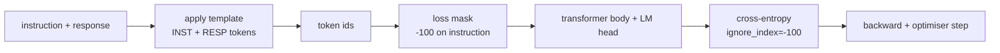
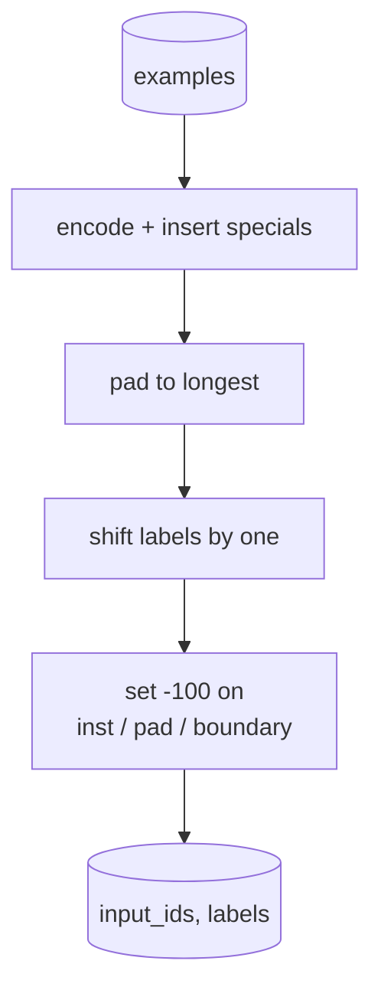
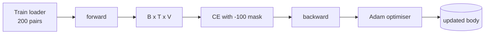

# Capstone 課程 39：以 Supervised Fine-Tuning 進行指令微調 (Instruction Tuning by Supervised Fine-Tuning)

> 預訓練的 base model 可以延續序列，卻無法遵循指令。Supervised fine-tuning 是修正這點的最小改動：餵給模型成對的指令與期望回應的範例，並訓練主體預測回應 token。訣竅在於，你只想讓 loss 計算回應，不計算指令。這堂課打造 Alpaca 風格的 SFT 迴圈，搭配自訂的 collate 函式，以 `ignore_index=-100` 遮蔽指令 token，在 200 組指令-回應配對上訓練，並用 exact-match 在 held-out 切分上評測。

**Type:** Build
**Languages:** Python (torch, numpy)
**Prerequisites:** Phase 19 lessons 30-37 (NLP LLM track: tokenizer, embedding table, attention block, transformer body, pre-training loop, checkpointing, generation, perplexity)
**Time:** ~90 分鐘

## 學習目標 (Learning Objectives)

- 將成對的指令-回應資料，格式化為帶有明確邊界 token 的單一 causal 序列。
- 建立遮蔽指令 token 的 collate 函式，讓 cross-entropy 只計算回應 token。
- 在 SFT 目標下訓練微型 transformer 主體，並觀察評測指標的變化。
- 實作遵守回應起點邊界的 greedy 與 temperature 取樣產生。
- 對產生的完成內容計算 held-out exact-match。

## 問題 (The Problem)

以 next-token prediction 訓練的 base model，不知道什麼是指令。給它字串 `"What is the capital of France?"`，它會續寫這個問題，或是編出一個新句子。模型有語言，但沒有格式契約。

SFT 契約是一個字串範本。每個訓練範例都變成具有三個區域的單一序列：

```text
<INST> What is the capital of France? <RESP> The capital of France is Paris.
```

邊界 token 是訓練時保留的特殊 token。模型學到 `<RESP>` 之後的一切都是回應，而回應才是被評分的對象。Base model 的 next-token 目標仍然適用；只是它在每個範例都有這種形狀的語料上訓練。

但有個陷阱。如果你把整個序列餵給一般的 cross-entropy loss，你是在訓練模型也去預測指令 token。指令是給定的。你要在那些位置上零梯度。解法就是 mask。

## 核心概念 (The Concept)



`ignore_index` 是 `torch.nn.functional.cross_entropy` 的功能。任何等於 `ignore_index` 的目標位置，都不貢獻 loss 也不貢獻梯度。PyTorch 的慣例是 `-100`。Collate 函式為每個範例建立兩個 tensor：`input_ids` (完整序列) 與 `labels` (`input_ids` 的副本，其中指令位置被覆寫為 `-100`)。

模型在前向傳遞時看到整個序列；attention 可以關注指令。Loss 只計算回應 token。這正是你想要的：以指令為條件，預測回應。

## 資料 (The Data)

兩百組指令-回應配對在 `main.py` 中以確定性方式產生。它們涵蓋六種任務類型：

- 單次事實問答 (X 的首都)
- 算術
- 清單擷取
- 一句話摘要
- 程式碼 (print、sort)
- 定義

每個任務都有範本化的指令與確定性的回應。這是刻意簡化的。Exact-match 很脆弱，這堂課使用的 fixture，其正確答案就是某一個特定字串。真實的 SFT 資料集需要模糊指標；原則是相同的。

切分為 160 筆訓練、40 筆測試。測試集涵蓋全部六種任務類型，所以可以回報每個類別的 exact-match。

## Tokenisation 與 Padding (Tokenisation and Padding)

Tokeniser 是位元組層級，並帶有三個保留的特殊 token：

- `INST_ID = 256`：標記指令區域的開始。
- `RESP_ID = 257`：標記指令與回應之間的邊界。
- `PAD_ID = 258`：用於可變長度 batch 的 padding。

序列是 `[INST] inst_bytes [RESP] resp_bytes [PAD]*`。Collate 函式：

1. 對每個範例做 tokenise。
2. 將 batch 中的每個範例 pad 到 batch 中最長的序列。
3. 建立 `labels` = `input_ids` 位移一位 (causal LM 目標)，其中：
   - 指令區域被換成 `-100`。
   - Padding 區域被換成 `-100`。
   - `RESP_ID` 邊界位置本身被換成 `-100` (你不訓練模型預測邊界 token；它預測的是接在後面的東西)。



位移是標準的 causal 技巧：`input_ids` 的位置 `i` 預測位置 `i+1`，所以 `labels[i] = input_ids[i+1]` (輸入丟掉最後一個位置，目標丟掉第一個)。Mask 在位移之後套用，才會落在正確的位置上。

## 訓練 (Training)



迴圈是標準的 PyTorch SFT 迴圈。Adam、學習率約 3e-4 到 1e-3、在這個 fixture 上跑十到二十個 epoch、沒有排程器。模型夠小 (hidden 96、2 個 block、最大長度 64)，在 CPU 上兩分鐘內就能訓練到收斂。

每五個 epoch，迴圈會在 held-out 集合上跑一次小型評測並印出 exact-match。看著 exact-match 從第一個 epoch 的 0.0，爬到第十五個 epoch 的 0.85 左右，就是這堂課的回報：你可以看到模型同時學會格式和答案。

## 產生 (Generation)

評測時，模型拿到指令前綴 `[INST] inst_bytes [RESP]`，並產生 token，直到：

- 序列達到 `max_len`，或
- 模型輸出特殊的停止啟發式：連續兩個句尾位元組 (`.`、`!`、`?`)。

這堂課提供 greedy 解碼，外加可選的 temperature 取樣器。Exact-match 使用 greedy，因為 temperature 會讓指標變成隨機的。真實系統常常取樣，再以模糊方式評判；那條管線是第 41 課。

## Exact-Match 評測 (Exact-Match Evaluation)

Exact-match 是最嚴格的文字指標。預測的回應字串會被正規化 (小寫、去除空白、壓縮雙空格)，並與以同樣方式正規化的參考回應比較。每個範例的指標不是 1 就是 0。彙總則是平均。

真實的 SFT 管線會用 token 層級的 F1 (第 41 課) 與評審模型來補充 exact-match。Exact-match 仍然有用，因為它沒有歧義；如果它說 0.7，就表示恰好 70% 的測試指令逐字元產生了標準答案。

```figure
cc-sft-loss-mask
```

## 你要建構的東西 (What you will build)

實作是一個 `main.py` 加上測試。

1. `InstructionTokenizer`：帶保留特殊 token 的位元組層級編碼器。可編碼指令前綴，或完整的配對。
2. `make_dataset`：以固定 seed 產生涵蓋六種任務類型的 200 組配對。
3. `SFTDataset`：每個範例回傳 `(input_ids, labels)`，已經準備好 mask。
4. `sft_collate`：動態 padding、建立 batch tensor，並在指令與 pad 位置設為 `-100`。
5. `TinyGPT`：transformer 主體，加上綁定或不綁定的 LM head。
6. `train_sft`：SFT 迴圈，附每個 epoch 的評測 hook。
7. `generate`：從前綴做 causal 解碼，greedy 或取樣，並帶有停止啟發式。
8. `exact_match`：正規化後的字串比較，回傳 `[0, 1]` 的浮點數。
9. `run_demo`：建立資料、訓練二十個 epoch、評測、印出各類別的拆解，成功時以零結束。

## 為什麼 mask 很重要 (Why the mask matters)

沒有 mask，loss 會把指令 token 當成目標。模型學著預測指令。這是不同的目標，並以兩種方式產生較差的模型。第一，模型容量浪費在重建使用者總是會提供的輸入上。第二，在大多數 batch 中指令 token 多於回應 token，所以回應 loss 在梯度總和中占比較小；optimiser 對你在意的那部分的有效學習率，低於你的預期。Mask 不是潤飾，它就是目標本身。

## 延伸目標 (Stretch goals)

- 加入學習率 warmup，接著 cosine 衰減。SFT 對 LR 比預訓練更敏感。
- 加入每個 token 的 loss 記錄，並繪製訓練期間的 loss 曲線。注意早期 epoch 由範本 token (`<RESP>`、常見前綴) 主導，後期 epoch 則由實際的答案 token 主導。
- 把評測擴充到 BLEU-1 或 chrF。Exact-match 會低估那些產生了相同答案的改寫的模型。
- 加入多輪格式的聊天範本，並在包含追問的 fixture 上訓練。

實作給了你格式契約、mask 與迴圈。從 base model 變成指令遵循者的目標改變，就是一個 collate 函式。
