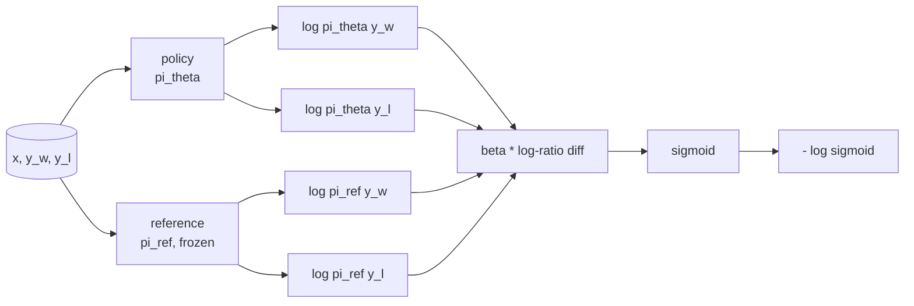
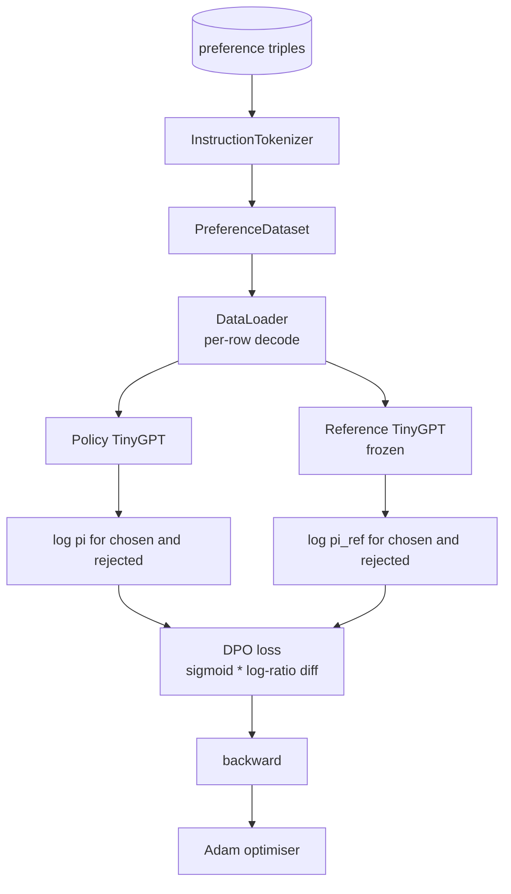

# Capstone 課程 40：從零實作 Direct Preference Optimization (Direct Preference Optimization from Scratch)

> Reward model 與 PPO 是經典的 RLHF 堆疊。DPO 把這個堆疊壓縮成單一的 supervised loss，直接針對偏好配對擬合 policy。這堂課從 reward 差異恆等式推導 DPO loss，提供可運作的 reference model 加 policy model，計算每個 token 的 log-probability，並在由 chosen 與 rejected completion 組成的偏好 fixture 上訓練微型 transformer。測試固定了 loss 的數學與梯度方向，讓你知道實作符合論文。

**Type:** Build
**Languages:** Python (torch, numpy)
**Prerequisites:** Phase 19 lessons 30-37 (NLP LLM track: tokenizer, embedding table, attention block, transformer body, pre-training loop, checkpointing, generation, perplexity)
**Time:** ~90 分鐘

## 學習目標 (Learning Objectives)

- 將 DPO loss 推導為縮放後 log-ratio 差異的 sigmoid，並連結到隱含的 reward。
- 建立 reference model + policy model 配對，reference 凍結，policy 可訓練。
- 在兩個模型下計算序列層級的 log-probability，並遮蔽 prompt token。
- 在 `(prompt, chosen, rejected)` 三元組上訓練 policy，觀察 chosen 的 log-prob 相對於 rejected 上升。
- 以針對 loss 數學、梯度正負號與 reference 不變性的測試固定行為。

## 問題 (The Problem)

你有一個 SFT 模型。它會遵循指令，但輸出不夠穩定；有些 completion 清楚，有些冗長或錯誤。你也有一個小型的偏好配對資料集：對同一個 prompt，人類把其中一個 completion 標為 chosen，另一個標為 rejected。

經典的 RLHF 答案是兩階段管線。在偏好上訓練 reward model。再用 PPO 針對 reward 最佳化 policy。這可行，但成本高：PPO 期間記憶體中有兩個模型、需要 KL 控制讓 policy 接近 reference，而且 reward model 脆弱時會有 reward hacking。

DPO 用單一的 supervised loss 取代兩個階段。Reward model 從不明確存在。Policy 直接在偏好配對上訓練，並對 SFT reference 施加明確的 KL 懲罰。在 Bradley-Terry 偏好模型下是同一個最佳解，程式碼少得多。

## 核心概念 (The Concept)

從 Bradley-Terry 模型出發。給定 prompt `x` 與兩個 completion `y_w` (chosen) 和 `y_l` (rejected)，人類偏好 `y_w` 的機率是

```math
P(y_w > y_l \mid x) = \sigma\big( r(x, y_w) - r(x, y_l) \big)
```

其中 `r` 是某個潛在的 reward 函式。RLHF 先從偏好擬合 `r`，再訓練 policy `pi` 以 KL 錨點來最大化 `r`：

```math
\max_{\pi} \; \mathbb{E}_{x, y \sim \pi} \big[ r(x, y) \big] - \beta \, \mathrm{KL}(\pi \,\|\, \pi_{\text{ref}})
```

DPO 的推導觀察到，在此目標下的最佳 policy `pi*`，有一個以 `r` 表示的封閉形式：

```math
\pi^*(y \mid x) = \frac{1}{Z(x)} \, \pi_{\text{ref}}(y \mid x) \exp\!\left( \frac{r(x, y)}{\beta} \right)
```

重新整理為 `r`：

```math
r(x, y) = \beta \big( \log \pi^*(y \mid x) - \log \pi_{\text{ref}}(y \mid x) \big) + \beta \log Z(x)
```

`log Z(x)` 項對 `y_w` 和 `y_l` 是相同的 (它取決於 `x`，不取決於 `y`)，所以計算偏好差異時會抵銷：

```math
\begin{aligned}
r(x, y_w) - r(x, y_l) = \beta \big( &\log \pi_\theta(y_w \mid x) - \log \pi_{\text{ref}}(y_w \mid x) \\
&- \log \pi_\theta(y_l \mid x) + \log \pi_{\text{ref}}(y_l \mid x) \big)
\end{aligned}
```

代入 Bradley-Terry 的 sigmoid，並對偏好配對取負對數似然：

```math
\begin{aligned}
L_{\text{DPO}}(\theta) = -\mathbb{E}_{(x, y_w, y_l)} \Big[
  \log \sigma\big( \beta \big( &\log \pi_\theta(y_w \mid x) - \log \pi_{\text{ref}}(y_w \mid x) \\
  &- \log \pi_\theta(y_l \mid x) + \log \pi_{\text{ref}}(y_l \mid x) \big) \big)
\Big]
\end{aligned}
```

這就是 loss。它是對每個範例單一純量取 sigmoid，由四個 log-probability 計算而得。沒有獨立的 reward model。沒有 PPO。Loss 中沒有 KL 項；KL 限制已經內建在封閉形式的推導中。



## 梯度的正負號 (The Sign of the Gradient)

在任何訓練執行之前，這是個有用的合理性檢查。對 `log pi_theta(y_w | x)` 取梯度：

```math
\frac{\partial L_{\text{DPO}}}{\partial \log \pi_\theta(y_w \mid x)} = -\beta \big(1 - \sigma(z)\big)
```

其中 `z` 是 sigmoid 的引數。對所有 `z` 它都是負的，這意味著：增加 policy 對 chosen completion 的 log-probability，會降低 loss。對稱地，對 `log pi_theta(y_l | x)` 的梯度是正的：增加 rejected 的 log-probability 會增加 loss。訓練把 chosen 往上推、把 rejected 往下推。Reference 被凍結；它不動。

## 資料 (The Data)

這堂課附帶十二個偏好三元組。每個都是 `(prompt, chosen, rejected)`。Chosen completion 簡短而精確。Rejected 冗長、離題或錯誤。這些配對涵蓋與第 39 課相同的任務家族 (首都、算術、清單)，所以從 SFT base 出發的 policy 有合理的起點。

Fixture 刻意做得很小。DPO 在正式環境中用數萬組配對；這裡的重點是，loss 的數學與迴圈在微小資料集上端到端執行，而 chosen 對 rejected 的 log-prob 差距明顯擴大。

## Reference 不變性 (Reference Invariance)

DPO 實作必須小心處理 reference model。Reference 是原地凍結的 SFT 模型。必須成立三個特性：

- Reference 參數從不接收梯度。
- Reference 的 log-probability 在各 epoch 間從不改變。
- Policy 從與 reference 相同的權重出發。(最佳的 `theta` 是 reference 加上學習到的更新；將 policy 初始化為 reference 的副本，是定義明確的起點。)

實作透過以下方式強制執行：

- 在前向傳遞期間，用 `torch.no_grad()` 包住 reference。
- 對每個 reference 參數設定 `requires_grad=False`。
- 在 reference 建立之後，透過 `policy.load_state_dict(reference.state_dict())` 建構 policy。

```figure
cap-dpo-preference
```

## 架構 (Architecture)



模型與第 39 課使用的 TinyGPT 相同 (decoder-only、causal、位元組 tokeniser)。Reference 與 policy 共用架構；訓練下 policy 的權重會從 reference 漂移，而 reference 保持固定。

## 你要建構的東西 (What you will build)

實作是一個 `main.py` 加上測試。

1. `InstructionTokenizer`：帶 `INST` 和 `RESP` 特殊 token 的位元組 tokeniser。形狀與第 39 課相同。
2. `TinyGPT`：decoder-only transformer。形狀與第 39 課相同，所以即使你跳過第 39 課，這堂課也是自足的。
3. `make_preferences`：回傳十二組 `(prompt, chosen, rejected)` 三元組。
4. `sequence_log_prob`：給定模型、prompt 前綴與 completion，回傳 completion 上 next-token log-probability 的總和 (不含 prompt 位置的貢獻)。
5. `dpo_loss`：接收四個 log-probability 與 `beta`，回傳每個範例的 loss tensor，以及用於記錄的隱含 reward 差異。
6. `train_dpo`：每個 epoch 的迴圈，在 policy 與 reference 下計算 chosen 和 rejected 的 log-prob、套用 loss，並對 Adam 步進。
7. `evaluate_margins`：回傳任何時間點 policy 下平均的 chosen-rejected log-probability 邊際。
8. `run_demo`：從小型的暖身預訓練建立 reference 與 policy、複製權重、訓練三十步、印出每一步的 loss 與邊際，成功時以零結束。

## 為什麼 DPO 有效 (Why DPO works)

在 Bradley-Terry 偏好模型下，DPO 在數學上等價於 RLHF，差別只在 reward 的參數化。隱含的 reward `r(x, y) = beta * (log pi(y|x) - log pi_ref(y|x))`，可由偏好辨識到僅差一個 `x` 的函式，而它在差異中會抵銷。封閉形式的 policy 讓你略過明確的 reward model。KL 限制是以結構方式強制執行的：`pi` 偏離 `pi_ref` 越多，log-ratio 越大，sigmoid 就飽和，這在 policy 移動過遠時會抑制梯度。Reference 就是你的安全網。

## 延伸目標 (Stretch goals)

- 對 log-probability 總和加入長度正規化：除以 completion 長度。長度偏差是已知的 DPO 失敗模式，模型會偏好較短的 completion，因為它們的 log-probability 在絕對值上較大。
- 加入 loss 的 IPO 變體：把 sigmoid + log 換成 `(z - 1)^2`。在 fixture 上比較收斂情況。
- 加入 label-smoothing 參數，在硬性的 chosen-rejected 標籤與均勻的 0.5 之間內插。
- 把 reference 換成更小、更便宜的模型 (知識蒸餾風格)。

實作給了你 loss、reference 不變性與訓練迴圈。數學就是這堂課。程式碼讓數學變得具體。
