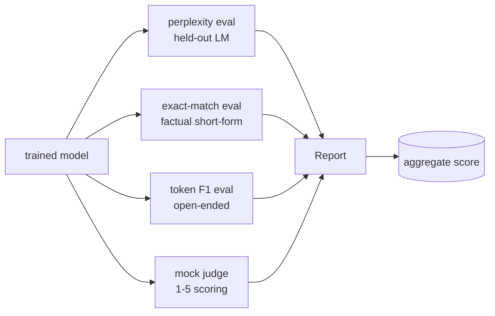
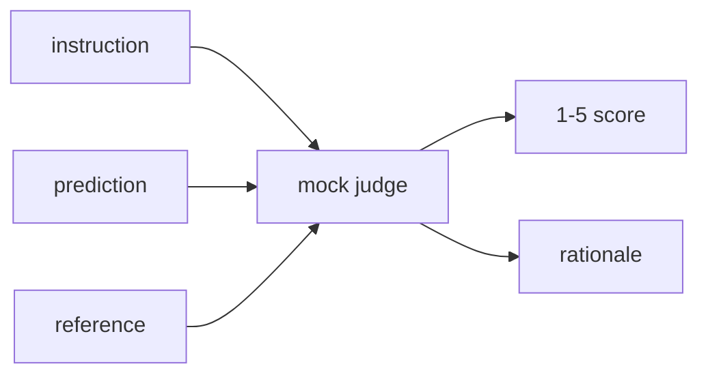
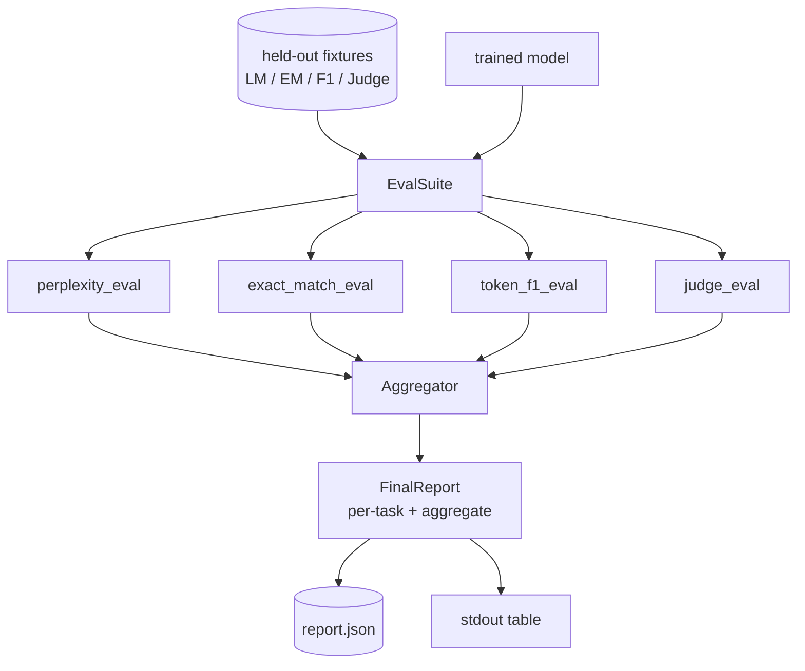

# Capstone 課程 41：完整評測管線 (Full Evaluation Pipeline)

> 訓練是你可以用 loss 曲線監控的部分。評測則是你必須設計的部分。這堂課打造統一的評測管線：接收任何訓練好的語言模型，對它執行四種異質的評測，把結果彙整成每個任務的報告，並提供本地的 mock LLM-as-judge，讓迴圈不需要網路也能執行。四項評測涵蓋每個要出貨的模型都需要的面向：語言建模 (perplexity)、短答正確性 (exact-match)、開放式相似度 (token F1)，以及定性評分 (judge)。

**Type:** Build
**Languages:** Python (torch, numpy)
**Prerequisites:** Phase 19 lessons 30-37 (NLP LLM track: tokenizer, embedding table, attention block, transformer body, pre-training loop, checkpointing, generation, perplexity)
**Time:** ~90 分鐘

## 學習目標 (Learning Objectives)

- 在微型 transformer 上，以遮蔽 token 的記帳方式計算 held-out perplexity。
- 對短答的事實性 prompt 執行 exact-match 評測。
- 以正規化計算預測字串與參考字串之間的 token 層級 F1。
- 建立本地 mock LLM-as-judge，以 1-5 的量表為模型輸出評分。
- 將四項評測彙整成單一加權報告，並附上每個任務的拆解。

## 問題 (The Problem)

單一指標永遠無法描述語言模型。Perplexity 說明模型擬合語言分布的程度，但無法說明它是否能回答問題。Exact-match 說明模型是否產生標準答案字串，但會懲罰正確的改寫。Token F1 原諒改寫，卻會被與錯誤內容的字詞重疊所騙。LLM-as-judge 能捕捉定性面向，但昂貴且具隨機性。

你真正想要的管線四者皆備。每項評測涵蓋其他評測錯過的面向。每項都在為該指標量身打造的不同 held-out 資料子集上執行。最終的報告把每個任務的數字與總體並排顯示，讓審查者一眼就能看出模型在做什麼取捨。

這堂課在單一檔案中端到端建構這條管線。

## 核心概念 (The Concept)



每項評測都是從 `(model, dataset) -> EvalResult` 的函式。結果攜帶指標值、供檢視的每個範例細節，以及彙總用的名稱。管線用一份設定組合它們，設定說明要執行哪些評測以及如何加權。

## 正確計算的 Perplexity (Perplexity, properly counted)

Perplexity 是 `exp(每個 token 平均負對數似然)`。實作有兩個陷阱：

- 平均必須針對實際的 token 位置，而不是針對 batch * sequence。Padding token 必須從分母中排除，否則 perplexity 會看起來比實際更好。
- 模型預測的是下一個 token，所以位置 `i` 的 logit 預測位置 `i+1` 的 token。這裡的 off-by-one 錯誤是無聲的：loss 仍然會訓練，但指標變得沒有意義。

評測計算每個 batch 在非 pad 位置上的 `-log p(token)` 總和，以及每個 batch 的 token 計數，最後再相除。這比平均各 batch 的 perplexity 在數值上更安全 (後者讓每個 batch 的權重相同，所以短 batch 中的每個 token 比長 batch 中的 token 更重要)，也符合教科書的定義。

## 帶正規化的 Exact-match (Exact-match, with normalisation)

Harness 在比較之前，會對預測與參考都做正規化：

- 轉小寫。
- 去除前後空白。
- 將內部連續空白壓縮成單一空格。
- 如果兩邊只差在標點，則去除結尾的句末標點 (`.`、`!`、`?`)。

正規化讓 exact-match 在實務上有用。說 `"Paris"` 的模型是對的；說 `"Paris."` 的也是對的；說 `"  paris  "` 的也是對的。指標仍然要求答案在正規化後是同一個字串。

## 正確做法的 Token F1 (Token F1, the right way)

Token F1 是 precision 與 recall 的調和平均，在詞袋 (bag-of-tokens) 上計算。步驟：

1. 正規化預測與參考 (規則與 exact-match 相同)。
2. 各自切成 token 清單 (以空白切分)。
3. 計算多重集合的交集。
4. Precision = `intersection_count / len(pred_tokens)`。Recall = `intersection_count / len(ref_tokens)`。F1 = 調和平均。

如果預測與參考都是空的，F1 為 1 (空洞的符合)。如果只有一邊是空的，F1 為 0。這個模式符合 SQuAD 評測的參考，並在各種改寫之間產生穩定的數字。

## 本地 Mock LLM-as-Judge (Local Mock LLM-as-Judge)

真正的 judge 是 API 後面的前沿模型。在這堂課中，judge 必須離線執行。Mock judge 是確定性的評分器，接收指令、模型預測與參考，並回傳 `{1, 2, 3, 4, 5}` 之一的分數，加上一行理由。評分規則是明確的：

- 如果正規化後的預測等於正規化後的參考，5 分。
- 如果預測與參考之間的 token F1 至少為 0.8，4 分。
- 如果 token F1 在 `[0.5, 0.8)`，3 分。
- 如果 token F1 在 `[0.2, 0.5)`，2 分。
- 否則 1 分。

這不是真正的 judge，但它有正確的介面。之後只要改一個函式，就能換成真正的模型。管線不在乎。



## 彙總 (Aggregation)

彙總是正規化後的評測分數的加權平均。每項評測回報自己在 `[0, 1]` 的數字：

- Perplexity：正規化為 `1 / (1 + log(perplexity))`。Perplexity 為 1 對應 1，無限大對應 0。
- Exact-match：已經在 `[0, 1]`。
- Token F1：已經在 `[0, 1]`。
- Judge：除以 5。

權重可設定。預設組合是 perplexity 0.2、exact-match 0.3、token F1 0.3、judge 0.2。權重的選擇是產品決策；這堂課公開這個旋鈕，讓你可以實驗。

```figure
cg-eval-quadrant
```

## 架構 (Architecture)



`EvalSuite` 是個薄薄的協調者。每個個別的評測都是接收 `(model, tokenizer, dataset, config)` 並回傳 `EvalResult` 的獨立函式。`Aggregator` 收集結果並產生最終報告。Demo 印出表格，並寫出一份下游 CI 可以匯入的 JSON 副本。

## 你要建構的東西 (What you will build)

實作是一個 `main.py` 加上測試。

1. `TinyGPT`：第 38-40 課使用的同一個 decoder-only 架構，納入其中讓這堂課自足。
2. `InstructionTokenizer`：帶 INST / RESP / PAD 特殊 token 的位元組 tokeniser。
3. 四個 fixture：LM 語料、EM 集合、F1 集合與 judge 集合。每個二十個範例，確定性產生。
4. `perplexity_eval`：回傳帶有 perplexity 值與每個 token loss 直方圖的 `EvalResult`。
5. `exact_match_eval`：回傳平均 EM 與每個範例的紀錄。
6. `token_f1_eval`：回傳平均 token F1 與每個範例的紀錄。
7. `mock_judge` 與 `judge_eval`：每個範例的分數與理由，以及整個集合的平均分數。
8. `Aggregator.normalise`：每項評測的正規化規則。
9. `Aggregator.aggregate`：加權平均與組合好的報告。
10. `run_demo`：短暫訓練微型模型、執行全部四項評測、印出報告表格並寫出 JSON，成功時以零結束。

## 解讀報告 (Reading the report)

報告有三層。最上面是總分。其下是四個各項評測的數字。再下面是用於診斷的每個範例拆解。失敗的 CI 執行通常只想要總分，但追查退步的審查者想要每個範例的拆解，看看模型答錯了哪些輸入。

JSON 輸出使用穩定的 key，讓 CI dashboard 可以跨版本繪製趨勢線。美化過的表格是給訓練執行後盯著終端機的人看的。

## 延伸目標 (Stretch goals)

- 加入校準評測：模型的 softmax 機率是否符合其準確度？依信心度將預測分桶，並回報每個桶的經驗準確度。
- 加入穩健性評測：為每個範例標記一種擾動 (錯字、改寫、干擾項)，並回報每種擾動造成的指標下降。
- 把 mock judge 換成 HTTP 呼叫後面的真實模型。函式簽章不變。
- 加入每個任務的權重學習：不使用固定權重，而是讓權重擬合對模型的目標偏好順序。

實作給了你四項評測、彙總器與報告。真實的評測管線會在上面疊加更多面向；模式保持不變：每項評測一個函式、一個彙總器、一份報告。
