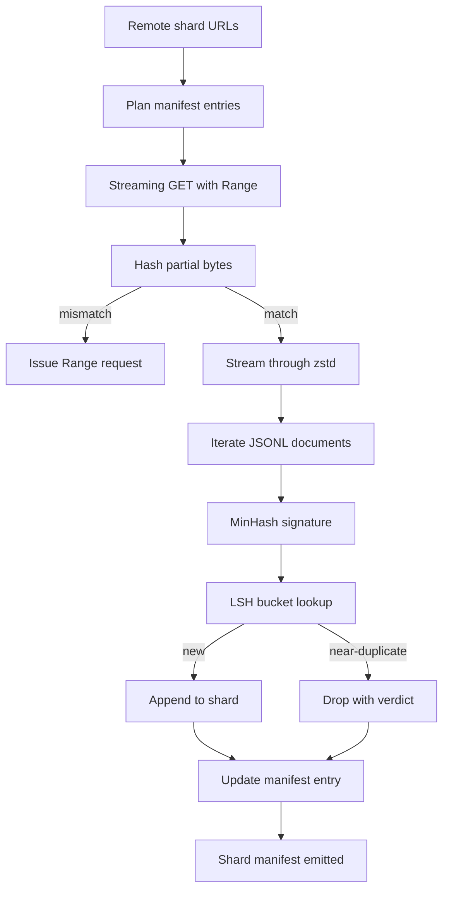

# 大型語料下載器 (Large Corpus Downloader)

> 訓練語言模型的工作，遠在第一次前向傳遞之前就開始了。語料必須落在磁碟上、解壓縮、去重、可定址，而且在網路於 4% 斷線之前，續傳的機制就已經設計好了。這堂課打造串流下載器：拉取壓縮的 shard、用 Zstandard 即時解壓縮、透過 MinHash 加 locality-sensitive hashing 為近似重複的內容做指紋，並寫出管線其餘部分可以信賴的 shard manifest。

**Type:** Build
**Languages:** Python
**Prerequisites:** Phase 19 lessons 30-37
**Time:** ~90 分鐘

## 學習目標 (Learning Objectives)

- 用 `urllib` 串流遠端 shard，並用 `zstandard` 解壓縮，不把整個檔案緩衝在記憶體中。
- 對已驗證的位元組偏移量發出 HTTP `Range` 請求，以續傳部分下載。
- 為每份文件建立 MinHash 簽章，並用 LSH 分桶，讓近似重複的文件發生碰撞。
- 輸出 shard manifest，包含內容雜湊、位元組大小、文件數與去重判定。

## 問題 (The Problem)

第一次在 200 GB 的語料上訓練時，網路在 41% 斷線，腳本因為 `urllib` 例外而結束。第二次在 78% 斷線。到 99% 時，你已經重寫迴圈三次。從第一分鐘起就必須設計的兩種失敗，是部分下載的續傳與重複文件的移除。兩者都有眾所周知的解法；兩者卻常被略過，因為管線一開始只是一行 `requests.get` 呼叫，後來才長出牙齒。

續傳是 HTTP 的問題。Server 必須遵守 `Range`，client 必須對照磁碟上的紀錄追蹤已驗證的偏移量，而且已驗證的偏移量必須撐得過行程的死亡。如果偏移量與檔案相差哪怕一個位元組，續傳的下載就會寫入垃圾，使語料以只有在 tokenization 時才會顯現的方式被損壞。

去重是簽章問題。Exact-hash 去重會漏掉近似重複：同一篇 Wikipedia 文章帶著三種不同的制式頁尾、同一個程式碼檔案帶著不同的授權標頭、同一篇部落格文章在每個連結上有追蹤參數。MinHash 加 LSH 能以次線性的成本抓到這些。成本是每份文件一個簽章，以及每個簽章一次分桶查找。

## 核心概念 (The Concept)



### 用 `urllib` 串流 (Streaming with `urllib`)

標準函式庫的 `urllib.request.urlopen` 回傳類檔案物件。把它包進 `zstandard.ZstdDecompressor().stream_reader`，位元組就會從網路經過解壓縮器流入文件迭代器，而不會在記憶體中實體化壓縮的 shard 或解壓縮後的 shard。唯一的記憶體成本是行緩衝、目前文件的 MinHash 簽章，以及 LSH 索引。

### 用 `Range` 續傳 (Resume with `Range`)

下載器對每個 shard 寫出兩個檔案：shard 本身和一個 `.partial.json` checkpoint。Checkpoint 記錄 `verified_bytes`、`expected_size`、`sha256_prefix` (針對前 `verified_bytes` 個位元組計算)，以及來源 URL。啟動時，下載器讀取 checkpoint，對磁碟上的位元組重新計算 `sha256_prefix`，只有在重新計算的雜湊相符時才續傳。如果雜湊不對，部分檔案會被丟棄，下載從位元組零重新開始。無聲的損壞是不可能的，因為已驗證的位元組是被檢查的，不是被假設的。

### MinHash 加 LSH (MinHash plus LSH)

MinHash 以固定空間估計兩個集合的 Jaccard 相似度。對文件來說，集合是其文字的 shingle (重疊的 n-gram)。簽章是 `k` 個最小雜湊值，每個獨立雜湊函式一個。Jaccard 相似度為 `s` 的兩份文件，在簽章的任何單一分量上一致的機率為 `s`。

LSH 接著把 `k` 個分量分組成 `b` 個 band，每個 band 有 `r` 列，其中 `k = b * r`。兩份文件在至少一個 band 中碰撞的機率為 `1 - (1 - s^r)^b`，這是圍繞你調整 `(b, r)` 所對應的 `s` 值的一個尖銳閾值。典型語料去重的閾值是 `s = 0.8`，LSH 研究文獻以 `k = 128`、`b = 32`、`r = 4` 達成。

### Shard manifest 作為契約 (Shard manifest as a contract)

下載器唯一持久的輸出是 manifest。Manifest 對每個 shard 保存 URL、解壓縮後的位元組數、文件數、去重後的唯一文件數，以及最終 shard 檔案的 sha256。下游的 tokenization 讀取 manifest，而不是目錄列表。如果 shard 遺失或其 sha256 錯誤，manifest 會告訴下一個階段拒絕啟動。Manifest 是「資料已下載」與「資料已下載且可驗證」之間的決定性界線。

```figure
cap-corpus-downloader
```

## 動手做 (Build It)

`code/main.py` 實作：

- `ShardPlanner` - 讀取 shard URL 清單，並產生規劃好的 manifest 項目。
- `StreamingDownloader` - 開啟帶有可選 `Range` 的 `urllib` 串流、寫入暫存檔、在每個 chunk 更新 `.partial.json` checkpoint，並在續傳時驗證 sha256 前綴。
- `ZstdDocIterator` - 把類檔案串流包進 `zstandard.ZstdDecompressor`，每行產出一份文件。
- `MinHasher` - 使用一組固定的雜湊 seed，為字串產生 `k` 個分量的簽章。
- `LSHIndex` - 依 band 對簽章分桶並回報碰撞。
- `Dedup` - 結合 hasher 與 index，將每份文件標記為 `keep` 或 `near_duplicate`，並附上相符的 shard id。
- `ManifestWriter` - 收集每個 shard 的統計並寫出 `manifest.json`。

檔案底部的 demo 在磁碟上建立小型合成語料、用 `zstandard` 壓縮、透過 `file://` URL 下載、去重，並印出 manifest。

執行它：

```bash
python3 code/main.py
```

腳本以零結束並印出 manifest 摘要。

## 正式環境模式 (Production Patterns)

四種模式讓這堂課能擴展到真實語料。

**寫入前先 checkpoint。** `.partial.json` 必須在位元組附加到 shard 之前先 `fsync`。否則斷電會顛倒順序：shard 位元組在磁碟上，checkpoint 卻沒有它們，下次續傳會以為自己的已驗證位元組比實際少，重複的後綴位元組就會損壞檔案。先 checkpoint，再寫入。這和 write-ahead log 的紀律相同。

**分片的 LSH 索引。** 在 200 GB 的規模下，涵蓋整個語料的單一 LSH 索引放不進 RAM。依第一個 band 雜湊對 LSH 索引分區、把分區存在磁碟上，並只查詢新簽章會落入的那個分區。成本是每份文件多一次磁碟讀取；好處是 LSH 索引不再是硬性的記憶體天花板。

**用墓碑標記，不要刪除。** 被丟棄的重複內容會在 manifest 中記錄，判定為 `near_duplicate`，並附上它們所碰撞文件的 shard id。刪除它們會失去重複內容與保留者之間的連結。墓碑標記保留了稽核軌跡，並讓下游階段可以改變它對閾值的看法。

**Manifest 中每個 shard 的 sha256，加上 manifest 本身的 sha256。** Manifest 本身也有內容雜湊。下游階段在信任每個 shard 項目之前，先驗證 manifest 雜湊。沒有這點，manifest 就是無聲的攻擊面：能編輯單一檔案的攻擊者就能損壞整條管線。

## 實際使用 (Use It)

正式環境模式：

- **每次 CI 執行都續傳。** CI runner 是暫時性的。下載器必須假設每次執行都是全新的磁碟，並從快取或遠端復原。`--cache-dir` 是一等公民的旗標。
- **在 tokenization 之前去重。** Tokenization 很昂貴。對同一份文件執行兩次，就是為相同的 loss 曲線付出兩倍成本。去重在 tokenization 的上游，不是下游。
- **Manifest 作為合併關卡。** 訓練執行從固定的 commit 讀取 manifest 的 sha256。新的資料集版本需要新的 manifest commit。程式碼和資料之間的連結是 git，不是口耳相傳。

## 交付 (Ship It)

在真實專案中，`outputs/skill-corpus-downloader.md` 會描述哪些 URL 餵給下載器、checkpoint 目錄如何佈局、去重使用什麼 shingle 寬度與 `(k, b, r)` 三元組，以及 manifest 在版本控制中的位置。這堂課交付的是引擎。

## 練習 (Exercises)

1. 加入 `--shingle-width` 旗標，並衡量去重判定在寬度 3、5、9 時如何變化。為你選擇的預設值辯護。
2. 在 zstd 旁邊，透過偵測 magic bytes 加入 gzip 支援。下載器不應該要求呼叫端指定 codec。
3. 加入 `--resume-only` 模式，在找不到 checkpoint 時拒絕開始全新的下載。在 CI 中很有用，可避免某次執行意外重新拉取 200 GB。
4. 把 LSH 索引移到 shelf 或 sqlite 檔案，並衡量與記憶體內版本相比的吞吐量。
5. 在啟動時加入 manifest sha256 檢查。如果磁碟上的 manifest 與 `manifest.lock` 中的 manifest 雜湊不一致，下載器應該以 fail closed 的方式失敗。

## 關鍵術語 (Key Terms)

| 術語 | 一般說法 | 實際意義 |
|------|-----------------|------------------------|
| Shard | 「一個檔案」 | 語料中自足的一個切片，有自己的 sha256，作為續傳與去重的單位 |
| MinHash signature | 「指紋」 | 集合的 `k` 分量草圖，其中每個分量是對集合做一個獨立雜湊後的最小值 |
| LSH band | 「桶」 | 用作單一桶 key 以偵測碰撞的 `r` 個簽章分量群組 |
| Verified bytes | 「續傳偏移量」 | 磁碟上 sha256 前綴與 checkpoint 相符的位元組；唯一安全的續傳偏移量 |
| Manifest | 「索引」 | 下載器產出內容的唯一持久紀錄，包含內容雜湊 |

## 延伸閱讀 (Further Reading)

- [RFC 7233](https://datatracker.ietf.org/doc/html/rfc7233) - HTTP Range 請求，續傳協定
- [Zstandard format specification](https://datatracker.ietf.org/doc/html/rfc8478) - 讓串流解壓縮安全的 frame 格式
- [MinHash](https://en.wikipedia.org/wiki/MinHash) - 這堂課使用的簽章家族
- [Locality-sensitive hashing](https://en.wikipedia.org/wiki/Locality-sensitive_hashing) - 去重閾值背後的分帶方案
- Phase 19 · 43 - 下載器所餵給的 HDF5 token 化語料
- Phase 19 · 44 - 在語料上訓練的 cosine 排程
- Phase 19 · 45 - 消耗該排程的 AMP 迴圈
