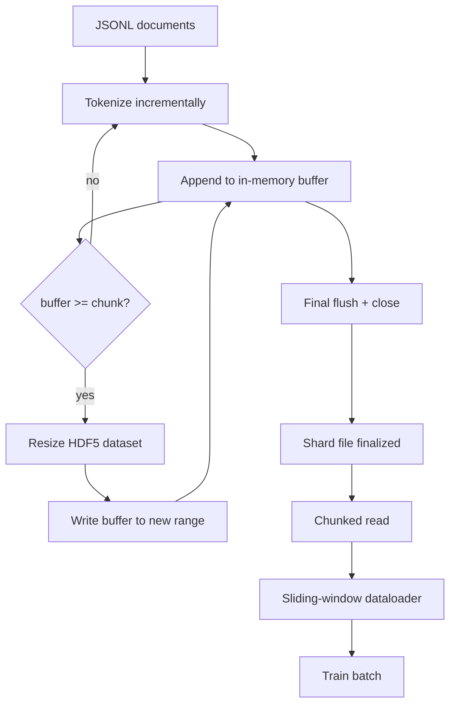

# HDF5 Token 化語料 (HDF5 Tokenized Corpus)

> 下載好的語料必須落在 trainer 能以線速串流的版面配置中。磁碟上的 JSONL 撐不過 16 個 dataloader worker。具備可調整大小、分 chunk 的整數資料集的 HDF5 則可以。這堂課打造串流 tokenization 到可調整大小的 HDF5 資料集、跨多個檔案的分片寫入、訓練時的分 chunk 讀取，以及產生固定長度序列、具正確 packing 的滑動視窗 dataloader。

**Type:** Build
**Languages:** Python
**Prerequisites:** Phase 19 lessons 30-37
**Time:** ~90 分鐘

## 學習目標 (Learning Objectives)

- 以確定性的 chunking，將文件串流寫入可調整大小的 HDF5 整數資料集。
- 把寫入分片到多個 HDF5 檔案，讓失敗有範圍限制，也讓平行成為可能。
- 透過 HDF5 以 page cache 為後盾的分 chunk 版面配置讀回 token，讓 dataloader 只在 batch 時才複製進 batch 緩衝區。
- 實作滑動視窗 dataloader，以明確的 packing 規則輸出固定長度的訓練序列。

## 問題 (The Problem)

現代語言模型的訓練執行，會以橫跨數十個 worker、每秒數十萬個樣本的速度讀取 token。磁碟上的 JSONL 在第一次冷快取的 page fault 就死了：JSON parser 很慢、文件邊界無法定址，而且要定位到「樣本 4,217,884」需要掃描整個檔案。即使壓縮效果良好的 Parquet 也不合適，因為 trainer 不要欄位；它要的是具 $O(1)$ 隨機存取的扁平 token 串流。

HDF5 適合，是因為它提供分 chunk、可調整大小、僅限整數的資料集，其 chunk 在讀取時對 page cache 友善。Trainer 要求 `tokens[3_200_000 : 3_208_192]` 的切片，HDF5 就把要求的 hyperslab 從 page cache 複製到新配置的 NumPy 陣列。成本是每個 worker 一個開啟的檔案 handle 和一個 chunk 大小的 page-cache 占用，與解碼 JSONL 的成本相比可以忽略。

建構上的問題，是讓寫入端誠實。可調整大小的資料集很容易被誤用：一次寫一份文件，HDF5 檔案就會碎片化到無法使用。一次 resize 就寫入所有文件，行程一死就丟掉整個 shard。正確的紀律是先緩衝再擴充，緩衝區大小與 chunk 大小一致，並用分片寫入把工作量分散到多個檔案，讓當機最多遺失一個 shard。

## 核心概念 (The Concept)



### 正確做法的可調整大小 HDF5 (Resizable HDF5 done right)

Token 資料集以 `maxshape=(None,)` 和固定的 `chunks=(chunk_size,)` 建立。寫入的方式，是把 token 緩衝在長度為 `chunk_size` 的 NumPy 陣列中。緩衝區滿了，資料集就恰好 resize `chunk_size`，並把緩衝區寫入新的範圍。Shard 結尾時，剩餘的緩衝區被寫入最後的部分範圍。除了最後一次，每次寫入都是連續且與 chunk 對齊的，而讀取端會被告知依 shard 的 HDF5 屬性中記錄的 `token_count` 截斷。

### 分片寫入 (Sharded write)

單一 HDF5 檔案是單點故障。管線平行寫入 shard：第 42 課的每個輸入 shard 產生一個 HDF5 輸出 shard。`shards.json` 索引對每個 shard 記錄檔案路徑、token 數、文件數，以及 token 的 sha256。Trainer 讀取 `shards.json` 來計算全域偏移量並驗證語料。

### 分 chunk 讀取 (Chunked read)

訓練時，每個 worker 以 `swmr=True` 模式開啟自己負責的 HDF5 檔案，並要求 `tokens[start:stop]`。HDF5 的 chunk 版面配置，讓 chunk 變熱之後的讀取很便宜：h5py 不會對檔案做 memory-map，它透過 HDF5 chunk cache 和作業系統 page cache 讀取整個 chunk，然後把要求的 hyperslab 複製出來。Worker 從不實體化整個檔案：切片被複製到 dataloader 的 batch 緩衝區，dataloader 再於 batch 時間將它複製進 pinned-memory 的訓練 tensor。熱路徑在每次 chunk 轉換時有一次 syscall；其餘都是 RAM 存取。

### 滑動視窗 dataloader (Sliding-window dataloader)

Dataloader 是唯一知道訓練序列長度的階段。它在全域 token 串流中挑選隨機的起始索引，讀取 `window_size + 1` 個 token，並回傳 `(input, target) = (tokens[:-1], tokens[1:])`。文件邊界不被強制執行：視窗可以橫跨兩份文件，兩者之間有明確的 `boundary_token_id`，讓模型學著使用分隔符。這是標準的 packing 規則；也是初學者會忘記的規則，結果得到的語料有 8% 是訓練用的邊界 token，92% 才是自然文字。

```figure
cc-hdf5-corpus
```

## 動手做 (Build It)

`code/main.py` 實作：

- `Tokenizer` - 對 demo 而言夠用的位元組層級確定性 tokenizer。介面是 `encode(text) -> list[int]` 與 `vocab_size`。
- `HDF5ShardWriter` - 開啟可調整大小的整數資料集、將 token 緩衝到 chunk 大小、以固定大小的步幅 resize 並寫入，並在關閉時把 `token_count` 和 `sha256` 記錄為 HDF5 屬性。
- `ShardedTokenizationPipeline` - 迭代輸入文件、將它們導向 writer，並輸出 `shards.json` 索引。
- `MmapTokenStore` - 開啟 shard 檔案做 chunk 讀取 (名稱只是方便；h5py 讀取 chunk，並不 mmap 檔案)、計算全域偏移量，並公開單一的 `get_slice(start, stop)` API。
- `SlidingWindowDataloader` - 從全域串流挑選隨機視窗，並產出 `(input_ids, target_ids)` NumPy 陣列。

檔案底部的 demo 建立一個微型記憶體內語料、tokenize 成兩個 shard、開啟它們做 chunk 讀取、執行 dataloader 10 個 batch，並印出每個 batch 的形狀與校驗和。

執行它：

```bash
python3 code/main.py
```

腳本以零結束，並印出 batch 校驗和。

## 正式環境模式 (Production Patterns)

四種模式讓這堂課能擴展到真實的訓練執行。

**Chunk 大小等於典型的讀取。** Trainer 每個樣本讀取 `window_size + 1` 個 token。將 HDF5 chunk 設為 `window_size` 的倍數，讀取就會與 page cache 對齊。Chunk 不匹配會讓吞吐量減半，因為每個樣本都會碰到兩個 chunk。

**Token 數放在屬性中，不放在資料集裡。** 資料集的尾端切片可能只填了一部分，因為 chunk 大小並不整除文件邊界。把真實的 `token_count` 存為資料集上的 HDF5 屬性，並讓讀取端在該值截斷。沒有這點，讀取端會走出結尾，進入補零的 token，模型就學會預測零。

**Shard 的 sha256 搭配平行驗證。** 每個 shard 對 token 位元組有自己的 sha256。Trainer 可以在訓練開始前平行驗證所有 shard。錯誤的 sha256 讓執行及早失敗，而不是在十六小時後的第三個 epoch。

**兩端都用 `swmr=True`，writer 端搭配 `libver="latest"`。** Single-Writer-Multiple-Reader 模式要求 writer 以 `libver="latest"` 開啟、預先建立所有資料集，然後設定 `file.swmr_mode = True`。之後 writer 必須在每次 resize 後呼叫 `dataset.flush()`，讓 reader worker (以 `swmr=True` 開啟) 看到一致的資料。略過 `libver="latest"`，或在結構變更之後才啟用 SWMR，是「檔案被鎖定」失敗的常見來源。

## 實際使用 (Use It)

正式環境模式：

- **每個來源 shard 一個 HDF5。** 下載器 (第 42 課) 每個 URL 輸出一個 shard；tokenization (這堂課) 每個來源 shard 輸出一個 HDF5。1:1 的對應讓續傳與部分失敗的復原變得簡單。
- **邊界 token id。** 邊界 token 是 tokenizer 詞彙表的一部分，也是 dataloader 唯一會注入的 token。如果模型應該忽略它，訓練 loss 會遮蔽邊界 token；否則模型會學著把它當作序列分隔符使用。
- **以 `shards.json` 作為事實來源。** 新增 shard 意味著寫入 HDF5、計算它的 sha256，並附加一個項目。Trainer 啟動時讀取一次該檔案，從不碰目錄列表。

## 交付 (Ship It)

在真實專案中，`outputs/skill-hdf5-tokenized-corpus.md` 會描述哪個 tokenizer 餵給管線、什麼 chunk 大小符合 trainer 的視窗、`shards.json` 在版本控制中的位置，以及 dataloader worker 如何跨檔案分片。這堂課交付的是引擎。

## 練習 (Exercises)

1. 在 HDF5 writer 加入 `--compression gzip` 旗標，並在 demo 語料上衡量吞吐量成本。為你選擇的預設值辯護。
2. 為滑動視窗 dataloader 加入確定性的 seed，並驗證使用相同 seed 的兩次執行產生相同的 batch。
3. 加入 `--validate` 模式，讀取每個 shard、對其 token 重新計算 sha256，並與 `shards.json` 比較。CI 應該在訓練開始前執行這個。
4. 比較 chunk 大小等於、為一半、以及兩倍視窗大小時的 dataloader 吞吐量。回報 page-cache 的效果。
5. 加入 `--max-document-tokens` 旗標，在寫入時截斷非常長的文件。針對在讀取時才決定的做法，為這個取捨辯護。

## 關鍵術語 (Key Terms)

| 術語 | 一般說法 | 實際意義 |
|------|-----------------|------------------------|
| Resizable dataset | 「僅追加」 | 具 `maxshape=(None,)` 的 HDF5 資料集，透過以 chunk 大小為步幅的 `resize` 呼叫成長 |
| Chunked layout | 「HDF5 的儲存方式」 | HDF5 以單位方式讀取與快取的固定大小磁碟區塊，讓 dataloader 能便宜地讀取連續範圍 |
| `swmr` mode | 「邊寫邊讀」 | 讓 dataloader worker 安全共用檔案的 Single-Writer-Multiple-Reader 模式 |
| Shard index | 「shards.json」 | 所有 token shard 的持久索引，附有偏移量與內容雜湊 |
| Sliding window | 「訓練樣本」 | trainer 搭配位移一位目標使用、取自全域 token 串流的固定長度切片 |

## 延伸閱讀 (Further Reading)

- [HDF5 chunking documentation](https://support.hdfgroup.org/documentation/hdf5/latest/hdf5_chunking.html) - 這堂課使用的分 chunk、可調整大小的資料集版面配置
- [h5py user guide](https://docs.h5py.org/en/stable/) - HDF5 的 Python 綁定
- [h5py chunked storage](https://docs.h5py.org/en/stable/high/dataset.html#chunked-storage) - h5py 如何讀取分 chunk 資料集並決定 chunk cache 大小
- Phase 19 · 42 - 這堂課所 tokenize 其輸出的下載器
- Phase 19 · 44 - 使用這個 dataloader 的 cosine 排程
- Phase 19 · 45 - 包住訓練步驟的 AMP 迴圈
