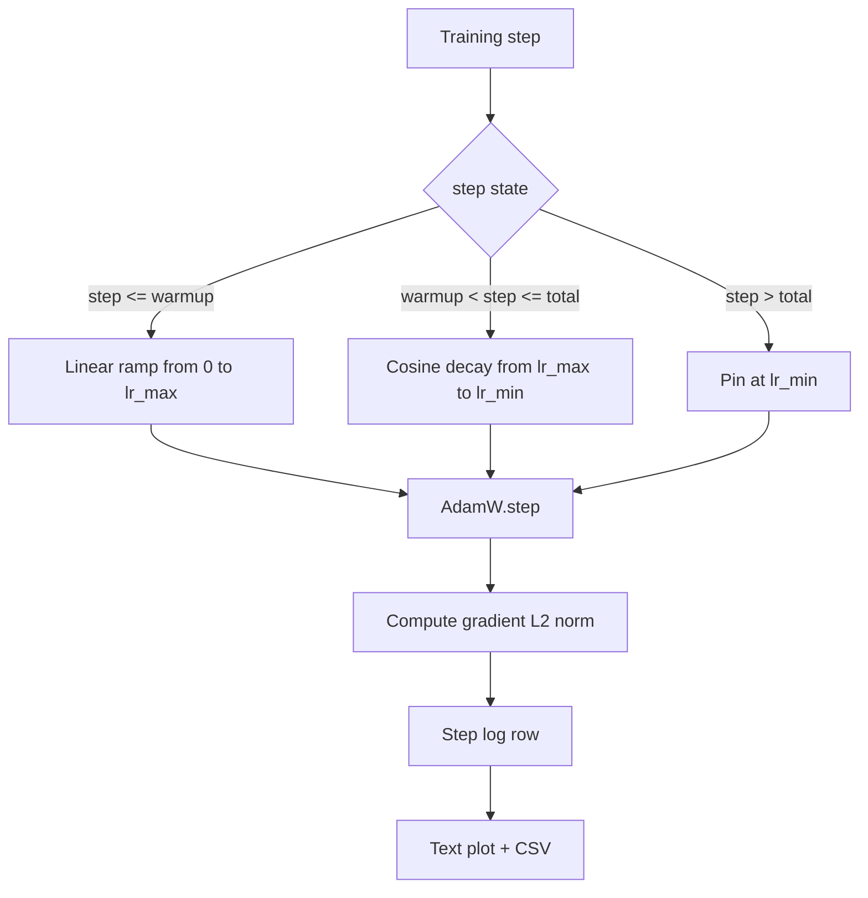

# 帶線性 Warmup 的 Cosine 學習率 (Cosine LR with Linear Warmup)

> 學習率排程是僅次於 loss 函式的第二重要決策。帶 cosine 衰減與線性 warmup 的 AdamW，是現代語言模型訓練的預設，因為它讓模型在脆弱的前一千次更新期間，只看到較小的有效步長，爬升到設定的峰值，然後平滑地衰減回接近零。這堂課打造那個排程、繪製訓練步驟上的曲線、在排程旁記錄梯度範數，並證明排程遵守 warmup、峰值與衰減的邊界。

**Type:** Build
**Languages:** Python
**Prerequisites:** Phase 19 lessons 30-37
**Time:** ~90 分鐘

## 學習目標 (Learning Objectives)

- 實作與帶線性 warmup 的 cosine 學習率排程相連的 AdamW optimizer。
- 在任何步驟計算排程的精確值，且各次執行之間沒有浮點數漂移。
- 把梯度 L2 範數與學習率並排記錄，讓訓練健康狀態可被觀察。
- 把排程繪成眼睛可讀的文字圖，以及任何工具都能使用的 CSV。

## 問題 (The Problem)

前一千次訓練更新是最吵的。模型的權重仍然接近初始化。Optimizer 執行中的二階動量估計尚未穩定。梯度範數又大又吵。如果在這些更新期間學習率位於峰值，模型要嘛直接發散，要嘛落入永遠逃不出的 loss 高原。兩個眾所周知的解法是梯度裁剪 (這是 Phase 19 第 45 課的主題)，以及從小開始再爬升的學習率排程。

帶 warmup 的 cosine 排程有三個區域。從步驟零到步驟 `warmup_steps`，學習率從零線性縮放到設定的峰值 `lr_max`。從步驟 `warmup_steps` 到步驟 `total_steps`，學習率沿著 cosine 曲線的上半部，從 `lr_max` 衰減到 `lr_min`。超過 `total_steps` 之後，學習率固定在 `lr_min`，所以超出範圍的設定錯誤 trainer 不會悄悄離開排程。

建構上的問題在於排程很容易出現 off-by-one 錯誤。這種 off-by-one 會在訓練執行六小時之後，在模型開始過擬合的那一刻，表現為學習率高了或低了 1%，除非在邊界上徹底測試排程，否則看不出來。

## 核心概念 (The Concept)



### Warmup 公式 (Warmup formula)

對 `[0, warmup_steps]` 中的 `step` 且 `warmup_steps > 0`，學習率為 `lr_max * step / warmup_steps`。退化的 `warmup_steps = 0` 情況被視為「沒有 warmup」：排程在步驟零直接從 `lr_max` 開始，並立刻進入 cosine 衰減。有些測試 harness 會傳入 `warmup_steps = 0`，以檢查排程仍能產生可用的曲線。

### Cosine 公式 (Cosine formula)

對 `(warmup_steps, total_steps]` 中的 `step`，學習率為 `lr_min + 0.5 * (lr_max - lr_min) * (1 + cos(pi * progress))`，其中 `progress = (step - warmup_steps) / max(1, total_steps - warmup_steps)`。在 `step = warmup_steps` 時，cosine 的值為 `cos(0) = 1`，得到 `lr_max`，與 warmup 的端點完全吻合。在 `step = total_steps` 時，cosine 的值為 `cos(pi) = -1`，得到 `lr_min`，與衰減的端點完全吻合。

兩個端點的連續性並非偶然。這正是排程被實作為單一個對 `step` 的函式，而不是把三個不同函式黏在一起的原因。黏起來的排程，第一次改動 `lr_max` 時就會失去一個邊界。

### 總步數之後的下限 (Floor after total steps)

對 `step > total_steps`，學習率維持在 `lr_min`。契約是明確的：排程不會報錯也不會外插；它固定在下限，讓 trainer 記錄警告。需要延長訓練的 trainer，應該改變排程的 `total_steps`，而不是改迴圈。

### 與速率並排記錄梯度範數 (Gradient norm logging alongside the rate)

排程是訓練健康狀態的一半。梯度範數是另一半。訓練迴圈每一步都記錄兩者。發散的訓練執行會在 loss 之前就先顯示梯度範數飆升；調得好的 warmup 讓範數隨速率線性上升；過於激進的峰值則表現為 warmup 之後範數仍然偏高。磁碟上的資料集是 `step, lr, grad_l2_norm, loss`。CSV 是唯一持久的紀錄。

```figure
cap-cosine-warmup
```

## 動手做 (Build It)

`code/main.py` 實作：

- `CosineWithWarmup` - 針對設定好的排程，無狀態的函式 `lr(step) -> float`。
- `TrainState` - 把模型、`AdamW` optimizer 與排程包成單一的步進函式。
- `TrainState.step` - 執行一次前向傳遞、一次反向傳遞、記錄梯度 L2 範數，並把 `lr(step)` 套用到 optimizer。
- `plot_schedule_ascii` - 把排程繪成眼睛可讀的文字圖。
- `write_schedule_csv` - 每一步輸出一列學習率。

檔案底部的 demo 建立微型 `nn.Linear` 模型，在固定輸入 batch 上訓練 20 步，並印出每一步的學習率、梯度範數與 loss。排程也會被繪成文字圖，供視覺上的合理性檢查。

執行它：

```bash
python3 code/main.py
```

腳本以零結束，並印出每一步的訓練日誌，加上排程圖。

## 正式環境模式 (Production Patterns)

四種模式把排程提升為正式的產出物。

**排程放在設定檔，不放在程式碼。** Trainer 從提交到 git 的 YAML 或 JSON 設定檔讀取 `warmup_steps`、`total_steps`、`lr_max`、`lr_min`。排程可重現，因為設定檔是以內容定址的；排程可稽核，因為設定檔是 PR diff 的一部分。

**步數計數器是單調的，且與 epoch 解耦。** 有些框架在資料集被分片或 dataloader 重新啟動時，會混淆 step 與 epoch。排程從 trainer checkpoint 讀取 `global_step`，而不是從本地計數器讀取。續跑的執行會在正確的排程位置繼續，因為步數計數器是持久的軸。

**排程圖放在執行目錄。** 每次訓練執行都把 `outputs/lr_schedule.png` (這堂課則是文字圖) 寫入它的執行目錄。瀏覽目錄的審查者，不必重新執行任何東西就能對排程做合理性檢查。這在 PR 階段就能抓到設定錯誤的排程這一類 bug。

**日誌列 schema 固定。** 依序為 `step, lr, grad_l2_norm, loss`。下游的 notebook 或 dashboard 會讀取這個 schema；不升版就重新命名欄位，會讓每個既有的 dashboard 失效。

## 實際使用 (Use It)

正式環境模式：

- **在掃描其他任何東西之前，先掃描峰值。** `lr_max` 是最敏感的旋鈕。先在小模型上掃描它；最佳的 `lr_max` 隨模型大小的縮放很弱，所以小模型的掃描是強有力的先驗。
- **Warmup 是總步數的比例，不是絕對的數量。** 2 億步的執行搭配 2,000 步 warmup，幾乎立刻就到峰值；20,000 步的執行搭配同樣的步數，則 warmup 了 10%。把 warmup 設定為比例 (典型為 1-3%)，讓排程隨訓練時長縮放。
- **`lr_min` 刻意不為零。** 設為 `lr_max` 的 10% 的下限，能讓 optimizer 在長尾期間持續學習。`lr_min = 0` 的排程會產生在圖上看起來很棒、但模型實際上沒訓練完的訓練曲線。

## 交付 (Ship It)

在真實專案中，`outputs/skill-cosine-warmup.md` 會描述哪個設定檔攜帶排程、全域計數器從哪個 trainer 步驟讀取，以及哪次 `lr_max` 掃描產生了部署的數值。這堂課交付的是引擎。

## 練習 (Exercises)

1. 加入排程的反平方根變體，並在 200 步的玩具訓練執行上比較。哪條曲線產生較低的最終 loss？
2. 加入 `--restart` 旗標，在 `total_steps / 2` 加入第二次 warmup。為 warm restart 在玩具執行上是改善還是傷害辯護。
3. 加入單元測試，驗證排程是連續的：在 `warmup_steps > 0` 時，對 `[0, total_steps]` 中的每一步，差值 `|lr(step+1) - lr(step)|` 受限於 warmup 斜率 `lr_max / warmup_steps` 與最陡的 cosine 斜率 `pi * (lr_max - lr_min) / (2 * (total_steps - warmup_steps))` 兩者中較大者。很短的 cosine 區段可能比 warmup 爬升更陡，所以單用 warmup 斜率不是安全的界限。
4. 把排程接進 `torch.optim.lr_scheduler.LambdaLR`，讓它能與框架程式碼組合。這堂課使用純粹的步進函式；包裝器改變了什麼？
5. 加入 `--plot-png` 旗標，透過 `matplotlib` 寫出真正的圖。為 CI 執行而言，這堂課的文字圖與 PNG 哪個是較好的預設，請辯護。

## 關鍵術語 (Key Terms)

| 術語 | 一般說法 | 實際意義 |
|------|-----------------|------------------------|
| Warmup | 「慢啟動」 | 前 `warmup_steps` 次更新中，從零到 `lr_max` 的線性爬升 |
| Cosine decay | 「平滑下降」 | 在剩餘步驟中，從 `lr_max` 到 `lr_min` 的 cosine 曲線上半部 |
| Floor | 「訓練之後」 | 超過 `total_steps` 之後，排程固定的 `lr_min` 值 |
| Gradient norm | 「梯度的 L2」 | 串接後的梯度向量的 Euclidean 範數，每步都記錄 |
| Global step | 「排程軸」 | 能撐過重啟並驅動排程的單調步數計數器 |

## 延伸閱讀 (Further Reading)

- [Loshchilov and Hutter, SGDR: Stochastic Gradient Descent with Warm Restarts (arXiv 1608.03983)](https://arxiv.org/abs/1608.03983) - cosine 排程的參考論文
- [Loshchilov and Hutter, Decoupled Weight Decay Regularization (arXiv 1711.05101)](https://arxiv.org/abs/1711.05101) - AdamW 的參考論文
- [PyTorch torch.optim.lr_scheduler](https://docs.pytorch.org/docs/stable/optim.html#how-to-adjust-learning-rate) - 步進函式如何與框架排程器組合
- Phase 19 · 42 - 這個排程所消耗其語料的下載器
- Phase 19 · 43 - 與排程共同演進的 dataloader
- Phase 19 · 45 - 梯度裁剪與 AMP，迴圈中的下一層
