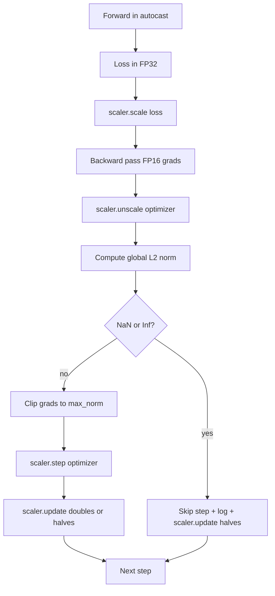

# 梯度裁剪與混合精度 (Gradient Clipping and Mixed Precision)

> 前一課的 optimizer 和排程，都假設梯度是正常的。它們通常不是。單一個壞 batch 就能讓梯度範數飆升三個數量級。混合精度訓練在 loss 端引入 FP16 溢位，讓這個問題更加放大。這堂課打造正式訓練不可或缺的兩條安全帶：將梯度裁剪到設定的全域 L2 範數，以及帶有 autocast 和 GradScaler 的混合精度迴圈，能偵測 NaN 和 Inf、乾淨地跳過該步，並記錄縮放因子以供事後鑑識。

**Type:** Build
**Languages:** Python
**Prerequisites:** Phase 19 lessons 30-37
**Time:** ~90 分鐘

## 學習目標 (Learning Objectives)

- 計算所有參數梯度的全域 L2 範數，並在超過設定閾值時就地裁剪。
- 把訓練步驟包進 autocast 加 GradScaler，讓 FP16 的前向與反向傳遞能撐過溢位。
- 偵測 loss 或梯度中的 NaN 與 Inf，跳過 optimizer 步驟，並記錄這次跳過。
- 每一步都回報 GradScaler 的縮放因子，讓長串的跳過能立即被看見。

## 問題 (The Problem)

昨天還跑得乾淨的訓練執行，產生的 loss 曲線在步驟 8,217 垂直飆升。罪魁禍首是單一個 batch，其梯度範數為 4,200，是先前峰值的二十倍。沒有裁剪的話，optimizer 會套用一個步驟，把模型前一小時所做的所有學習全部重設。使用範數 1.0 的全域 L2 裁剪，同一個 batch 只貢獻單位範數的更新；loss 留在它的趨勢線上；執行得以存活。

混合精度訓練透過在 FP16 中計算前向傳遞與大部分反向傳遞，將吞吐量提高 2-3 倍。代價是 FP16 的指數範圍很窄。典型在 FP16 中溢位的梯度會計算成 Inf，它會在後續層以 NaN 的形式傳播，在下一次 optimizer 步驟把每個權重都設成 NaN。PyTorch 的 GradScaler 透過在反向傳遞之前把 loss 乘以一個大的縮放因子，並在 optimizer 步驟之前把梯度除以同樣的因子來解決這個問題。如果在還原縮放的時候，任何梯度是 Inf 或 NaN，scaler 就跳過該步並把縮放因子減半；如果前 N 步都是乾淨的，scaler 就把因子加倍。在訓練過程中，因子會找到 FP16 範圍所允許的最高值。

建構上的問題是把兩者正確地接起來。在還原縮放之前裁剪，閾值是作用在已縮放的梯度上；在還原縮放之後裁剪，GradScaler 上的操作順序就很重要。正確的順序是：`scaler.scale(loss).backward()`，然後 `scaler.unscale_(optimizer)`，然後 `clip_grad_norm_`，然後 `scaler.step(optimizer)`，然後 `scaler.update()`。任何其他順序都會產生無聲壞掉的迴圈。

## 核心概念 (The Concept)



### 全域 L2 範數 (Global L2 norm)

全域 L2 範數是串接後的梯度向量的 Euclidean 範數，不是每個參數各自的範數。PyTorch 將它實作為 `torch.nn.utils.clip_grad_norm_(parameters, max_norm)`。函式會回傳裁剪前的範數，所以這堂課可以同時記錄自然值與裁剪後的值，這對於診斷「我們在每一步都在裁剪」是必要的。

### autocast 與 GradScaler (autocast and GradScaler)

`torch.amp.autocast(device_type)` 是選擇性地以 FP16 執行符合條件的運算 (大多數 matmul 類運算) 的 context manager。`torch.amp.GradScaler(device_type)` 是在反向傳遞前縮放 loss，並在 optimizer 步驟前反向縮放梯度的輔助工具。兩者是一起設計的；只用其中一個是設定錯誤，測試應該要抓到。

這堂課使用 CPU autocast，因為那是 CI 中執行的；把 `device_type="cpu"` 改成 `device_type="cuda"`，同樣的模式就原封不動地轉移到 CUDA。CPU 上的 GradScaler 只是個替身 (CPU autocast 預設已使用 BF16 運算，不需要 loss 縮放)，但這堂課包含了這些呼叫點，所以接線方式與 GPU 迴圈相同。

### NaN 與 Inf 偵測 (NaN and Inf detection)

偵測發生在兩個地方。第一，loss 本身在反向傳遞之前以 `torch.isfinite` 檢查；Inf 或 NaN 的 loss 不會產生有用的梯度，會在不進入 optimizer 的情況下被跳過。第二，在 `scaler.unscale_(optimizer)` 之後，這堂課用 `has_non_finite_grad(...)` 掃描已還原縮放的梯度，並把任何 Inf 或 NaN 視為跳過。兩項檢查合起來涵蓋了前向傳遞與反向傳遞的失敗模式。

### 縮放因子診斷 (Scaling factor diagnostics)

縮放因子是 GradScaler 的內部狀態。每一步，這堂課都讀取 `scaler.get_scale()`，並與學習率和梯度範數一起記錄。健康的執行會顯示縮放因子以 2 的冪次攀升，直到在 `2^17` 或 `2^18` 附近飽和。行為異常的執行會顯示因子在高低值之間震盪，這是模型的梯度有時在範圍內、有時不在的訊號。沒有記錄，這個診斷就看不見。

```figure
grad-clip-monitor
```

## 動手做 (Build It)

`code/main.py` 實作：

- `clip_global_l2_norm` - 包住 `torch.nn.utils.clip_grad_norm_` 的包裝器，同時回傳裁剪前與裁剪後的範數。
- `has_non_finite_grad` - 掃描梯度中 NaN 與 Inf 的輔助函式。
- `AmpTrainState` - 包住模型、`AdamW` optimizer、GradScaler 與 autocast 裝置。公開 `step(inputs, targets)`，執行完整的裁剪、縮放與遇到 NaN 就跳過的管線。
- `StepLog` 與 `SkipLog` - 結構化的每步紀錄。
- 一個 demo：將小型 `nn.Linear` 模型訓練 20 步、在第 5 步對梯度注入一個 Inf 以演練跳過路徑，並印出結果日誌。

執行它：

```bash
python3 code/main.py
```

腳本以零結束，並印出每一步的日誌，每列標記為 `STEP` 或 `SKIP`；至少有一列是 `SKIP`。

## 正式環境模式 (Production Patterns)

四種模式把迴圈提升為正式環境的訓練步驟。

**跳過計數器是警示，不是日誌行。** 一次訓練執行中有少數幾次跳過的步驟是健康的。每個 epoch 數百次跳過就是強烈的警示：模型進入了 FP16 無法承載的狀態，迴圈正在悄悄失敗。這堂課追蹤 1,000 步滾動窗口的跳過率，在正式環境中會在比率超過 5% 時發出通知。

**裁剪閾值放在設定檔。** `max_norm = 1.0` 是語言模型訓練的現代預設值。先在小模型上掃描它；較大的閾值讓模型能從真正困難的 batch 中恢復；較小的閾值以更吵的 loss 曲線為代價限制最壞情況。閾值應該與第 44 課的排程放在同一份 YAML 或 JSON 設定檔中。

**範數日誌與排程一起寫入 CSV。** CSV 欄位是 `step, lr, grad_l2_pre_clip, grad_l2_post_clip, loss, skipped, skip_reason, scaler_scale`。打開檔案的審查者，在一列中就能看到排程、梯度的狀況、縮放因子與跳過結果 (連同原因)。把欄位拆散到多個檔案，是造成分析對不上的原因。

**`scaler.update()` 每一步都執行，即使跳過也一樣。** 在乾淨的步驟中，scaler 讀取它的 no-inf 計數器、遞增，並可能把因子加倍。在跳過的步驟中，scaler 把因子減半並重設計數器。在跳過路徑上忘了 `update()`，就是產生「縮放因子從不改變」的 bug。

## 實際使用 (Use It)

正式環境模式：

- **Autocast 裝置與 optimizer 裝置一致。** GPU 訓練用 `torch.amp.autocast(device_type="cuda")`；CPU 用 `torch.amp.autocast(device_type="cpu")`。混用裝置會產生無聲的型別錯誤，表現為看起來沒問題的 loss 曲線，但模型其實沒在學習。
- **反向傳遞前先檢查 loss。** `torch.isfinite(loss).all()` 是一次 tensor 歸約；成本可以忽略，而遇到 NaN loss 時省下的是整個訓練步驟。一定要執行。
- **`zero_grad` 使用 `set_to_none=True`。** 把梯度設為 `None` 而不是零，讓 optimizer 可以跳過未受影響的參數組的計算。這個設定是免費的吞吐量改善，也稍微減少了 bug 面。

## 交付 (Ship It)

在真實專案中，`outputs/skill-clip-amp.md` 會描述訓練步驟使用的裁剪閾值與 autocast 裝置、每一步的 CSV 在版本控制中的位置，以及正式環境跳過率警示的閾值是多少。這堂課交付的是引擎。

## 練習 (Exercises)

1. 把合成的 Inf 注入換成真實的 loss 尖峰 (將某個 batch 的目標乘以 1e8)，並驗證跳過路徑被觸發。
2. 加入 `--bf16` 模式，把 autocast 切換成 BF16 而不是 FP16。BF16 的指數範圍比 FP16 寬，很少需要 loss 縮放；驗證在同一個 demo 上跳過率降到零。
3. 加入單元測試，驗證在沒有發生裁剪時，梯度裁剪包裝器正確回傳裁剪前與裁剪後的範數。
4. 加入滾動窗口的跳過率計算，以及一個 CLI 旗標：如果比率連續 100 步超過設定的閾值，就讓執行失敗。
5. 把迴圈接上，寫出標準 CSV (`step, lr, grad_l2_pre_clip, grad_l2_post_clip, loss, skipped, skip_reason, scaler_scale`)，並透過每列寫完後 flush，確認檔案能撐過 Ctrl-C。

## 關鍵術語 (Key Terms)

| 術語 | 一般說法 | 實際意義 |
|------|-----------------|------------------------|
| Global L2 norm | 「裁剪目標」 | 跨所有可訓練參數串接的梯度向量的 Euclidean 範數 |
| autocast | 「混合精度」 | 在 `with` 區塊內，對符合條件的運算選擇性地以 FP16 (或 BF16) 執行 |
| GradScaler | 「Loss 縮放器」 | 在反向傳遞前將 loss 相乘、在 optimizer 步驟前反向縮放梯度的輔助工具 |
| Skip | 「壞步驟」 | 因為梯度或 loss 非有限值而被拒絕的 optimizer 步驟；scaler 會把因子減半 |
| Scaling factor | 「Scaler 狀態」 | GradScaler 目前的乘數；乾淨一段時間後加倍，每次跳過就減半 |

## 延伸閱讀 (Further Reading)

- [Micikevicius et al., Mixed Precision Training (arXiv 1710.03740)](https://arxiv.org/abs/1710.03740) - 最初的 loss 縮放提案
- [Pascanu, Mikolov, Bengio, On the difficulty of training recurrent neural networks (arXiv 1211.5063)](https://arxiv.org/abs/1211.5063) - 梯度裁剪的參考論文
- [PyTorch torch.amp.GradScaler](https://docs.pytorch.org/docs/stable/amp.html) - 這堂課所包裝的 scaler API
- [PyTorch torch.nn.utils.clip_grad_norm_](https://docs.pytorch.org/docs/stable/generated/torch.nn.utils.clip_grad_norm_.html) - 這堂課使用的裁剪原語
- Phase 19 · 42 - 其語料餵給迴圈的下載器
- Phase 19 · 43 - 迴圈所消耗的 dataloader
- Phase 19 · 44 - 這個迴圈所組合的排程
