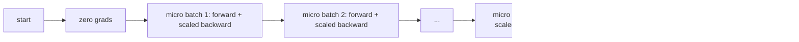
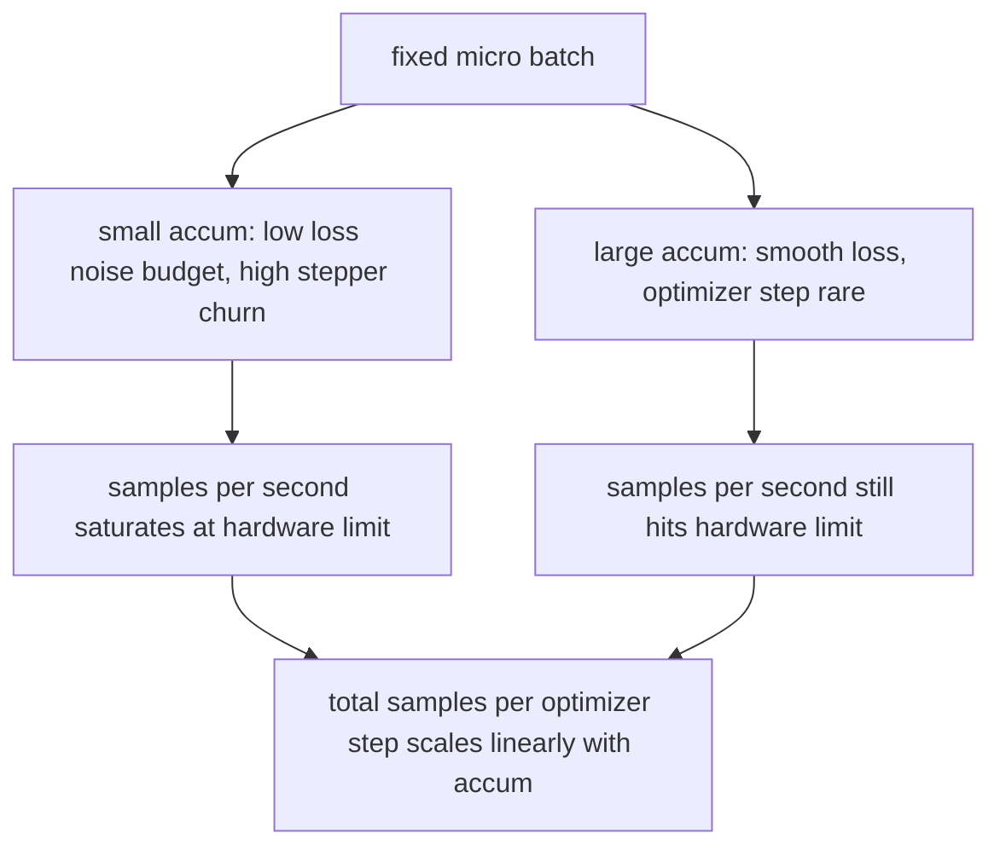

# 梯度累積 (Gradient Accumulation)

> 用你負擔不起的有效 batch 來訓練，一次只跑一個 micro-batch。縮放 loss、延後 optimizer step，讓 gradient 慢慢累積起來。

**Type:** Build
**Languages:** Python
**Prerequisites:** Phase 19 lessons 42 to 45
**Time:** ~90 分鐘

## 學習目標 (Learning Objectives)

- 推導有效 batch 的恆等式：`effective_batch = micro_batch * accum_steps * world_size`。本課只用單一裝置，所以等於 `micro_batch * accum_steps`。
- 實作每個 micro-batch 的 loss 縮放，讓累積後的 gradient 與單次 full-batch backward 一致。
- 在最後一個 micro-batch 之前，略過 optimizer 同步（sync-on-last-step）。
- 讀懂吞吐量對有效 batch 的曲線，並解釋邊際效益遞減。

## 問題 (The Problem)

你想用 512 的有效 batch 來訓練，因為 loss 曲線比較平滑，optimizer step 在這個規模下也比較合理。但桌上的 accelerator 只能放 32 個樣本，再多就會 out of memory。把 batch 加倍不行，把模型砍半也不行。2017 年業界找到、之後一直沿用的做法是：跑 16 次 backward，讓 gradient 累積在參數 buffer 裡，等次數達到目標才執行 optimizer step。

風險在於，loss 的數值已經和大 batch 時不同。把 16 個 mini-batch 的 cross entropy 直接加總，會是一個 full batch loss 的 16 倍。沒有縮放的話，gradient 方向是對的，但大小不對，optimizer step 會大 16 倍。解法只要一次除法，但也很容易忘記。

## 核心概念 (The Concept)



規則很簡短：

- 每個 micro-batch 的 loss 在 `backward()` 之前，先除以 `accum_steps`。PyTorch 預設會把 gradient 加總進 `param.grad`；這次除法把累加的總和拉回正確的尺度。
- optimizer step 每個有效 batch 只執行一次，在最後一個 micro-batch 的 backward 之後。在累積途中 step，會讓後續整個訓練依賴的每個參數都偏掉。
- optimizer 的狀態（momentum buffer、Adam moments）每個有效 step 只前進一次，而不是每個 micro-batch 一次。否則指數移動平均看到的頻率不對，會把排程提早耗盡。
- 在單一裝置上，這只是記帳。在多 rank 的叢集上，同樣的模式會把非最後的 micro-batch 包在 `no_sync` context 裡，略過 gradient all-reduce；最後一個 micro-batch 一次 reduce 完整的累積 gradient，而不是付 N 次網路成本。

### 用程式碼證明等價 (The equivalence proof in code)

```python
loss = criterion(model(x_full), y_full)
loss.backward()
opt.step()
```

等價於

```python
for x, y in chunks(x_full, y_full, n):
    scaled = criterion(model(x), y) / n
    scaled.backward()
opt.step()
```

差別只在浮點數加總順序。迴圈結束時，累積的 gradient buffer 與單次 full-batch backward 產生的 tensor 相同。課程程式碼在 `equivalence_check` 中，用最大絕對差小於 1e-4 來斷言這件事。

### 成本花在哪裡 (Where the cost goes)

每個 micro-batch 要付一次 forward 和一次 backward。使用累積，是拿時間換記憶體。`outputs/accum-curve.json` 中的吞吐量曲線，顯示了在固定 micro-batch 下，有效 batch 變大時會發生什麼事：



天下沒有白吃的午餐。`accum_steps` 加倍，每個 optimizer step 的牆上時間也加倍。改變的是 gradient 估計的變異數：在相同的時間預算下，你走的 optimizer step 變少了，但每一步都是對更多樣本取平均。文獻把大 batch 和小 batch 視為不同的最佳化問題；本課只談機制，不談統計。

```figure
cc-grad-accumulation
```

## 動手做 (Build It)

`code/main.py` 是可執行的成品，它做三件事。

### 步驟 1：等價性檢查

`equivalence_check()` 用相同的 seed 建立兩份相同的網路。一份一次 forward 看 16 個樣本的 batch。另一份看四個 4 個樣本的區塊，loss 除以四。函式會比較 optimizer step 之前的 gradient buffer，以及 step 之後的參數。斷言條件是 `max_abs_diff < 1e-4`。

### 步驟 2：sync-on-last-step 模式

`train_one_optimizer_step` 逐一走過 micro-batch。除了最後一個之外，每個 micro-batch 都會進入 `no_sync_context(model)`。在單一 process 上，這個 context 什麼都不做；在 DDP 上，gradient all-reduce 就是在這裡被略過。不論哪種情況，記帳方式都一樣。`sync_counter` 會記錄我們離開 no_sync 範圍的次數；對 N 個 micro-batch 而言，每個有效 step 計數是一次，而不是 N 次。

### 步驟 3：吞吐量曲線

`sweep_effective_batches` 用固定的 micro-batch 與一串累積步數，跑同一個模型。每個設定都會記錄：

- `samples_per_sec`：看過的總樣本數除以牆上時間
- `median_step_ms`：每個有效 step 的第 50 百分位數
- `sync_calls`：實際執行的 collective 次數
- `avg_loss`：整個掃描中各 optimizer step 的平均 loss

輸出會寫到 `outputs/accum-curve.json`，可以直接在 notebook 中重複使用。

執行它：

```bash
python3 code/main.py
```

腳本會依序印出等價性差異、掃描表格，最後是 JSON 路徑。結束碼為零。

## 實際使用 (Use It)

在正式環境的訓練中，梯度累積只靠一個旋鈕控制。PyTorch 的寫法是 `accumulation_steps = effective_batch // (micro_batch * world_size)`。你在本課不能使用的框架，也是包裝同一個迴圈，步驟都一樣：縮放 loss、非最後的 micro 略過同步、累積、只 step 一次。

實務上常見三種做法：

- micro-batch 大小要選到剛好吃滿裝置記憶體。再小就浪費 accelerator 週期，再大就會當掉。
- 有效 batch 依 learning rate 排程來決定。大的有效 batch 需要等比例調高 learning rate 並加上 warmup；這就是 2017 年起常被談到的 linear scaling rule。
- 累積次數是兩者之間的橋樑，也是你在執行時唯一可以自由調整、又不必改寫 data loader 的旋鈕。

## 交付 (Ship It)

`outputs/skill-gradient-accumulation.md` 記錄了這份配方，讓同事能直接放進新的 repo：用 `accum_steps` 縮放 loss、非最後的 micro 略過 optimizer 同步、每個有效 batch 只 step 一次、把吞吐量對有效 batch 的關係記成 JSON，讓取捨一目了然。

## 練習 (Exercises)

1. 用 `--num-steps 100` 重新執行掃描，畫出每秒樣本數對有效 batch 的圖。曲線在哪裡開始變平？
2. 加入一個錯誤縮放的版本（不做除法），並顯示它在第 1 步與參考版本的參數差異。
3. 把 SGD 換成 AdamW，確認 optimizer 狀態每個有效 step 前進一次，而不是每個 micro-batch 一次。
4. 引入真正的 `DistributedDataParallel` wrapper，並把 `no_sync_context` 接到它的方法上。確認每個有效 batch 的 sync_calls 減少 N-1 次。
5. 修改等價性檢查，比較兩種不同的 micro 切分（2 乘 8 對 4 乘 4），並說明你需要放寬哪些容許誤差。

## 關鍵術語 (Key Terms)

| 術語 | 一般說法 | 實際意義 |
|------|----------|----------|
| Micro batch | 你 forward 的那個 batch | 單次 forward 時能放進記憶體的切片 |
| Accum steps | 每個 step 的 backward 次數 | 一次 optimizer step 之前加總的 backward 次數 |
| Effective batch | 那個 batch | Micro batch 乘以 accum steps 乘以 data parallel world size |
| Loss scaling | 除以 N | 對每個 micro-batch 做除法，讓加總後的 gradient 與 full batch 一致 |
| Sync on last | 略過其他的 | 只在視窗內最後一次 backward 執行 gradient collective |

## 延伸閱讀 (Further Reading)

- PyTorch 文件中的 `DistributedDataParallel.no_sync`，是 sync-on-last-step 技巧的正式版本。
- Goyal 等人，2017，談大 batch 訓練的 linear scaling，是在意有效 batch 的經典理由。
- PyTorch issue tracker 上關於梯度累積與 mixed precision unscaling 交互作用的討論。
- Phase 19 lessons 42 to 45 涵蓋本課假設你已有的模型、data loader、optimizer 與 trainer 骨架。
- Phase 19 lesson 47 涵蓋 checkpoint 與 resume，讓長時間的累積訓練能撐過牆上時間上限。
