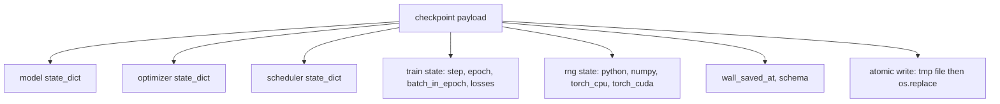
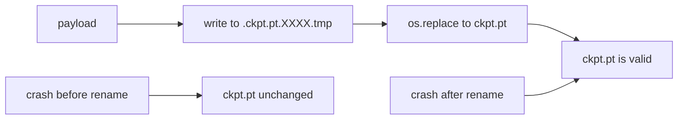
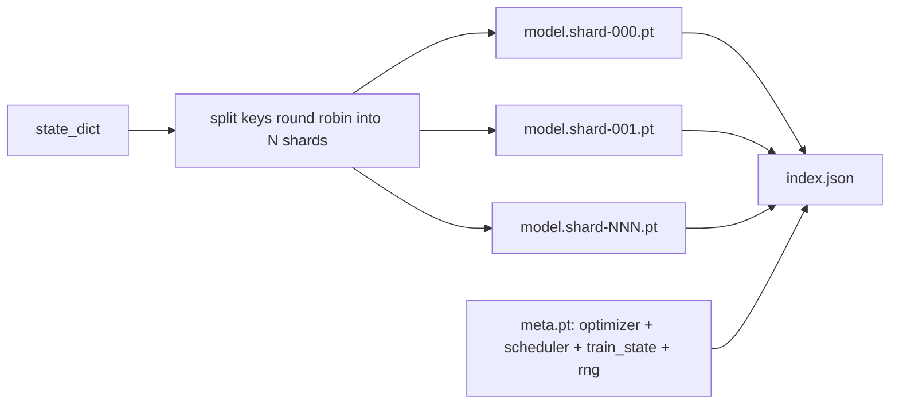

# Checkpoint 儲存與恢復 (Checkpoint Save and Resume)

> 訓練中斷會殺掉整個 run；checkpoint 讓它能繼續。以原子方式儲存 model、optimizer、scheduler、loss 歷史、step 計數與 RNG 狀態，這樣無論何時被中止，磁碟上都留著一份有效的檔案。

**Type:** Build
**Languages:** Python
**Prerequisites:** Phase 19 lessons 42 to 45
**Time:** ~90 分鐘

## 學習目標 (Learning Objectives)

- 把完整的訓練狀態收進單一 payload，並能在全新的 process 中重新載入。
- 用「先寫入暫存檔再 rename」實作原子儲存，讓當機時不會留下寫到一半的檔案。
- 還原 Python、NumPy 與 PyTorch 的 RNG 狀態，讓恢復後的 loss 與不中斷的基準一致。
- 為單一檔案放不下的模型建立分片 (sharded) checkpoint 版面，包含經過雜湊驗證的分片與 JSON index。

## 問題 (The Problem)

你排了一個 18 小時的訓練工作。排程器把每次配置限制在 4 小時，所以這個 run 本來就是一串接力恢復的工作。然後叢集在第 11 小時重新開機，因為某個你管不到的人核准了 kernel 升級。沒有 checkpoint，你得從頭來過。沒有 resume，你也會失去前 11 小時才學到的 optimizer 狀態；就算模型權重保住了，AdamW 的 moments 也不見了，下一步會朝訓練軌跡早已走過的方向猛然偏移。

正確的成品是一個檔案，裡面有繼續訓練所需的一切：模型參數、optimizer 狀態、scheduler 狀態、用來畫圖的 loss 歷史、目前的 step、epoch 與 epoch 內 batch 計數，以及每一個隨機性來源的 RNG 狀態。少了 RNG 狀態，恢復後的 loss 曲線就是另一條曲線。同樣的模型、同樣的資料，卻有不同的 shuffle、不同的 dropout mask，儀表板上的數字也不一樣。

原子儲存是這份約定的另一半。直接寫進最終檔名，代表寫到一半當機會留下損毀的檔案，resume 讀到的是垃圾。先寫進同一個目錄下的暫存檔再 rename，代表寫到一半當機時，前一份完好的檔案不受影響。在 POSIX 檔案系統上，rename 是原子的。

## 核心概念 (The Concept)



### 五個狀態桶 (The five state buckets)

| 類別 | 為什麼重要 |
|------|------------|
| Model | 權重與 buffer；也就是模型本身。 |
| Optimizer | Momentum 與 adaptive moments；少了這些，下一步就變成另一個最佳化問題。 |
| Scheduler | learning rate 目前在曲線的哪個位置；cosine 排程尤其在意。 |
| Train counters | Step、epoch、epoch 內 batch 計數，加上畫出儀表板的 loss 歷史。 |
| RNG state | dropout、資料 shuffle 與模型內任何取樣的確定性。 |

### 原子儲存 (Atomic save)



有兩條規則。第一，暫存檔放在與目標相同的目錄，讓 rename 留在同一個檔案系統內；跨裝置的 rename 不是原子的。第二，暫存檔名每次嘗試都要唯一，避免兩個 writer 互相踩到。

### 分片 checkpoint (Sharded checkpoints)

模型變大之後，單檔 payload 會變得載入太慢、檢查太難，網路共享在讀取中途出狀況時也太痛苦。解法是把參數狀態切成多個分片，再寫一個小的 index 把它們串起來。



index 記錄分片數量、每個分片的 sha256，以及 meta 檔的 sha256。只要有任何雜湊不符，loader 就會直接大聲報錯。分片可以放在不同的實體磁碟；meta 很小，會先讀取。

### 從 epoch 中途恢復 (Resume continues mid epoch)

如果 resume 是跳到下一個 epoch 的開頭，會浪費幾分鐘到一整天不等的時間。解法是記錄 `(epoch, batch_in_epoch)` 加上 RNG 狀態。載入之後，訓練迴圈會把亂數產生器快轉到目前 epoch 中已經消耗掉的 batch 之後，再從 `batch_in_epoch` 繼續。課程程式碼就是這樣做的；斷言條件是恢復後的 loss 軌跡與不中斷的基準相差在 1e-4 以內。

```figure
cc-atomic-checkpoint
```

## 動手做 (Build It)

`code/main.py` 提供四個基本元件與一個示範驅動程式。

### 步驟 1：擷取與還原 RNG 狀態

`capture_rng_state` 回傳一個 dict，內含 Python 的 `random.getstate`、NumPy 的 `np.random.get_state`，以及 PyTorch CPU 和 CUDA 的 RNG bytes。每一項都存成單純的 Python 數字、tuple 與 list（NumPy 的 key 陣列經過 `tolist()`），所以步驟 3 的 loader 讀回時不需要 unpickle 任意物件。`restore_rng_state` 做相反的事。CPU tensor 是 uint8 的 byte buffer，PyTorch 的 RNG 知道如何消化它。

### 步驟 2：原子儲存

`atomic_save` 把 payload 寫進目標目錄下的暫存檔，再用 `os.replace` 換成最終檔名。`atomic_write_json` 對分片 index 做同樣的事。

### 步驟 3：完整 checkpoint 往返

`save_checkpoint` 把 model、optimizer、scheduler、train state 與 RNG 打包成一個 dict。`load_checkpoint` 反向處理並回傳一個 `TrainState`。schema 欄位是升級的掛鉤：未來格式變更時，會更新版本字串，loader 再依此分派。

`load_checkpoint` 會呼叫 `torch.load(..., weights_only=True)`。`.pt` 檔是 pickle，用 `weights_only=False` 對不受信任的檔案 unpickle，檔案指名的任何程式碼都會被執行。weights-only 的 loader 只接受 tensor 和基本容器，其他一律拒絕，這就是步驟 1 把 RNG 狀態存成單純 list 的原因。完整性檢查會丟出 `ValueError`，而不是用 `assert`，因為 `python -O` 會把 assert 拿掉。請使用 torch 2.6 或更新版本：在那之前，`weights_only=True` 有已知的繞過方式 (CVE-2025-32434)，所以本課倚賴的保證只從 2.6 起才成立。

### 步驟 4：分片版本

`save_sharded_checkpoint` 以 round-robin 把參數 key 分配到 N 個分片，每個分片各自原子儲存，再寫一個含 optimizer、scheduler 與 train state 的 meta 檔，並寫出帶有各分片 sha256 的 JSON index。`load_sharded_checkpoint` 在合併之前會驗證每個分片，並拒絕任何解析後落在 checkpoint 目錄之外的分片路徑。

### 步驟 5：resume 示範

`run_resume_demo` 訓練一個小模型 `total_steps` 步，在 `interrupt_at` 儲存 checkpoint，然後繼續。第二個 process 還原 checkpoint 並跑完剩下的步驟。函式會回傳中斷點之後兩條 loss 軌跡的最大絕對差。RNG 還原後，差值為零或只是浮點數雜訊。

執行它：

```bash
python3 code/main.py
```

單檔與分片的示範都會斷言最大差小於 1e-4。摘要會寫到 `outputs/resume-demo.json`。

## 實際使用 (Use It)

正式環境的訓練框架都把 checkpoint 當成 trainer 的一部分。形狀都一樣：model + optimizer + scheduler + counters + RNG，以原子方式寫入，並以 step 命名，方便找到最新的一份。分片版面讓大型模型能平行讀取載入；讓這件事成立的就是 index.json。

要落實的四個做法：

- **用 `weights_only=True` 載入。** 從共享磁碟或下載取得的 checkpoint 是不受信任的輸入。weights-only 的 loader 能防止惡意檔案在執行 resume 的機器上跑程式碼。
- **Schema 是 payload 裡的一個字串。** 遷移（migration）依它分支。沒有它，你就無法在不破壞舊 run 的前提下演進格式。
- **每個分片都做 sha256。** 靜默被截斷的下載是最糟的 bug；loader 要嘛早點失敗，要嘛晚點失敗。
- **誠實設定 checkpoint 頻率。** 每 N 個 step 和每一個牆上時間分鐘各存一次，取較短者。否則一個很長的 step 當機時，會浪費整個視窗的工作。

## 交付 (Ship It)

`outputs/skill-checkpoint-save-resume.md` 是任何新訓練腳本的配方：payload 形狀、原子寫入、RNG 擷取、分片 index。把這個 skill 放進 repo，在定期儲存處接上 `save_checkpoint`，在啟動時接上 `load_checkpoint`，訓練就能撐過被中止。

## 練習 (Exercises)

1. 把 round-robin 分片換成依參數群組分片（以 `.weight` 結尾的層對 `.bias`）。什麼時候哪一種版面比較好？
2. 擴充儲存迴圈，只保留最後 K 份 checkpoint，並清掉更舊的。磁碟很小時，K 要選多少才合理？
3. 加入 `--ckpt-every-seconds` 旗標，除了 step 數之外，也能依牆上時間間隔觸發儲存。
4. 加入一條 checksum 驗證路徑，在啟動時掃描目錄中的每份 checkpoint，並回報哪些已損毀。
5. 實作 `migrate_v1_to_v2` 函式，在 payload 中加入新欄位並更新 schema 字串。讓 load 同時容許兩個版本。

## 關鍵術語 (Key Terms)

| 術語 | 一般說法 | 實際意義 |
|------|----------|----------|
| Atomic save | 「寫了再祈禱」 | 寫到同目錄的暫存檔，再用 os.replace 換成目標檔名 |
| State dict | 「權重」 | 以參數名稱為 key 的模型參數與 buffer |
| Sharded checkpoint | 「大型模型檔」 | 多個檔案，每個分片一個，加上 meta 檔與帶有 sha256 的 JSON index |
| RNG state | 「隨機種子」 | python random、numpy、torch CPU、torch CUDA 的擷取狀態；不只是 seed |
| Mid-epoch resume | 「重來」 | 快轉 RNG，並從同一個 epoch 的下一個 batch 繼續 |

## 延伸閱讀 (Further Reading)

- POSIX `rename` 的語意，是 `os.replace` 所依賴的原子性主張的來源。
- PyTorch 關於 `torch.save` 與 `torch.load` 的文件，包括跨裝置還原用的 `map_location`，以及載入不受信任檔案用的 `weights_only`。
- Phase 19 lesson 46 涵蓋梯度累積，本課的 checkpoint payload 能跨越它而存活。
- Phase 19 lesson 48 涵蓋分散式 wrapper，本方案可以容納它們的 state dict 格式。
- Linux kernel 的 `fsync` 文件，說明原子 rename 背後的持久性保證。
