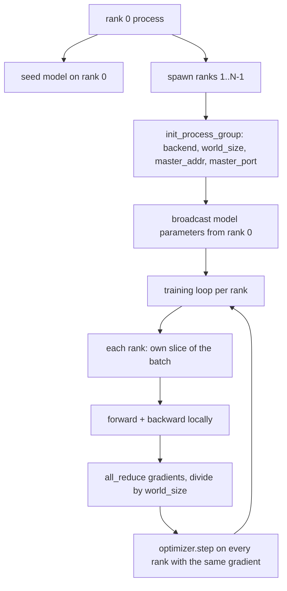
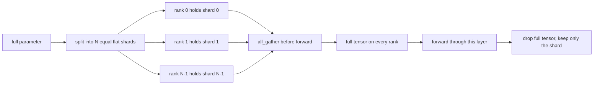

# 從零實作 Distributed Data Parallel 與 FSDP (Distributed Data Parallel and FSDP from Scratch)

> 多 rank 訓練就是兩個 collective 加一條規則。啟動時 broadcast 參數，backward 之後平均 gradient，永遠不要讓各個 rank 對「現在是第幾步」有不同看法。

**Type:** Build
**Languages:** Python
**Prerequisites:** Phase 19 lessons 42 to 45
**Time:** ~90 分鐘

## 學習目標 (Learning Objectives)

- 用 `gloo` backend 在 N 個 rank 上建立 process group，不需要特殊硬體。
- 實作最小化的 DDP wrapper：建構時 broadcast 參數，backward 之後 all-reduce gradient。
- 證明各 rank 的 gradient 經 all-reduce 後，與單一 process 在串接輸入上算出的 gradient 一致。
- 勾勒 FSDP 的參數分片：每個 rank 只持有一個切片，forward 時收集完整 tensor，用完就丟掉。

## 問題 (The Problem)

模型放得進一個裝置，但資料集不行。最佳化預算要求你每秒牆上時間看到 N 倍的樣本。第一個槓桿是 data parallel：每個 rank 對 batch 的不同切片執行同一個模型，然後在 optimizer step 之前平均 gradient。第二個槓桿是 FSDP：模型連一個裝置都放不下，所以每個 rank 只持有每個參數的一小部分，並在 forward 期間逐層重建完整 tensor。

痛點在記帳。如果參數在各 rank 之間漂移，這個 run 會悄悄壞掉。如果你平均了 gradient 卻沒有平均 loss，儀表板就會說謊。如果 collective backend 對拓撲無法達成共識，這個 run 會永遠卡住。解法是自己親手寫一次 collective，永遠不要信任一個你無法重現的 wrapper。

本課在 CPU 上執行，不假設有 CUDA。`gloo` backend 隨每個 PyTorch 版本附帶，並接受 `torch.multiprocessing` 的 worker；同樣的程式碼在多 GPU 節點上只要換成 `nccl`，結構不用改。

## 核心概念 (The Concept)



### 重要的兩個 collective (The two collectives that matter)

| Collective | 做什麼 | 何時使用 |
|------------|--------|----------|
| `broadcast` | 把 tensor 從一個 rank 複製到其他所有 rank | 參數初始化、scheduler 狀態、任何一對多的同步 |
| `all_reduce` | 跨所有 rank 對 tensor 做加總（或平均、最大值），每個 rank 都拿到結果 | backward 之後的 gradient 平均 |
| `all_gather` | 每個 rank 貢獻一個 tensor，每個 rank 都拿到串接後的結果 | 收集 logits、FSDP 參數 unshard |

DDP 的約定是：建構時 `broadcast`，backward 之後 `all_reduce`。FSDP 的草圖則在每層 forward 之前多加一個 `all_gather`。

### Gradient 平均與單一 process 的 gradient 一致 (Gradient averaging matches single-process gradient)

一個模型在 N 個 rank 上各訓練 B 個樣本的 batch，產生的 gradient 必須與單一 process 訓練 N*B 個樣本的 batch 相同。關鍵在於：把各 rank 的 gradient 加總再除以 N，得到的是平均 loss 的 gradient，這正是 mean reduction 的 cross entropy 在完整 batch 上會產生的結果。課程程式碼用手動 all-reduce 的 gradient 與單一 process 參考 gradient 之間 `max-abs-diff < 1e-3` 來斷言這件事。

### FSDP 草圖 (FSDP sketch)



記憶體的好處是精確的：每個 rank 的參數記憶體降到 1/N。代價是 gather，每次 forward 都要付。正式的 FSDP 會讓 gather 與前一層的運算重疊，所以牆上時間的成本遠小於天真計算的預測。本課對每個參數做一次往返，並斷言重建結果與原始值逐位元相等。

### CPU 與 gloo backend (CPU and the gloo backend)

CUDA 是正式環境的目標，但同樣的程式路徑在 CPU 上也存在。`gloo` 是 CPU 的 collective backend。它比 GPU 上的 `nccl` 慢好幾個數量級，但 API 介面完全相同。本課的 process group 以 `backend="gloo"` 初始化，rank 用 `torch.multiprocessing` 產生，而不是 `torchrun`；兩者最後都會呼叫相同的 `torch.distributed`。在多 GPU 節點上，唯一要改的是 `backend="nccl"`、裝置 tensor，以及改用 `torchrun` 啟動。

```figure
cg-allreduce-ring
```

## 動手做 (Build It)

`code/main.py` 是可執行的成品。

### 步驟 1：啟動 process group

```python
os.environ["MASTER_ADDR"] = "127.0.0.1"
os.environ["MASTER_PORT"] = str(port)
dist.init_process_group(backend="gloo", rank=rank, world_size=world_size)
```

`MASTER_ADDR` 和 `MASTER_PORT` 是會合點 (rendezvous)：每個 rank 都連到同一台主機的同一個 port。本課用「綁定後關閉」的技巧挑選空閒 port，避免多個 run 共用一台機器時發生衝突。

### 步驟 2：建構時 broadcast

`MinimalDDP.__init__` 會走過每個參數和 buffer，並呼叫 `dist.broadcast(tensor, src=0)`。Rank 0 的數值成為標準初始值。沒有這一步，每個 rank 會用自己的 seed 初始化，從第一步起各 rank 就分道揚鑣。

### 步驟 3：backward 之後 all-reduce gradient

```python
def all_reduce_grads_(module, world_size):
    for p in module.parameters():
        if p.grad is None:
            p.grad = torch.zeros_like(p.data)
        dist.all_reduce(p.grad.data, op=dist.ReduceOp.SUM)
        p.grad.data.div_(world_size)
```

每個 rank 最後都拿到相同的平均 gradient。optimizer step 現在對每個 rank 而言都是同樣輸入的函數，這就是參數在整個 run 中保持同步的原因。

### 步驟 4：證明等價

`manual_all_reduce_matches_single_process` 在 rank 0 上建立同樣的模型，並把 all-reduce 後的 gradient 與單一 process 在串接輸入上算出的 gradient 做比較。最大絕對差約為 1e-8。

### 步驟 5：FSDP 往返

`fsdp_round_trip_sketch` 把每個參數攤平、補齊到 `world_size` 的倍數、切片、all-gather，再去掉補齊。每個 rank 的重建結果都等於原始值。這是 unshard 步驟；反向的動作（forward 後重新分片）只要從收集後的 tensor 切出一片即可。

執行它：

```bash
python3 code/main.py
```

預設 world size 是 2。兩個 CPU process 會被產生出來，透過 `gloo` 互相溝通，然後以零結束。輸出的 `outputs/ddp-demo.json` 記錄了每個 rank 的參數總和、all-reduce 之後的 gradient norm、FSDP 往返結果，以及手動與參考 gradient 的差異。

## 實際使用 (Use It)

正式環境的訓練框架呼叫的是同樣的基本元件。PyTorch 的 `DistributedDataParallel` 額外加上：backward 之後的 gradient hook，讓 all-reduce 與 backward 重疊；bucketed all-reduce，把幾個小 gradient 合併成一次 collective；以及第 46 課用過的 `no_sync` context。

PyTorch 的 FSDP 額外加上：每層一個攤平的參數 view，讓每個 rank 持有一塊連續的 buffer；讓下一層的 unshard 與目前這層的運算重疊；以及可選的分片 CPU offload。

形狀不變：啟動時 broadcast，backward 之後 reduce，參數放不下時就分片。

## 交付 (Ship It)

`outputs/skill-distributed-fsdp-ddp.md` 載有新訓練腳本的配方：CPU 用 `gloo`、GPU 用 `nccl` 啟動 process group，把模型包進 DDP 外殼（建構時 broadcast、backward 之後 reduce），並可選擇用 FSDP 草圖中的 all_gather 模式對參數分片。

## 練習 (Exercises)

1. 用 `--world-size 4` 執行，確認整個 run 中參數的離散程度維持在 1e-3 以下。
2. 把手動平均換成 `dist.all_reduce(op=dist.ReduceOp.AVG)`，並計時比較差異。
3. 為 DDP wrapper 加上 backward 之後的 hook，讓 all-reduce 與其餘的 backward 重疊；量測牆上時間的改善。
4. 實作 FSDP 的重新分片步驟：forward 之後，把完整 tensor 換回本地分片。確認每個 rank 的記憶體下降。
5. 在 CUDA 機器上把 backend 換成 `nccl`。記下哪些環境變數要改，哪些維持不變。

## 關鍵術語 (Key Terms)

| 術語 | 一般說法 | 實際意義 |
|------|----------|----------|
| Backend | 「gloo 或 nccl」 | 實作 collective 操作的函式庫；gloo 用於 CPU，nccl 用於 GPU |
| World size | 「總 rank 數」 | group 中的 process 數量；group 是 collective 運作的單位 |
| Rank | 「Worker id」 | group 內的 process 識別碼，從零開始 |
| All-reduce | 「把 grad 加起來」 | 跨所有 rank 加總 tensor，每個 rank 最後得到相同的結果 |
| Unshard | 「收集參數」 | 透過 all_gather 從各 rank 的切片重建完整 tensor |

## 延伸閱讀 (Further Reading)

- PyTorch `torch.distributed` 文件，說明本課倚賴的 collective 語意。
- `gloo` 函式庫的 collective 清單，形狀與 CUDA 支援的 `nccl` 基本元件相同。
- Phase 19 lesson 46：梯度累積的模式，把 DDP 的 all-reduce 包在 `no_sync` 裡。
- Phase 19 lesson 47：能撐過 DDP 與 FSDP 訓練的 checkpoint 版面。
- PyTorch FSDP 文件，是這裡所勾勒的參數分片的正式實作。
