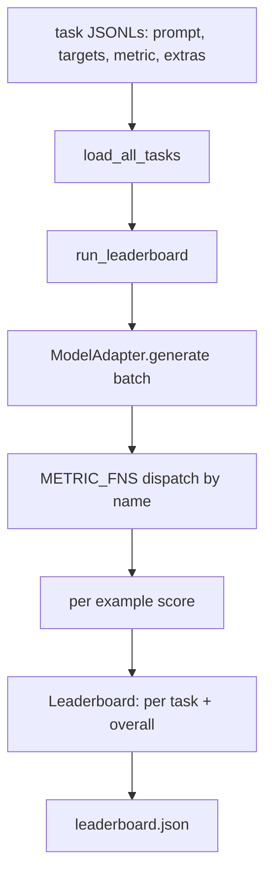
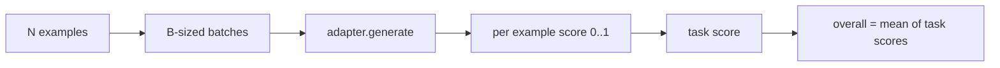

# 語言模型評估框架 (Language Model Evaluation Harness)

> 一個在你無法定義的任務上表現良好的模型，只是碰巧表現良好。Harness 就是任務定義、指標、執行器與排行榜，濃縮成一個簡短、可替換的形狀。

**Type:** Build
**Languages:** Python
**Prerequisites:** Phase 19 lessons 42 to 45
**Time:** ~90 分鐘

## 學習目標 (Learning Objectives)

- 把任務定義成一個 JSONL 檔，每個範例包含 `prompt`、`targets`、`metric`，以及可選的 `extras`。
- 實作五種指標：exact match、rouge-l F1、可執行檢查、選擇題，以及 substring contains。
- 建立一個執行器，依任務對範例分批，並派送給可替換的模型 adapter。
- 輸出排行榜 JSON，包含各任務分數、延遲，以及可重現的整體平均。

## 問題 (The Problem)

每週都有新的語言模型問世。行銷說法是它表現很好。誠實的問題是：好在哪裡？誠實的答案是你自己寫的排行榜，因為廠商的排行榜是他們調校過的那一份。

repo 裡沒有 harness 的話，你只能憑感覺比較兩個模型。有了 harness，你就能在固定的任務集上，用固定的指標，輸出可以 diff 的 JSON 來比較。Harness 是昨天的 run 和今天的 run 之間的契約。沒有它，退化就會上線。

陷阱是把 harness 過度擬合到單一模型。解法是讓所有模型專屬的選擇都留在 harness 之外：harness 小到十五分鐘就讀得完，任務小到能隨 repo 一起發佈，指標從零寫成，讓同事能稽核，而 adapter 是唯一放模型專屬程式碼的地方。換 adapter，排行榜會動；換任務，排行榜會動。其他東西都不該動。

## 核心概念 (The Concept)



### 任務規格 (Task spec)

每個範例是一行 JSONL：

```json
{"id": "arith-00", "prompt": "compute: 2 + 2", "targets": ["4"], "metric": "exact_match"}
```

對於需要評分輔助資料的指標，`extras` 攜帶額外的 payload：

```json
{
  "id": "code-00",
  "prompt": "python: write a function f that doubles its input",
  "targets": ["ok"],
  "metric": "code_exec",
  "extras": {"io_pairs": [[1, 2], [3, 6]]}
}
```

任務是 `outputs/tasks/` 下的一個 `.jsonl` 檔。檔名就是任務名稱。同一個檔案中的所有範例共用一種指標。

### 五個 fixture 任務 (The five fixture tasks)

| 任務 | 指標 | 測試什麼 |
|------|------|----------|
| arithmetic | exact_match | 對確定性答案的 token 層級正確性 |
| summary | rouge_l | 與一行參考摘要比較的最長共同子序列 F1 |
| code-exec | code_exec | 可執行測試：預測出的函式必須滿足一串輸入輸出配對 |
| multiple-choice | multiple_choice | 預測的第一個字母必須符合允許的字母 |
| generation | substring_contains | 自由格式文字必須包含至少一個目標子字串 |

### 指標的約定 (The metric contract)

每個指標都是一個函式，從 `(prediction, targets, extras) -> float in [0.0, 1.0]`。Harness 對各範例分數取平均得到任務分數，再對任務分數取平均得到整體分數。指標函式都很小：

- `exact_match`：轉小寫、壓縮空白、比較相等。
- `substring_contains`：同樣的正規化，做子字串測試。
- `multiple_choice`：第一個字元轉大寫。
- `rouge_l`：LCS 長度分別除以預測與參考的長度，取 precision 與 recall 的 F1。
- `code_exec`：在受限的 namespace 中執行預測，對每組輸入輸出呼叫 `f(x)`，計算符合的數量。

code_exec 指標在剝除 builtins 的 namespace 中執行預測。本課的測試斷言 `import os` 會炸掉，因為 `os` 不在 namespace 裡；你無法從程式碼預測中碰到檔案系統。

### 模型 adapter (The model adapter)

```python
class ModelAdapter(Protocol):
    def generate(self, prompts: Sequence[str]) -> List[str]: ...
    @property
    def name(self) -> str: ...
```

Adapter 是接縫。本課附帶 `ToyAdapter`，一個確定性的模式比對器，對五個 fixture 任務中的每個 prompt 都回傳正確答案。真正的 adapter 會呼叫模型並回傳它的輸出。Harness 不在乎是哪一種。

### 執行器 (The runner)

`run_task` 一次處理 `batch_size` 個 prompt，並派送給指標函式。`run_leaderboard` 走過每個任務並取平均。`write_leaderboard` 輸出帶有 schema 字串的 JSON，讓未來格式變更時不會悄悄弄壞儀表板。



```figure
eval-harness-matrix
```

## 動手做 (Build It)

`code/main.py` 是可執行的成品。

### 步驟 1：播種 fixture 任務

`seed_fixture_tasks(target_dir)` 會寫出五個 `.jsonl` 檔。`main.py` 第一次執行時，若目錄是空的就會播種。

### 步驟 2：載入任務

`load_all_tasks(task_dir)` 讀取每個 `.jsonl`，並回傳一個從任務名稱對應到 `Example` 記錄清單的 dict。以 `#` 開頭的註解行與空白行會被略過，讓貢獻者可以在檔案中加註解。

### 步驟 3：實作指標

每個指標都是一個小函式，並附有單元測試。本課的測試套件包含 13 個案例，涵蓋正規化、部分重疊、程式碼執行，以及不安全程式碼的拒絕。

### 步驟 4：寫執行器

`run_task` 迭代各批次，並產生一個 `TaskResult`，包含分數、正確數、總數與延遲。`run_leaderboard` 走過所有任務，並產生帶有整體平均的 `Leaderboard`。

### 步驟 5：輸出 JSON

`write_leaderboard` 序列化排行榜。`--include-per-example` 旗標會傾印每個範例的記錄，讓分數變動時，你能拿預測結果與上一次的 run 做 diff。

執行它：

```bash
python3 code/main.py
```

腳本在第一次執行時播種 fixture，用 toy adapter（它每個 fixture 都答對）評分，並寫出 `outputs/leaderboard.json`。用 toy adapter 的整體分數是 1.0；`test_main.py` 中的 stub adapter 測試顯示，當 adapter 答不出來時，同一個 harness 會產生 0.0。

## 實際使用 (Use It)

要接上真正的模型，寫一個 adapter。形狀如下：

```python
class HttpAdapter:
    name = "vendor.v1"

    def __init__(self, endpoint, api_key):
        self.endpoint = endpoint
        self.api_key = api_key

    def generate(self, prompts):
        out = []
        for prompt in prompts:
            response = http_post(self.endpoint, prompt, self.api_key)
            out.append(response["text"])
        return out
```

在 `main()` 開頭把 `ToyAdapter` 換成 `HttpAdapter`。Harness、任務、指標與排行榜都維持不變。

在真實專案中發佈 harness 時，要落實三個做法：

- **固定任務檔。** leaderboard.json 要帶有以雜湊固定的任務內容，或把 JSONL 一起附上；否則任務檔一變，分數就跟著動，你無法分辨是哪一個造成的。
- **比對預測，而不只是分數。** `--include-per-example` 旗標讓你看到分數下降那天模型說了什麼。
- **限制 batch size。** 真正的 adapter 有 rate limit。較小的 batch size 讓 harness 能相容於不同廠商。

## 交付 (Ship It)

`outputs/skill-lm-eval-harness.md` 載有這份配方：JSONL 任務規格、五種指標、可替換的 adapter、分批的執行器，以及帶有 schema 字串的排行榜 JSON。`outputs/tasks/` 裡的任務檔就是 fixture；把它們複製進真實專案當作起點。

## 練習 (Exercises)

1. 新增第六個任務，並用你從零寫的自訂指標（類 BLEU 的重疊、類 BLEURT 的參考評分，或任何約定明確的指標）。
2. 擴充 `code_exec`，讓它能擷取 stdout，並接受一串預期的 stdout 作為 targets。
3. 新增排行榜 diff 指令：給兩個 `leaderboard.json`，印出哪些任務有變動、變動多少。
4. 限制每個範例的延遲。用 timeout 包住 adapter 呼叫；在排行榜中新增獨立的 `timeouts` 欄位。
5. 在排行榜中用 sha256 固定任務內容，讓日後的讀者能驗證自己評分的是同一批任務。

## 關鍵術語 (Key Terms)

| 術語 | 一般說法 | 實際意義 |
|------|----------|----------|
| Task spec | 「評估格式」 | JSONL 檔，每個範例含 prompt、targets、metric，以及可選的 extras |
| Metric | 「怎麼評分」 | 從 (prediction, targets, extras) 到 [0, 1] 浮點數的函式 |
| Adapter | 「模型 client」 | 具有 generate(prompts) -> list[str] 方法的物件；唯一的模型專屬程式碼 |
| Leaderboard | 「計分板」 | 含各任務分數、總數、延遲與整體平均的 JSON |
| Code exec metric | 「跑起來檢查」 | 在受限 namespace 中執行預測，並與輸入輸出配對比較 |

## 延伸閱讀 (Further Reading)

- 原版 lm-evaluation-harness，是正式環境的參考實作，規模大得多，但形狀相同。
- HuggingFace 的 lighteval，是同一份約定的另一種實作。
- Phase 19 lesson 46 涵蓋 harness 所評分的訓練框架中使用的梯度累積模式。
- Phase 19 lesson 47 涵蓋你所評分對象的 checkpoint 格式；請在排行榜中固定 checkpoint 的雜湊。
- Phase 19 lesson 48 涵蓋產生受測模型的分散式訓練框架。
