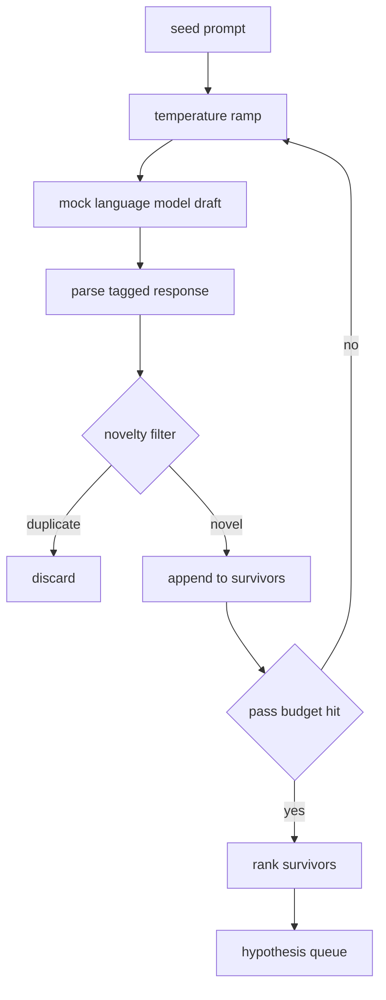

# 假說產生器 (Hypothesis Generator)

> 一個把同一個問題問兩次的研究 agent，是在浪費 token。訣竅是強迫每一份草稿都落在新的地方。

**Type:** Build
**Languages:** Python
**Prerequisites:** Phase 19 Track A lessons 20-29
**Time:** ~90 分鐘

## 學習目標 (Learning Objectives)
- 從 seed prompt 驅動 sampler，並把輸出轉成有型別的假說記錄。
- 每一輪都提高 sampler 的 temperature，讓下一份草稿離上一份更遠。
- 用小型 embedding 模型與 cosine distance 門檻過濾近似重複。
- 用混合新穎性、具體性與可測試性的評分函式，替存活者排名。
- 讓每一步都保持確定性，使相同的 seed 永遠產生相同的佇列。

## 為什麼要先產生、再過濾 (Why generate, then filter)

規劃器只問一個模型一次，就只得到一個假說。這對示範範例還行。對研究迴圈來說，這是錯誤的形狀。迴圈需要一個有深度的排名佇列，這樣第一個假說失敗時，執行器手上已有下一個，不必再付一整輪取樣的成本。

兩個想法結合起來產生這個佇列。第一個是 temperature ramping：每經過 sampler 一輪就調高一點 temperature，鼓勵後面的草稿四處遊走。第二個是新穎性過濾：每份草稿之後，產生器會量測它與每個先前存活者的 embedding 距離，並拒絕落在群集內的任何草稿。

本課附帶一個 mock 語言模型，對固定的 prompt 回傳腳本化的 token 序列。這個 mock 足以走完完整的路徑：輸入 seed prompt、套用 temperature ramp、解析候選、執行新穎性過濾、輸出排名佇列。

## Hypothesis 的形狀 (The Hypothesis shape)

```text
Hypothesis
  id             : int           (monotonic within a run)
  text           : str           (the claim)
  variables      : list[str]     (what changes between conditions)
  metric         : str           (what the runner will measure)
  baseline_ref   : str | None    (which paper or run the comparison cites)
  draft_pass     : int           (which sampler pass produced this)
  temperature    : float         (the sampler setting at draft time)
  novelty_score  : float         (distance from prior survivors, 0..1)
  rank_score     : float         (weighted sum used for ordering)
```

`variables` 和 `metric` 不是自由文字。Parser 會從帶標籤的回應中取出它們。第五十二課的執行器在建立實驗設定時，會直接讀取這些欄位。

`baseline_ref` 是可選的，但建議提供。第五十三課的評估器需要一個 baseline 來比較。如果假說沒有指定，評估器會退而使用同一指標上前一次的 run。

```figure
cg-novelty-ramp
```

## 架構 (Architecture)



迴圈很直接。有趣的地方在於每個方塊都有硬性的約定。

## Temperature ramp

從 `t_min` 開始，到 `t_max` 結束，步長為 `(t_max - t_min) / (n_passes - 1)`。每一輪以目前的 temperature 呼叫 sampler，由 `GeneratorConfig.schedule()` 產生 `n_passes` 個等間距的數值。Mock 模型透過在一小組腳本化回應之間切換來配合 temperature，這些回應以 `(prompt, temp_bucket)` 為 key。這些 bucket 是開區間，所以 temperature 的小幅變動就會選到不同的 bucket，產生不同的草稿。在正式環境中，sampler 會是真正的模型，並傳入 `temperature=t`。

預設的排程是六輪，從 `0.2` 到 `1.2`。六輪足以填滿佇列，又不必為新穎性過濾器反正會拒絕的樣本付費。低於 `0.2`，模型會把 seed 鸚鵡學舌地吐回來。高於 `1.2`，回應容易偏離主題，也過不了 parser。

## 新穎性過濾 (Novelty filter)

每份草稿解析完之後，產生器會對文字做 embedding，並與每個已接受的假說比較。這個 embedding 是一個小型的雜湊詞袋（hashed bag of word tokens），正規化成單位長度。兩個單位向量之間的 cosine distance 是 `1 - dot(a, b)`。如果一份草稿與任何先前存活者的最小距離高於 `novelty_threshold`，就通過。預設是 `0.25`。

這個雜湊 embedding 不花俏。它是確定性的，零依賴，足以抓出明顯的情況：兩份草稿共用大部分名詞。正式部署會換成小型的 sentence 模型。介面維持不變。

## 排名分數 (Rank score)

```text
rank_score = w_novelty * novelty_score
           + w_specificity * specificity_score
           + w_testability * testability_score
```

三個子分數。`novelty_score` 是與先前存活者的最小 embedding 距離。`specificity_score` 是假說中具體變數的數量，除以目標數量。`testability_score` 在假說同時指定 metric 與 baseline 時為一，只有 metric 時為二分之一，否則為零。

預設權重是 `0.4`、`0.3`、`0.3`。權重放在產生器設定裡，讓下游的課程可以調整而不必 fork 程式碼。

## Mock 語言模型 (Mock language model)

```python
class MockLLM:
    def sample(self, prompt: str, temperature: float, seed: int) -> str:
        ...
```

給定 `(prompt, temperature, seed)` 三元組，sampler 是確定性的。Mock 維護一張腳本化的回應表，以 `(prompt_signature, temperature_bucket)` 為 key。如果表裡沒有某個 key 的項目，sampler 會回傳一個過不了 parser 的 fallback。這條 fallback 路徑由其中一個測試覆蓋。

Seed 會混進回應中，所以相同的 `(prompt, temperature)` 搭配不同的 seed 會產生不同的草稿。測試中我們固定 seed 以保持結果可重現。實際部署時，seed 會來自系統時鐘或計數器。

## 輸出佇列 (Output queue)

輸出是依 `rank_score` 由高到低排序的 `Hypothesis` 記錄清單。第五十二課的執行器彈出佇列頭，執行實驗，第五十三課的評估器再寫回判定。如果判定說假說是錯的，執行器就彈出下一個。

佇列是有限的。清空時，orchestrator 可以選擇放寬 seed prompt 再跑一次產生器，或停止並回報預算耗盡。

## 如何閱讀程式碼 (How to read the code)

`code/main.py` 定義了 `Hypothesis`、`MockLLM`、`HypothesisGenerator`，以及一個確定性的示範。產生器只暴露單一的 `run(seed_prompt)` 方法，回傳排序後的佇列；輪數是從 `GeneratorConfig.n_passes` 讀取，而不是當作參數傳入。Embedding 是雜湊詞袋。新穎性過濾是單一函式。排名分數也是單一函式。沒有任何東西依賴 `numpy`；embedding 的數學純用 stdlib，讓本課保持可攜。

`code/tests/test_generator.py` 涵蓋線性路徑、拒絕重複的路徑、parser 失敗的路徑、temperature ramp 的邊界，以及排名順序。

## 它放在哪裡 (Where this slots in)

第五十課產生佇列。第五十一課取佇列頭，執行文獻搜尋來證實或反駁它。第五十二課取同一個佇列頭，執行真正的實驗。第五十三課讀取兩者的輸出並寫下判定。這四課組合成一個沒有人在裡面的研究迴圈；人可以在任何邊界介入。
