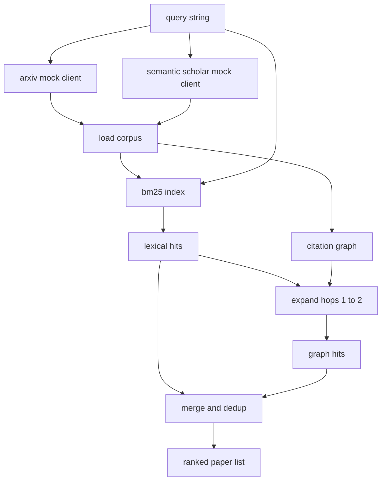

# 文獻檢索 (Literature Retrieval)

> 提出假說很便宜，知道別人是否已經證明過它才是昂貴的部分。在執行器啟動 sandbox 之前，先建好能回答這個問題的檢索層。

**Type:** Build
**Languages:** Python
**Prerequisites:** Phase 19 Track A lessons 20-29
**Time:** ~90 分鐘

## 學習目標 (Learning Objectives)
- 用迴圈下游會讀取的欄位，建立一個小型論文記錄模型。
- 只用 stdlib 資料結構，在摘要上建立 BM25 index。
- 走訪引用圖 (citation graph)，找出詞彙搜尋遺漏的論文。
- 以穩定的論文 id，去除詞彙搜尋與圖搜尋結果之間的重複命中。
- 把兩個 mock 外部 API 包在單一 client 後面，讓真正的 endpoint 上線時，上游的呼叫點維持不變。

## 為什麼要兩輪檢索 (Why two retrieval passes)

對摘要做關鍵字搜尋，會回傳與查詢共用詞彙的論文。這涵蓋了大部分表面。但它會漏掉兩種情況。第一種是奠基性論文使用不同的詞彙；例如查詢「sparse attention」會漏掉標題為「block selection in transformer routing」的論文。第二種是相關論文是引用某個已知錨點的後續研究；找到錨點再往前走，比暴力搜尋整個摘要池更有效率。

本課建立了兩輪。對摘要的 BM25 抓出詞彙命中。引用圖走訪則從種子集合出發，往前與往後各擴展一到兩跳。兩者的聯集以論文 id 去重，並依一個小型的綜合分數排名。

## Paper 的形狀 (The Paper shape)

```text
Paper
  id          : str           (stable identifier, "p001" for the mock corpus)
  title       : str
  abstract    : str
  year        : int
  authors     : list[str]
  references  : list[str]     (paper ids this paper cites)
  citations   : list[str]     (paper ids that cite this paper)
  source      : str           (which mock api supplied it, "arxiv" or "s2")
```

references 和 citations 欄位形成有向的引用圖。兩個 mock API 回傳的欄位有重疊但不完全相同，所以 corpus loader 以 `id` 取其聯集。

```figure
cg-citation-hops
```

## 架構 (Architecture)



檢索 client 擁有這兩輪與合併。呼叫者給它一個查詢，就會拿回一份排名清單，其中每一筆都帶有解釋排名的各論文分數欄位（`bm25_score`、`graph_distance`、`recency_score`、`final_score`）。

## 從零實作 BM25 (BM25 from scratch)

實作是標準的 Okapi BM25，預設參數 `k1=1.5`、`b=0.75`。Index 是兩個 dict：`term -> doc_frequency` 和 `term -> list of (doc_id, term_count)`。文件長度是摘要的 token 數。平均文件長度在建立 index 時只算一次。對查詢評分，是對查詢詞彙加總 `idf * tf_norm`，其中 `tf_norm` 是標準 BM25 經長度正規化的詞頻。

Tokenizer 是先 `lower`，再依非英數字元切分。不做詞幹還原。正式系統會換成小型的 stemmer。介面維持不變。

```math
\begin{aligned}
\text{idf}(t) &= \log\!\left(\frac{N - \text{df} + 0.5}{\text{df} + 0.5} + 1.0\right) \\
\text{tf\_norm}(t) &= \frac{f \cdot (k_1 + 1)}{f + k_1 \cdot \left(1 - b + b \cdot \text{dl} / \text{avgdl}\right)} \\
\text{score}(d, q) &= \sum_{t \in q} \text{idf}(t) \cdot \text{tf\_norm}(t)
\end{aligned}
```

## 引用圖走訪 (Citation graph traversal)

圖只從語料庫建立一次。前向邊從一篇論文指向它的 references。後向邊從一篇論文指向它的 citations。走訪是以 BM25 前幾名為種子的廣度優先搜尋，上限兩跳。

兩跳是刻意設定的上限。一跳太淺；agent 經常想要的是直接的祖先或後代。三跳會讓連通圖上的結果大小爆炸，也容易偏離主題。本課把跳數上限暴露為設定旋鈕，讓下游迴圈可以收緊。

## 去重與排名 (Dedup and ranking)

兩輪回傳的集合有重疊。合併時以論文 id 為 key。每篇論文的最終分數是加權混合。

```text
final_score = w_bm25 * bm25_score_norm
            + w_graph * graph_score
            + w_recency * recency_score
```

`bm25_score_norm` 是 BM25 分數除以合併集合中的最大 BM25 分數（所以此欄位落在零到一之間）。`graph_score` 對直接詞彙命中為一，一跳為 `0.6`，兩跳為 `0.3`，其他為零。`recency_score` 是線性斜坡，從語料庫最小年份的零到最大年份的一。

預設權重是 `0.5`、`0.3`、`0.2`。權重屬於設定；停滯的主題可能把 recency 調低，變動快速的主題則調高。

## Mock 語料庫 (Mock corpus)

語料庫是一百篇論文，由 `build_corpus()` 產生。每篇論文都有手寫的標題與摘要，屬於五個主題之一：attention sparsity、retrieval augmentation、low rank adapters、dataset distillation 與 evaluation harnesses。references 與 citations 經過連接，讓每個主題形成一個連通子圖，並帶有少數跨主題的邊。

兩個 mock API client（`ArxivMockClient`、`SemanticScholarMockClient`）讀取同一份語料庫，但暴露不同的欄位。Arxiv 回傳 title、abstract、year、authors。Semantic Scholar 再加上 references 與 citations。檢索 client 以 id 取聯集；跨 client 欄位不一致的處理，留待後續課程。

## 第 52 與 53 課會讀什麼 (What lessons 52 and 53 read)

第五十二課的執行器讀取 `paper.id`、`paper.title`，以及摘要的前三句，作為實驗的脈絡。第五十三課的評估器讀取 `paper.year` 與 `paper.references`，把 baseline 歸屬到特定論文。

檢索 client 回傳 `RetrievalResult`，其中包含排名清單，以及每次查詢的指標：命中數、平均分數、最高分、總牆上時間。執行器會記錄這些，讓下游的 observability 流程能畫出品質隨時間的變化。

## 如何閱讀程式碼 (How to read the code)

`code/main.py` 定義了 `Paper`、`ArxivMockClient`、`SemanticScholarMockClient`、`BM25Index`、`CitationGraph`、`RetrievalClient`，以及一個確定性的示範。Mock client 與語料庫放在同一個檔案，讓本課保持可攜。BM25 實作是一個 class，六十行。圖走訪是一個方法。

`code/tests/test_retrieval.py` 涵蓋詞彙路徑、圖路徑、合併、去重，以及空查詢。

## 它放在哪裡 (Where this slots in)

第五十課產生假說。第五十一課搜尋文獻，看這個假說是否已有定論。第五十二課在尚無定論時執行實驗。第五十三課讀取檢索結果與實驗指標，寫下判定。檢索 client 是四個階段中最便宜的，在 orchestrator 中最先執行。
