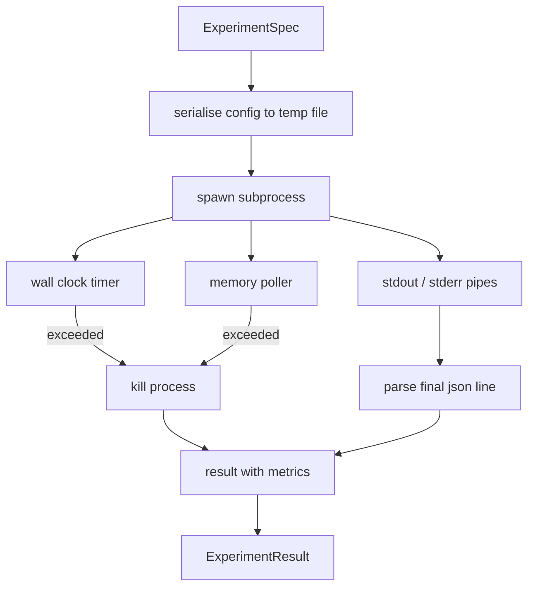

# 實驗執行器 (Experiment Runner)

> 迴圈的誠實程度，取決於它的量測。打造這個執行器：它接收規格，在 sandbox 子行程中執行，並輸出評估器可以信任的 json 指標。

**Type:** Build
**Languages:** Python
**Prerequisites:** Phase 19 Track A lessons 20-29
**Time:** ~90 分鐘

## 學習目標 (Learning Objectives)
- 把實驗編碼成有型別的規格，讓執行器能序列化給子行程。
- 啟動帶有硬性牆上時間 timeout 與軟性記憶體上限的子行程，並把兩者都呈現為終止條件。
- 把 stdout、stderr 與結構化指標 blob 擷取到單一結果記錄中。
- 建立 ablation 表，在固定的基礎規格上，一次只掃描一個設定旋鈕。
- 在給定 seed 的情況下讓每個結果都具確定性，讓評估器在每次 run 都看到相同的數字。

## 為什麼用子行程 (Why a subprocess)

研究迴圈會執行不受信任的程式碼。假說來自 sampler，實驗腳本也來自同一條路徑；把其中任何一個當作在行程內執行是安全的，就是在自找會拖垮 orchestrator 的當機。子行程是語言內建最簡單的隔離方式：獨立的行程、獨立的位址空間，以及父行程端的 signal handle。

這裡的執行器沒有實作完整的 sandbox。沒有 cgroup、沒有 seccomp filter、沒有 namespace 重新對應。它有的是牆上時間 timeout、監看記憶體成長的輪詢迴圈，以及在任一上限被觸及時終止行程的 kill 路徑。這是每個更精細的 sandbox 都會擴充的執行期約定。本課把約定維持得夠小，一次就能讀完。

## ExperimentSpec 的形狀 (The ExperimentSpec shape)

```text
ExperimentSpec
  spec_id        : str            (stable id, "exp_001")
  hypothesis_id  : int            (link back to the queue from lesson 50)
  script_path    : str            (path to the python script to run)
  config         : dict           (passed to the script as one json arg)
  seed           : int            (deterministic seed for the experiment)
  wall_timeout_s : float          (hard timeout, killed on exceed)
  memory_cap_mb  : int            (soft cap, polled; killed on exceed)
  metric_keys    : list[str]      (which fields the evaluator will read)
```

腳本放在磁碟上；執行器把設定寫到一個暫存檔路徑，供腳本讀取。腳本預期在 stdout 印出單一一行 json，其 key 是 `metric_keys` 的超集合。stdout 上的其他內容會被擷取，但指標 parser 會忽略。

```figure
cg-runner-limits
```

## 架構 (Architecture)



執行器是一個 class，只有一個主要方法。Poller 是一個小執行緒，每隔一個輪詢間隔醒來一次，並在可用時從 proc 檔案系統讀取等同於子行程 `psutil` 的資訊，平台不提供時則退化為 no op。

## 為什麼是軟性記憶體上限 (Why a soft memory cap)

硬性記憶體上限需要 `resource.setrlimit`，而且只在 POSIX 上有效。本課採用可攜的做法：從平台輪詢 resident set size，超過上限就 kill 子行程。上限是軟性的，因為 poller 的間隔不為零；行程可能在兩次輪詢之間飆高超過上限，然後又降回來。執行器會記錄觀察到的最大 RSS，讓評估器看出這次 run 離上限有多近。

在不支援行程檢視的系統上，poller 會記錄一次性的警告並停用自己。牆上時間 timeout 仍然適用。本課的測試涵蓋兩條路徑。

## 擷取 stdout 與 stderr (Capturing stdout and stderr)

執行器在完成時把兩條 pipe 都讀乾。Stdout 逐行掃描；最後一行能解析成含所有必要 `metric_keys` 的 json，就被當作指標 blob。較早的 json 行會以 `intermediate_metrics` 保留在結果中；評估器可以用它們畫學習曲線。

Stderr 會逐字擷取到結果裡。執行器對非零結束碼從不丟例外；而是把結束碼記錄在結果中。任何非零結束都會被標記為 `"crash"`，即使腳本印出了指標也一樣，所以評估器預設把不完整的 run 視為失敗。

## Ablation 表 (Ablation table)

```python
def ablate(base: ExperimentSpec, knob: str, values: list[Any]) -> list[ExperimentSpec]:
    ...
```

給定一個基礎規格與旋鈕名稱，這個輔助函式會為每個值回傳一份規格，其中 `config[knob]` 被覆寫。每份規格會得到一個衍生的 `spec_id`（`f"{base.spec_id}_{knob}_{value}"`）。執行器附帶 `AblationRunner`，依序執行它們，並回傳以旋鈕值為 key 的 `AblationTable`。

為什麼一次一個旋鈕。完整的 factorial 掃描會指數爆炸，產生評估器無法詮釋的結果。一次一個旋鈕，則產生一條評估器可以畫出來的乾淨座標軸。本課只支援多旋鈕掃描，做法是由呼叫者組合重複的單旋鈕 ablation。

## 確定性 (Determinism)

每份規格都帶有 seed。執行器透過設定 dict 把 seed 轉交給腳本（`config["__seed"] = spec.seed`）。`code/experiments/` 中的 mock 實驗腳本遵守 seed，並在每次 run 產生相同的指標。第五十三課的評估器依賴這一點；沒有確定性，「退化」可能只是不同的隨機初始化。

## Mock 實驗腳本 (The mock experiment script)

本課附帶一個實驗腳本：`code/experiments/sparsity_experiment.py`。它是真正的腳本，會讀取自己的設定檔，用 numpy 隨機跑一遍模擬小型訓練，並印出 json 指標 blob。腳本支援用來測試 timeout 的 `sleep_s` 旋鈕，以及用來測試記憶體 poller 的 `allocate_mb` 旋鈕。

模擬並沒有訓練任何真實的東西。它是一段數值運算，模仿訓練迴圈的形狀：loss 曲線、最終 perplexity、牆上時間。本課的重點是執行器，而不是模擬。真正的實驗腳本會 import 一個模型。

## 結果的形狀 (Result shape)

```text
ExperimentResult
  spec_id              : str
  hypothesis_id        : int
  exit_code            : int
  terminal             : "ok" | "timeout" | "oom" | "crash"
  wall_time_s          : float
  peak_rss_mb          : float | None
  metrics              : dict
  intermediate_metrics : list[dict]
  stdout_tail          : str
  stderr_tail          : str
```

評估器先讀取 `metrics` 和 `terminal`。如果 terminal 不是 `"ok"`，這次實驗就算失敗的 run，評估器的判定是自動的。否則，指標會被送進顯著性檢定。

## 如何閱讀程式碼 (How to read the code)

`code/main.py` 定義了 `ExperimentSpec`、`ExperimentResult`、`ExperimentRunner`、`AblationRunner`，以及一個確定性的示範。子行程管理是一個 class。記憶體 poller 是一個小執行緒。Ablation 輔助是單一函式。

`code/experiments/sparsity_experiment.py` 是測試中使用的 mock 實驗。它從 argv 讀取設定檔路徑，並在完成時寫出單一一行 json 指標。

`code/tests/test_runner.py` 涵蓋成功路徑、timeout 路徑、crash 路徑、ablation 表，以及兩次 run 之間的確定性檢查。

## 它放在哪裡 (Where this slots in)

第五十課產生假說。第五十一課過濾掉文獻已有定論的內容。第五十二課為剩下的部分執行實驗。第五十三課讀取結果、執行顯著性檢定，並寫下 orchestrator 依假說 id 儲存的判定。
