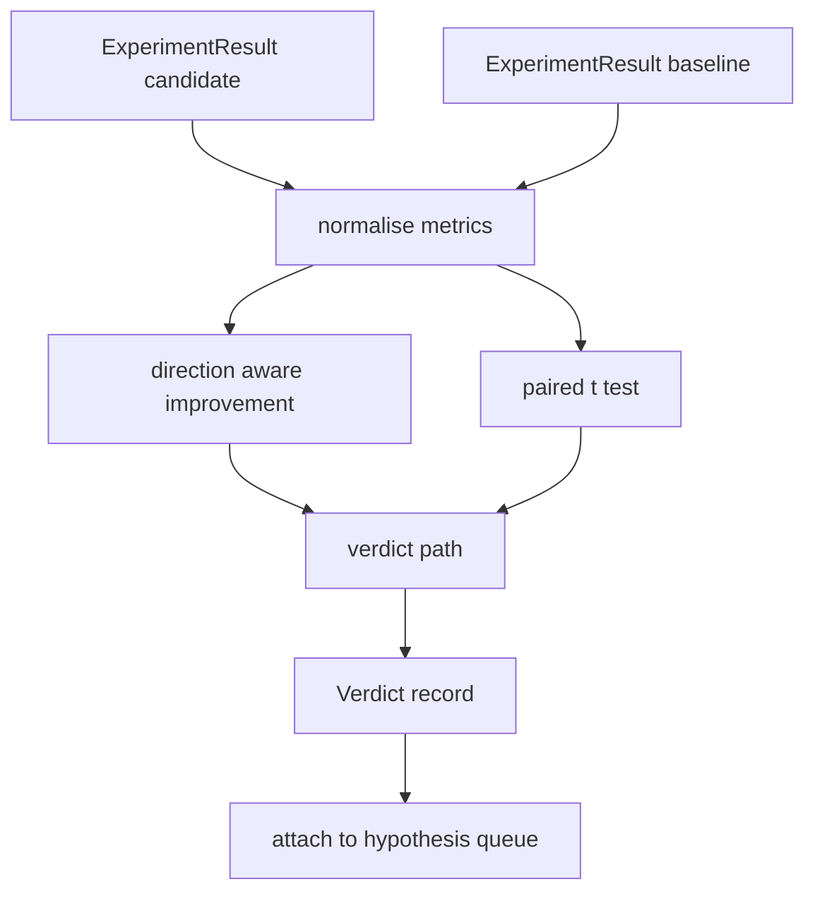

# 結果評估器 (Result Evaluator)

> 執行器產生了數字。評估器決定這些數字是進步、退化，還是雜訊。打造這條判定路徑，把指標變成一行結論。

**Type:** Build
**Languages:** Python
**Prerequisites:** Phase 19 Track A lessons 20-29
**Time:** ~90 分鐘

## 學習目標 (Learning Objectives)
- 用考慮方向的進步幅度與固定門檻，把候選 run 與 baseline 比較。
- 從零對每個 seed 的指標執行 paired t test，並解讀得到的 p value。
- 正規化 log 尺度的指標，讓下游報告能把它們與線性指標混合。
- 輸出每個假說的判定，讓 orchestrator 能附加到第五十課的佇列上。
- 讓每一步都保持純粹，使相同的輸入永遠產生相同的判定。

## 為什麼用成對檢定 (Why a paired test)

執行器給出的單一數字，說不出這個變動是不是真的。同樣的設定換一個 seed，會得到不同的 perplexity。這個變動可能只是雜訊。正確的比較是成對的：相同的 seed、相同的資料，用候選跑一次，再用 baseline 跑一次。每個 seed 貢獻一個差值。這些差值的平均就是效應。這些差值的標準誤就是雜訊底線。

本課從零實作這個檢定。沒有 `scipy.stats`。數學小到一個畫面就讀得完。

```text
diffs    = [a_i - b_i for i in seeds]
mean     = sum(diffs) / n
variance = sum((d - mean) ** 2 for d in diffs) / (n - 1)
t_stat   = mean / sqrt(variance / n)
df       = n - 1
p_value  = two_sided_p(t_stat, df)
```

雙尾 p value 使用正則化的 incomplete beta function。本課附帶一個使用 Lentz continued fraction 的小型實作。整個東西是六十行 stdlib 數學。

## 考慮方向的進步 (Direction aware improvement)

有些指標上升代表進步（accuracy、throughput）。其他指標下降才代表進步（loss、perplexity、牆上時間）。評估器在每個指標上帶有 `direction` 欄位。

```text
if direction == "higher_is_better":
    improvement = (candidate - baseline) / abs(baseline)
elif direction == "lower_is_better":
    improvement = (baseline - candidate) / abs(baseline)
```

進步是有正負號的。在「越高越好」的指標上出現負的進步，代表候選比較差。判定路徑會同時讀取正負號與大小。

固定門檻（`improvement_threshold=0.02`，百分之二）決定變動是否大到可以下結論。低於這個值，無論 p value 如何，判定都是「noise」；迴圈對使用者量不到的變動不感興趣。

```figure
cg-paired-verdict
```

## 架構 (Architecture)



評估器執行三個獨立的運算，並在判定路徑中合併。每個運算都是沒有共享狀態的純函式。

## Log 正規化 (Log normalisation)

Perplexity 是 loss 的指數。Loss 下降 0.1，在 perplexity 上是大得多的下降。直接比較兩種設定的 perplexity 沒問題，但要在單一報告中把它與線性指標混合，就需要正規化。

本課對任何 `scale` 欄位為 `"log"` 的指標，先取自然對數再計算進步幅度。門檻接著在 log 空間中套用。Perplexity 從 32 降到 28，變成 `log(32) = 3.466` 對 `log(28) = 3.332`。在「越低越好」的指標上，相對進步為 `(3.466 - 3.332) / 3.466 = 0.039`，超過百分之二的門檻。

```text
if scale == "log":
    a = log(candidate)
    b = log(baseline)
else:
    a = candidate
    b = baseline
```

`scale="linear"`（預設）的指標會跳過這個轉換。同一條程式路徑同時處理兩者。

## 每個 seed 的成對檢定 (Per seed paired test)

第五十二課的執行器每次 run 輸出一個最終指標 blob。為了做成對檢定，評估器需要候選的每個 seed 一個 blob，以及 baseline 的每個 seed 一個 blob。Orchestrator 在兩種設定下，跨一串 seed 執行同一個實驗，並交給評估器兩份 `ExperimentResult` 記錄清單。

評估器依 seed 配對（seed 放在 `result.metrics["seed"]`），並走訪所要求的指標。如果兩份清單的 seed 不相符，評估器會丟出 `PairingError`。Orchestrator 應該重新執行。

## Verdict 的形狀 (The Verdict shape)

```text
Verdict
  hypothesis_id          : int
  metric                 : str
  direction              : "higher_is_better" | "lower_is_better"
  scale                  : "linear" | "log"
  candidate_mean         : float
  baseline_mean          : float
  improvement            : float       (signed, fraction; see direction rules)
  p_value                : float | None  (None if n < 2)
  significance_threshold : float
  improvement_threshold  : float
  verdict                : "improved" | "regressed" | "noise" | "failed"
  rationale              : str
```

判定路徑是一張小型的決策表：

```text
1. If any candidate result has terminal != "ok": verdict = "failed"
2. else if |improvement| < improvement_threshold:  verdict = "noise"
3. else if p_value is None or p_value > significance: verdict = "noise"
4. else if improvement > 0:                          verdict = "improved"
5. else:                                             verdict = "regressed"
```

Rationale 是一行人類可讀的句子，orchestrator 可以依假說 id 記錄它。

## 如何閱讀程式碼 (How to read the code)

`code/main.py` 定義了 `MetricSpec`、`Verdict`、`Evaluator`、t 統計量與 incomplete beta 輔助函式，以及一個確定性的示範。t test 用純 stdlib 數學實作；numpy 只用來讀取指標清單並計算平均與變異數。

`code/tests/test_evaluator.py` 涵蓋進步路徑、退化路徑、雜訊路徑（小幅進步）、雜訊路徑（n 太低）、失敗 terminal 路徑、log 正規化路徑、對照已知參考值的 t test，以及配對錯誤。

## 它放在哪裡 (Where this slots in)

第五十課產生了假說佇列。第五十一課過濾掉文獻已有定論的內容。第五十二課在候選與 baseline 兩種設定下，跨 seed 執行實驗。第五十三課讀取這些 run 並寫下判定。Orchestrator 把這四者縫合起來：

```text
for hypothesis in queue:
    literature = retrieval.search(hypothesis.text)
    if literature_settles(hypothesis, literature):
        attach(hypothesis, verdict="settled")
        continue
    candidates = runner.run_all(specs_for(hypothesis))
    baselines  = runner.run_all(baseline_specs_for(hypothesis))
    metric_spec = MetricSpec("perplexity", direction=LOWER, scale=LOG)
    verdict = evaluator.evaluate(hypothesis.id, metric_spec, candidates, baselines)
    attach(hypothesis, verdict)
```

那個 orchestrator 不在本課之中；這四課組合成它，除了各自定義的 dataclass 之外，不需要任何黏合程式碼。
