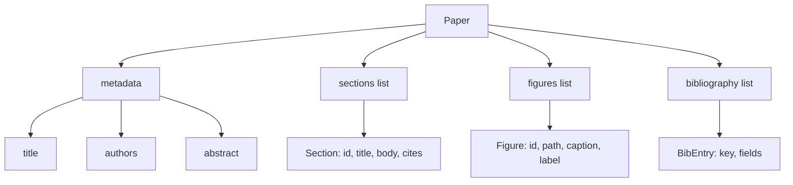
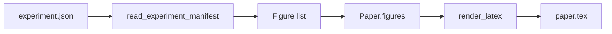
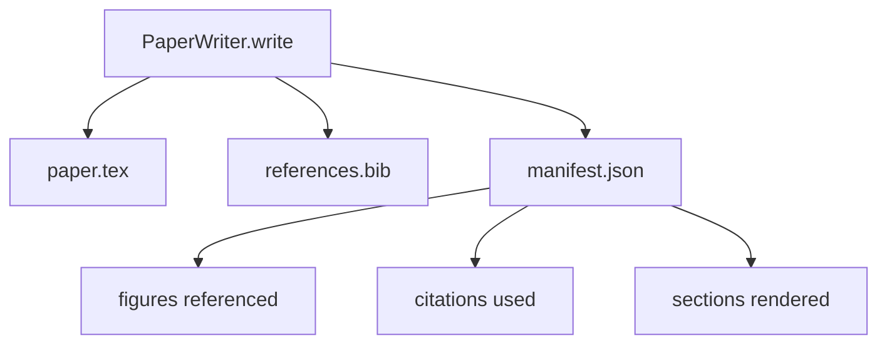

# 論文撰寫器 (Paper Writer)

> LaTeX 骨架是研究者與排版者之間的契約。契約一旦被破壞，文件就無法編譯，而且失敗得很明顯。先建好骨架，再填內容。

**Type:** Build
**Languages:** Python
**Prerequisites:** Phase 19 lessons 50-53
**Time:** ~90 分鐘

## 學習目標 (Learning Objectives)

- 把研究論文視為具有已知章節圖的結構化成品，而不是自由格式的文件。
- 產生 LaTeX 骨架，在寫任何內文之前，先宣告它的摘要、章節、圖表插槽與參考文獻 key。
- 透過確定性的插槽機制，把實驗輸出的圖（路徑與說明文字）注入骨架。
- 接上一個 mock 的內文產生器，從結構化大綱填入每個章節，讓 harness 不需要模型就能測試。
- 輸出單一 `paper.tex`、一份 `references.bib`，以及一份列出所有被引用的圖與所有使用到的引文的 manifest。

```figure
ch-paper-skeleton
```

## 為什麼先做骨架 (Why a skeleton first)

從內文開始寫的草稿會累積結構性債務。引言長出三個本來該放在相關研究的段落。某張圖在被定義之前就被引用了。參考文獻中，同一篇論文有三個 key。等作者發覺時，重寫的成本已經比寫作的成本高。

骨架則反過來。結構一開始就以資料的形式宣告。章節是有名稱與順序的插槽。圖是有 id 與說明文字的插槽。參考文獻 key 在最上方宣告，並附上它們指向的條目。內文一次一個地產生到這些插槽裡。在寫任何內文之前，harness 就能驗證每張圖都有插槽、每個引用都有條目、每個章節都出現在目錄裡。

這和先前的課程套用在計畫、工具呼叫與 trace 上的紀律相同。結構就是契約。

## Paper 的形狀 (The Paper shape)



每個欄位都是單純的 Python 資料。Renderer 是一個從 `Paper` 到 LaTeX 字串的純函式。Harness 可以在渲染之前檢視論文：計算章節數、列出缺少的圖檔，並檢查每個 `\cite{key}` 都有對應的 `BibEntry`。

## 渲染的約定 (The render contract)

Renderer 保證三個性質。第一，骨架中的每個圖插槽都會輸出一個 `\begin{figure}` 區塊，帶有 `fig:<id>` 形式的穩定 label。第二，每個章節都會輸出 `\section{}`，帶有 `sec:<id>` 形式的穩定 label，讓交叉引用能運作。第三，參考文獻會輸出 `\bibliography` 區塊，其 `references.bib` 恰好包含論文上宣告的條目，不多也不少。

違反其中任何一項都是渲染錯誤，而不是警告。骨架就是契約；悄悄漏掉一張圖的渲染，就是破壞契約。

## 從實驗注入圖 (Figure injection from experiments)

本 track 先前的課程把實驗輸出產生為 JSON manifest。每個 manifest 帶有一串成品，含路徑與簡短說明。論文撰寫器讀取該 manifest 並產生 `Figure` 記錄。



注入是確定性的。圖的 id 由實驗名稱加上單調遞增的計數器衍生。說明文字來自 manifest。路徑會相對於論文的輸出目錄正規化，所以即使實驗輸出放在磁碟的別處，LaTeX 也能編譯。

## Mock 內文產生器 (The mocked prose generator)

本課不呼叫模型。`MockProseGenerator` 讀取大綱的形狀，並以確定性的方式輸出內文。大綱的形狀是每個章節一個短字串。產生器把該字串展開成兩個短段落，並編入章節標題。產生的內文只在大綱宣告時，才會提到圖和引用。

這足以測試撰寫器的每個行為。真正的實作會把產生器換成模型呼叫。周圍的 harness 不會改變。這就是把內文產生器宣告成 callable 的價值：測試替換成確定性的版本，正式環境替換成模型版本，管線的其餘部分完全相同。

## Manifest 輸出 (The manifest output)

撰寫器會在輸出目錄中輸出三個檔案。



Manifest 是下游評估器或 critic 迴圈所讀取的東西。它不解析 LaTeX；它讀取 manifest。下一課的 critic 迴圈以這份 manifest 作為輸入，並產生回饋清單。這就是為什麼 manifest 是契約的一部分，而 LaTeX 不是。

## 驗證關卡 (Validation gates)

撰寫器在寫入任何檔案之前，會先跑四道關卡。

1. 每個圖 id 在論文內都是唯一的。
2. 每個章節的 `cites` 欄位所引用的參考文獻 key，都已在論文上宣告。
3. 摘要不是空的。
4. 標題不是空的。

關卡失敗會丟出 `PaperValidationError`，並附上精確的原因。Harness 把這個原因當作失敗模式呈現。不會有部分寫入：三個檔案要嘛全部輸出，要嘛都不輸出。

## 如何閱讀程式碼 (How to read the code)

`code/main.py` 定義了 `Paper`、`Section`、`Figure`、`BibEntry`、`PaperValidationError`、`MockProseGenerator`、`PaperWriter`，以及 `render_latex` 函式。`write` 方法接受輸出目錄，並輸出 `paper.tex`、`references.bib` 與 `manifest.json`。`read_experiment_manifest` 輔助函式把一串實驗 manifest 轉成 `Figure` 記錄。

`code/tests/test_paper_writer.py` 涵蓋：沒有章節的骨架渲染、有兩個章節與兩張圖的完整渲染、缺少引用的關卡、重複圖 id 的關卡、manifest 內容，以及 LaTeX 字串的約定（每個章節都輸出 `\section{}`，每張圖都輸出 `\begin{figure}`）。

## 延伸方向 (Going further)

真正的實作會想要兩個擴充。第一，多格式渲染：同一個 `Paper` 形狀可以編譯成給部落格文章的 Markdown，以及給預覽用的 HTML。Renderer 會成為 `Paper` 上的一個 strategy。第二，引文充實：在有本地 DOI 快取的情況下，撰寫器依引文 key 取得 BibTeX 條目。兩者都有價值，也都可以在不動骨架契約的前提下加入。

骨架就是賭注。章節、圖與引文以資料宣告，內文產生到插槽中，manifest 與 LaTeX 一起輸出。其他所有改進都建立在這之上。
