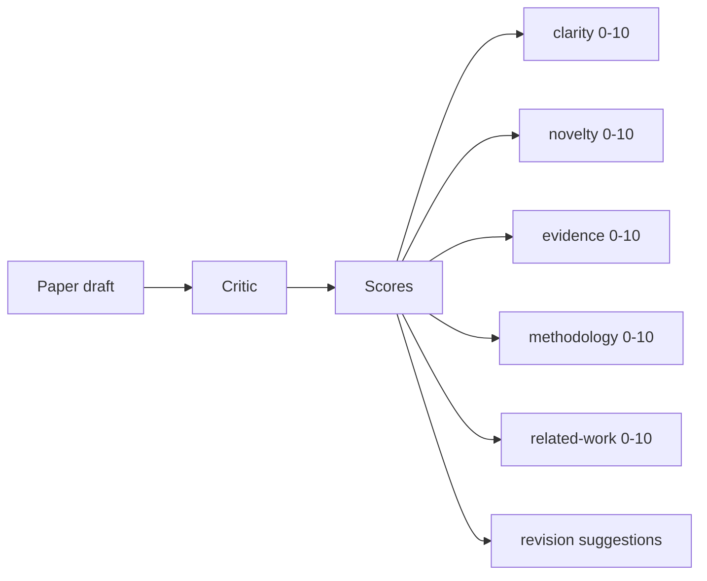
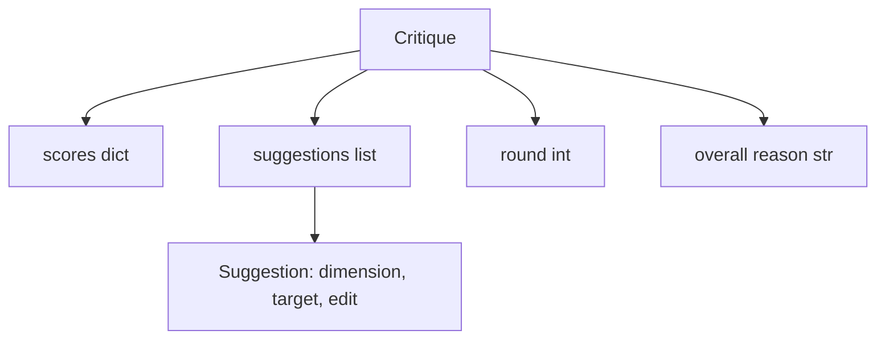
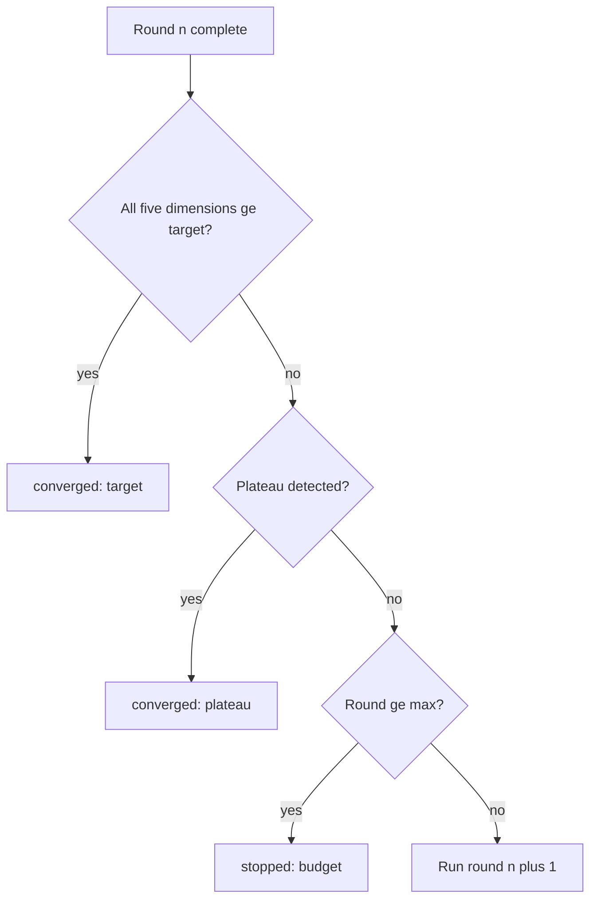
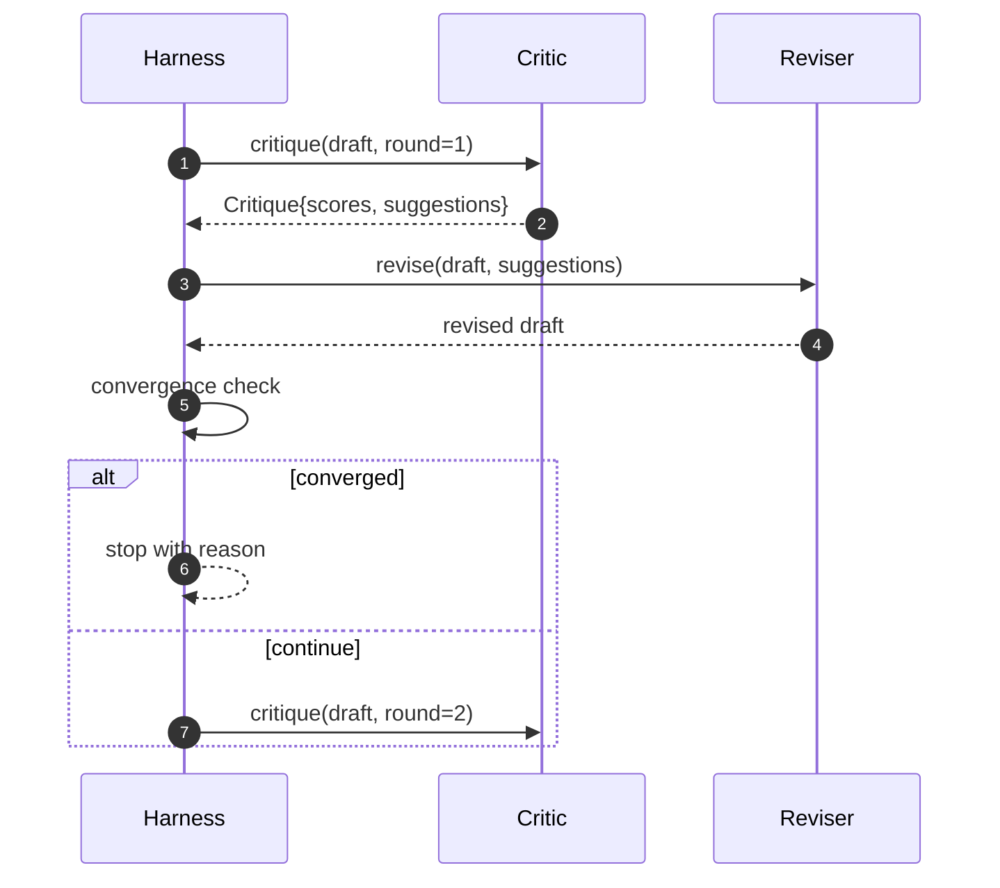

# Critic 迴圈 (Critic Loop)

> 第一次就回傳「看起來不錯」的 critic 是壞的。永遠回傳「還需要改進」的 critic 也是壞的。有趣的 critic 是會收斂的那一個，而收斂是需要你去設計的。

**Type:** Build
**Languages:** Python
**Prerequisites:** Phase 19 lessons 50-53
**Time:** ~90 分鐘

## 學習目標 (Learning Objectives)

- 從五個固定維度為論文草稿評分：clarity、novelty、evidence、methodology、related-work。
- 把每一輪的批評套用成結構化的修訂 diff，而不是自由格式的重寫。
- 透過比較各輪分數來偵測收斂；在進入平台期 (plateau)、達成目標或預算耗盡時停止。
- 以最大迭代次數的預算限制輪數，讓不收斂的 critic 不會永遠跑下去。
- 輸出每一輪的 trace，讓儀表板或下一階段能畫出分數軌跡。

```figure
ch-critic-converge
```

## 為什麼是五個固定維度 (Why five fixed dimensions)

自由格式的 critic 是一個回傳一段建議的模型。下一輪的修訂把這一段當作背景脈絡。重寫是否處理了批評，是無法驗證的，因為批評從來沒有結構。

五個維度給了 harness 一份契約。



分數是一個向量。Harness 會跨輪次觀察每個維度。一個提高了 clarity、卻讓 evidence 崩盤的修訂，在 evidence 上就是退化，而收斂檢查看得到它。只靠模型的 critic 無法提供這種保證。

## Critique 的形狀 (The Critique shape)



每個建議都帶有它所改進的維度、它所針對的章節，以及 reviser 可以套用的 `edit` 指令。Reviser 也是一個 callable。本課附帶一個確定性的 reviser，把 edit 指令解讀為「附加到章節」的操作。由模型驅動的 reviser 會把同一個欄位解讀為 prompt。契約不會改變。

## 依序的收斂規則 (Convergence rules, in order)

當三個條件中任何一個觸發時，critic 迴圈就會終止。



目標是最嚴格的情況：五個維度（clarity、novelty、evidence、methodology、related_work）每一個都必須達到 `>= target_score`（預設 `8.0`），迴圈才會回傳成功。平均很高、但有一個維度很弱，是不夠的。平台期偵測會把本輪的平均與上一輪的平均比較。如果進步幅度連續兩輪低於 `plateau_epsilon`（預設 `0.1`），迴圈就以 `plateau` 結束。預算是輪數的硬上限（預設 `5`），並以 `budget` 結束。

順序很重要。Target 優先於 plateau，plateau 優先於 budget。如果第三輪達到目標，而同一次迭代也會觸發 plateau，結果是 `target`，而不是 `plateau`。

## 為什麼平台期偵測要跨兩輪 (Why plateau detection runs over two rounds)

只有一輪的平台期是雜訊。真正的 critic 即使在固定的草稿上，每次迭代回傳的分數也會略有不同，因為確定性評分仍取決於哪些建議被套用、以什麼順序套用。要求連續兩個平台期輪次，就能過濾掉這種雜訊。如果 harness 回報平台期，代表草稿真的停止進步了。

## 本課的確定性 critic (The deterministic critic in this lesson)

本課不呼叫模型。附帶的 critic 是一個 callable，根據三個訊號為草稿評分：章節內文的平均長度 (clarity)、圖數量與引用數量 (evidence)，以及論文 metadata 上的 `originality_tag` 欄位 (novelty)。Reviser 知道如何把各項分數往上推。

```text
clarity      grows when the average section body length increases
novelty      grows when originality_tag is set to "high"
evidence     grows when a section's figure_refs is non-empty
methodology  grows when a section titled "Method" exists with body
related-work grows when a section titled "Related Work" exists with body
```

Reviser 把每個建議解讀為有針對性的附加。第一輪之後，harness 可以觀察到分數上升。測試利用這個性質，來斷言迴圈縮小了差距。

## 完整的迴圈約定 (The full loop contract)



Harness 擁有輪次計數器、trace 與收斂檢查。Critic 擁有分數。Reviser 擁有 diff。三者都不碰其他人的狀態。

## Trace 輸出 (The Trace output)

每一輪都輸出一個 trace 事件，包含輪次編號、分數向量、建議數量與收斂判定。完整的 trace 會與最終草稿一起回傳。下游的儀表板可以畫出每輪分數的圖表。下一課的 iteration scheduler 會讀取 trace，來決定這個分支值不值得保留。

## 防範壞 critic 的預算 (Budgets that protect against bad critics)

一個產生的建議從不改善分數的 critic，會把迴圈鎖在最大迭代上限。Trace 讓這件事一目了然：五輪、分數持平、判定為 `budget`。使用者會把它讀成 critic 的 bug，而不是草稿的 bug。另一種做法是只呈現最終草稿，會隱藏診斷資訊。Trace 優先的設計會把它呈現出來。

## 如何閱讀程式碼 (How to read the code)

`code/main.py` 定義了 `Critique`、`Suggestion`、`Critic` protocol、`Reviser` protocol、`CriticLoop`，以及一個 `make_deterministic_critic_pair` 工廠，回傳確定性的 critic 與相配的 reviser。其中包含一個最小的 `Paper` 形狀，讓本課可以獨立運作。

`code/tests/test_critic_loop.py` 涵蓋：第一輪之後的單調進步、調校過的草稿上的目標收斂、兩輪持平後的平台期偵測、沒有任何建議能改善時的預算耗盡、reviser 套用建議，以及 trace 的形狀。

## 延伸方向 (Going further)

真正的實作會想要兩個擴充。第一，維度權重：工作坊的論文把 novelty 的權重設得比 methodology 高；期刊則相反。收斂檢查會變成加權平均。第二，成對的 critic：一個 critic 評分，第二個 critic 在 reviser 看到建議之前先裁決這些建議。兩者都有價值，也都建立在同一個 `Critique` 形狀之上。

賭注是分數向量。一旦批評有了結構，其他所有改進，包括收斂規則、儀表板、成對 critic，都可以直接放進來，而不必改動迴圈。
