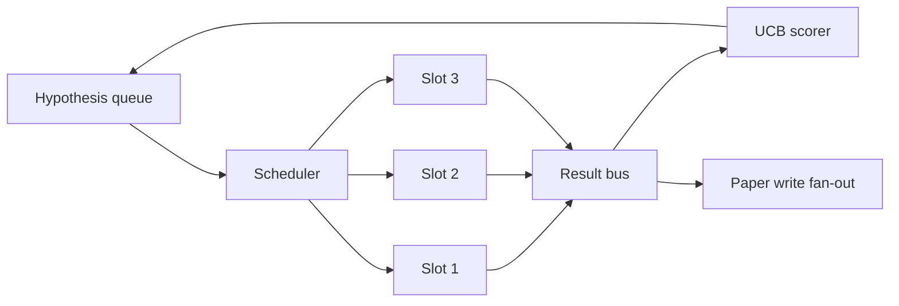
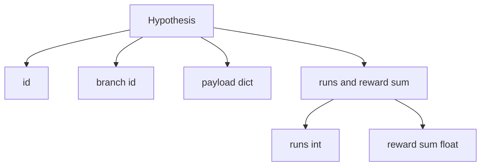
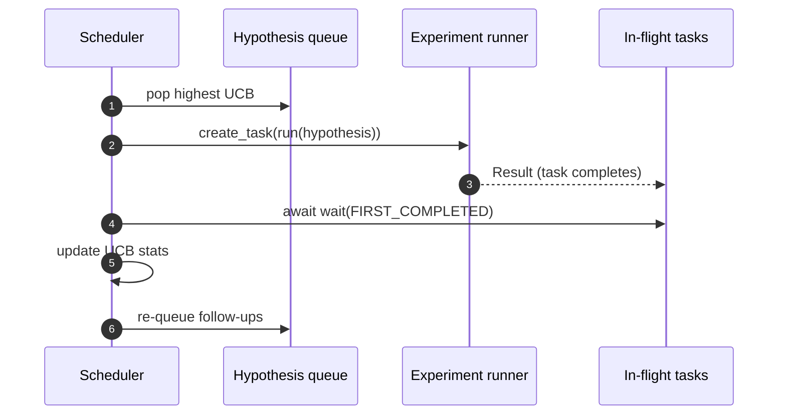

# 迭代排程器 (Iteration Scheduler)

> 沒有排程器的研究迴圈，只是一個有妄想的佇列。排程器是迴圈決定該停止探索什麼的地方，而這個決定就是整場遊戲的關鍵。

**Type:** Build
**Languages:** Python
**Prerequisites:** Phase 19 lessons 50-53
**Time:** ~90 分鐘

## 學習目標 (Learning Objectives)

- 把研究工作流程建模成：假說佇列餵給平行的實驗插槽，結果再 fan-in 回來。
- 用 asyncio 並行執行多個實驗，讓排程器能讓所有插槽保持忙碌。
- 用 UCB 為每個假說分支評分，讓排程器能修剪低產出的分支，又不放棄探索。
- 把完成的結果 fan-out 到論文撰寫階段與重新排隊階段，讓高產出的分支能衍生後續假說。
- 呈現每次迭代的 trace，包含分支分數、插槽佔用率與修剪決策。

```figure
ch-ucb-scheduler
```

## 為什麼是排程器，而不是工作清單 (Why a scheduler, not a worklist)

扁平的工作清單依提交順序執行工作。當每個工作彼此獨立時，這沒問題。研究並不獨立：實驗三的發現會改變實驗四和五的優先順序。讀取結果 fan-in 並重新排序佇列的排程器，每單位算力能完成更多有用的工作。

有趣的設計選擇是評分規則。貪婪的評分器永遠挑目前領先者，從不探索。均勻的評分器從不利用。UCB (upper confidence bound) 是中間路線：利用領先者，同時為嘗試較少的分支保留容量。

## 系統的形狀 (The system shape)



佇列存放假說。當有插槽空出時，排程器挑出 UCB 最高的假說。每個插槽以非同步方式執行一個實驗。完成的實驗把結果 fan 到 bus 上。Bus 更新來源分支的 UCB 統計，並在某個分支的產出越過門檻時，fan-out 到論文撰寫階段。

## Hypothesis 的形狀 (The Hypothesis shape)



`branch` 是 UCB 統計的 key。多個假說可以共用一個分支（分支是研究方向；假說是其中的一次嘗試）。`runs` 是該分支已完成實驗的次數，`reward_sum` 是累積獎勵。UCB 會讀取兩者。

## UCB 評分 (UCB scoring)

本課使用的 UCB 公式是經典的 UCB1。

```math
\text{ucb}(\text{branch}) = \text{mean\_reward}(\text{branch}) + c \sqrt{ \frac{\ln(\text{total\_runs})}{\text{runs}(\text{branch})} }
```

`total_runs` 是所有分支已完成實驗的總數。`c` 是探索權重；本課預設為 `sqrt(2)`。零次執行的分支會得到 `+inf`，所以未嘗試過的分支永遠最先被排程。平均獎勵高的分支會維持高分，直到其他分支迎頭趕上；執行很多次卻沒什麼獎勵的分支，會被執行較少的替代方案蓋過。

修剪關卡與挑選器是分開的。當某個分支在至少 `prune_after_runs` 次嘗試（預設 `3`）之後，平均獎勵低於絕對下限（預設 `0.2`），修剪就會把它從未來的排程中移除。這讓佇列保持有界。

## 用 asyncio 的平行插槽 (Parallel slots with asyncio)

排程器用 `asyncio.create_task` 驅動實驗。每個 task 執行實驗執行器（一個 `async def` callable），並回傳 `Result`。主迴圈用 `asyncio.wait(..., return_when=asyncio.FIRST_COMPLETED)` 等待進行中的 task 集合，並在每次完成時觸發分數更新。



三個插槽同時執行。主迴圈從不卡在單一實驗上。排程器在插槽一空出就開始新的 task，直到佇列清空且沒有進行中的 task 為止。

## Fan-out：論文觸發 (Fan-out: paper triggers)

當某個分支的平均獎勵越過 `paper_threshold`（預設 `0.7`），而該分支尚未產出論文時，排程器會把 `paper.trigger` 事件 fan 到輸出清單上。在下游，第五十四課的論文撰寫器會接手。本課把觸發擷取為清單，讓測試可以對它做斷言。

## Fan-out：後續假說 (Fan-out: follow-up hypotheses)

當高產出的結果出現時，排程器可以呼叫使用者提供的 `expander`，在同一個分支上產生一個或多個後續假說。Expander 是一個從 `Result` 到 `list[Hypothesis]` 的純函式。本課附帶一個確定性的 expander，對任何獎勵超過論文門檻的結果，產生兩個後續假說。

## 預算 (Budgets)

兩個預算保護排程器免於失控的迴圈。

```text
max_experiments    : total count of experiments run across all branches
max_seconds        : wall-clock cap (asyncio time)
```

當任一個觸發時，排程器停止排程新的 task，等待進行中的 task 完成，並回傳最終 trace。Trace 包含 `stop_reason`。

## Trace 與最終報告 (The Trace and final report)

每個排程決策（挑選、派送、結果、修剪、fan-out）都會輸出一個事件。最終報告彙總各分支的統計、總執行次數、總牆上時間，以及觸發的論文觸發。下一課的端到端示範會讀取這份報告，來驅動論文撰寫器。

## 如何閱讀程式碼 (How to read the code)

`code/main.py` 定義了 `Hypothesis`、`Result`、`BranchStats`、`IterationScheduler`，以及一個 `make_deterministic_runner` 工廠，回傳獎勵可預測的 asyncio 實驗執行器。執行器會睡眠固定的 `delay_ms`（預設 `5ms`），讓並行性可被觀察。

`code/tests/test_scheduler.py` 涵蓋：UCB 先挑未嘗試的分支、平行插槽佔用率、越過門檻時的論文觸發、低產出嘗試後的分支修剪、fan-out 後續假說，以及預算結束（實驗次數與牆上時間兩種）。

## 延伸方向 (Going further)

真正的實作會想要三個擴充。第一，跨 session 持久化 UCB 統計：目前的統計存在記憶體中；真正的排程器會把它們做 checkpoint，讓重啟後保留已花費的探索預算。第二，多目標評分：每個結果輸出的不是純量獎勵而是向量，UCB 變成 Pareto 風格的挑選器。第三，contextual bandit：挑選器以假說的特徵（長度、複雜度）為條件，讓相似的假說共享探索。

排程器是研究超越工作清單的地方。一旦 UCB 接上、插槽平行執行，其他所有改進都建立在這之上。
