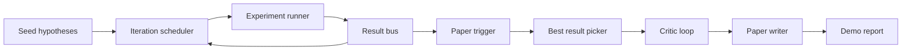
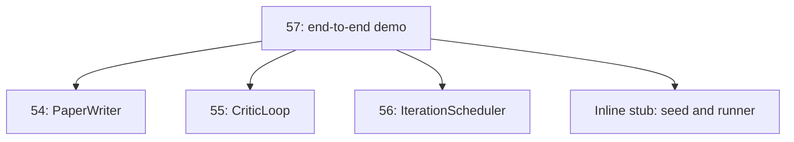
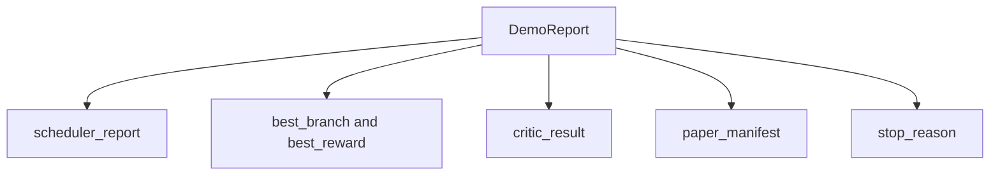

# 端到端研究示範 (End-to-End Research Demo)

> 示範是你先前寫的每一份契約必須組合在一起的地方。只要有任何一份漏了，抓到它的就是這個示範課。

**Type:** Build
**Languages:** Python
**Prerequisites:** Phase 19 lessons 50-53
**Time:** ~90 分鐘

## 學習目標 (Learning Objectives)

- 把自動研究迴圈從頭到尾接起來：假說 seed、實驗執行器、排程器、critic 迴圈、論文撰寫器。
- 透過單純的 Python import（而不是框架），組合先前四個 Track D 課程的基本元件。
- 讓迴圈執行到自行終止，並輸出單一示範報告，列出每個階段的輸出。
- 讓示範保持確定性，讓測試套件能斷言最終的形狀。
- 當任何階段的契約被破壞時，呈現清楚的失敗模式，讓下一階段不會帶著壞掉的輸入去執行。

```figure
ch-research-pipeline
```

## 這裡組合了什麼 (What composes here)



六個階段。Seed 是三個假說的清單。排程器用三個平行插槽，在它們之間執行六個實驗。Bus 回報一個或多個論文觸發。挑選器選出單一最佳結果。Critic 迴圈在由該結果建立的草稿上迭代。論文撰寫器輸出最終的 LaTeX、BibTeX 與 manifest。

## 為什麼 import，而不是複製 (Why import, not copy)

先前的每一課都附帶一個 `main.py`，內含公開的 dataclass 與函式。示範透過調整 `sys.path` 指向每一課的父目錄來 import 它們。這不是框架的接線；而是先前課程的測試檔本來就在用的同樣 import。



行內的 stub 代表第五十到五十三課：一個小型的 seed 假說產生器，以及一個同步的獎勵函式。使用者只要調整兩個 import，就能把行內 stub 換成那些課程中真正的基本元件。

## 確定性保證 (Determinism guarantees)

示範在設計上就是確定性的。實驗執行器使用固定 seed 的 numpy。Critic 迴圈的 reviser 以固定順序走訪固定的維度。論文撰寫器的內文產生器是第五十四課的 mock 版本。排程器的 UCB 挑選器在平手時依迭代順序決定，而不是隨機選擇。

給定相同的 seed，示範會輸出相同的報告。測試透過執行示範兩次並比較 manifest 來斷言這個性質。

## 示範報告的形狀 (The demo report shape)



每個欄位都逐字來自上游階段。示範不轉換任何輸出；它只是把它們組合起來。這就是示範本身所要通過的測試。

## 失敗模式的處理 (Failure mode handling)

每個階段要嘛成功，要嘛丟出有型別的錯誤。

```text
Scheduler ........ returns SchedulerReport with stop_reason
                   in {queue_empty, max_experiments, deadline}
Best-result pick . raises NoTriggerError if no paper trigger fired
Critic loop ...... returns LoopResult with status converged or stopped
Paper writer ..... raises PaperValidationError on contract break
```

任何階段的失敗都會以有型別的例外讓示範短路。測試固定了這份契約：`test_no_triggers_raises_typed_error` 和 `test_best_picker_raises_when_no_triggers` 斷言，當沒有任何分支觸發時，挑選器會丟出 `NoTriggerError` / `BestResultError`，而且撰寫器從未被呼叫。

## 最佳結果挑選器 (The best-result picker)

排程器為每個分支輸出論文觸發。挑選器選出所有觸發中平均獎勵最高的分支。平手時依分支 id 的字母順序決定，讓示範具確定性。挑選器是一個小型的純函式；測試把它固定在一份固定的排程器報告上。

## 接上 critic 迴圈 (Wiring the critic loop)

第五十五課的 critic 迴圈操作的是 `MiniPaper`。示範由挑出的分支建立 `MiniPaper`：以分支 id 填入摘要、放入兩個章節（Introduction 和 Results），並依分支的平均獎勵設定 `originality_tag`（`>= 0.8` 為 high，`>= 0.6` 為 medium，其餘為 low）。

Reviser 接著迭代草稿直到收斂。輸出會進入論文撰寫器。

## 接上論文撰寫器 (Wiring the paper writer)

第五十四課的論文撰寫器操作的是帶有圖與參考文獻的完整 `Paper` 形狀。示範透過 `mini_to_full_paper` 把收斂後的 `MiniPaper` 升級，它會附上所選分支的一張圖，以及由 critic 建議的引用 key 聯集所建立的小型合成參考文獻。示範加入的每個引用也會加進參考文獻清單，所以驗證會通過。

## 如何閱讀程式碼 (How to read the code)

`code/main.py` 定義了 `BestResultError`、`NoTriggerError`、`DemoReport`、`pick_best_branch`、`build_mini_paper`、`mini_to_full_paper` 與 `run_demo`。開頭的 import 只調整一次 `sys.path`，並從各自的課程拉進 `PaperWriter`、`CriticLoop` 與 `IterationScheduler`。

`code/tests/test_e2e.py` 涵蓋：示範端到端執行，並輸出五個欄位都已填入的報告；兩次執行之間的確定性；沒有分支越過門檻時的 NoTriggerError；撰寫器契約被破壞時的 PaperValidationError；論文 manifest 含有所選分支的圖；以及排程器的停止原因是預期值之一。

## 延伸方向 (Going further)

示範通過之後，值得接上三個擴充。第一，持久化狀態：每個階段的結果寫到小型 JSON store，讓重啟後可以恢復，而不必重跑便宜的階段。第二，儀表板：排程器與 critic 迴圈的 trace 事件渲染成單一時間軸。第三，真實的模型呼叫：把 mock 的內文產生器與確定性的 critic 換成模型驅動的版本；接線不會改變。

示範的工作是證明「組合」就是架構。五堂課、四個 import、一份報告。下次你新增一個階段時，接線剛好只會多一行。
