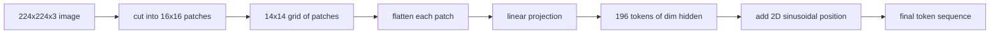

# 視覺編碼器的 Patch (Vision Encoder Patches)

> 讀取像素的視覺模型，需要一個替像素做的 tokenizer。Patch embedding 就是那個 tokenizer。把影像切成方格網格，把每個方格攤平，用一個線性層投影，再加上 2D 位置訊號，讓 transformer 知道每個方格原本在影像中的哪個位置。

**Type:** Build
**Languages:** Python
**Prerequisites:** Phase 19 lessons 30-37 (Track B foundations)
**Time:** ~90 分鐘

## 學習目標 (Learning Objectives)

- 把影像 tokenize 成固定長度的 patch embedding 序列。
- 實作以 `Conv2d` 為基礎的 patch 投影，其數學與 unfold-then-linear 一致。
- 建立確定性的 2D 正弦位置 embedding，讓 token 順序編碼空間位置。
- 在合成 fixture 上驗證 patch 數量、embedding 形狀，以及 `Conv2d`/unfold 的等價性。

## 問題 (The Problem)

Transformer 吃的是向量序列。影像是 3 通道的網格。把每個像素都當成 token，序列長度會爆炸：一張 224x224 的 RGB 影像有 150,528 個 token，12 層的 transformer 在 attention 上負擔不起。把影像當成一個巨大的扁平向量，則會丟掉局部性，attention 層無法挽回。編碼器前端的工作，是把像素網格壓縮成幾百個 token，每個 token 概括一塊方形區域。

Patch embedding 用一次線性投影解決這個問題。一張 224x224 的影像切成 16x16 的 patch，會產生 14x14 共 196 個 patch 的網格。每個 patch 從 `(3, 16, 16) = 768` 個像素值攤平成一個向量，然後線性層把它映射到模型的 hidden 維度。Transformer 看到的是 196 個維度為 `hidden`（通常是 768）的 token，再加上一個 CLS token。這就是網路其餘部分可以消化的序列。

## 核心概念 (The Concept)



### 為什麼是 patch，不是像素 (Why patches, not pixels)

Attention 對序列長度是二次方的。196 個 token 的序列，每個 head 每層要付 `196 * 196 = 38,416` 個 attention 分數；150,528 個 token 的序列則要 `150,528 * 150,528 = 22.6 billion`。Patch 讓 attention 運算量減少 590,000 倍，而且單一個 16x16 區域就帶有足夠的訊號，可供高階視覺任務使用。代價是損失單一 patch 內的細緻空間細節，這也是為什麼在需要精細定位時，下游多模態架構常常會多跑一條高解析度分支。

### 為什麼線性投影就夠了 (Why a linear projection is enough)

每個 patch 被視為獨立的向量。投影學到的是一組基底：邊緣偵測器、顏色濾鏡、簡單紋理。單一線性層很小（ViT-Base 是 `768 * 768 = 589,824` 個參數），訓練也快。更深的卷積 stem 也存在（「hybrid」ViT），但扁平的線性投影才是標準，而且大多數現代開放權重編碼器都採用這個形狀。

### `Conv2d` 的技巧 (The `Conv2d` trick)

沒有 padding 的 `Conv2d(in_channels=3, out_channels=hidden, kernel_size=patch_size, stride=patch_size)`，數值結果與 unfold-then-linear 相同，因為每個輸出位置都是把 patch 像素與一個濾波器做內積。卷積就是 patch 投影，而大多數正式環境的程式碼都這樣寫，因為它在 GPU 上更快，也少一次 reshape。

### 位置 embedding (Position embeddings)

Token 從投影出來時不帶任何順序。2D 正弦 embedding 給每個 token 一個固定的訊號，編碼它的 `(row, col)` 位置。Embedding 維度的一半用多種頻率的 sin/cos 編碼列位置；另一半編碼欄位置。這個編碼是確定性的，所以你可以在不重新訓練的情況下更換解析度，也能乾淨地內插到模型在訓練時從未見過的網格。

| 元件 | 形狀 | 參數 |
|------|------|------|
| Patch 投影 (`Conv2d`) | `(hidden, 3, patch, patch)` | `3 * P * P * hidden + hidden` |
| 位置 embedding（固定） | `(num_patches, hidden)` | 0（用算的，不是學的） |
| CLS token（學習而得） | `(1, hidden)` | `hidden` |

以 224 解析度的 ViT-Base/16 為例：投影有 590,592 個參數，CLS token 有 768 個，正弦位置為零。下一課 (59) 會在這個前端之上疊一個 12 層的 transformer。

### 以等價性作為健全性檢查 (Equivalence as a sanity check)

Patch 步驟有兩種寫法：`Conv2d` 投影，以及明確的 unfold-then-linear。對相同的權重，它們必須產生相同的輸出。如果不一樣，代表 unfold 的數學是錯的，編碼器的其他部分就是蓋在沙地上。本課的測試會驗證這個等價性。

```figure
ch-patch-tokenizer
```

## 動手做 (Build It)

`code/main.py` 實作了：

- `PatchEmbed`，一個包裝 `Conv2d` 做 patch 投影的 `nn.Module`。
- `sinusoidal_2d(grid_h, grid_w, dim)`，一個無狀態的函式，建立 2D 位置表。
- `VisionFrontEnd`，把 patch embedding、前置 CLS 與加上位置組合成一次 forward。
- 一個 `synthesize_image(seed)` 輔助函式，用 `numpy.random` 建立確定性的 224x224x3 fixture。
- 一個示範，讓一張 fixture 影像通過前端，並印出輸出形狀、CLS token 的 norm，以及位置 embedding 的其中一列。

執行它：

```bash
python3 code/main.py
```

輸出：224x224 的 fixture 被 tokenize 成形狀為 `(1, 197, 768)` 的序列。第一個 token 是 CLS；接下來的 196 個是 patch token。位置 embedding 的 norm 在同一列內是均勻的，這就是正弦訊號的特徵。

## 實際使用 (Use It)

同樣的 patch 前端出現在每個現代的視覺語言模型：CLIP ViT-L/14、SigLIP、DINOv2、Qwen-VL 系列與 InternVL 架構，全部都從 `Conv2d` patch 投影加上位置訊號開始。各系列之間的差異在下游（CLS 與無 CLS 的 pooling、register token、不同的 patch 大小 14 對 16、透過內插位置的動態解析度）。本課的前端是這些模型全都站在上面的基底。

## 測試 (Tests)

`code/test_main.py` 涵蓋：

- patch 數量符合 `(image_size / patch_size) ** 2`
- 輸出形狀符合 `(batch, num_patches + 1, hidden)`
- 在小 fixture 上，`Conv2d` 投影等於手動的 unfold-then-linear
- 正弦位置表在多次呼叫之間是確定性的
- CLS token 沿 batch 維度廣播且不會洩漏

執行它們：

```bash
python3 -m unittest code/test_main.py
```

## 練習 (Exercises)

1. 把正弦位置換成學習而得的 `nn.Parameter`，並在小型合成分類任務上比較第一個 epoch 的 loss。學習而得的位置在固定解析度下勝出；訓練後改變解析度時，正弦勝出。

2. 把 `Conv2d` 換成明確的 `nn.Unfold` 加 `nn.Linear`，並斷言輸出在浮點誤差內一致。同樣的數學，兩種寫法。

3. 加入非正方形 patch 大小的支援（例如寬幅輸入用 32x16），並驗證位置表能處理非正方形的網格。

4. 在 batch size 為 1、8、64 時，對 patch 步驟做效能剖析。Patch 投影很少是瓶頸；下游的 attention 層才是主導。

5. 把前端當作凍結的特徵萃取器，在 4 類合成形狀資料集（圓形、正方形、三角形、星形）上訓練。CLS token 的輸出應該可以線性分開。

## 關鍵術語 (Key Terms)

| 術語 | 意義 |
|------|------|
| Patch | 影像的方形子區域，通常是 14x14 或 16x16 |
| Patch embedding | 把一個攤平的 patch 線性投影到 hidden 維度 |
| Sequence length | Patch tokenize 之後的 token 數量，通常再加上 CLS |
| Sinusoidal position | 編碼 2D 網格座標的固定 sin/cos 訊號 |
| CLS token | 學習而得的向量，前置在序列開頭，作為 pooling head |

## 延伸閱讀 (Further Reading)

- An Image is Worth 16x16 Words (ViT, 2021)，patch-embed 的原始框架。
- Attention Is All You Need (2017)，本課改編為 2D 的正弦位置公式來源。
- DINOv2 論文，介紹 register token，這是你可以當作練習 6 加入的擴充。
