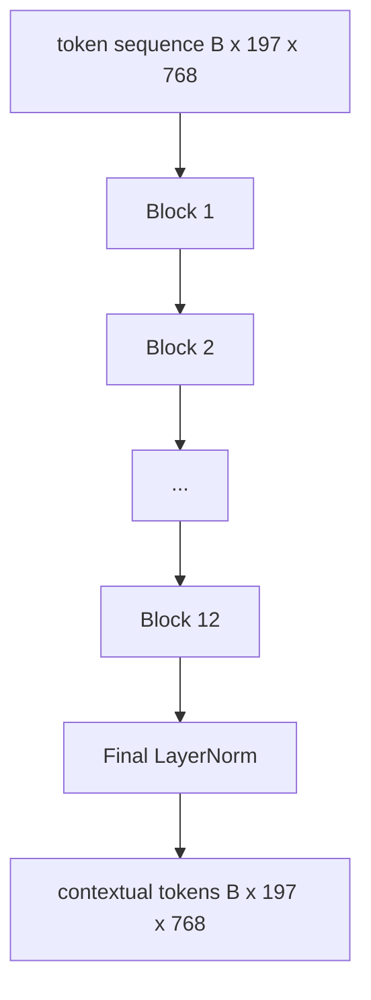
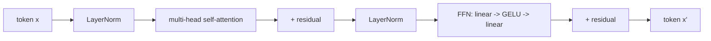

# Vision Transformer 編碼器 (Vision Transformer Encoder)

> 光有 patch 是看不見的。12 層、12 個 attention head 的 pre-LN transformer，把 patch token 序列轉成帶有上下文的 token 序列，而 CLS token 在最終的 hidden state 中聚合整張影像的特徵。本課是每個現代視覺語言模型的引擎室。

**Type:** Build
**Languages:** Python
**Prerequisites:** Phase 19 lessons 30-37 (Track B foundations)
**Time:** ~90 分鐘

## 學習目標 (Learning Objectives)

- 實作帶有 multi-head self-attention 與 feed-forward 子層的 pre-LN transformer block。
- 疊 12 個 block、每個 12 個 head，組成 ViT-Base 編碼器。
- 把第 58 課的 patch 前端接進編碼器，並執行一次 forward。
- 驗證 CLS token 聚合了每個 patch 的資訊。

## 問題 (The Problem)

Patch embedding 產生一個 197 個 token 的序列，每個 token 都是一個向量，對其他任何 patch 一無所知。一張貓的圖片需要每個 patch 知道哪些 patch 含有鬍鬚、哪些是背景、哪些是眼睛。Transformer 就是一層一層 attention 建立這種認知的機制。沒有它，patch 前端只是個聰明的 tokenizer，沒有任何理解。

標準配方是十二個 block 深、十二個 head 寬，採用 pre-LayerNorm 位置、GELU 啟動函數，以及 4 倍的 feed-forward 擴張。這個配方是 CLIP ViT-L、SigLIP、DINOv2、Qwen-VL 系列、InternVL，以及 2025-2026 年所有其他開放權重視覺編碼器的骨幹。這個配方穩定到你讀任何一篇論文時，除非明確說明，否則都可以假設是這個 block 形狀。

## 核心概念 (The Concept)





### Pre-LN 與 post-LN (Pre-LN vs post-LN)

原始的 Transformer 把 LayerNorm 放在 residual 之後。Pre-LN（LayerNorm 放在每個子層之前）是每個現代視覺語言模型都使用的版本，因為它不需要 learning-rate warm-up 的技巧就能穩定訓練。差別只在 forward 中的一行，但在 12 層以上的深度，gradient 流動的情況是天差地遠。

### Multi-head self-attention

每個 head 把 token 向量投影成自己的 `(query, key, value)` 三元組，維度為 `head_dim = hidden / num_heads`。在 `hidden = 768`、`heads = 12` 的情況下，每個 head 的 `dim = 64`。12 個 head 平行進行 attention，然後輸出串接回維度 768，再通過輸出投影。Multi-head 的重點是：一個 head 可以學「注意貓的眼睛」，另一個學「注意背景漸層」，彼此互不干擾。

### 為什麼 feed-forward 擴張 4 倍 (Why the 4x feed-forward expansion)

FFN 的形狀是 `hidden -> 4 * hidden -> hidden`，中間用 GELU。係數 4 是經驗值，自 2017 年起在語言與視覺 transformer 上都一直適用。較小（2 倍）會 underfit；較大（8 倍）在固定資料預算下會 overfit。MLP 是模型存放大部分學到的事實的地方，而較寬的中間層就是它們所在之處。

| 元件 | ViT-Base 規模的參數 |
|------|---------------------|
| 每個 block 的 qkv 投影 | `3 * 768 * 768 = 1.77M` |
| 每個 block 的輸出投影 | `768 * 768 = 590K` |
| 每個 block 的 FFN（4 倍擴張） | `2 * 768 * 4 * 768 = 4.72M` |
| 每個 block 的 LayerNorm | `4 * 768 = 3K` |
| 每個 block 總計 | 約 7.1M |
| 12 個 block | 約 85M |
| 加上前端 | 總共約 86M |

ViT-Base 是一個 86M 參數的編碼器。以 2026 年的標準來說很小（SigLIP-So400M 是 400M，Qwen-VL 的 ViT 是 675M），但架構除了寬度與深度外完全相同。

### 要不要 causal mask？(Causal mask or not?)

Vision Transformer 是 encoder-only 且雙向的：token `i` 可以 attend 任何 token `j`。沒有 mask。第 61 課的文字 decoder 中，文字 self-attention 會使用 causal mask（它對影像 patch 的 cross-attention 則不會），但在視覺編碼器內部，attention 是全連接的。

### CLS token 學到什麼 (What the CLS token learns)

CLS token 一開始是學習而得的參數，自己沒有任何 patch 內容，並透過每個 block 的 attention 累積資訊。到了最後一層，CLS 那一列是整張影像的向量摘要；下游的 head 把這個單一向量投影成分類 logits、對比式 embedding，或文字 decoder 的 cross-attention key。

```figure
ch-cls-funnel
```

## 動手做 (Build It)

`code/main.py` 實作了：

- `MultiHeadSelfAttention`，包含 `qkv` 與輸出投影、scaled-dot-product attention 的數學，以及形狀斷言。
- `FeedForward`，4 倍擴張的 GELU MLP。
- `Block`，組合 attention 與 feed-forward 子層並加上 residual 的 pre-LN block。
- `ViT`，12 個 block 的堆疊，外加最後的 LayerNorm。
- `VisionEncoder`，把第 58 課的 `VisionFrontEnd` 接到 `ViT` 堆疊，並暴露 `forward()`，回傳帶有上下文的序列與 pooled CLS 向量。
- 一個示範，讓合成的 224x224 fixture 影像通過完整編碼器，並印出輸入形狀、輸出形狀、參數數量，以及每隔一層的 CLS norm。

執行它：

```bash
python3 code/main.py
```

輸出：fixture 被編碼成 `(1, 197, 768)` 的 tensor。CLS 的 norm 隨著層層組合而往上漂移，然後在最後的 LayerNorm 穩定下來。總參數量約 86M。

## 實際使用 (Use It)

這裡定義的編碼器，除了寬度與深度，與 2025-2026 年每個開放權重 VLM 內部的 block 堆疊相同。差異在於：

- **寬度與深度。** ViT-Large 是 `hidden=1024, depth=24, heads=16`；SigLIP So400M 是 `hidden=1152, depth=27, heads=16`。同樣的 block。
- **Pooling head。** CLS pooling（本課）、average pooling (SigLIP) 與 attention pooling（較新的 VLM）。
- **位置處理。** 固定正弦（第 58 課）、學習而得的 1D、ALiBi 與 2D RoPE。Block 的數學不變。
- **Register token。** DINOv2 在前面加 4 個額外的學習 token。只要一行程式碼。

這個 block 堆疊就是基底。接下來的課程 (60-63) 都站在它之上。

## 測試 (Tests)

`code/test_main.py` 涵蓋：

- 單一 block 保持形狀，且對輸入 batch size 具不變性
- attention 分數沿 key 軸加總為一（softmax 健全性檢查）
- residual 路徑已接上（零輸入仍會透過 CLS token 產生非零輸出）
- 4 層堆疊的 forward 產生正確的形狀
- gradient 從 CLS 輸出流回 patch 投影

執行它們：

```bash
python3 -m unittest code/test_main.py
```

## 練習 (Exercises)

1. 加入 register token（在 CLS 之後前置 4 個學習向量）並重新執行。透過最後一層 softmax 分佈的 entropy，比較 attention map 的平滑度。

2. 把 pre-LN 換成 post-LN，並在合成形狀分類器上訓練一個 epoch。觀察哪一個在沒有 LR warm-up 的情況下能穩定訓練。

3. 實作 causal masking，作為 `attn_mask` 參數，讓同一個 block 能重複用作 decoder block。Mask 的形狀是 `(seq, seq)`，下三角。

4. 用 `torch.profiler` 在 batch size 為 1、8、64 時剖析 forward。主導牆上時間的是 MLP 層，而不是 attention。

5. 把其中一個 attention head 的 q-k-v 投影換成低秩的 LoRA adapter，凍結其餘部分，並驗證 gradient 只流向你預期的地方。

## 關鍵術語 (Key Terms)

| 術語 | 意義 |
|------|------|
| Pre-LN | LayerNorm 套用在每個子層之前，而不是之後 |
| Self-attention | 每個 token 對同一序列中的所有其他 token 做 attention |
| Multi-head | hidden 維度被分到 `H` 個獨立的 attention head |
| FFN expansion | feed-forward 層先加寬到 `4 * hidden`，再收縮回來 |
| CLS pooling | 以第一個 token 的最終 hidden state 作為影像摘要 |

## 延伸閱讀 (Further Reading)

- An Image is Worth 16x16 Words (ViT, 2021)，編碼器的配方。
- DINOv2 (2023)，register token 與自監督預訓練目標。
- SigLIP (2023)，average-pooling 變體，以及第 62 課使用的 sigmoid 對比式 loss。
