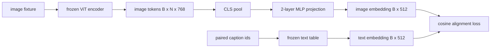

# 模態對齊的投影層 (Projection Layer for Modality Alignment)

> 視覺編碼器產生影像 token。文字 decoder 消費文字 token。兩者活在不同的向量空間。一個小型的兩層 MLP 把影像 token 投影到文字 embedding 空間，而對配對 caption 的 cosine alignment loss 把兩個空間拉到一致。這個投影是視覺語言模型中最小的一塊，卻是對遷移最重要的一塊。

**Type:** Build
**Languages:** Python
**Prerequisites:** Phase 19 lessons 30-37 (Track B foundations)
**Time:** ~90 分鐘

## 學習目標 (Learning Objectives)

- 建立兩層 MLP 投影，把影像特徵映射到文字 embedding 空間。
- 建構 mock 文字 embedding 表（沒有預訓練 tokenizer，也沒有真實語料）。
- 計算投影後的影像 token 與配對 caption embedding 之間的 cosine alignment loss。
- 在凍結視覺編碼器與凍結文字表的情況下，只訓練投影。

## 問題 (The Problem)

你有一個視覺編碼器（第 58-59 課），產生維度為 `vision_hidden = 768` 的 token。你有一個想接在上面的文字 decoder，embedding 維度為 `text_hidden = 512`（其他數字也一樣合理）。Decoder 期待文字形狀的 token。影像 token 不是文字形狀：它們活在編碼器在純視覺預訓練期間學到的基底中，與 decoder 的詞向量沒有任何關係。

兩層 MLP 投影（linear、GELU、linear）彌補了這個落差。它夠小（約 `768 * 1024 + 1024 * 512 = 1.3M` 個參數），在單一 GPU 上幾分鐘就能訓練完，而且是對齊階段中唯一需要學習的部分。視覺編碼器保持凍結。文字 embedding 表保持凍結。只有投影在動。這是 LLaVA 在 2023 年推出的配方，BLIP-2 把它重新包裝成 Q-Former，之後每個開放權重 VLM 也以某種形式採用。

## 核心概念 (The Concept)



### 投影之前先 pooling (Pooling before projection)

視覺編碼器輸出 197 個 token。文字端只有一個 caption 層級的 embedding。要對齊它們，每個樣本需要一個影像層級的向量。CLS pooling 最簡單：取編碼器的第一個 token 並投影。對全部 197 個 token 做 mean pooling 是另一個選項，也是 SigLIP 所用的做法。兩者都把 197 個向量壓成一個。

### 為什麼是兩層而不是一層 (Why two layers and not one)

單一線性投影可以旋轉與縮放，但如果兩個空間的曲率不匹配，它無法修正基底。在兩個線性層之間放 GELU，讓投影有一個非線性的彎折，經驗上這足以把 CLIP 風格的特徵對齊到語言模型 embedding。更深的投影（LLaVA-NeXT 用 GLU；Qwen-VL 用一疊 attention 層）是延伸；兩層 MLP 是標準的 baseline，也是 BLIP-2 的 Q-Former 投影 head 底層所用的東西。

| 層 | 形狀 | 參數 |
|----|------|------|
| fc1 | `(vision_hidden, projection_hidden)` | `768 * 1024 + 1024` |
| activation | GELU | 0 |
| fc2 | `(projection_hidden, text_hidden)` | `1024 * 512 + 512` |

`768 -> 1024 -> 512` 的 head 約 1.3M 個參數。

### Cosine alignment loss

對齊不代表 `image_emb == text_emb`。對齊的意思是 `image_emb` 在共同空間中與 `text_emb` 指向同一個方向。Cosine loss 是 `1 - cos_sim(image, text)`，範圍從 0（完全對齊）到 2（相反）。訓練會逐對把它推向零。第 62 課會推廣到對比式 batch (InfoNCE)，其中每張影像都必須比 batch 裡任何其他 caption 更接近自己的 caption；本課使用逐對的版本，讓動態過程清楚可見。

### 凍結編碼器是關鍵 (Frozen encoder is the trick)

視覺編碼器有 86M 個參數。文字表還有幾百萬個。從 mock 語料訓練所有這些是行不通的。兩者都凍結，代表投影的 1.3M 個參數是唯一在變的東西，在合成配對上跑幾百步就足以把 loss 壓下來。這正是每個基於 adapter 的 VLM 的運作形狀：重的部分保持凍結，輕的橋樑去訓練。

```figure
ch-projection-bridge
```

## 動手做 (Build It)

`code/main.py` 實作了：

- `MLPProjector(in_dim, hidden_dim, out_dim)`，帶 GELU 啟動函數的兩層線性 MLP。
- `MockTextEmbedding(vocab_size, dim)`，由 seed 確定性初始化的凍結 embedding 表。
- `make_pair(seed, vocab_size)`，合成一個配對的 (image, caption) 樣本。Caption 是短的 id 序列；caption embedding 是對 token embedding 做 mean pooling。
- `cosine_alignment_loss(image_emb, text_emb)`，逐對的 `1 - cos_sim` 目標。
- 一個訓練迴圈，在 32 組合成配對上（循環使用）訓練投影 200 步，視覺編碼器與文字表皆凍結，並每 25 步印出 loss。

執行它：

```bash
python3 code/main.py
```

輸出：訓練回報顯示 loss 在 200 步內從初始約 1.07 降到約 0.80，證明單靠投影就能把影像 token 拉向文字空間。每一對最終的 cosine 相似度也會印出。

## 實際使用 (Use It)

同樣的模式出現在每個開放權重 VLM：

- **LLaVA 1.5。** 從 CLIP-ViT-L hidden 到 LLaMA embedding 維度的兩層 GELU MLP 投影。凍結視覺編碼器、凍結 LLM，只訓練投影（第二階段再解凍 LLM）。
- **BLIP-2。** Q-Former 讓 32 個學習 query token 對影像 token 做 cross-attention，然後投影到 LLM embedding 維度。Q-Former 最末端的投影 head 就是本課 MLP 的對應物。
- **MiniGPT-4。** 從 BLIP-2 Q-Former 輸出到 Vicuna embedding 維度的單一線性投影。
- **Qwen-VL。** 多層的 cross-attention adapter，但最後一塊同樣是投影到 LM embedding 維度。

形狀各異，角色相同：pool 影像 token、投影到文字 embedding 維度、單獨訓練。

## 測試 (Tests)

`code/test_main.py` 涵蓋：

- projector 輸出形狀符合設定的 `out_dim`
- 凍結的文字 embedding 表沒有 `requires_grad` 的參數
- cosine loss 在相同向量上為零，在反向平行的向量上為 2
- projector 的 gradient 在一次 backward 之後會流動
- 訓練迴圈讓第 0 步到第 200 步之間的 loss 下降

執行它們：

```bash
python3 -m unittest code/test_main.py
```

## 練習 (Exercises)

1. 把 CLS pooling 換成對 196 個 patch token 的 mean pooling，並比較 200 步後的最終 loss。在合成資料上，mean pooling 通常訓練得較快；在自然影像上，CLS 的樣本效率較高。

2. 在 cosine loss 加上學習而得的純量 temperature（`cos / tau`），並觀察 `tau` 太小（gradient 雜訊）或太大（loss 停在高處）時會發生什麼事。

3. 把兩層 MLP 換成單一線性層，並量化 loss 的差距。非線性在自然影像特徵上影響較大，在合成特徵上較小。

4. 對 projector 權重加上小的 L2 懲罰，觀察它如何與 cosine alignment 交互作用（cosine 與尺度無關，所以這個懲罰主要是縮小未使用的方向）。

5. 保存 projector 權重，然後在凍結的視覺編碼器旁邊重新載入，並在沒有 backward 的情況下執行推論。驗證 projector 是你唯一需要發佈的新成品；編碼器在部署時仍然要跑它的 forward。

## 關鍵術語 (Key Terms)

| 術語 | 意義 |
|------|------|
| Modality alignment | 讓影像與文字 embedding 在同一個共享空間中可以比較的動作 |
| Projection head | 把一個空間映射到另一個空間的小模組，通常是 2 層 MLP |
| Cosine similarity | 內積除以 L2 norm 的乘積 |
| Frozen encoder | 視覺（或文字）模型的所有參數都是 `requires_grad=False` |
| Mock corpus | 使用合成配對，讓訓練不依賴資料集下載 |

## 延伸閱讀 (Further Reading)

- LLaVA 論文，兩階段訓練（先投影，再解凍 LM）。
- BLIP-2 論文，以 Q-Former 作為可學習投影的替代方案。
- Qwen-VL 技術報告，以 cross-attention adapter 作為更深的投影 head。
