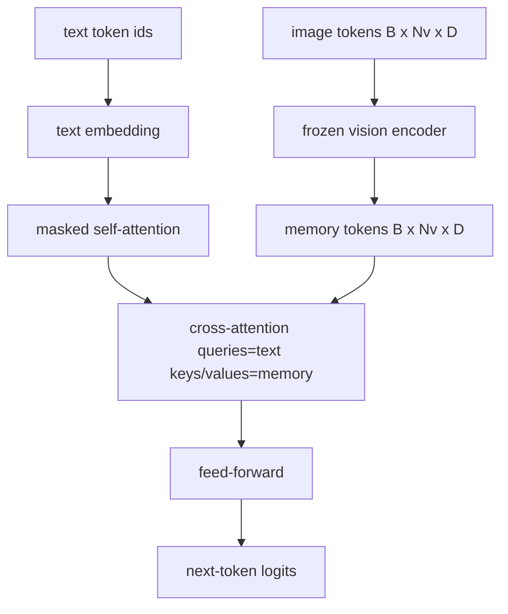
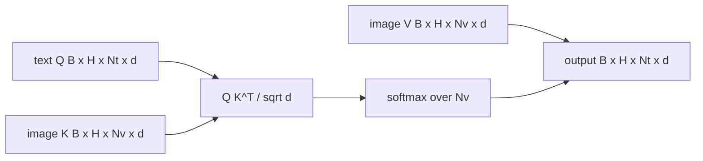

# Cross-Attention 融合 (Cross-Attention Fusion)

> 投影層把一個影像向量與一個 caption 向量對齊。真正的視覺語言 decoder 需要每個文字 token 都 attend 每個 patch token，讓模型能把每個詞對應到某個區域。Cross-attention 就是這種對應發生的方式。文字負責 query；視覺的 key 與 value 負責回答。本課建立 cross-attention block、causal 文字 self-attention，以及讓兩者都合法的 mask 形狀。

**Type:** Build
**Languages:** Python
**Prerequisites:** Phase 19 lessons 30-37 (Track B foundations)
**Time:** ~90 分鐘

## 學習目標 (Learning Objectives)

- 實作 multi-head cross-attention，其中 query 串流是文字，key/value 串流是視覺。
- 組合 decoder block：causal self-attention + cross-attention + feed-forward。
- 把 mask 形狀弄對：self-attention 用 causal mask，cross-attention 不用 mask。
- 用批次的文字 token 與固定的影像 token 池執行一次 forward。

## 問題 (The Problem)

把影像 token 與文字 token 串接成一個序列，是融合的其中一種選項（early fusion，Chameleon 與 Emu3 走的路）。Cross-attention 是另一種（late fusion，Flamingo 引入、之後每個 Flamingo 形狀的 decoder 都沿用的路）。在 late fusion 中，文字 decoder 只對純文字 token 運作，並在每一層透過 cross-attention 伸手進影像串流。

Late fusion 有兩個優點。第一，文字串流保持乾淨，模型保有純文字的能力。第二，影像串流每張影像只算一次，之後每個 decode 步驟重複使用，所以即使是長 caption，生成也很便宜。代價是每個 block 多一個 attention 子層。

## 核心概念 (The Concept)





### Mask 的形狀 (Mask shapes)

Decoder block 內的兩個 attention 需要不同的 mask：

| Attention | Query 長度 | Key 長度 | Mask | 原因 |
|-----------|------------|----------|------|------|
| Self-attention | `Nt`（文字） | `Nt`（文字） | Causal：下三角 `(Nt, Nt)` | 文字 token 在自迴歸期間不能往前看 |
| Cross-attention | `Nt`（文字） | `Nv`（視覺） | 無 mask | 整張影像對每個文字位置都是可見的 |

本課包含一個形狀驗證函式，讓搞混兩者的錯誤以 `ValueError` 浮現，而不是變成悄悄壞掉的 loss 曲線。

### 為什麼 cross-attention 不用 mask (Why no mask on cross-attention)

在任何文字被生成之前，影像就已經被完整觀察了。Caption 的 token `t` 可以 attend 影像的任何 patch；影像 patch 之間沒有時間順序。有些 Flamingo 變體在交錯多張影像與文字片段時，會加上逐樣本的 masking 模式，但對於單張影像加一個 caption，cross-attention 看得到所有東西。

### Key/value 快取 (Key/value caching)

影像的 key 與 value 在 decode 開始時算一次，並存放在快取中。每個新的文字 token 都使用快取，不必重新計算。這就是推論時 captioning 很快的原因：沉重的 ViT 只跑一次；cross-attention 在每個步驟重複使用它的 key 與 value。本課暴露了這個快取，並測試快取命中的路徑。

### Block 的組成 (Block composition)

Decoder block 的執行順序：pre-LN -> self-attention -> residual -> pre-LN -> cross-attention -> residual -> pre-LN -> feed-forward -> residual。三個子層，各有自己的 LayerNorm。Flamingo 論文在 cross-attention 上加了以零初始化、可學習的 tanh gate，讓凍結的語言模型一開始維持不變，訓練也保持穩定；標準的 baseline（這裡使用的）沒有 gate。

```python
class DecoderBlock:
  def forward(self, text_tokens, image_tokens, text_mask, cross_mask):
      text_tokens = text_tokens + self.self_attn(self.ln1(text_tokens),
                                                 mask=text_mask)
      text_tokens = text_tokens + self.cross_attn(self.ln2(text_tokens),
                                                  image_tokens,
                                                  mask=cross_mask)
      text_tokens = text_tokens + self.ffn(self.ln3(text_tokens))
      return text_tokens
```

```figure
ch-crossattn-fan
```

## 動手做 (Build It)

`code/main.py` 實作了：

- `CrossAttention(hidden, heads)`，具有獨立 `q` 與 `kv` 投影的 multi-head cross-attention。
- `CausalSelfAttention(hidden, heads)`，標準 decoder 中帶 mask 的 self-attention。
- `DecoderBlock`，以 pre-LN residual 組合三個子層。
- `VisionLanguageDecoder`，四層 decoder，餵入 mock 視覺編碼器輸出與小型文字 embedding 表。
- `causal_mask(length)`，回傳 `(length, length)` 的下三角布林 tensor。
- 一個示範，餵入兩個長度為 10 的文字序列批次與長度為 197 的影像 memory，並印出輸出形狀、self-attention mask 形狀，以及每個位置的 cross-attention 輸出 norm。

執行它：

```bash
python3 code/main.py
```

輸出：decoder 產生 `(2, 10, text_vocab)` 的 logits tensor。Mask 形狀是 `(10, 10)`。KV-cache 重用檢查確認快取路徑與未快取路徑的 logits 完全一致。

## 實際使用 (Use It)

Cross-attention 出現在兩個正式環境的系列中：

- **Flamingo 與 IDEFICS。** 每隔 K 個語言模型 block 插入一個 cross-attention 子層，LM 保持凍結。視覺語言 adapter 就是 cross-attention block 加上它的 gate。
- **BLIP-2。** Q-Former 讓一組固定的 32 個 query token 對影像特徵做 cross-attention，然後把這些 query 投影到 LM embedding 空間。

本課 block 的形狀直接對應這兩者。Mask 的紀律（self 用 causal，cross 不用）是相同的。

## 測試 (Tests)

`code/test_main.py` 涵蓋：

- causal mask 是下三角，並符合預期的布林形狀
- 不論 key 長度為何，cross-attention 輸出形狀都是 `(B, Nt, hidden)`
- KV-cache 路徑與未快取路徑在浮點誤差內一致
- 文字與影像串流之間的形狀不符，會丟出清楚的 `ValueError`
- 完整的 decoder forward 產生正確的 batch 與序列形狀

執行它們：

```bash
python3 -m unittest code/test_main.py
```

## 練習 (Exercises)

1. 在 cross-attention 的 residual 上加入學習而得的 tanh gate（Flamingo 的技巧），並驗證訓練能從接近零的初始 gate 收斂。Gate 從 0 開始；模型會先恢復純文字行為，再混入影像串流。

2. 實作交錯 attention，讓同一個 decoder 消費多張影像與多個文字片段。建立逐樣本的 cross-attention mask，防止文字片段 2 去 attend 影像 1。

3. 在 `Nt=64, Nv=576`（較高解析度下的 24x24 網格）時，剖析 cross-attention 與 self-attention 層。Cross-attention 的成本是 `Nt * Nv`，在高影像解析度下占主導。

4. 在 cross-attention map 上加入 query 端的 dropout，並在示範中量測 caption 的多樣性（cross map 的 dropout 越高，caption 樣本變異越大）。

5. 把 cross-attention 層換成 Q-Former 風格的 attention block，其中固定的 32 個 token query 池在每層對影像特徵 attend 一次。

## 關鍵術語 (Key Terms)

| 術語 | 意義 |
|------|------|
| Late fusion | 文字與視覺保持在各自獨立的串流；cross-attention 在每個 block 把它們銜接起來 |
| Cross-attention | Q 來自一個串流，K 和 V 來自另一個串流 |
| Causal mask | 下三角的布林 mask，防止自迴歸期間往前看 |
| KV cache | 影像的 key 與 value 只存一次，並在每個 decode 步驟重複使用 |
| Memory tokens | decoder 伸手去取的、被凍結的影像 token |

## 延伸閱讀 (Further Reading)

- Flamingo (2022)，帶 gated cross-attention 的標準 late-fusion 設計。
- BLIP-2 (2023)，Q-Former，是偽裝成可學習 query 池的 cross-attention block。
- IDEFICS (2023)，Flamingo 配方的開放權重重現。
