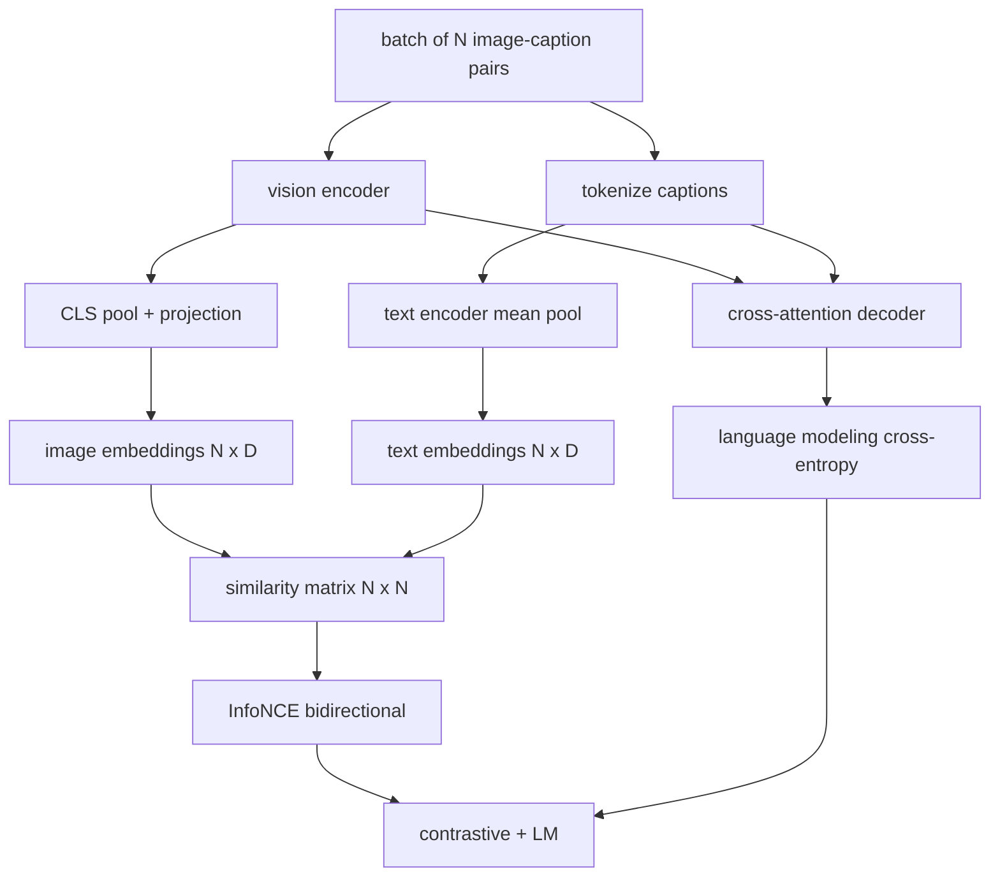

# 視覺語言預訓練 (Vision-Language Pretraining)

> 編碼器、投影與 decoder 都接好了。現在把它們一起訓練。兩個目標驅動學習：對比式的影像文字 loss (InfoNCE)，把配對的樣本在共同 embedding 空間中拉近；以及語言建模 loss，要求 decoder 為每張影像寫 caption。兩者結合，教會網路既能為 caption 找到正確的影像，也能為影像寫出 caption。

**Type:** Build
**Languages:** Python
**Prerequisites:** Phase 19 lessons 30-37 (Track B foundations)
**Time:** ~90 分鐘

## 學習目標 (Learning Objectives)

- 在一個影像 caption 配對的 batch 上實作 InfoNCE 對比式 loss。
- 把對比式 loss 與自迴歸語言建模 loss 組合起來。
- 合成一個 200 組配對的 mock 影像 caption 語料，不需要下載真實資料集。
- 執行 50 步的示範訓練迴圈，並觀察兩個 loss 都在下降。

## 問題 (The Problem)

視覺語言模型需要兩種技能。它必須排序：給定 caption，從眾多影像中找出正確的那張。它必須生成：給定影像，寫出 caption。只用其中一種技能預訓練模型，只會得到半個系統。CLIP 把排序做得很好，但不能寫 caption。GPT-4V 能寫 caption，但用另一個檢索 head 做排序。多目標預訓練一次就能同時得到兩者。

InfoNCE 處理排序的那一半。對於 N 組配對的 batch，模型把 N 組配對視為正樣本，把 `N^2 - N` 組不匹配的配對視為負樣本，然後對所得的 `(N, N)` 相似度矩陣做 cross-entropy loss。LM loss 處理生成的那一半：以影像為條件的標準 next-token 預測。兩個 loss 都是可微分的，並共用編碼器與投影器的權重；decoder 只靠 LM loss 訓練。

## 核心概念 (The Concept)



### 一段話講完 InfoNCE (InfoNCE in one paragraph)

把 N 個影像 embedding 堆成列，N 個文字 embedding 也堆成列。兩者都做 L2 正規化。計算 `N x N` 的矩陣 `S = I T^T / tau`，其中 `tau` 是學習而得的 temperature。對角線上的項目是配對；非對角線的項目是負樣本。套用 cross-entropy，目標 `argmax` 沿著對角線走：第 `i` 列的最大值應該在第 `i` 欄。沿著欄也對稱地做一次。總和是兩者的平均。這就是八行程式的 CLIP loss。

### Temperature 很重要 (Temperature matters)

Temperature `tau` 控制 softmax 有多尖銳。太小（例如 `tau = 0.01`），gradient 只來自最困難的那個負樣本，訓練很吵。太大則 softmax 變平，gradient 消失。CLIP 把 `tau` 當作參數來學；這裡的示範也這麼做。

### 語言建模 loss (Language modeling loss)

Decoder 透過 cross-attention 消費影像 memory token，並在每個位置預測下一個文字 token。Loss 是標準的 cross-entropy，目標是下一個位置。Padding 位置會從 loss 中遮掉。

### 結合兩個 loss (Combining the losses)

`total = contrastive + lm_weight * lm`，其中 `lm_weight` 是純量（通常為 1.0）。兩個 loss 把 gradient 共同傳進編碼器與投影；decoder 只從 LM loss 接收 gradient。這是 CoCa 與 BLIP 使用的多任務配方，只是權重不同。SigLIP 只保留對比式項，並把 softmax 換成 sigmoid 配對 loss。

| 元件 | Loss 曲面 | 影響 |
|------|-----------|------|
| InfoNCE | 共同空間中的配對排序 | 編碼器 + 投影 + 文字 head |
| LM | 以影像為條件的 token 預測 | 編碼器 + 投影 + decoder |
| 合併 | 多任務 | 整個堆疊 |

### 為什麼示範只要 50 步就夠 (Why 50 steps is enough for a demo)

Mock 語料是一個合成的 200 組配對集合，包含隨機影像與隨機 caption id。以 batch size 16 做 50 步 SGD 之後，兩個 loss 都明顯下降，即使絕對值仍高於真實資料模型能達到的水準。示範的重點是確認 gradient 的管線從頭到尾都運作，而且加入 LM loss 不會讓對比式目標不穩定。

```figure
ch-infonce-diagonal
```

## 動手做 (Build It)

`code/main.py` 實作了：

- `MultimodalModel`，結合小型 ViT 編碼器、MLP 投影器、小型文字端編碼器（對 embedded id 做 mean-pool），以及第 61 課的 cross-attention decoder。
- `info_nce_loss(image_emb, text_emb, temperature)`，雙向的 CLIP 風格對比式 loss。
- `lm_loss(logits, target_ids, padding_id)`，帶 mask 的 next-token cross-entropy。
- `make_mock_corpus(seed, n_pairs)`，回傳 200 組確定性的 (image, caption_ids) 配對。
- 一個訓練迴圈，以 batch size 16、Adam optimizer 與學習而得的 log-temperature 參數，執行 50 步。兩個 loss 每 5 步印出一次。

執行它：

```bash
python3 code/main.py
```

輸出：對比式 loss 從約 `ln(16) = 2.77` 往 2.4 下降；LM loss 從隨機均勻的 baseline `ln(512) ≈ 6.24` 下降到約 4.7。兩者都下降，證明 gradient 接線正確。真實的模型會訓練數百萬步；動態過程是一樣的。

## 實際使用 (Use It)

這是以下模型所採用的同一套 loss 配方：

- **CLIP (2021)。** 只有影像文字對比式，另外有獨立的凍結編碼器 caption probe。
- **CoCa (2022)。** 在同一個模型中結合影像文字對比式與影像 captioning 的 LM loss。正是本課所建立的模式。
- **BLIP (2022) 與 BLIP-2。** 對比式加 LM 加影像文字匹配 head。三個 loss 結合。
- **SigLIP (2023)。** 把 InfoNCE 換成 sigmoid 配對 loss；對比式的角色相同，函數形式不同。
- **LLaVA 系列。** 兩階段訓練，第一階段是對齊（在凍結 LM 上做 cosine），第二階段在解凍 LM 的情況下加入 LM loss。第 60 課對應第一階段；本課對應第二階段。

## 測試 (Tests)

`code/test_main.py` 涵蓋：

- InfoNCE loss 在影像/文字列之間是對稱的
- 當相似度矩陣是由大的正數構成的完美對角線時，InfoNCE loss 回傳 0
- LM loss 正確地遮掉 padding 位置
- 模型 forward 能產生兩個 loss 且沒有錯誤
- 5 步訓練迴圈會降低合併後的 loss

執行它們：

```bash
python3 -m unittest code/test_main.py
```

## 練習 (Exercises)

1. 把 InfoNCE 換成 SigLIP 風格的 sigmoid 配對 loss，並在 mock 語料上比較收斂情況。

2. 加入 hard-negative mining 步驟：每隔一個 batch，從前一個 batch 選出最難的非對角線配對並附加進來。訓練並檢查對比式 loss 是否下降得更快。

3. 在共同 embedding 之上加入影像文字匹配的二元 head（真/假：這兩者是否匹配？）作為第三個 loss，重現 BLIP 的三個 head 設定。

4. 把 mock 語料換成從 Markov chain 抽出的 caption-id 序列，其轉移矩陣以影像雜湊為條件。Captioning 的 loss 應該會再下降，因為有真正可學習的訊號。

5. 用 `lm_weight = 0` 與 `lm_weight = 1` 各訓練一次同一個模型。比較對比式 loss；LM loss 不應該使排序目標退化。

## 關鍵術語 (Key Terms)

| 術語 | 意義 |
|------|------|
| InfoNCE | Noise contrastive estimation：對相似度矩陣做 cross-entropy |
| Temperature | 控制對比式 softmax 有多尖銳的純量 |
| Hard negative | 模型覺得容易混淆的非對角線配對，適合用來取樣 |
| LM loss | captioning 端的標準 next-token cross-entropy |
| Joint embedding space | 投影之後，影像與文字向量所在的共享空間 |

## 延伸閱讀 (Further Reading)

- CLIP 論文，原始的對比式配方。
- CoCa 論文，在一個模型中結合對比式與 captioning。
- SigLIP 論文，sigmoid 配對 loss 變體，以及它為何更容易擴展。
