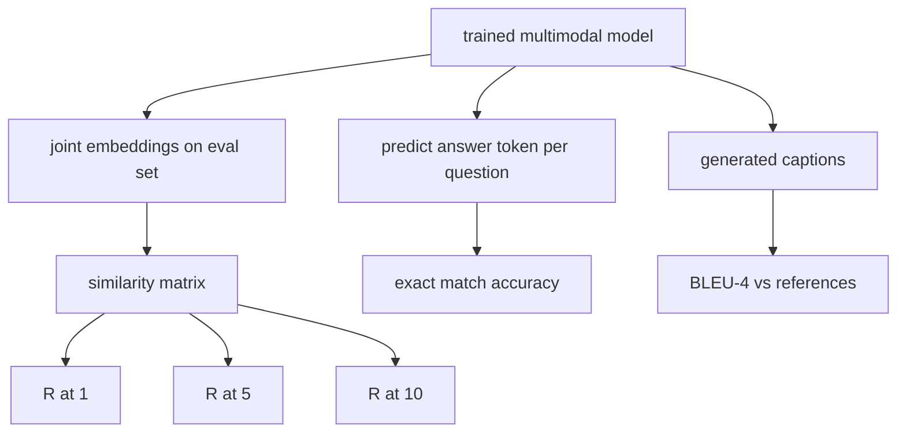

# 多模態評估 (Multimodal Evaluation)

> 訓練只是迴圈的一半。另一半是量測。本課從基本元件建立三個評估面向：影像 caption 檢索，以 R@1、R@5、R@10 回報；視覺問答，以 exact match 準確率回報；以及影像 captioning，以 BLEU-4 回報。每個指標都是模型輸出與合成評估套件之上的函式，幾秒就能跑完。

**Type:** Build
**Languages:** Python
**Prerequisites:** Phase 19 lessons 58-62 (Track E foundations: encoder, transformer, projection, cross-attention fusion, pretraining)
**Time:** ~90 分鐘

## 學習目標 (Learning Objectives)

- 從影像與 caption embedding 之間的相似度矩陣計算 Recall@K。
- 從把 (image, question) 配對映射到固定答案詞彙的模型，計算 exact-match VQA 準確率。
- 不使用任何外部函式庫，從生成與參考的 token 序列計算 BLEU-4。
- 對建立在第 62 課訓練好的模型之上的合成套件，執行這三個評估。

## 問題 (The Problem)

誘惑在於當訓練 loss 進入平台期就宣告多模態模型完成。訓練 loss 衡量的是對訓練分佈的擬合；它並不衡量模型能否在保留的 batch 中排序配對、回答問題，或寫出人類會接受的 caption。有三個標準的評估面向：

- **檢索 (R@1, R@5, R@10)。** 為查詢 caption 建立共同 embedding；依 cosine 對評估池中的每張影像排序；回報配對的影像是否落在前 1、前 5、前 10。對稱（影像到文字）的形式以相同方式執行。
- **視覺問答 (exact match)。** 給定 (image, question)，模型輸出一個答案 token。Exact match 是每個樣本一個位元：預測的答案是否等於參考答案？對評估集取平均。
- **Captioning (BLEU-4)。** 生成 caption。計算與參考 caption 比較之 1-gram 到 4-gram precision 的幾何平均，並加上簡短懲罰 (brevity penalty)。多參考是標準形式（一張影像，多個參考 caption）。

每個指標都是薄薄的函式。本課把它們全部寫成程式碼，讓數學具體、整個介面都在你的掌控之中。真正的 benchmark 套件（MS-COCO、VQA v2、GQA、OK-VQA）可以接上同樣的函式形狀。

## 核心概念 (The Concept)



### 從相似度矩陣算 Recall@K (Recall@K from a similarity matrix)

建立影像與 caption embedding 之間的 `(N, N)` cosine 相似度矩陣。對每一列，依相似度遞減排序各欄。Recall@K 是對角線欄索引落在前 K 個位置的列所占的比例。對稱的 Recall@K（caption 到影像）在轉置矩陣上計算。兩個數字都會回報。對於 N=100 的評估，R@1 = 0.6 表示 100 個 caption 中有 60 個把正確的影像檢索為第一名。

### VQA exact match

對每個 (image, question, answer)，編碼影像、對問題做 embedding、透過 decoder 融合，並讀出下一個 token。預測的 token id 與參考 id 比較；相等就算正確。對評估集取平均。真正的 VQA 資料集每個問題附帶多個人工標註的答案，並使用軟準確率公式（至少 3 位標註者同意為 1.0，以下依比例縮放）；本課為了清楚，使用單一答案的 exact match。

### BLEU-4

```math
\text{BLEU-4} = \text{BP} \cdot \exp\big(\text{mean}(\log p_1, \log p_2, \log p_3, \log p_4)\big)
```

其中 `p_n` 是修正後的 n-gram precision（出現在任何參考中的生成 n-gram 的截斷計數，除以生成 n-gram 的總數），`BP` 是簡短懲罰：

```math
\text{BP} = \begin{cases} 1 & \text{if generated length} > \text{reference length} \\ \exp(1 - r/g) & \text{otherwise, where } r \text{ is reference length and } g \text{ is generated} \end{cases}
```

在小樣本中，某些 `p_n` 為零，需要平滑。實作使用 Chen 與 Cherry 的「method 1」（對任何為零的計數，分子與分母都加 1），這是低計數情況下最安全的預設值。

### 合成評估套件 (Synthetic eval suite)

50 個樣本的評估套件，以第 62 課使用的同一種 mock 語料模式，用保留的 seed 在記憶體中建立。套件由三份清單組成：

- `pairs`：用於檢索的 50 組 (image, caption_ids) 配對。
- `vqa`：50 組 (image, question_ids, answer_id) 三元組。
- `caps`：50 筆 (image, [reference_caption_ids, ...]) 項目，每張影像最多 3 個參考。

套件由 seed 決定、具確定性，並且與訓練語料分開保留，所以這些指標是在模型從未見過的資料上計算的。把套件保存成 JSON 留作練習（見下方）。

| 指標 | 範圍 | 隨機 baseline (N=50) |
|------|------|----------------------|
| R@1 | 0 到 1 | 0.02 (1 / N) |
| R@5 | 0 到 1 | 0.10 |
| R@10 | 0 到 1 | 0.20 |
| VQA EM | 0 到 1 | 1 / vocab |
| BLEU-4 | 0 到 1 | 很小但不為零 |

對於在合成資料上訓練 50 步的 run，指標預期不會很高；預期是高於隨機 baseline，這也是示範所檢查的。

```figure
ch-recall-window
```

## 動手做 (Build It)

`code/main.py` 實作了：

- `recall_at_k(sim_matrix, k)`，對兩個方向都回傳 `[0, 1]` 內的 float。
- `vqa_exact_match(predictions, references)`，回傳 `int` 相等性的平均。
- `bleu4(generated, references, smoothing=True)`，支援多參考。
- `build_eval_suite(seed, n_samples, vocab_size, max_len)`，回傳三份確定性的評估清單。
- `evaluate(model, suite)`，執行全部三個指標，並回傳數字的 `dict`。
- 一個示範，載入第 62 課剛初始化的多模態模型、評估它，然後訓練 50 步並再次評估，印出前後的指標。

執行它：

```bash
python3 code/main.py
```

輸出：前後指標表顯示檢索從接近隨機改善到模型學到的訊號、VQA 改善到高於隨機，BLEU-4 也有改善（合成結構足以讓 4-gram precision 提升）。

## 實際使用 (Use It)

每個指標都直接對應到正式環境的 benchmark：

- **檢索。** MS-COCO 5K val 與 Flickr30K 是在同一個相似度矩陣上的 R@K 問題。ImageNet zero-shot 也用那個矩陣，每個類別一個 prompt embedding，但它回報的是 top-1 分類準確率，也就是對類別 prompt 的 R@1。把合成評估換成真正的檔案，函式簽名不變。
- **VQA。** VQA v2、GQA、OK-VQA 使用相同的 exact-match 形狀（VQA v2 用軟準確率，而不是單一答案 EM）。
- **BLEU-4。** MS-COCO captioning、NoCaps、Flickr30K captioning 都使用 BLEU-4 加上 CIDEr 與 METEOR。加入 CIDEr 只要多一個函式。

對於真正的 benchmark，把 `build_eval_suite` 換成真正的 loader，並保留函式主體。數學與 benchmark 無關。

## 測試 (Tests)

`code/test_main.py` 涵蓋：

- 對於 k < N，recall@k 在完美的單位相似度矩陣上回傳 1.0，在翻轉的矩陣上回傳 0.0
- recall@k 遵守 `k <= N` 的上限
- 當生成結果與其中一個參考完全相同時，bleu4 回傳 1.0
- 在詞彙不相交時，bleu4 回傳 0.0
- vqa exact match 等於相等配對所占的比例
- build_eval_suite 回傳預期數量的配對、vqa 項目與 caption 項目

執行它們：

```bash
python3 -m unittest code/test_main.py
```

## 練習 (Exercises)

1. 把 CIDEr 加入 captioning 指標。CIDEr 對 n-gram 使用 TF-IDF 加權，獎勵資訊量大的 token。

2. 實作軟準確率 VQA：每個問題有多個人工答案，只要有任何一個符合，準確率就是 `min(human_count / 3, 1)`。重現 VQA v2。

3. 加入 `bleu4` 的 NaN 安全變體，處理空的生成序列而不當掉。

4. 在 R@K 之外一併計算 mean reciprocal rank (MRR)。MRR 對正確項目落在前 K 名之外的位置敏感；R@K 則對它是否落在前 K 名敏感。

5. 在訓練期間的六個 checkpoint（步驟 0、10、20、30、40、50）對模型執行評估，並畫出學習曲線。確認指標軌跡與 loss 軌跡一致。

## 關鍵術語 (Key Terms)

| 術語 | 意義 |
|------|------|
| R@K | 正確配對落在前 K 個結果中的查詢所占的比例 |
| Exact match | 最簡單的 VQA 評分：預測答案等於參考答案 |
| BLEU-4 | 1 到 4-gram precision 的幾何平均，並加上簡短懲罰 |
| Multi-reference | captioning 指標接受每張影像多個參考 caption |
| Held-out | 評估集是從與訓練語料不相交的 seed 取樣而來 |

## 延伸閱讀 (Further Reading)

- VQA v2 論文，軟準確率公式與資料集統計。
- CIDEr 論文，TF-IDF 加權的 n-gram captioning。
- 原始 BLEU（Papineni 等人，2002），各種平滑變體。
- MS-COCO captioning 評估腳本，標準的參考實作。
