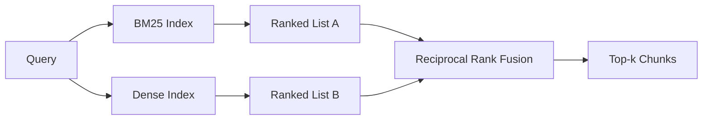

# 結合 BM25 與 Dense Embedding 的混合檢索 (Hybrid Retrieval with BM25 and Dense Embeddings)

> 詞彙檢索與語意檢索在相反的查詢分佈上失敗。用 reciprocal rank fusion 的混合檢索不做內插，而是投票，而且這個投票在每一類查詢上都勝出。

**Type:** Build
**Languages:** Python
**Prerequisites:** Phase 11 lessons 04 (embeddings), 06 (RAG); Phase 19 Track B foundations (lessons 20-29); Phase 19 lesson 64 (chunking strategies)
**Time:** ~90 分鐘

## 學習目標 (Learning Objectives)
- 依 Robertson 與 Sparck Jones 的公式，從零實作 BM25，包含欄位加權、文件長度正規化，以及可調的 k1 與 b。
- 在確定性的 mock embedding 之上建立 dense retriever，讓迴圈能離線執行。
- 完全依照 Cormack、Clarke 與 Buettcher 在 2009 年發表的方式實作 reciprocal rank fusion，並解釋它為何優於以分數加權的內插。
- 調整 RRF 的 k 常數與各模態的權重，並在小型 fixture 語料上讀出取捨。

## 問題 (The Problem)

當查詢帶有語料中逐字出現的字面識別字時，詞彙搜尋會勝出。查詢 `AbortMultipartOnFail`，BM25 在微秒內就回傳正確的 Go 函式。同一個查詢做 embedding 之後，位在三個相似度群集的邊界，dense retriever 把錯誤的檔案排第一。

當查詢被改寫、遠離語料的字面 token 時，dense 搜尋會勝出。使用者問「我們如何處理被取消的上傳」，從來沒打過 abort 或 multipart 這兩個詞。BM25 回傳「上傳大型檔案」的文件 chunk，因為那一頁含有 uploads 這個詞。Dense 檢索則找到摘要提到 cancellation 的 abort 函式。

在兩者之間做選擇不是靜態的。查詢分佈才是變數。正式環境的 RAG 系統從同一個 endpoint 處理兩類查詢，所以檢索必須同時處理兩者。這就是混合檢索。合併步驟是必須做對的部分。

## 核心概念 (The Concept)



### 一段話講完 BM25 (BM25 in one paragraph)

BM25 對查詢與文件的配對評分，方式是對查詢詞彙加總：逆文件頻率 (inverse document frequency) 因子，乘上包含長度正規化修正的飽和詞頻因子。兩個旋鈕。`k1` 控制詞頻飽和；預設的 1.5 是已發表的建議值，沒有 benchmark 就不要動它。`b` 控制文件長度有多重要；預設的 0.75 表示較長的文件會被懲罰，但不是線性的。

IDF 公式使用平滑後的 Robertson 與 Sparck Jones 定義，也就是 `log((N - df + 0.5) / (df + 0.5) + 1)`。Log 內的加一，讓某個詞出現在超過一半語料時，IDF 仍保持為正。這對大部分文件都會出現的停用詞很重要，在小語料中，一個常見詞也可能越過半數語料的線。

欄位加權讓你告訴 BM25，符號名稱上的比對比內文中的比對更有價值。實作方式是在建立 index 時對詞頻乘上一個係數，而不是在評分時。這樣數學保持不變，也避免每個欄位各有一個分數。

### 一段話講完 dense 檢索 (Dense retrieval in one paragraph)

用 embedding 模型把每個 chunk 轉成固定維度的向量。查詢時，對查詢做 embedding，依相似度對每個 chunk 做 cosine 排名，並回傳前 k 個。決定品質的變數是模型。檢索演算法本身只有兩行：內積與排序。

本課使用確定性的、基於雜湊的 embedding，讓你不必網路呼叫就能讀融合的數學。這個雜湊把以 token 為 key 的位移加總到 96 維向量中並正規化。Cosine 排名在每次執行間都是確定性的，這是測試套件所需要的。

### Reciprocal rank fusion，已發表的公式 (Reciprocal rank fusion, the published formula)

兩份排名清單。對出現在任一份清單的每個候選，加總它的倒數排名貢獻。2009 年的論文使用 `1 / (k + rank)`，預設 k 等於 60。依總分排序。這就是整個演算法。

已發表的常數 k = 60 並非隨意的。在 k = 60 時，排名 1 的貢獻是 1 / 61，排名 10 的貢獻是 1 / 70。貢獻衰減得很慢，所以較深的候選仍然有投票權。較小的 k 讓最前面的結果占主導。較大的 k 讓貢獻曲線變平。

我們的實作有兩個可調旋鈕。一個是 `k` 常數。另一個是一對各模態的權重，當你有先驗證據顯示某一個在你的語料上較好時，可以加強 BM25 或 dense。把排名貢獻乘上權重，是最簡單且有原則的實作；它保留了排名衰減的形狀，並且與尺度無關。

### 為什麼融合勝過以分數加權的內插 (Why fusion beats score-weighted interpolation)

BM25 分數沒有上界，且依賴語料。Cosine 相似度則限制在 -1 到 1。線性組合 `alpha * bm25 + (1 - alpha) * cosine` 需要針對每個語料調整 alpha，每次重建 index 就壞掉一次。以排名為基礎的融合沒有這個問題。兩個排名在不同模態之間是可比較的。已發表的 RRF baseline 自 2010 年以來，在每個公開的 TREC track 上都優於分數內插。

這與你在 Vespa 與 Weaviate 文件中聽到的 RankFusion 對 RRF 的論點相同。他們得出同樣的結論：除非有非常強的證據要對分數內插，否則就維持以排名為基礎。

```figure
rrf-fusion
```

## 動手做 (Build It)

`code/main.py` 實作了：

- `tokenize(text)` - 快速的 regex tokenizer。
- `BM25Index` - 有欄位加權，具備 `add` 與 `search`，並有可調的 k1、b。
- `mock_embed`、`DenseIndex` - 與第 64 課相同的確定性 embedding，讓 chunk 可以互相比較。
- `rrf(rankings, k, weights)` - 已發表的融合，並支援多模態權重。
- `HybridRetriever` - 結合 BM25 與 dense。
- 一個示範 `main()`，載入小型 fixture 語料，執行三個查詢，分別針對各 retriever 的長處與弱點，並印出每個模態產生的排名，以及融合後的清單。

執行它：

```bash
python3 code/main.py
```

並排讀示範輸出。字面識別字查詢在 BM25 排第 1、dense 排第 4、RRF 排第 1。改寫過的查詢在 BM25 排第 6、dense 排第 1、RRF 排第 1。含糊的查詢在 BM25 排第 3、dense 排第 3、RRF 排第 1。融合不是用來決定平手的；它是在每一類查詢上都勝出的系統。

## 調整旋鈕 (Tuning the knobs)

| 旋鈕 | 預設 | 往上調的時機 | 往下調的時機 |
|------|------|--------------|--------------|
| BM25 k1 | 1.5 | 詞在文件中會重複出現，而你希望頻率更重要 | 文件很短，詞的重複只是雜訊 |
| BM25 b | 0.75 | 長文件確實每個字說得比較少 | 文件長度與主題無關 |
| RRF k | 60 | 較深的候選應該繼續投票 | 第 1 名應該占主導 |
| BM25 權重 | 1.0 | 你的語料含有字面識別字，且查詢會比對到它們 | 你的查詢是使用者改寫的 |
| Dense 權重 | 1.0 | 查詢是改寫過的 | 查詢是字面的 |

調整時請在你保留的查詢集上重新執行第 68 課的評估 harness，不要憑直覺。

## 示範會藏起來的失敗模式 (Failure modes the demo will hide)

**詞彙表外 (out-of-vocabulary) 的 token。** BM25 的 IDF 是從語料計算的，所以只存在於查詢中的詞貢獻為零。Dense embedding 則會對同一個詞幻想出一個向量。對語料外的識別字，dense 模態會回傳看似合理卻錯誤的鄰居。融合能吸收這個問題，因為 BM25 什麼都不回傳，排名貢獻就消失了，但前提是你要以文件而不是 chunk 去重。

**停用詞主導。** BM25 對「the」這個詞產生的是整個語料上的均勻排名。在 indexer 中過濾停用詞，或接受高 IDF 的詞會自然占主導。

**跨模態的內容相同。** 如果你的語料小到 BM25 的第 1 名同時也是 dense 的第 1 名，RRF 會給你相同的第 1 名和相同的鄰居。這是正確的行為，不是失敗，但它讓融合看起來像是隱形的。在你的評估中加入一對對抗性的查詢，以驗證融合真的在運作。

## 實際使用 (Use It)

正式環境的做法：

- 在 process 內建立 BM25 index；瓶頸是詞頻字典，而不是向量。
- 把 dense 向量 index 在獨立的儲存體中（本課使用扁平清單；正式環境會使用 HNSW）。
- 平行執行兩個查詢；融合是對聯集做常數時間的合併。
- 保存每個檢索命中所屬的模態，讓下游的 reranker 能看出是哪個模態投票支持它。

## 交付 (Ship It)

第 66 課會取本課融合後的 top-k，並用 cross-encoder 做 rerank。第 68 課用 precision、recall、MRR 與 nDCG 評估整個管線。本課的混合 retriever 是第 69 課端到端系統的第一階段。

## 練習 (Exercises)

1. 把 `mock_embed` 換成你 provider 提供的真實模型。重新執行示範，並回報在改寫過的查詢上，只用 dense 的排名如何改變。
2. 新增第三種模態：獨立 index 的 chunk 摘要，並作為第三份排名清單融合。量測增益。
3. 掃描 RRF 的 k 為 10、30、60、100、200。畫出第 68 課的 recall@k 曲線。回報在你的語料上曲線達到峰值時的 k 值。
4. 正確實作 BM25F（每個欄位各自的長度正規化，而不是乘數技巧），並在符號比對最重要的語料上比較。

## 關鍵術語 (Key Terms)

| 術語 | 一般說法 | 實際意義 |
|------|----------|----------|
| BM25 | 「詞彙搜尋」 | 機率式排名，idf x 飽和 tf x 長度正規化 |
| RRF | 「排名融合」 | 跨排名清單加總 1 / (k + rank)；預設 k = 60 |
| k1 | 「TF 飽和」 | 控制重複的詞多快就不再增加分數 |
| b | 「長度懲罰」 | 0 表示忽略文件長度，1 表示完全正規化 |
| Field weighting | 「符號加成」 | 在建立 index 時重複 token，以加強該欄位中的比對 |
| Rank-based vs score-based fusion | 「為什麼 RRF 勝過線性」 | 排名在模態之間可以比較；分數則不行 |

## 延伸閱讀 (Further Reading)

- Cormack, Clarke, Buettcher, "Reciprocal Rank Fusion outperforms Condorcet and individual rank learning methods", SIGIR 2009
- Robertson, Walker, Beaulieu, Gatford, Payne, "Okapi at TREC-3"（原始的 BM25 論文）
- [Vespa: Hybrid Retrieval with BM25 and Embeddings](https://docs.vespa.ai/en/tutorials/hybrid-search.html)
- [Weaviate: Hybrid Search](https://weaviate.io/developers/weaviate/search/hybrid)
- Phase 11 lesson 06 - RAG 基礎
- Phase 19 lesson 64 - 在這裡建立 index 的 chunk 的 chunker
- Phase 19 lesson 66 - 消費融合後 top-k 的 cross-encoder reranker
