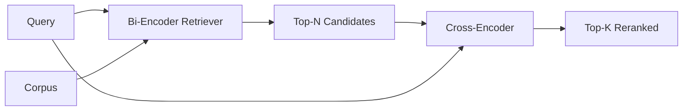

# Cross-Encoder Reranker

> Bi-encoder 獨立地對查詢和文件做 embedding。Cross-encoder 把它們串接起來，同時讀兩者。Cross-encoder 是最聰明的讀者，也是最慢的。把它當作 bi-encoder top-k 之上的第二階段使用，是值得的。

**Type:** Build
**Languages:** Python
**Prerequisites:** Phase 11 lesson 06 (RAG), Phase 11 lesson 07 (advanced RAG); Phase 19 Track B foundations (lessons 20-29); Phase 19 lesson 65 (hybrid retrieval feeding this stage)
**Time:** ~90 分鐘

## 學習目標 (Learning Objectives)
- 從輸入形狀、參數量與每次查詢成本，區分 bi-encoder retriever 與 cross-encoder reranker。
- 從零實作小型 cross-encoder，作為消費打包後 (query, document) 序列、並輸出單一相關性純量的 transformer block。
- 接上兩階段的「先檢索再 rerank」管線：用便宜的 retriever 取出 top-N，用 cross-encoder 把 N 個 rerank 成 top-K，回傳 K 個。
- 在小型 fixture 語料上量測延遲與品質的取捨，並為給定的延遲預算選出正確的 N。

## 問題 (The Problem)

Bi-encoder 把查詢和文件映射到同一個向量空間，並依 cosine 排名。兩個編碼從不互相見面。模型必須把文件所有有用的資訊壓縮成單一向量，對查詢是盲目的。這很快：index 時每個文件一次 embedding，查詢時每個查詢一次，而且這是在語料規模下排名的唯一方式。

代價是精確度。兩份整體主題相同的文件，即使其中一份回答了查詢而另一份沒有，它們的 embedding 也可能幾乎相同。Bi-encoder 無法區分它們。

Cross-encoder 藉由同時讀取查詢與文件來解決這個問題。模型接收 `[query] [SEP] [document]` 作為單一序列，在接合處進行完整的 attention，並產生一個相關性純量。文件的每個 token 都可以 attend 查詢的每個 token。模型在完整的上下文下決定分數。

代價是吞吐量。Bi-encoder 只 embed 一次，之後永遠都能查詢，而 cross-encoder 對每個 (query, document) 配對都要跑一次。對於一千萬份文件的語料，每次查詢要一千萬次 forward。在請求預算內是不可能跑完的。

解法是分階段。用 bi-encoder 取回 top-N。用 cross-encoder 把 N 個 rerank 成 top-K。N 很小（50 到 200），而 cross-encoder 的品質提升集中在最重要的地方。總延遲維持在請求預算內。總品質是 cross-encoder 的品質，上限由 bi-encoder 在 N 的 recall 決定。

## 核心概念 (The Concept)



### Cross-encoder 的輸入形狀 (The cross-encoder's input shape)

標準的打包方式是 `[CLS] query_tokens [SEP] document_tokens [SEP]`。CLS 位置的輸出餵進單一線性 head，輸出相關性純量。有些實作改用 mean-pooling 而不是 CLS；差別很小。重點是模型每個配對只產生一個數字。

一個 22M 參數的 cross-encoder（已發表的 `ms-marco-MiniLM-L-6-v2` 權重等級）是典型的正式環境選擇點。更小的模型品質流失得比節省的延遲快。更大的模型（例如 568M 參數的 `bge-reranker-v2-m3`）保留給離線 rerank，或 K 很小的第一頁 rerank。

### 為什麼本課訓練一個很小的 (Why this lesson trains a tiny one)

真正的 cross-encoder 是微調過的 encoder transformer。在正式環境中，你載入 checkpoint 並執行它。本課的目標是讓你看到模型的形狀，以及延遲與品質曲線的形狀，而不是訓練最先進的 ranker。所以我們建立一個小的 `nn.Module`，只有一個 transformer block、multi-head attention（預設 4 個 head），以及一個迴歸 head。它由 seed 確定性地初始化，讓示範不需要磁碟上的權重也能重現。

這個玩具模型從 fixture 語料學到正確的形狀：相關的 query-document 配對，預測分數比不相關的配對高。端到端管線會對 bi-encoder 的輸出做 rerank，而 rerank 的 top-k 與黃金標註相關。

### 延遲與品質 (Latency vs quality)

兩階段管線只有一個可調參數：N。在保留的查詢集上，把 N 從 5 掃描到 100，你就得到這條曲線。

| N | 第 2 階段的 Recall@1 | 每次查詢的 cross-encoder forward 次數 | 延遲 |
|---|----------------------|----------------------------------------|------|
| 5 | 0.62 | 5 | 低 |
| 20 | 0.81 | 20 | 中 |
| 50 | 0.86 | 50 | 高 |
| 100 | 0.86 | 100 | 非常高 |

上面的數字用來說明形狀，不是這個 fixture 的量測值。但形狀是真實的。在 20 到 50 個候選附近總會有一個拐點，rerank 的提升在那裡飽和。過了拐點，你就是在白白付費。

從評估曲線加上延遲預算來選 N。Cross-encoder 無法把 recall 提高到超過 bi-encoder 在 N 的 recall，所以太小的 N 不只限制延遲，也限制品質。

```figure
rerank-funnel
```

## 動手做 (Build It)

`code/main.py` 實作了：

- `CrossEncoder` - 一個小的 `torch.nn.Module`：token embedding、一個帶 multi-head attention 與 feedforward 的 transformer block，以及產生一個純量的 mean-pooled head。
- `tokenize_pair(query, document)` - 把兩個字串打包成單一 id 序列，並用 type id 標記邊界，具確定性，只用 stdlib。
- `train_tiny(pairs)` - 在手工標註的 (query, document, relevance) 三元組清單上做一輪監督式訓練，讓模型在 fixture 上產生合理的分數。
- `rerank(query, candidates, top_k)` - 正式環境的介面。
- `pipeline(query, retriever, top_n, top_k)` - 兩階段流程。
- 一個示範 `main()`，依第 65 課的模式載入語料、取回 top-N、rerank 成 top-K、並排印出兩份清單，並回報每個階段的延遲。

執行它：

```bash
python3 code/main.py
```

輸出顯示 bi-encoder 的 top-N、cross-encoder 的 top-K，以及計時摘要。Cross-encoder 每次呼叫花的時間較長，但不會對整個語料執行。兩階段的總時間維持在請求預算內，同時挑出 bi-encoder 排第二或第三的答案。

## 示範會藏起來的失敗模式 (Failure modes the demo will hide)

**Cross-encoder 不是對稱的。** `rerank(q, d)` 和 `rerank(d, q)` 是不同的分數。永遠先餵查詢。如果不小心對調，recall 會崩潰。

**N 太低而無法暴露 bug。** 如果你把 N 設成等於 K，cross-encoder 可以重新排序這 K 個候選，卻無法把新的候選帶進 top K。K 處的 recall 不會動，所以提升看起來是零。把 N 選成至少 K 的三倍。

**訓練資料洩漏到評估中。** 如果手工標註的訓練配對包含評估用的查詢，rerank 看起來就像魔法。即使在 fixture 上，也要嚴格區分訓練與評估。

**正式環境的權重很大。** 22M 參數的 cross-encoder 以 float32 計算是 88MB。在承諾 p95 低於 100ms 之前，先規劃好模型伺服器的記憶體。

**批次處理很重要。** 真正的 cross-encoder 會把 N 個候選放在同一個 batch 裡執行。本課在 `_batch_encode` 中這麼做，它用 `torch.tensor(...)` 建立批次的 id 與 type-id tensor，然後只做一次 forward。跳過批次處理，延遲會乘以 N。

## 實際使用 (Use It)

正式環境的做法：

- 把 bi-encoder、cross-encoder 與 N 一起固定。更改其中任何一個都會讓評估失效。
- 以 (query, document_id) 雜湊快取 reranker 的輸出。同一個查詢對穩定的語料會 rerank 成相同的順序；快取命中能免費換來延遲的下降。
- 記錄 cross-encoder 第 1 名的分數。第 1 名分數低於語料專屬門檻的查詢，是領域外的命中；把它以「我不太有把握」的形式呈現給 LLM。

## 交付 (Ship It)

第 68 課會端到端評估這個兩階段管線。第 69 課把這個 reranker 接在第 65 課混合 retriever 的後面、答案產生器的前面。Reranker 是端到端系統的第二階段。

## 練習 (Exercises)

1. 把 N 從 5 掃描到 50，並畫出 rerank 後輸出的 recall@1。找出這個 fixture 上的拐點。
2. 把 cross-encoder 訓練十個 epoch，而不是一個。量測每個 epoch 時正負配對之間的分數差距。
3. 把 mean-pooling 換成 CLS-token head。比較在這個 fixture 上的收斂情況。
4. 新增第二個 cross-encoder head，預測「這個答案是否在文件中」的二元標籤。推論時兩個 head 都使用；一個用來排名，一個用來設門檻。
5. 把確定性的 mock bi-encoder 換成第 65 課的版本，並把兩個階段串接起來。量測 top-K 相對於只用 bi-encoder 的變化。

## 關鍵術語 (Key Terms)

| 術語 | 一般說法 | 實際意義 |
|------|----------|----------|
| Bi-encoder | 「向量 retriever」 | 獨立編碼查詢和文件；用 cosine 排名 |
| Cross-encoder | 「Reranker」 | 聯合編碼 (query, doc)；輸出一個相關性純量 |
| Two-stage pipeline | 「檢索再 rerank」 | 便宜的 retriever 回傳 N 個，昂貴的 reranker 保留 K 個 |
| N (candidate budget) | 「Rerank 池」 | cross-encoder 對每個查詢評分的候選數量 |
| Mean-pooling head | 「最後 hidden 的平均」 | 把 encoder 最後一層的輸出平均成一個向量 |

## 延伸閱讀 (Further Reading)

- Nogueira, Cho, "Passage Re-ranking with BERT", 2019 - 標準的 cross-encoder ranker 論文
- Reimers, Gurevych, "Sentence-BERT: Sentence Embeddings using Siamese BERT-Networks", 2019 - 關於 bi-encoder 與 cross-encoder
- [SentenceTransformers Cross-Encoders documentation](https://www.sbert.net/examples/applications/cross-encoder/README.html)
- [BGE Reranker v2 model card](https://huggingface.co/BAAI/bge-reranker-v2-m3)
- Phase 19 lesson 65 - 餵給這個 rerank 階段的混合 retriever
- Phase 19 lesson 68 - 量測這個 rerank 所帶來提升的評估
