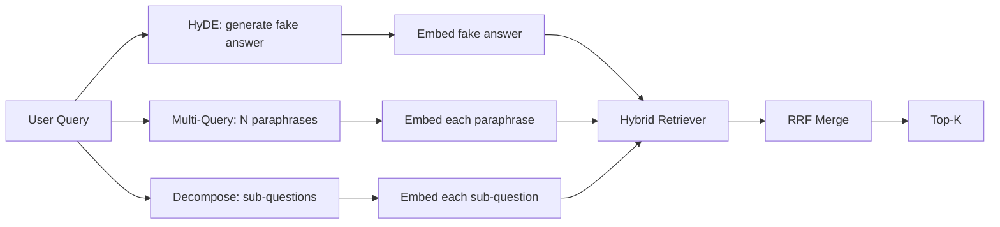

# Query Rewriting：HyDE、Multi-Query 與 Decomposition (Query Rewriting: HyDE, Multi-Query, and Decomposition)

> 使用者輸入的查詢，不是你的 retriever 想要的查詢。Rewriting 在檢索之前彌合這個落差，讓 index 看到的東西更接近答案本身的樣子。

**Type:** Build
**Languages:** Python
**Prerequisites:** Phase 11 lessons 04 (embeddings), 06 (RAG); Phase 19 Track B foundations (lessons 20-29); Phase 19 lessons 64 and 65
**Time:** ~90 分鐘

## 學習目標 (Learning Objectives)
- 實作 Hypothetical Document Embeddings (HyDE)：生成一份假的答案、對它做 embedding，並用那個向量而不是查詢向量去檢索。
- 實作 multi-query expansion：把一個查詢改寫成 N 個改述，每個都檢索一次，並用 reciprocal rank fusion 合併聯集。
- 實作 query decomposition：把複雜問題拆成子問題，每個子問題各自檢索，再合併。
- 在 fixture 上直接比較這三種 rewriter，並解釋各策略何時勝出。
- 接上一個 mock LLM，產生確定性、符合 fixture 的輸出，讓 rewriter 迴圈能離線執行。

## 問題 (The Problem)

使用者輸入「當上傳失敗而且預算用完時，我們團隊會怎麼做？」。語料中有一份文件寫著「AbortMultipartOnFail aborts an in-flight S3 multipart upload and decrements the per-bucket retry budget when the upload fails」。查詢和文件沒有共享任何名詞片語。BM25 漏掉了。Bi-encoder 把這份文件排在第三或第四，因為查詢向量落在 embedding 空間中偏好「被取消的工作」文件的區域，而不是「被中止的上傳」文件。如果答案位於 top-N 內，第 66 課的兩階段 rerank 可以挽救它，但如果它連 top-N 都進不去，reranker 就永遠看不到它。

解法是在查詢碰到 retriever 之前先改寫它。2023 年的論文 "Precise Zero-Shot Dense Retrieval without Relevance Labels" (Gao 等人) 提出了 HyDE：請 LLM 寫出能回答該查詢的文件，對這份假設性文件做 embedding，並把它的 embedding 當作檢索向量。這份假設性文件落在 embedding 空間的正確區域，因為它是以語料的口吻寫成的。查詢向量則不是。

有兩個近親技術與 HyDE 搭配。Multi-query expansion（Microsoft 的 GraphRAG 使用的術語）產生查詢的 N 個改述，每個都檢索一次，再合併。Decomposition（在 2024 年 Stanford DSPy 的工作中以「subquery decomposition」之名普及）把「當上傳失敗而且預算用完時，我們團隊會怎麼做」拆成兩個問題：「上傳失敗時會發生什麼事」和「重試預算用完時會發生什麼事」。兩次檢索，一個合併後的結果，答案的兩個部分都找得到。

本課實作這三種，並在同一個 fixture 語料上執行它們。

## 核心概念 (The Concept)



### HyDE 詳解 (HyDE in detail)

HyDE 用 LLM 寫出的假設性文件向量，取代使用者的查詢向量。Prompt 很短：

```
You are a domain expert. Write a one-paragraph passage that answers the question
below. Use the same vocabulary and phrasing the documentation in this domain would
use. Do not refuse. Do not say you do not know.

Question: {user_query}

Passage:
```

作為事實答案，LLM 的回答是錯的，因為 LLM 不認識你的語料。沒關係。Retriever 不在乎事實是否正確，只在乎 token 的分佈。假設性段落包含「abort」、「multipart」、「bucket」、「budget」等詞，因為這個主題的文件段落就是這麼說的。對那個段落做 embedding，向量就會落在真正段落的附近。

在正式環境中，你會把假設性文件限制在兩三句話。更長的假設性文件會收集更多雜訊。更短的又會失去 HyDE 所需的詞彙訊號。

### Multi-query expansion 詳解 (Multi-query expansion in detail)

產生使用者查詢的 N 個改述。最簡單的 prompt：

```
Rewrite the following question in {N} different ways. Each rewrite must preserve
the original intent. Number them 1 to {N}. Do not add explanations.
```

對每個改述取出 top-k。用 RRF（第 65 課的同一個演算法）合併這 N 份排名清單。便宜、可平行、具確定性。

當使用者的措辭只是同樣有效的許多提問方式之一，而任何一個改寫都能問得更好時，multi-query 會勝出。當所有改寫都同樣糟糕，因為原始查詢本來就以同樣的方式糟糕時，它就會輸。

### Decomposition 詳解 (Decomposition in detail)

單次檢索無法滿足多面向的問題。Decomposition 請 LLM 把問題拆成子問題，系統再對每個子問題各自檢索。Prompt：

```
The following question may require information from multiple distinct topics.
Decompose it into a list of sub-questions. Each sub-question must be answerable
independently. If the question is already atomic, return it unchanged.

Question: {user_query}
```

對每個子問題各自檢索，然後合併。Decomposition 是處理含連接詞、多子句比較，或兩個不相關主題的問題的正確工具。對原子問題則是錯誤的工具；decomposer 在那裡的工作是回傳單一問題，而不是捏造假的子問題。

### 為什麼三種都存在 (Why all three exist)

三者是互補的。HyDE 彌合查詢與語料之間的 token 落差。Multi-query 涵蓋改述的變異。Decomposition 涵蓋多主題的查詢。正式環境的系統會三個都跑，並依查詢挑選策略（第 69 課的端到端系統展示了選擇器）。

## Mock LLM

本課離線執行。Mock LLM 是以使用者查詢為 key 的小型查找表，外加一個處理未見過查詢的 fallback。查找表包含：

- 每個 fixture 查詢：一段寫好的假設性段落、三個改述，以及一個 decomposition。
- 對未知查詢：一個確定性的轉換：取出查詢的內容詞，透過同義詞對照表展開，並回傳結果。

重要的是 mock 的形狀，而不是資料。在正式環境中，你把 mock 換成真正的模型呼叫。Retriever 不會改變。

```figure
cd-hyde-vector
```

## 動手做 (Build It)

`code/main.py` 實作了：

- `MockLLM` - 上述的確定性替身。
- `HyDERewriter` - 呼叫 LLM 寫出假設性文件，以 `RewriteResult` 回傳 rewriter 的輸出，包含假設性文字與 retriever 應使用的查詢。
- `MultiQueryRewriter` - 呼叫 LLM 取得 N 個改述，回傳查詢清單。
- `DecomposeRewriter` - 呼叫 LLM 做 decomposition，回傳子問題。
- `retrieve_with_rewriter` - 接受 rewriter 與 retriever，執行改寫，並融合結果。
- 一個示範，在 fixture 上執行這三個 rewriter，並印出哪個策略最先回傳黃金答案文件。

Retriever 的形狀沿用第 65 課（混合 BM25 + dense）。融合也是同一個 RRF。唯一新增的形狀是 rewriter 介面，它很小。

執行它：

```bash
python3 code/main.py
```

輸出是各策略的排名與最終摘要。HyDE 在措辭不匹配的查詢上勝出。Multi-query 在改述變異的查詢上勝出。Decomposition 在多主題的查詢上勝出。Fallback（沒有 rewriter）在三者中至少輸掉一個。

## 示範會藏起來的失敗模式 (Failure modes the demo will hide)

**HyDE 把語料專屬的識別字幻想錯了。** 模型發明了一個函式名稱。假設性文件在正確文件上的 BM25 分數崩潰，因為這個發明出來的名稱現在是一個高權重的 token，卻不存在於 index 中。限制假設性文件的長度，並在融合中調低 BM25 的權重。

**Multi-query 的改寫全都收斂。** 弱的模型產生三個幾乎相同的改述。N 次檢索回傳相同的 top-k。RRF 合併並不比單次檢索好。在改寫 prompt 中加入明確的多樣性指示，並用 Jaccard 偵測重複。

**Decomposition 切過頭。** Decomposer 把原子問題變成一個清單。每次檢索都回傳同一份文件，但排名降低。合併後的結果比原本更差。在 fan-out 之前，用「這些子問題是否足夠不同」的檢查來偵測這個情況。

**延遲倍增。** HyDE 花一次 LLM 呼叫。Multi-query 花一次 LLM 呼叫產生 N 個改寫，再加 N 次檢索。Decomposition 花一次 LLM 呼叫做拆解，再加 M 次檢索。檢索是平行執行的；LLM 呼叫是延遲的下限。

## 實際使用 (Use It)

正式環境的做法：

- 依查詢長度挑選每個查詢的策略：簡短的原子查詢用 multi-query，複雜的多子句查詢用 decomposition，術語很多的查詢用 HyDE。
- 以查詢雜湊快取 rewriter 的輸出。許多查詢會重複。
- 三個平行執行，並用 RRF 把三組結果融合成一個。成本是三次 LLM 呼叫加一次融合；品質是三個策略涵蓋範圍的聯集。

## 交付 (Ship It)

第 69 課把這個 rewriter 階段接在第 65 課的 retriever 與第 66 課的 reranker 之前。第 68 課評估 rewriter 為檢索 recall 帶來的提升。

## 練習 (Exercises)

1. 實作 RAG-Fusion（multi-query 的 2024 年變體），其中 rewriter 的改述刻意多樣，再由 rerank 步驟（第 66 課）挑出最終清單。
2. 新增第四種策略：step-back prompting（請 LLM 提出更一般的問題，對它檢索，然後再縮小範圍）。在 fixture 上比較。
3. 加上「這個問題是否為原子問題」的 head，訓練 decomposer 辨認原子查詢。量測前後的過度切分率。
4. 把 mock LLM 換成真正的模型呼叫。量測你的技術堆疊上每個策略的延遲。
5. 為每個改寫加上信心分數。丟掉低於門檻的改寫。量測對 recall 的影響。

## 關鍵術語 (Key Terms)

| 術語 | 一般說法 | 實際意義 |
|------|----------|----------|
| HyDE | 「假文件檢索」 | LLM 寫出答案；對它做 embedding 並據以檢索，而不是用查詢 |
| Multi-query | 「改述擴展」 | 查詢的 N 個改寫；檢索 N 次，用 RRF 合併 |
| Decomposition | 「子查詢拆分」 | 多主題查詢被拆成子問題，分別檢索 |
| Atomic query | 「單一主題」 | 不捏造假子問題就無法拆解 |
| Step-back | 「把查詢抽象化」 | 先問更一般的問題、檢索，再縮小範圍 |

## 延伸閱讀 (Further Reading)

- Gao, Ma, Lin, Callan, "Precise Zero-Shot Dense Retrieval without Relevance Labels" (HyDE), 2023
- Microsoft Research, "Multi-Query Expansion for Retrieval"
- Stanford DSPy, "Subquery Decomposition for Multi-Hop QA"
- [LlamaIndex query transformations documentation](https://docs.llamaindex.ai/en/stable/optimizing/advanced_retrieval/query_transformations/)
- Phase 11 lesson 07 - 進階 RAG 模式
- Phase 19 lesson 65 - 這個 rewriter 所餵給的 retriever
- Phase 19 lesson 68 - 量測 rewriter 提升的評估
