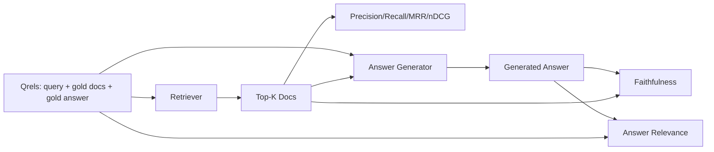

# RAG 評估：Precision、Recall、MRR、nDCG、Faithfulness、Answer Relevance (RAG Evaluation: Precision, Recall, MRR, nDCG, Faithfulness, Answer Relevance)

> 如果你無法同時為檢索和答案評分，你就無法發佈這個系統。這兩者不是同一個指標，同一個 prompt 會在不同的軸上失敗。

**Type:** Build
**Languages:** Python
**Prerequisites:** Phase 11 lessons 06 (RAG), 10 (evaluation); Phase 19 Track B foundations (lessons 20-29); Phase 19 lessons 64, 65, 66, 67
**Time:** ~90 分鐘

## 學習目標 (Learning Objectives)
- 從黃金 qrels 計算四個檢索指標：precision@k、recall@k、MRR (mean reciprocal rank) 與 nDCG@k。
- 計算兩個答案評分指標：faithfulness（每個主張都有根據於檢索到的上下文）與 answer relevance（答案回應了問題）。
- 建立 fixture qrels 檔（查詢、黃金文件 id、黃金答案文字），讓評估從頭到尾讀取。
- 讀懂指標的數值，診斷管線在哪裡失敗：檢索、排名、生成，還是 grounding。

## 問題 (The Problem)

RAG 系統至少有四個會動的部分：chunker、retriever、reranker、generator。其中任何一個都可能是錯誤答案的原因。沒有各階段的指標，你就是在盲飛。

使用者回報了錯誤的答案。是因為 chunker 切斷了答案區段嗎？是因為 retriever 沒有把那個 chunk 放進 top-k 嗎？是因為 reranker 把正確的 chunk 推過了第一名嗎？是因為 generator 忽略了那個 chunk 而自己編造東西嗎？光從答案無法分辨。你需要：

- 檢索指標，為 retriever 的產出評分。
- 排名指標，為正確 chunk 在順序中的位置評分。
- Faithfulness，評估 generator 是否留在檢索到的上下文之內。
- Answer relevance，評估答案究竟有沒有回應問題。

本課在 fixture qrels 檔之上建立這六個指標。評估是離線且具確定性的；在正式環境中，你把 mock 的 LLM-as-judge 換成真正的。

## 核心概念 (The Concept)



### Precision@k

在 retriever 回傳的 top-k 文件中，有多少比例在黃金集合內？如果黃金有三份文件，而 top-3 回傳了其中兩份和一份錯的，precision@3 是 2 / 3。當回傳不相關 chunk 的代價很高時（generator 在上面浪費 token，或那個 chunk 污染了答案），就使用 precision。

### Recall@k

在黃金文件中，有多少比例在 top-k 內？如果黃金有三份文件，而 top-5 包含全部三份，recall@5 就是 1.0。當錯失答案的代價很高時（你寧可多看到一個錯的 chunk，也不願完全漏掉答案 chunk），就使用 recall。

在正式環境的 RAG 中，人們通常引用的指標是 recall@k。Generation 可以輕易丟棄不相關的 chunk；卻無法從它從未看過的 chunk 憑空生出答案。

### MRR (Mean Reciprocal Rank)

對每個查詢，找出第一份相關文件在排名清單中的位置。倒數排名是 1 / position。再對整個查詢集取平均。MRR 是 retriever 把最佳答案放在最上面的程度的單一數字摘要。

MRR 對第 1 名的權重很重。黃金文件排第 1 的查詢貢獻 1.0。排第 2 貢獻 0.5。排第 10 貢獻 0.1。這個指標由清單的頂端主導。

### nDCG@k

Normalized Discounted Cumulative Gain。完整公式為每份檢索到的文件指派一個 gain（通常相關為 1、不相關為 0），依位置的對數做折減、加總，再除以理想的 DCG（完美排名時你會得到的 DCG）。範圍 0 到 1。

nDCG 可以容納分級的相關性：黃金可以說「文件 A 是 3、文件 B 是 2、文件 C 是 1」。MRR 和 recall@k 把一切壓平成二元。當語料中每個查詢有多份部分相關的文件時，就使用 nDCG。

### Faithfulness

對生成答案中的每個主張，檢查該主張是否被檢索到的上下文所支持。標準實作使用 LLM-as-judge 的 prompt，接收 (claim, context) 並回傳 yes 或 no。指標是通過的主張所占的比例。

Faithfulness 抓出模型編造內容的 generator 失敗模式。即使 retriever 回傳了正確的 chunk，會幻想的 generator 仍然是壞的。Faithfulness 也被稱為 groundedness、support、attribution。

本課用確定性的 mock judge 實作 faithfulness，它檢查每個主張的 token 與檢索到的上下文重疊是否達到門檻。在正式環境中，你換成真正的模型呼叫。指標的形狀相同。

### Answer relevance

答案是否真的回應了問題？Faithfulness 問的是「答案是否根據上下文？」。Answer relevance 問的是「答案是否根據問題？」。一個忠實但離題的答案，faithfulness 得分高、relevance 得分低。一個簡短、切題但無視上下文的答案，relevance 得分高、faithfulness 得分低。

標準實作同樣使用 LLM-as-judge：取 (question, answer)，詢問答案是否回應了問題。本課實作的是 token 重疊加上 judge 的替代版本。

## Fixture qrels

```python
{
  "qid": "q1",
  "query": "what is the abort threshold for multipart uploads",
  "gold_doc_ids": ["d1", "d3"],
  "gold_answer_substring": "three failed parts",
  "graded_relevance": {"d1": 3, "d3": 2},
}
```

每個查詢帶有：
- 查詢字串，
- 一組黃金文件 id（用於 precision / recall / MRR），
- 分級相關性的 dict（用於 nDCG），
- 黃金答案子字串（作為每筆 qrel 的參考 metadata 保留；本課的 faithfulness 是透過對照檢索到的上下文判斷抽取的主張來計算，而不是對照這個子字串）。

在正式環境中，這些需要你去標註。本課附帶手工建立的 fixture，讓評估可以直接執行。

```figure
ci-rag-metric-ladder
```

## 動手做 (Build It)

`code/main.py` 實作了：

- `precision_at_k(retrieved, gold, k)` - 字面上的定義。
- `recall_at_k(retrieved, gold, k)` - 字面上的定義。
- `mean_reciprocal_rank(retrieved_list_of_lists, gold_list)` - 對查詢取平均。
- `ndcg_at_k(retrieved, graded_relevance, k)` - 以二元或分級 gain 計算 DCG / IDCG。
- `extract_claims(answer)` - 把答案拆成句子形狀的主張。
- `faithfulness(claims, context_texts, judge)` - 被判定為有支持的主張所占的比例。
- `answer_relevance(question, answer, judge)` - judge 判定答案是否回應了問題。
- `MockJudge` - 確定性的 token 重疊 judge，讓評估能離線執行。
- `evaluate_pipeline(pipeline_fn, qrels, ks)` - 執行每個指標的 orchestrator。
- 一個示範，對 qrels 執行三種管線變體（chunker baseline、混合檢索、混合 + rerank），並印出指標表。

執行它：

```bash
python3 code/main.py
```

輸出在單一指標表中，顯示每個變體的 precision@k、recall@k、MRR、nDCG@k、faithfulness 與 answer relevance。混合檢索那一列在 recall 上勝過 chunker baseline；rerank 那一列在 MRR 上勝過混合檢索。

## 讀指標來診斷失敗 (Reading the metrics to diagnose failures)

| 症狀 | 可能原因 | 要修什麼 |
|------|----------|----------|
| recall@k 低、precision@k 低 | Chunker 切斷了答案，或 retriever 找不到它 | Chunker 邊界（第 64 課）或 retriever 模態（第 65 課） |
| recall@k 還可以、MRR 低 | 正確的 chunk 在 top-k 裡，但不在第 1 名 | Reranker（第 66 課） |
| MRR 高、faithfulness 低 | Generator 即使有正確的上下文仍編造內容 | 生成 prompt；強制引用或拒絕 |
| faithfulness 高、relevance 低 | 答案有根據但離題 | Query rewriter（第 67 課）或生成 prompt |
| 四個都高，使用者仍然抱怨 | 評估集不具代表性 | 用真實的使用者查詢擴充 qrels |

## 示範會藏起來的失敗模式 (Failure modes the demo will hide)

**LLM-as-judge 的偏誤。** 模型會把自己的輸出判定得比實際上更忠實。judge 使用與 generator 不同的模型系列，或手動評分一個樣本。

**Qrels 腐爛。** 隨著語料變化，黃金答案會漂移。2024 年 1 月作為 q1 黃金的文件，在 2024 年 10 月已不再是正確答案，因為團隊重新命名了函式。排定每季一次的 qrels 檢閱。

**Faithfulness 的微觀檢查漏掉宏觀的主張。** 逐句的 faithfulness 可以通過，但整體答案的結構卻具有誤導性。在自動化指標之上，加上樣本層級的質性檢閱。

**Recall@k 掩蓋了逐查詢的失敗。** 90% 的平均 recall 可能隱藏了某一類查詢總是失手。依查詢類別（字面、改寫、多主題）切分 qrels，並回報每個切片。

## 實際使用 (Use It)

正式環境的做法：

- 每次 retriever 或 generator 變更時都執行評估。把 recall@k 的退化當作測試失敗。
- 保存每個查詢的指標 trace。當使用者抱怨時，查出相符的 qrels 項目，看看它是否本來就能被抓到。
- 為 qrels 分層：在 CI 執行的 20 個查詢 smoke 集；每晚執行的 200 個 regression 集；每週執行的 2000 個深度集。

## 交付 (Ship It)

第 69 課接上整個管線（chunker、retriever、reranker、generator），並對端到端系統執行這個評估。

## 練習 (Exercises)

1. 新增第五個檢索指標：hit-rate@k。與 recall@k 比較。解釋它們何時不同。
2. 實作分級的 faithfulness：0（無支持）、1（部分支持）、2（完全支持）。據此更新指標。
3. 把 mock judge 換成真正的模型呼叫。量測 mock 與真實 judge 在 fixture 上的分歧。
4. 新增查詢類別切片（「literal」、「paraphrased」、「multi-topic」）。回報每個切片的指標。
5. 新增「答案長度」指標，並與 faithfulness 做相關性分析。畫出曲線。

## 關鍵術語 (Key Terms)

| 術語 | 一般說法 | 實際意義 |
|------|----------|----------|
| Precision@k | 「檢索結果的命中率」 | top-k 中屬於黃金的比例 |
| Recall@k | 「黃金的命中率」 | 黃金中落在 top-k 的比例 |
| MRR | 「第一個命中的位置」 | 第一份相關文件的 1 / rank 的平均 |
| nDCG@k | 「分級排名品質」 | top-k 的 DCG 除以理想 DCG |
| Faithfulness | 「Groundedness」 | 答案主張中被檢索到的上下文所支持的比例 |
| Answer relevance | 「有回應問題嗎？」 | 答案是否符合問題的意圖 |
| Qrels | 「黃金標籤」 | 標註過的查詢集，以及它們的黃金文件與答案 |

## 延伸閱讀 (Further Reading)

- Buckley, Voorhees, "Evaluating Evaluation Measure Stability", SIGIR 2000 - 關於排名指標的標準論文
- Jarvelin, Kekalainen, "Cumulated Gain-based Evaluation of IR Techniques" - nDCG 論文
- [Ragas: Automated Evaluation of RAG Pipelines](https://docs.ragas.io)
- [Anthropic, Introducing Contextual Retrieval](https://www.anthropic.com/engineering/contextual-retrieval) - 以 1 減去 recall@20 為檢索評分
- Phase 11 lesson 10 - 評估框架基礎
- Phase 19 lessons 64-67 - 這裡被評估的元件
- Phase 19 lesson 69 - 這個評估所評分的端到端管線
