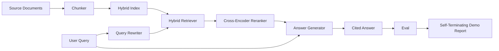

# 端到端 RAG 系統 (End-to-End RAG System)

> 六堂課的元件。一條管線。一個評估迴圈。一個會自行終止的示範。這就是你要交付的系統。

**Type:** Build
**Languages:** Python
**Prerequisites:** Phase 11 lessons 06 (RAG), 10 (evaluation); Phase 19 Track B foundations (lessons 20-29); Phase 19 lessons 64, 65, 66, 67, 68
**Time:** ~90 分鐘

## 學習目標 (Learning Objectives)
- 把 chunker、混合 retriever、query rewriter、cross-encoder reranker 與答案 generator 組合成單一的端到端管線。
- 實作以 chunk anchor 引用其主張的答案 generator，並帶有信心低時拒絕回答的 fallback。
- 對組裝好的管線執行第 68 課的評估，並證明分階段建置在每個指標上都勝過單獨使用相同元件。
- 建立會自行終止的 CLI 示範，匯入 fixture 語料、執行固定的查詢集，並以零結束並附上摘要報告。

## 問題 (The Problem)

六個單獨的元件什麼都證明不了。Chunker 可以在語料上的 recall@5 勝出，卻在系統的 recall@5 上輸掉，因為 retriever 無法為 chunker 輸出的東西排名。Reranker 可以在合成候選池上提升 MRR，卻在真正的 bi-encoder 候選上失敗，因為 bi-encoder 在 rerank 預算下的 recall 太低。Query rewriter 可以在單一查詢上把黃金文件往前推，卻在下一個查詢上壞掉，因為 LLM mock 回傳了退化的假設性文件。

整合測試是整條管線從頭到尾對同一份 fixture qrels、用同一個指標，以一個把一切接在一起的 orchestrator 檔案執行。這就是本課要建立的。如果整合後管線的指標勝過每個階段單獨示範的指標，你就證明了這個系統。

## 核心概念 (The Concept)



### 接線的選擇 (Wiring choices)

管線是一張小圖。每個階段都是有清楚簽名的函式。

| 階段 | 輸入 | 輸出 |
|------|------|------|
| Chunker | 文件文字 | Chunk 記錄的清單 |
| Retriever | 查詢字串 | Top-N Chunk 記錄 |
| Rewriter（可選） | 查詢字串 | 改寫清單 + 假設性文件 |
| Reranker | 查詢、候選 | 帶有 cross 分數的 Top-K Chunk 記錄 |
| Generator | 查詢、Top-K Chunk 記錄 | 帶有引用的答案字串 |

當每個簽名都穩定時，組合就很直接。本課的 `Pipeline` class 持有五個階段，以及依序執行它們的 `query` 方法。每個階段都可以替換：傳入不同的 chunker、retriever、rewriter、reranker 或 generator，管線仍然能執行。

### 帶引用的答案 generator (Answer generator with citations)

Generator 是最後一個階段，也是最容易壞掉的。本課附帶一個確定性的 mock generator，它：

1. 取得 rerank 後的 top-K chunk。
2. 選出最多兩個其文字與查詢的內容 token 重疊最高的 chunk。
3. 輸出一個答案，由每個被選中 chunk 的一個句子串接而成，每個句子後面跟著 `[doc_id:chunk_index]` anchor。
4. 如果沒有任何 chunk 的重疊高於拒絕門檻，就輸出「I do not know」，不附引用。

在正式環境中，你把 mock 換成真正的 LLM 呼叫，並使用這個 prompt 模板：

```
You are answering a question using only the snippets below.
Cite every claim with the anchor in parentheses.
If the snippets do not answer the question, say "I do not know".

Question: {query}

Snippets:
{enumerated chunks with anchors}

Answer:
```

信心低時拒絕的路徑，正是記錄 cross-encoder 第 1 名分數的全部理由。如果它低於語料門檻，generator 就拒絕回答。這是防範幻覺答案的安全閥。

### 自行終止的示範 (The self-terminating demo)

示範從頭到尾執行一切。它印出單一查詢的各階段明細，對四個 fixture qrels 執行評估，印出指標表，如果第 68 課所有指標都達到示範中設定的門檻，就以狀態零結束。如果任何指標低於門檻，示範會以非零狀態結束，並附上點名失敗指標的訊息。

這就是 CI smoke test 的形狀。管線離線、快速、具確定性地執行。門檻在 fixture 上刻意設得很緊，讓六堂課中任何一課的退化都會讓示範失敗。

```figure
rag-pipeline-flow
```

## 動手做 (Build It)

`code/main.py` 實作了：

- `Chunk` - 貫穿所有階段的記錄（擴充第 64 課的形狀，加上 chunk_index 與來源 doc_id）。
- `Chunker` - 從第 64 課選擇一種策略（預設為 recursive split）。
- `HybridIndex` - 打包第 65 課的 BM25 + dense + RRF。
- `Rewriter`（可選）- 依查詢長度與是否有連接詞，從第 67 課的 HyDE、multi-query、decomposition 中選一個。
- `Reranker` - 第 66 課訓練好的 cross-encoder，使用較小的 fixture 訓練集，幾秒內就能收斂。
- `Generator` - 帶引用且信心低時拒絕的確定性 mock generator。
- `Pipeline` - 組合五個階段，具有 `query(question)` 方法，回傳 `Result(answer, top_k, latency_ms_per_stage)`。
- `run_demo()` - 匯入語料、執行三個 fixture 查詢、執行評估、印出結果，並依門檻設定結束碼。

執行它：

```bash
python3 code/main.py
```

輸出是一份印出的查詢 trace、完整的評估表，以及最終的通過/失敗狀態。在 fixture 上回傳結束碼 0。

## 示範會藏起來的失敗模式 (Failure modes the demo will hide)

**Chunker 邊界漂移。** 如果你在 qrels 標註階段與示範之間更換 chunker 策略，黃金文件 id 就不再對得上。在 qrels 檔中鎖定 chunker 策略。示範包含一個點名 chunker 的標頭。

**Reranker 訓練集洩漏到評估中。** 第 66 課的 14 組訓練三元組包含與評估查詢相似的查詢。在正式環境中，要嚴格保留評估查詢。示範的評估查詢刻意與 rerank 訓練集不相交。

**Mock generator 隱藏了幻覺風險。** Mock 不會幻想，因為它只輸出檢索到的 chunk 中的文字。本課註明了這一點，並指出換成真實模型的正式環境路徑。

**沒有 streaming。** 管線在每個階段結束時回傳完整的答案。正式環境的系統會串流 generator 的輸出。Streaming 超出範圍；無論哪種方式，答案評分指標都是對最終字串運作。

**延遲是離線的。** Mock LLM 呼叫是常數時間。真正的 LLM 呼叫才是主導。請在請求範圍內規劃延遲預算；本課各階段的計時只量測 CPU 工作。

## 實際使用 (Use It)

正式環境的做法：

- 把管線檔案放在一個 orchestrator 之下，並明確定義各階段介面。避免把接線散落在整個 repo。
- 每次觸及某個階段的 merge 之前都執行評估。如果評估下降，就不合併。
- 保存每次 CI 執行的指標 trace，以便把退化歸因到某次階段替換。
- 加入 20 個查詢的 smoke 集（regression 集的子集），在 30 秒內執行完；完整的 regression 集每晚執行。

## 交付 (Ship It)

本課的管線檔案，就是 Phase 19 Track F 其餘課程所假設的形狀。後續的課程會在上面加入匯入自動化、增量重新建立 index、遙測與服務層。檢索、rerank、改寫與評估這幾個部分在這裡都已完整。

## 練習 (Exercises)

1. 在 rewriter 內加入每個查詢的策略選擇器：用第 67 課的啟發式規則（長度、連接詞、術語比例）挑選 HyDE、multi-query 或 decomposition。
2. 在環境變數旗標後面，為 generator 加上真正的 LLM 呼叫。預設為 mock。量測延遲差異。
3. 擴充示範，讓它接受 `--corpus path` 旗標以載入真實語料。重新執行評估與門檻檢查。
4. 為 chunker 新增 `--strategy` 旗標。量測每個策略對端到端 recall 的貢獻。
5. 新增 streaming generator 介面，並餵進評估。確認 faithfulness 是在最終字串上計算，而不是在已串流的前綴上。

## 關鍵術語 (Key Terms)

| 術語 | 一般說法 | 實際意義 |
|------|----------|----------|
| Pipeline | 「RAG 管線」 | 從匯入到帶引用答案的組合階段 |
| Citation anchor | 「來源連結」 | 附加在每個主張上的 (doc_id, chunk_index) 參照 |
| Refuse-on-low-confidence | 「I do not know」 | 當 reranker 的第 1 名分數低於門檻時，generator 不回傳答案 |
| Smoke set | 「CI 評估」 | 在每個 PR 檢查中執行的最小 qrels 子集 |
| Stage interface | 「函式簽名」 | 每個管線階段穩定的輸入與輸出型別 |

## 延伸閱讀 (Further Reading)

- [Anthropic, Building search and retrieval](https://www.anthropic.com/news/contextual-retrieval)
- [Pinterest, MCP internal search](https://medium.com/pinterest-engineering) - 正式環境架構的參考
- [Ragas: Automated Evaluation of RAG Pipelines](https://docs.ragas.io)
- Phase 11 lesson 06 - RAG 基礎
- Phase 19 lessons 64-68 - 這裡組合的元件
