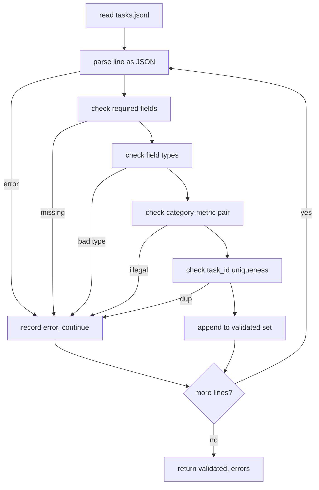

# Task Spec 格式 (Task Spec Format)

> 評估 harness 的好壞，取決於它的任務所遵守的契約。在寫任何一個評分函式之前，先凍結 JSONL 的形狀與指標詞彙。

**Type:** Build
**Languages:** Python
**Prerequisites:** Phase 19 Track B foundations
**Time:** ~90 分鐘

## 學習目標 (Learning objectives)

- 定義 JSONL 任務記錄的 schema，用同一個形狀涵蓋算術、選擇題、程式碼執行、分類與自由文字摘要。
- 固定一組封閉的指標名稱詞彙，讓下游課程 (71-73) 能依單一欄位派送。
- 把 few-shot 範例與後處理規則定義為任務的一部分，而不是 runner 的一部分，讓同一個 prompt 在不同模型間產生相同的目標。
- 實作嚴格的 validator，在格式錯誤的記錄到達 runner 之前就拒絕它們。
- 附帶 10 個任務的 fixture 集，涵蓋規格的每個分支，讓 validator 有真正的東西可以處理。

```figure
ci-task-spec-gate
```

## 為什麼要凍結規格 (Why a frozen spec)

研究程式碼庫累積評估腳本的速度，會比累積測試快。六個月後，每個 notebook 都有自己的 JSON 形狀，每個指標都被重新實作兩次，而且不同 run 之間什麼都無法比較。解法很無聊：選定一個 schema。寫一個 validator。拒絕其他一切。這就是本課要做的。

這個形狀借用了 BIG-bench、HELM 與 lm-eval 風格 harness 的想法，但欄位名稱是我們自己的。每個欄位只有一個擁有者。Runner 讀取任務。指標讀取目標。後處理步驟正規化生成結果。沒有任何欄位能在管線中途被修改。

## 記錄的形狀 (The record shape)

任務是單一行上的 JSON 物件。Harness 讀取 `tasks.jsonl`，並獨立驗證每一行。壞掉的一行只會中止那筆記錄，而不是整個 run。

```json
{
  "task_id": "arith_001",
  "category": "arithmetic",
  "prompt": "Compute the result. Question: 17 + 24\nAnswer:",
  "targets": ["41"],
  "metric_name": "exact_match",
  "few_shot_examples": [
    {"prompt": "Question: 2 + 2\nAnswer:", "completion": "4"}
  ],
  "post_process": "strip_whitespace",
  "metadata": {"difficulty": "easy"}
}
```

必要欄位是 `task_id`、`category`、`prompt`、`targets`、`metric_name`、`post_process`。`few_shot_examples` 與 `metadata` 是可選的。未知的頂層欄位會驗證失敗。

## 欄位規則 (Field rules)

`task_id` 是不含空白的字串。Validator 強制整個檔案內必須唯一。

`category` 是 `arithmetic`、`mcq`、`code_exec`、`classification`、`summary` 之一。Category 限制哪些指標與後處理的組合是合法的。`code_exec` 任務必須使用 `metric_name = code_exec`，而 `mcq` 任務必須對單一字母的目標使用 `metric_name = exact_match`。

`prompt` 是非空字串。Validator 禁止結尾有空白，並拒絕 prompt 本文中已經含有 few-shot 區塊的記錄。Few-shot 的渲染發生在 runner 中，而不是作者那裡。

`targets` 是非空的字串清單。對 `exact_match`，任何一個元素符合就算數。對 `f1` 與 `rouge_l`，取得分最高的目標。對 `mcq`，清單恰好只有一個元素。

`metric_name` 是 `exact_match`、`f1`、`bleu_4`、`rouge_l`、`accuracy`、`code_exec` 之一。詞彙是封閉的。新增指標需要新的一課，以及這裡的新項目。

`few_shot_examples` 是 `{prompt, completion}` 配對的清單。Validator 把清單上限定為八個項目，讓 prompt 保持有界。

`post_process` 是 `none`、`strip_whitespace`、`lower`、`extract_letter`、`extract_code_block`、`extract_first_line` 之一。每條規則只有單一的確定性行為。Validator 禁止組合多條規則。

## Validator 的行為 (Validator behaviour)



Validator 回傳兩份清單：通過驗證的記錄，以及錯誤記錄（含有問題的那一行、被違反的規則與出錯的欄位）。除非明確設定 `--allow-bad-tasks` 旗標，否則只要錯誤清單不是空的，runner 就拒絕啟動。

## Few-shot 渲染 (Few-shot rendering)

Runner 把 few-shot 範例串接在 prompt 之前，中間以空白行分隔。每個模型都走同一條程式路徑，所以唯一的變異來源就是模型本身。作者只寫一次範例，而不是每個 provider 各寫一次。

```python
def render(task):
    parts = []
    for ex in task.get("few_shot_examples", []):
        parts.append(ex["prompt"] + " " + ex["completion"])
    parts.append(task["prompt"])
    return "\n\n".join(parts)
```

## 後處理規則 (Post-process rules)

後處理步驟在生成之後、指標之前執行。它是確定性且無狀態的。

- `none` 原封不動回傳字串。
- `strip_whitespace` 去掉前後空白。
- `lower` 轉為小寫。
- `extract_letter` 回傳第一個符合 `[A-E]` 的字元，用於 MCQ。
- `extract_code_block` 回傳第一個三重反引號 fenced 區塊的本文，用於 code-exec。
- `extract_first_line` 回傳第一個非空行，用於摘要分類。

需要這份清單以外規則的任務，屬於新的一課。

## 本課不做什麼 (What this lesson does not do)

它不評分。它不呼叫模型。它不執行程式碼。那些在第 71、72 與 75 課。本課凍結的是它們全都遵守的契約。

10 個任務的 fixture 涵蓋兩個算術項目、兩個 MCQ 項目、兩個 code-exec 項目、兩個分類項目，以及兩個摘要項目。Validator 對這 10 個全都通過。另一個 fixture (`tasks_bad.jsonl`) 會觸發每一條規則，validator 剛好回傳那麼多個錯誤。

## 如何閱讀程式碼 (How to read the code)

`main.py` 定義了 `TaskSpec`、`validate_task`、`validate_file` 與 CLI 進入點。Fixture loader 是 `load_fixtures`。渲染與後處理的輔助函式放在驗證旁邊，讓第 75 課的 runner 只需匯入單一模組。

由上到下讀 `main.py`。然後讀 `code/tests/test_spec.py`。測試固定了每一條驗證規則與每一個後處理行為。`main.py` 底部的示範會驗證附帶的 fixture 並印出摘要。

## 延伸方向 (Going further)

真正的評估套件長出 category，就像 schema 長出欄位一樣。穩健的做法是，沒有同時新增指標、後處理規則，以及至少一個 fixture 任務，就拒絕新增 category。把規格當成資料庫 migration 看待。每次變更都要經過審查、版本化，並附上測試。本課的 validator 就是這道關卡。
