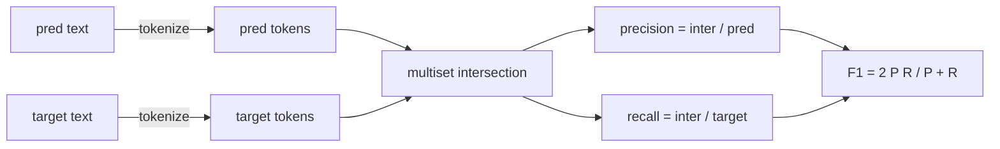
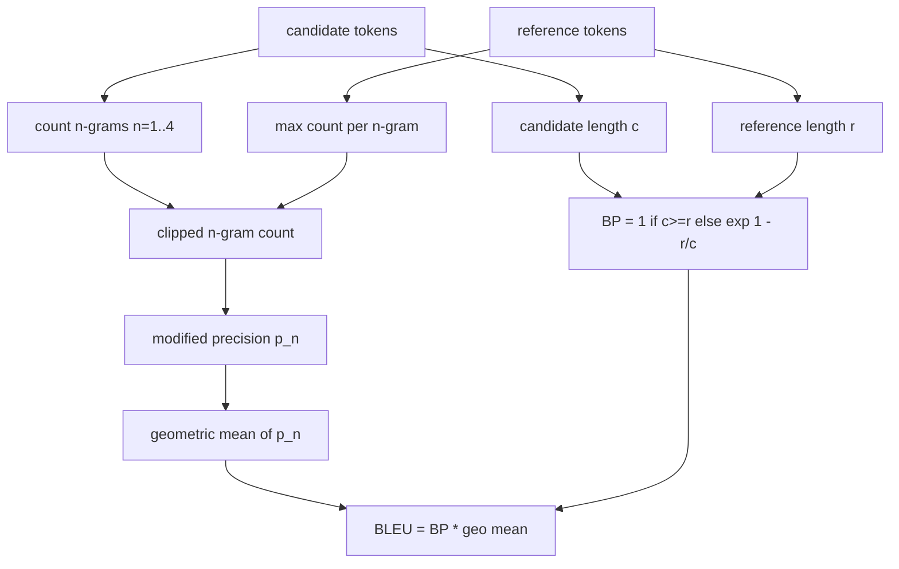

# 經典指標 (Classical Metrics)

> BLEU、ROUGE-L、F1、exact-match、accuracy。這五個指標仍然占了已發表 LLM 評估數字的大多數。從第一原理實作每一個，這樣你才知道那個數字的意思。

**Type:** Build
**Languages:** Python
**Prerequisites:** Phase 19 Track B foundations, lesson 70
**Time:** ~90 分鐘

## 學習目標 (Learning objectives)

- 以明確的 tokenization 規則，實作 token 層級的 exact-match、F1 與 accuracy。
- 從頭實作 BLEU-4：修正後的 n-gram precision、n 等於 1 到 4 的幾何平均，以及簡短懲罰 (brevity penalty)。
- 使用最長共同子序列實作 ROUGE-L，並以 F-beta 組合 precision 與 recall。
- 依第 70 課的 metric_name 欄位派送，讓 runner 與指標無關。
- 用從實際算例取得的參考向量固定行為，而不是從第三方函式庫取得。

```figure
cd-bleu-overlap
```

## 為什麼要重新實作 (Why reimplement)

你會讀到一篇論文回報 BLEU 28.3，另一篇回報 BLEU 0.283。你會發現 ROUGE-L 分數在兩個函式庫之間差了十分，因為其中一個轉成小寫，另一個沒有。不再困惑的最快方法，是自己寫這些指標，然後指出決定 tokenizer 的那一行，和套用平滑的那一行。之後，跨論文比較數字就變成閱讀指標設定的問題，而不是爭論函式庫。

Stdlib 加 numpy 就夠了。BLEU 是計數加一個 clamp。ROUGE-L 是動態規劃。F1 是 token 上的集合交集。最難的部分是選定 tokenizer 並堅持使用它。

## Tokenization

Tokenizer 是 `re.findall(r"\w+", text.lower())`。轉小寫、取連續的字詞字元（字母、數字與底線），丟掉其餘的一切。本課的每個指標都使用這個完全相同的 tokenizer。Runner 無權選擇。如果你換了 tokenizer，你就是在跑不同的 benchmark。

```python
TOKEN_RE = re.compile(r"\w+", re.UNICODE)
def tokenize(text):
    return TOKEN_RE.findall(text.lower())
```

這是刻意的簡化。正式環境的設定會在意 CJK、縮寫與程式碼識別字。本課的重點是：tokenizer 是契約，不是旋鈕。

## Exact match

```python
def exact_match(pred, targets):
    return float(any(pred.strip() == t.strip() for t in targets))
```

每個任務回傳 1.0 或 0.0。整個資料集的聚合是平均。這是算術、MCQ 與簡短分類任務的主力。

## Token 層級的 F1 (Token-level F1)

建立預測與目標的 token multiset。Precision 是 multiset 交集除以預測的 multiset。Recall 是相同的交集除以目標的 multiset。F1 是調和平均數。實作處理了預測為空與目標為空的邊界情況。



對於多目標任務，我們取目標清單中最佳的 F1。這符合文獻中廣泛回報的 SQuAD 風格行為。

## BLEU-4

BLEU 是標準的機器翻譯指標，在摘要工作中仍然會出現。我們使用的公式是句子層級的 BLEU-4，對每個預測與參考的配對評分，使用標準的簡短懲罰，並對修正後的 n-gram 計數做加一平滑，讓單一個缺少的 4-gram 不會把分數推到零。

對每個候選與參考的配對，我們計算 n 等於 1、2、3、4 的修正後 n-gram precision。修正後的 precision 以任一參考中該 n-gram 的最大計數，截斷候選的 n-gram 計數，所以候選無法靠重複一個片語來灌水。四個 precision 的幾何平均再套上簡短懲罰。



平滑規則是 Lin 與 Och 所稱的 method 1：在取 log 之前，對每個 n-gram precision 的分子與分母都加一。這避免了參考沒有任何相符 4-gram 時出現 `log 0`，並且在長候選上與未平滑的值很接近。

## ROUGE-L

ROUGE-L 比較候選與參考 token 序列的最長共同子序列。LCS 捕捉字詞順序，卻不要求連續，這就是它成為預設摘要指標的原因。我們用標準的動態規劃表計算 LCS 長度，然後得到 recall 為 `lcs / reference length`、precision 為 `lcs / candidate length`，並以 beta 等於一的 F-beta 組合，得到對稱的 F1 形式。

```python
def lcs_length(a, b):
    n, m = len(a), len(b)
    dp = numpy.zeros((n + 1, m + 1), dtype=int)
    for i in range(n):
        for j in range(m):
            if a[i] == b[j]:
                dp[i+1, j+1] = dp[i, j] + 1
            else:
                dp[i+1, j+1] = max(dp[i+1, j], dp[i, j+1])
    return int(dp[n, m])
```

numpy 表讓實作易讀；純 Python 的 list 也行得通。選用 ROUGE-L 的任務，每個任務要付 $O(n m)$ 的成本。對典型的摘要長度，這會維持在一毫秒以下。

## Accuracy

對分類任務，accuracy 化簡為 exact-match：如果預測符合清單中任何一個正規化後的目標，就得 1 分。我們把它暴露為獨立的函式，讓派送器可以依 `metric_name` 派送，而不必在 runner 內做字串比較。

## 派送的約定 (Dispatch contract)

單一進入點是 `score(metric_name, prediction, targets)`。它回傳 `[0, 1]` 內的 float。Runner 不會依指標名稱分支。它把呼叫交出去並寫下結果。這個介面，就是第 75 課會與第 70 課的任務規格黏合的地方。

```python
def score(metric_name, pred, targets):
    if metric_name == "exact_match":
        return exact_match(pred, targets)
    if metric_name == "f1":
        return max(f1_score(pred, t) for t in targets)
    if metric_name == "bleu_4":
        return max(bleu4(pred, t) for t in targets)
    if metric_name == "rouge_l":
        return max(rouge_l(pred, t) for t in targets)
    if metric_name == "accuracy":
        return accuracy(pred, targets)
    raise ValueError(f"unknown metric_name: {metric_name}")
```

`code_exec` 在第 72 課處理，並在那裡放進派送器。

## 本課不做什麼 (What this lesson does not do)

它不呼叫模型。它不做第 70 課的後處理規則已經做過之外的任何生成結果正規化。它不計算信賴區間。它不做 BLEURT 或 BERTScore（那些需要模型，屬於另一課）。重點是底線：五個指標、一個 tokenizer、一張派送表。

## 如何閱讀程式碼 (How to read the code)

`main.py` 把每個指標定義為獨立函式，外加派送器。參考向量放在檔案底部的 `_reference_examples` 區塊。示範對八個範例執行派送器，並印出各指標的分數。`code/tests/test_metrics.py` 中的測試固定了參考向量，並對每個邊界情況施壓（空預測、空參考、沒有共享 token、exact match、重複片語的截斷）。

由上到下讀 `main.py`。函式依複雜度排序。exact_match 與 accuracy 各一行。F1 是六行。BLEU 與 ROUGE-L 是比較重的部分，其中附有關於平滑規則與 LCS 遞迴的詳細註解。

## 延伸方向 (Going further)

經典指標是必要的，但不充分。它們獎勵表面的重疊，卻漏掉意義。解法是在你信任了經典底線之後，往上疊加以模型為基礎的指標（BLEURT、BERTScore、GEval）。那是後面的課程。現在：讓這五個指標運作、用測試固定它們，你就擁有一組可稽核、快速、可重現的指標堆疊。
