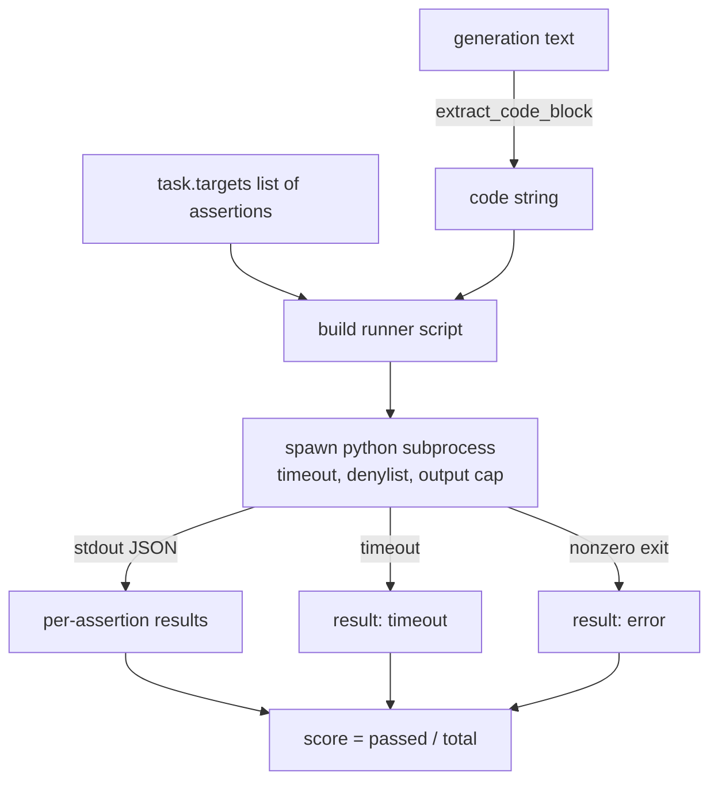
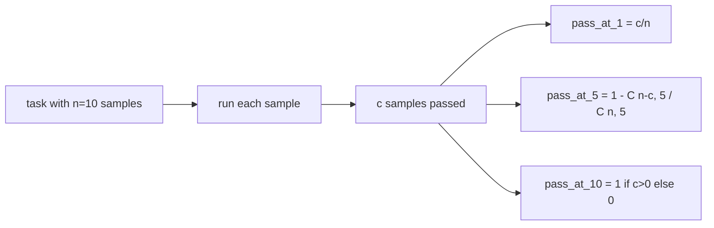

# Code Exec 指標 (Code Exec Metric)

> 生成的程式碼，在通過測試時才是對的。評估 harness 必須擷取程式碼、在不讓主機當機的情況下執行它，並誠實地統計通過率。本課建立這個介面。

**Type:** Build
**Languages:** Python
**Prerequisites:** Phase 19 Track B foundations, lessons 70 and 71
**Time:** ~90 分鐘

## 學習目標 (Learning objectives)

- 以符合第 70 課後處理規則的方式，從自由格式的生成結果中擷取程式碼區塊。
- 在隔離的子行程中執行候選程式碼，並設有牆上時間 timeout、輸出上限與 import 拒絕清單 (denylist)。
- 把任務的分數定義為，提供的 assertion 字串中通過候選程式碼的比例。
- 對從一個模型取樣多次生成的任務，計算 pass-at-k。
- 把 sandbox 當機、語法錯誤與 timeout 視為一等的失敗模式，並使用 runner 可以記錄的不同結束碼。

```figure
sandbox-runner
```

## 為什麼用隔離的子行程 (Why an isolated subprocess)

行內的 `exec` 是安全性與穩定性的隱患。生成的 `while True: pass` 會讓評估永遠卡住。生成的 `import shutil; shutil.rmtree('/')` 正如聽起來一樣是場災難。解法是為每個候選產生一個全新的 Python 直譯器，把程式碼從 stdin 傳入，把 assertion 結果寫到 stdout，並在它超時時終止該行程。主機的評估行程會繼續執行。

像 HumanEval、MBPP、BigCodeBench 與 LiveCodeBench 這樣的真實評估，全都使用子行程 sandbox。有些還在上面疊 Docker。我們止步於子行程是有理由的：它可攜、屬於 stdlib，並且能抓到對教學用評估重要的失敗模式。正式環境的部署會加上 seccomp、網路隔離與唯讀檔案系統。下一堂關於強化的課程不在這個 track 之內。

## Code-exec 任務的形狀 (The shape of a code-exec task)

`code_exec` 任務在 `targets` 中帶有 assertion 字串。Runner 從生成結果中擷取 fenced 程式碼區塊，圍繞它建立測試 harness，並執行結果。



分數是 `[0, 1]` 內的分數。一個有三個 assertion、其中兩個通過的任務得分 0.667。無論什麼失敗，runner 回傳的形狀都一樣：子行程當機被映射為正規化的錯誤碼，而不是讓 Python traceback 冒泡到 harness。

## Denylist

Denylist 是以 import 為基礎的。在執行候選程式碼之前，runner 腳本會把危險模組的 import 改寫成會丟出 `ImportError("denied")` 的 stub。清單刻意保守：`os.system`、`subprocess`、`socket`、`requests`、`urllib`、`urllib.request`、`urllib.error`、`urllib.parse`、`ctypes`、`shutil`、`http.client`、`asyncio.subprocess`。

我們不假裝這是滴水不漏的。有決心的對抗性程式碼可以逃出 Python 中任何行程內的 sandbox。Denylist 只是後盾。牆上時間 timeout 與輸出上限才是承重的控制。

```python
DENIED = {
    "os.system": True,
    "subprocess": True,
    "socket": True,
    "shutil": True,
    "requests": True,
    "urllib": True,
    "ctypes": True,
}
```

我們透過在前面加上 `import sys`，以及一個 monkey-patch `os.system` 使其丟出例外的保護，來包裝候選程式碼。完整模板在 `main.py` 中。

## 牆上時間 timeout (Wall-clock timeout)

每個子行程預設有三秒的牆上時間預算。Runner 使用 `subprocess.run(..., timeout=t)`。如果 timeout 觸發，runner 會捕捉 `TimeoutExpired`、終止行程，並為該任務記錄 `timeout` 的結束原因。該任務的分數為零。Runner 繼續往下。

Timeout 是 `run_candidate` 的 `timeout_s` 參數；第 75 課的 runner 透過 `code_exec_timeout_s` 在每次 run 中設定一次。執行時間很長的單元測試可以要求更多，但 `run_candidate` 會把值限制在 0.1 到三十秒之間，讓套件保持有界。

## 輸出上限 (Output cap)

子行程可能灌爆 stdout，耗盡主機記憶體。Runner 把 stdout 串流到 buffer，一旦累計總量超過 256 KB，就立即終止子行程。結果記錄為 `exit_code = error`，細節字串為 `"output overflow"`。實務上，當生成結果不小心寫出一個會印出東西的無窮迴圈時，就會出現這種情況。

## Pass-at-k

Pass-at-k 是 HumanEval 及其同類使用的不偏估計量。給定每個任務 `n` 個獨立樣本，其中 `c` 個通過，那麼從這 `n` 個中取出大小為 `k` 的樣本，至少含有一個通過解答的機率為：

```
pass_at_k(n, c, k) = 1 - C(n - c, k) / C(n, k)
```

當 `n - c < k` 時，分子 `C(n - c, k)` 依慣例為零（你無法從少於 `k` 個失敗中挑出 `k` 個），所以值為 `1`。實作直接處理這個邊界情況。我們暴露 `pass_at_k(n, c, k)`，供第 74 課的排行榜層使用。



## 結束碼 (Exit codes)

Runner 對每個任務回傳五種結果之一：

- `pass`：每個 assertion 都通過。
- `assertion_fail`：程式碼執行了，但至少一個 assertion 失敗。
- `syntax_error`：程式碼無法 import，或有 SyntaxError。
- `timeout`：牆上時間耗盡。
- `error`：任何其他當機，包括 denylist 命中與輸出溢出（溢出時的細節為 `"output overflow"`）。

分數仍然是一個分數。結束碼是 metadata。下游的課程可以決定要把 timeout 算成零，還是算成遺失資料。

## 本課不做什麼 (What this lesson does not do)

它不會給你真正的 sandbox。它不會執行來自開放網路、不受信任的程式碼。它不處理像檔案 I/O 或網路呼叫這種有狀態的任務。那些需要容器或 microVM。本課的重點是契約：隔離的子行程、denylist、timeout、輸出上限、乾淨的結束碼詞彙，以及 pass-at-k 的數學。

## 如何閱讀程式碼 (How to read the code)

`main.py` 定義了 `extract_code`、`run_candidate`、`score_code_exec` 與 `pass_at_k`。子行程的 runner 腳本被建立成字串，並以 `-c` 傳給全新的 Python 直譯器。`code/tests/test_exec.py` 中的測試，用 HumanEval 風格的算例，驗證四種結束碼加上 pass-at-k。

由上到下讀 `main.py`。Runner 模板是承重的部分。盯著 assertion 迴圈看，直到你能預測它寫回父行程的 JSON 封包為止。

## 延伸方向 (Going further)

一旦子行程的形狀可以運作，下一個考量是可攜性。不同的 Python 版本在 Windows 上處理 SIGKILL 的方式不同。最乾淨的修法是把 runner 放進 Docker 映像檔。再往後的下一件事，是用真正的單元測試檔取代 assertion 字串，讓評估與正式環境 CI 所做的一致。到那個時候就別再把 assertion 字串稱為測試了；它們是玩具測試，也有玩具般的失敗模式。
