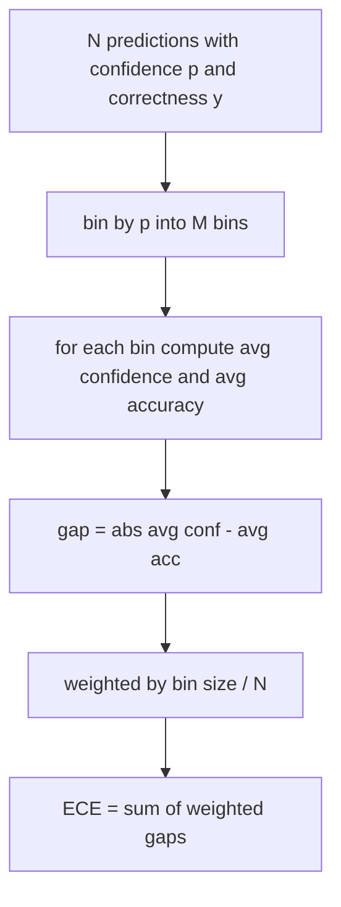
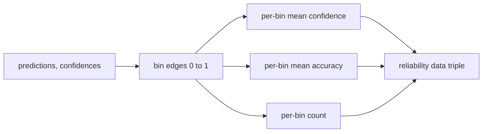

# Perplexity 與校準 (Perplexity and Calibration)

> 如果你的模型在一千個答案上都說有 90% 的信心，卻只答對六百個，它就沒有校準好。校準是值得信賴的評估的一半。另一半是 perplexity，它告訴你模型是否覺得保留的文字根本是合理的。

**Type:** Build
**Languages:** Python
**Prerequisites:** Phase 19 Track B foundations, lessons 70 and 71
**Time:** ~90 分鐘

## 學習目標 (Learning objectives)

- 從模型 adapter 提供的 token negative log-probability，計算保留語料上 token 層級的 perplexity。
- 從分 bin 的預測機率，計算分類器或選擇題評估的 expected calibration error (ECE)。
- 計算 Brier score（對正確性指示變數的均方誤差），並解釋它何時能做 ECE 做不到的事。
- 建立畫出信心對準確率曲線所需的 reliability diagram 資料。
- 把三者都接進評估 harness，讓 runner 能把 `perplexity`、`ece` 與 `brier` 數字附加到模型報告上。

```figure
cd-reliability-diagram
```

## Perplexity 告訴你什麼 (What perplexity tells you)

Perplexity 是每個 token 的平均 negative log-likelihood 取指數。越低越好。Perplexity 為一，表示模型對每個實際的 token 都指派機率一。Perplexity 等於詞彙表大小，表示模型是均勻分佈，什麼都沒學到。真實的數字介於兩者之間：2026 年一個強的 base 模型在 WikiText-103 上大約是八到十二。同樣的文字上，一個差的模型則在五十以上。

Harness 本身不計算 log-probability。那些來自模型 adapter。Harness 做聚合：它取得每個 token log-probability 的清單、每個序列的 token 數清單，並回傳語料的 perplexity。

```python
def perplexity(neg_log_probs, token_counts):
    total_nll = sum(neg_log_probs)
    total_tokens = sum(token_counts)
    return math.exp(total_nll / total_tokens)
```

實作處理零 token 的邊界情況，並斷言 negative log-probability 是非負的。常見的錯誤是忘記取負號：回傳 `log p` 而不是 `-log p` 的 adapter，會產生低於一的 perplexity，這是不可能的。函式會把它當作契約違反抓出來。

## ECE 衡量什麼 (What ECE measures)

Expected calibration error 依信心把預測分到固定數量的 bin，然後衡量各 bin 中信心與準確率之間的平均差距，並以 bin 的大小加權。



標準的公式在 `[0, 1]` 上使用十個等寬的 bin。實作支援任何正整數的數量。我們暴露 `bins` 參數，讓 runner 可以在發表慣例 (10) 與比較慣例 (15) 之間選擇。

ECE 會被 bin 的數量與樣本大小所偏誤。用十個 bin 和一百個預測，你無法區分 0.02 的 ECE 與隨機雜訊。實作會連同 ECE 一起回傳有資料的 bin 數量，讓 runner 可以在樣本太少時，拒絕回報單一數字。

## Brier score 做了 ECE 沒做的事 (What Brier score does that ECE does not)

ECE 只在意每個 bin 中的平均差距。它對每個 bin 取絕對差距，所以不同 bin 的差距不會互相抵消。但在一個 bin 之內它們可以：如果 bin 中有些預測過度自信、有些則信心不足，bin 的平均可以吻合，這個 bin 對 ECE 幾乎沒有貢獻，然而每個預測的校準都很差。Brier score 衡量每個預測相對於真實結果的平方誤差，所以它直接懲罰離散程度。

對二元結果，Brier 是 `mean((p_i - y_i)^2)`。它可以分解為 reliability、resolution 與 uncertainty。我們同時計算分數與分解。Runner 回報純量，但把分解記錄下來供儀表板使用。

```python
def brier(p, y):
    return float(np.mean((p - y) ** 2))
```

## Reliability diagram 資料 (Reliability diagram data)

Reliability diagram 畫出每個 bin 中預測信心對經驗準確率。對角線是完美的校準。函式回傳三個陣列：每個 bin 的平均信心、每個 bin 的平均準確率，以及每個 bin 的計數。畫圖的程式碼在下游；本課止步於資料的形狀。



回傳的 tuple 就是呼叫層畫圖或計算自訂 ECE 變體（adaptive ECE、sweep ECE 等）所需要的。我們回傳 numpy 陣列，讓下游程式碼不必轉換。

## 信心的來源 (Confidence sources)

Harness 不假設信心來自 softmax。它接受每個預測在 `[0, 1]` 內的任何數字。對選擇題任務，自然的信心是對選項 log-likelihood 做 softmax。對自由文字，自然的信心是模型自我回報的機率，或平均 log-likelihood 的指數。評估只是消費這個數字。它從哪裡來是 adapter 的工作。

## 邊界情況 (Edge cases)

- 所有預測都錯：ECE 是平均信心，Brier 很高，perplexity 是模型對該文字的看法。
- 所有預測都以高信心答對：ECE 接近零，Brier 接近零。
- p=0.5 的完全不確定預測器：每個預測都落在同一個 bin，所以 ECE 是 `|0.5 - accuracy|`。Brier 恰好是 0.25，因為不論 `y` 是 0 或 1，`(0.5 - y)^2 = 0.25`。
- 空輸入：ECE、Brier 與 reliability 回傳 `0.0`（或填零的陣列）。零 token 的情況下，Perplexity 回傳 `NaN`。這些路徑都不會發出警告；runner 檢查這些值，並決定要回報還是略過。

這些情況都已寫進測試。真實模型在真實 benchmark 上不會遇到它們，但有 bug 的 adapter 或很小的樣本會，而 runner 不該因此當掉。

## 派送 (Dispatch)

校準不像 F1 那樣是每個任務的指標。它是每個模型的報告。Runner 在整個評估過程中累積 `(confidence, correct)` 配對，並只計算一次 ECE、Brier 與 reliability 資料。Perplexity 則是在保留的文字語料上計算，與逐任務的評分分開。

介面是：

```python
report = CalibrationReport.from_predictions(confidences, correct)
report.ece          # float
report.brier        # float
report.reliability  # tuple of three numpy arrays
report.populated_bins  # int
```

`PerplexityResult.from_token_nll(neg_log_probs, token_counts)` 回傳 perplexity 與每個 token 的平均 negative log-likelihood。

## 本課不做什麼 (What this lesson does not do)

它不呼叫模型。它不實作 softmax。它不從輸出 token 估計信心；那是 adapter 的工作。它不做 temperature scaling 或 Platt scaling；那些是事後的修正，屬於另一課。本課的重點是讓這三個數字（perplexity、ECE、Brier）值得信賴且可重現。

## 如何閱讀程式碼 (How to read the code)

`main.py` 定義了 `perplexity`、`expected_calibration_error`、`brier_score`、`reliability_diagram`，以及 `CalibrationReport` / `PerplexityResult` dataclass。示範在已知真實答案的合成預測上執行：一個校準良好的模型、一個過度自信的模型，以及一個信心不足的模型。`code/tests/test_calibration.py` 中的測試固定了每個邊界情況，以及合成預測器的參考值。

由上到下讀 `main.py`。函式的順序從純量到向量到報告。每個函式都有簡短的 docstring，說明數學與契約。

## 延伸方向 (Going further)

校準是已發表評估中最被忽略的軸。大多數排行榜只回報單一個 accuracy 數字就當作完成。一個在 accuracy 上勝出、卻在 Brier 上落敗的模型，作為正式環境的部署，比一個 accuracy 低幾分、卻能可靠回報自己不確定性的模型更差。一旦你有了校準的管線，就在保留的驗證切片上加入 temperature scaling，重新計算 ECE，並觀察差距縮小。那是另一課，但底線在這裡。
