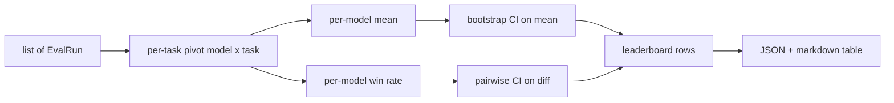
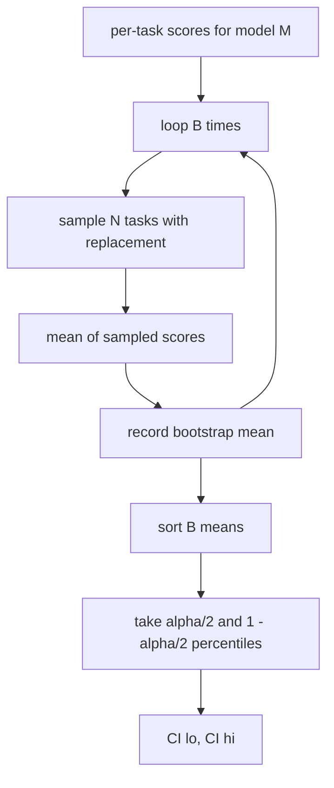

# 排行榜聚合 (Leaderboard Aggregation)

> 每個任務的分數很容易。跨異質任務的每個模型排名比較難。在千筆預測的排行榜上做統計顯著性，則是大家都跳過的部分。本課不跳過它。

**Type:** Build
**Languages:** Python
**Prerequisites:** Phase 19 Track B foundations, lessons 70, 71, 73
**Time:** ~90 分鐘

## 學習目標 (Learning objectives)

- 把多個模型、多個任務的每任務分數聚合成每個模型一列的整齊資料。
- 正規化異質的分數，讓通過率與 BLEU 值不會過度影響聚合結果。
- 依平均與勝率為模型排名，並解釋各自何時是正確的摘要。
- 對每個模型的平均分數，以及成對差異，計算 bootstrap 信賴區間。
- 把排行榜輸出為 JSON 報告，以及第 75 課的 runner 可以貼進 CI 留言的 markdown 表格。

```figure
ci-leaderboard-ci
```

## 輸入的形狀 (The shape of input)

聚合器消費一份 `EvalRun` 記錄的清單：

```python
@dataclass
class EvalRun:
    model_id: str
    task_id: str
    metric_name: str
    score: float          # in [0, 1]
    category: str
```

第 75 課的 runner 對每個 `(model, task)` 配對輸出一筆記錄。聚合器不在乎分數是怎麼產生的。它預期正規化已經發生：每個分數都在 `[0, 1]` 內。

## 輸出 (The output)

會產生三張表：



排行榜的每一列包含：`model_id`、`mean_score`、`mean_ci_lo`、`mean_ci_hi`、`win_rate`、`tasks_completed`，以及可選的 `categories` 對照表，記錄每個類別的平均。

## 正規化 (Normalisation)

如果一個任務的分數落在 `[0, 1]`，另一個落在 `[0, 100]`，第二個會悄悄主導平均。聚合器驗證每個輸入分數都在 `[0, 1]` 內，否則拒絕該次 run。修正方法在上游：指標應該已經回傳一個分數。第 71 到 73 課強制執行了這份契約。

## 平均與勝率 (Mean and win-rate)

兩種排名方案服務於不同的目標。

平均分數是一個模型各任務分數的平均。這是排行榜回報的頭條數字。它對離群值與任務不平衡敏感。

勝率計算一個模型在同一任務上擊敗所有其他模型的頻率。對每個任務，最高分的模型獲勝（平手則讓每個平手的模型都得到完整的一勝）。勝率等於勝場數，除以該模型有分數的任務數。它對離群值與尺度差異較不敏感，但會損失資訊。

```python
def win_rate(model_id, runs_by_task, all_models):
    wins, total = 0, 0
    for task_id, runs in runs_by_task.items():
        scores = {r.model_id: r.score for r in runs if r.model_id in all_models}
        if model_id not in scores:
            continue
        total += 1
        best = max(scores.values())
        if scores[model_id] >= best:
            wins += 1
    return wins / total if total else 0.0
```

Harness 兩者都回報。第 75 課的 runner 預設依平均排名；勝率的 markdown 欄位就放在那裡，以防使用者偏好它。

## Bootstrap 信賴區間 (Bootstrap confidence intervals)

每個模型的平均都附帶一個信賴區間，透過對任務做 bootstrap 重抽樣來估計。我們以放回的方式重抽樣任務 id，計算重抽樣集合上的平均，重複 `B` 次，並取 `alpha` 水準的百分位區間。



對於成對比較，我們對每個任務的差異 `score_A - score_B` 做 bootstrap，取百分位區間並回報。使用者看區間是否排除零。如果排除，則差異在 alpha 水準下顯著。如果沒有，排行榜就把這些模型視為平手。

低階輔助函式 (`bootstrap_mean_ci`、`bootstrap_pairwise_diff`) 預設 `B=1000`；公開的聚合器 (`aggregate`、`pairwise_diffs`) 預設 `b=500`，讓示範與測試保持快速。預設的 alpha 是 0.05。本課讓 bootstrap 保持純 numpy，沒有 scipy。

## 類別 (Categories)

如果設定了 `EvalRun.category`，聚合器也會回報每個類別的平均。這是每個排行榜上寫著 `math`、`reasoning`、`code`、`safety` 的那一欄。它讓 runner 能看出某個模型整體不錯，但在 code 上很弱，這是頭條平均所隱藏的資訊。

## Markdown 渲染 (Markdown rendering)

排行榜被渲染成 markdown 表格：

```text
| Rank | Model | Mean | 95% CI | Win rate | Tasks |
|------|-------|------|--------|----------|-------|
| 1    | gpt   | 0.78 | 0.74-0.82 | 0.62 | 50 |
| 2    | claude| 0.75 | 0.71-0.79 | 0.34 | 50 |
| 3    | random| 0.10 | 0.07-0.13 | 0.04 | 50 |
```

表格依平均分數排序。CI 渲染到小數點後兩位。過長的模型 id 會被截斷到二十個字元。

## 本課不做什麼 (What this lesson does not do)

它不執行模型。它不呼叫指標層。它不實作 adaptive ECE 或其他校準變體；那些在第 73 課。它不實作任務加權。這裡每個任務的份量都相同。正式環境的排行榜會為任務加權；我們透過 `weight` 欄位保留了這個掛鉤，但聚合器忽略它。如果你需要加權，請在後續課程中加入。

## 如何閱讀程式碼 (How to read the code)

`main.py` 定義了 `EvalRun`、`LeaderboardRow`、`aggregate`、`bootstrap_mean_ci`、`bootstrap_pairwise_diff` 與 `render_markdown`。示範建立三個模型、十二個任務的合成套件，進行聚合，並印出排行榜加上成對差異表。`code/tests/test_leaderboard.py` 中的測試固定了 bootstrap、markdown 渲染、勝率的邊界情況，以及空輸入的行為。

由上到下讀 `main.py`。資料形狀 (EvalRun、LeaderboardRow) 最先，接著是聚合器，第三是 bootstrap，最後是渲染。每個函式都有聚焦的契約。

## 延伸方向 (Going further)

每個模型的區間是不成對的，但模型比較應該是成對的。如果模型 A 和 B 都跑了同樣的一百個任務，適當的檢定是對逐任務差異做成對 bootstrap，而 `bootstrap_pairwise_diff` 已經實作了這一點。除此之外，你還需要一個尊重任務家族的階層式 bootstrap（數學題之間並非彼此獨立；一個算術錯誤模式會影響其中十題）。那是後續的事。本課的重點是把底線做對，讓評估回報一個你站得住腳的數字。
