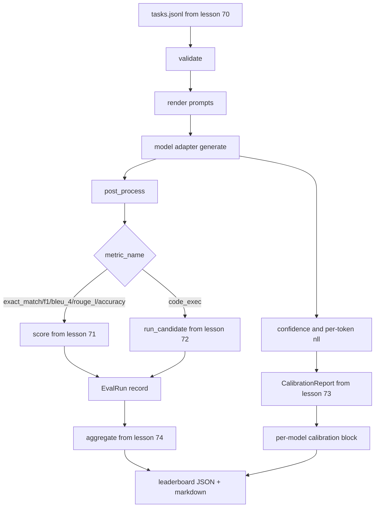

# 端到端評估 Runner (End-to-End Eval Runner)

> 五堂課的管線，一堂課把它們黏起來。Runner 讀取第 70 課的任務規格，透過 adapter 呼叫模型，用第 71 與 72 課評分，附上第 73 課的校準報告，並輸出第 74 課的排行榜。示範會自行終止。

**Type:** Build
**Languages:** Python
**Prerequisites:** Phase 19 Track B foundations, lessons 70 through 74
**Time:** ~90 分鐘

## 學習目標 (Learning objectives)

- 定義 `ModelAdapter` 介面，讓任何模型（mock、本地、API）都能用很小的方法介面滿足它。
- 透過 worker pool 平行執行任務，在 fixture JSONL 檔上執行評估。
- 在一次 pass 中組合指標層 (exact_match、F1、BLEU-4、ROUGE-L、code_exec) 與校準層。
- 輸出每個模型的 `EvalRun` 記錄，並直接餵進排行榜聚合器。
- 同時輸出 JSON 報告與 markdown 表格；乾淨執行時以零自行終止，驗證或執行期失敗時則以非零終止。

```figure
eval-grid
```

## 管線 (The pipeline)



Runner 是整合點。第 70 到 74 課各擁有一個模組，由 runner 組合。Runner 不重複那些模組中的任何邏輯：它直接 import 它們。

## Adapter 介面 (The adapter interface)

Adapter 是 runner 與任何模型之間的接縫。介面刻意保持很小。

```python
class ModelAdapter:
    model_id: str

    def generate(self, prompt: str, task: TaskSpec) -> Generation: ...
```

`Generation` 是一個 dataclass，包含：

- `text`：模型的自由格式輸出
- `confidence`：`[0, 1]` 內的 float，代表模型自我回報的答案機率
- `token_nll`：生成 token 的 negative log-likelihood 總和（可選）
- `token_count`：生成的 token 數量（可選）

Runner 中的 mock adapter 提供三種風味：`RuleBasedAdapter`（確定性，近乎完美）、`NoisyAdapter`（過度自信，常常答錯），以及 `BiasedAdapter`（擅長一個類別，在另一個類別上很糟）。示範對第 70 課的 fixture 執行這三者。

## 平行執行 (Parallel execution)

Runner 使用 `concurrent.futures.ThreadPoolExecutor` 對每個模型平行執行任務。Worker 數量預設為八與任務數中較小者。執行緒就夠了，因為真實模型呼叫的瓶頸是網路 I/O。Code-exec 路徑在任務內部產生自己的子行程，executor 只負責排程等待。

為了確定性的測試，runner 暴露 `run_eval(adapters, tasks, parallel=False)`，讓測試可以固定執行順序。

## 單次 pass 的評分迴圈 (The single-pass scoring loop)

對每個任務：

1. 渲染 prompt（few-shot 前綴加上 prompt 本文）。
2. 呼叫 adapter 並計時。
3. 依任務的規則對生成結果做後處理。
4. 派送到指標層。
5. 建立帶有分數與指標 metadata 的 `EvalRun` 記錄。
6. 把 `(confidence, correct)` 配對附加到校準 buffer。

`correct` 訊號對 exact_match 風格的指標 (`exact_match`、`accuracy`、`code_exec`) 是 `score >= 1.0`，對分級的指標則是 `score >= 0.5`。門檻存在 `_correct_from_score` 中，runner 沒有公開覆寫的方式。

## 聚合 (Aggregation)

每個任務都有結果之後，runner 呼叫第 74 課的 `aggregate` 與 `pairwise_diffs`，以及第 73 課的 `CalibrationReport.from_predictions`。輸出是單一的 JSON 封包：

```json
{
  "leaderboard": [...],
  "pairwise": [...],
  "calibration": {
    "model_id_a": {"ece": 0.04, "brier": 0.10, "populated_bins": 8, ...},
    ...
  },
  "summary": {
    "tasks": 10,
    "models": 3,
    "wall_seconds": 1.2
  }
}
```

Runner 也會把 markdown 表格寫到 stdout，讓使用者可以把結果貼進 PR 審查。

## 自行終止的示範 (Self-terminating demo)

示範對第 70 課的十個 fixture 任務執行三個 mock adapter。牆上時間應該在十秒以下。乾淨執行時，結束碼為零。

乾淨執行的標準是：

- 每個任務都通過第 70 課的驗證。
- 每個任務都通過第 71 與 72 課的評分。
- 校準報告在第 73 課中聚合時沒有錯誤。
- 排行榜將 rule-based adapter 嚴格排在 random adapter 之上。

如果其中任何一個壞掉，runner 會以非零結束，並在 JSON 封包中附上結構化的錯誤。

## 本課不做什麼 (What this lesson does not do)

它不呼叫真實的模型。它不實作 API key 流程或 rate-limit 處理。它不實作 streaming 或部分生成；adapter 每次呼叫回傳一個生成結果。它不做重試或快取。這些考量屬於 adapter 層；runner 與指標無關，也與 provider 無關。

## 如何閱讀程式碼 (How to read the code)

`main.py` 是整合。它透過一個以相對路徑解析的小型 `_load_sibling` 輔助函式，從其他五個課程的模組 import。Dataclass `Generation`、`EvalReport` 與 `ModelAdapter` 定義在本地。Mock adapter 在檔案底部。

由上到下讀 `main.py`。快速瀏覽 import，然後看 `run_eval`，接著是 `_score_one`，然後是各 adapter。最後的示範是進入點。

`code/tests/test_runner.py` 中的測試固定了 adapter 介面、單次 pass 迴圈、平行與循序的等價性、校準 buffer，以及 JSON 封包的形狀。

## 延伸方向 (Going further)

這個 runner 是底線。正式環境的評估系統還會加上：以 `(task_id, model_id, model_version)` 為 key 的結果快取、追蹤每次 run 的金額與 token 的成本帳本、遇到 rate limit 時退避的重試層、pass-at-k 任務的取樣政策，以及給長套件使用的 streaming 輸出格式。每一項都是單一的考量，包在 runner 外面，不需要更動指標或聚合層。這種分離正是契約的重點。

在你的 mock 運作之後，再為一個真實的 provider 加上 adapter。選一個有免費額度的，寫三十行黏合程式碼，看著排行榜亮起來。然後加上第二個 provider，讓 harness 去做事。
