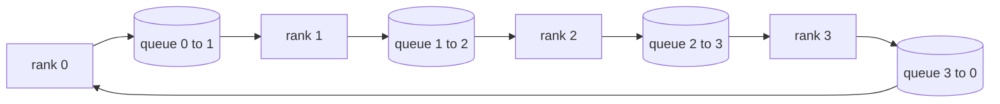

# 從零實作 Collective Ops (Collective Ops From Scratch)

> 撐起分散式訓練的四個 collective 操作是 allreduce、broadcast、allgather 與 reduce_scatter。訓練框架提供的其他所有基本元件，都是圍繞這些的包裝。在 `multiprocessing.Queue` mesh 上建立它們一次，對照參考實作驗證，這個 track 的其餘部分就變成管線工程了。

**Type:** Build
**Languages:** Python
**Prerequisites:** Phase 19 Track C lessons 42-49
**Time:** ~90 分鐘

## 學習目標 (Learning Objectives)

- 以兩個 pass（先 reduce-scatter 再 allgather）實作 ring allreduce，並證明每個 rank 每個元素的通訊量是 2(N-1)/N bytes。
- 在 `multiprocessing.Queue` 上的點對點傳送之上，建立 broadcast、allgather 與 reduce_scatter。
- 針對相同輸入，對照 `torch.distributed` 的 gloo 參考實作，驗證每個基本元件。
- 就叢集形狀、延遲下限與頻寬上限，為選擇 ring 或 tree 辯護。

## 問題 (The Problem)

天真的 allreduce 在 N 個 rank 之間，會把 tensor 傳送 N 次到 root，再 broadcast N 次回來。每個 rank 的頻寬以 $O(N)$ 成長，root 成為瓶頸，牆上時間的下限是最慢的連結乘以 N。Ring allreduce 把它攤平成 $2(N-1)$ 個大小為 $T/N$ 的 chunk，所以每個 rank 的 bytes 降到 $2T(N-1)/N$，隨著 N 變大趨近 $2T$，且不論叢集多大都不會超過。Tree allreduce 在小 N 與高延遲連結時勝出，因為深度是 $\log_2(N)$ 個 hop，而不是 $2(N-1)$。為叢集形狀選錯拓撲，最慢的 GPU 就會決定 step 時間。

你在這個 track 會讀到的每個分散式訓練框架，都依賴這四個基本元件。PyTorch DDP 用每個參數 bucket 一次 allreduce 來同步 gradient。ZeRO 用 reduce_scatter 對 optimizer 狀態分片，並用 allgather broadcast 更新後的參數。FSDP 把完整的 forward 變成 allgather 加 reduce_scatter。Pipeline parallel 需要 broadcast，在各 stage 群組之間傳送 activation。如果你無法實作這四個 collective，你就無法推論為什麼訓練會停滯、為什麼 gradient 不一致出現在 rank 3，或是為什麼換拓撲時 pipeline bubble 加倍。

## 核心概念 (The Concept)



### 兩個 pass 的 ring allreduce (Ring allreduce in two passes)

把 tensor 切成 N 個相等的 chunk，索引為 0..N-1。每個 rank 擁有索引等於自己 rank 的 chunk。Pass 1，reduce-scatter，執行 N-1 步。在第 s 步，rank r 把 chunk (r - s) mod N 傳給 rank (r + 1) mod N，並從 rank (r - 1) mod N 接收 chunk (r - s - 1) mod N，把接收到的 chunk 累加進本地副本。N-1 步之後，rank r 擁有 chunk r 的完整加總。Pass 2，allgather，再執行 N-1 步，沿環旋轉已完成的 chunk，直到每個 rank 都持有每個 chunk 的完整加總。

| 基本元件 | 每個 rank 的 bytes | 步數 | 何時使用 |
|----------|-------------------|------|----------|
| Ring allreduce | 2T(N-1)/N | 2(N-1) | 大 T、寬頻管道的同質叢集 |
| Tree allreduce | T log2(N) | 2 log2(N) | 小 T 或高延遲連結 |
| Broadcast | T | log2(N) tree | 參數初始化、純量設定 |
| Allgather | T(N-1)/N | N-1 | 分片 forward、ZeRO unshard |
| Reduce_scatter | T(N-1)/N | N-1 | ZeRO gradient 分片 |

### 以 Queue mesh 取代 NCCL (Queue mesh as a stand-in for NCCL)

NCCL 在 PCIe 與 NVLink 上執行，並有硬體卸載的 reduction。在 CPU 上你沒有這些。每條環邊一個 `multiprocessing.Queue`，提供單一生產者與單一消費者的有序點對點傳遞。Reduction 發生在 user space，所以你要付 Python 的額外開銷，但線路上的模式與 NCCL ring allreduce 完全相同。在 queue 版本上推論正確性，叢集行為就會跟著成立。

### 對照 gloo 驗證 (Verify against gloo)

每個基本元件都附帶單元測試，在相同的 world size 上，對相同的 tensor，將其輸出與以 gloo backend 初始化的 `torch.distributed` 比較。如果你的 ring allreduce 與 gloo 的差距超過 float32 epsilon，測試就失敗。對照參考實作驗證是不能妥協的；沒有它，基本元件看起來是正確的，直到真實訓練的第 10000 步才出問題。

```figure
ci-ring-allreduce
```

## 動手做 (Build It)

`code/main.py` 實作了：

- `Mesh` class，把 N 個 `multiprocessing.Queue` 實例接成一個環，並對每個 rank 暴露 `send(dst, tensor)` 與 `recv(src)`。
- `ring_allreduce(mesh, rank, world_size, tensor)`，執行兩個 pass 的演算法。
- `broadcast(mesh, rank, world_size, tensor, src)`，在對數 tree 上執行。
- `allgather(mesh, rank, world_size, tensor)`，使用 N-1 次旋轉。
- `reduce_scatter(mesh, rank, world_size, tensor)`，作為 allreduce 的前半。
- `_gloo_reference(op, world_size, tensor)`，把相同的輸入透過帶 gloo 的 `torch.distributed` 執行，以便逐位元組比較。

執行它：

```bash
python3 code/main.py
```

輸出：一張各基本元件的驗證表，比較 queue-mesh 與 gloo 的輸出，接著是每個 rank 的 byte 計數器，證明 2T(N-1)/N 的擴展關係。

## 實務上的正式環境模式 (Production patterns in the wild)

有三個模式把基本元件強化到足以發佈。

**allreduce 之前先把 gradient 分 bucket。** 一個 1B 參數的模型有數萬個 gradient tensor。每個 tensor 一次 allreduce，會付 N 次延遲下限。DDP 把 gradient 分成約 25 MB 的 bucket，每個 bucket 發出一次 allreduce；小的 tensor 搭著大的 tensor 順風車。沒有分 bucket，延遲額外開銷會主導 step 時間。

**讓通訊與運算重疊。** Backward 以相反順序逐層計算 gradient。最後一層的 gradient 一準備好，就在下一層繼續計算的同時啟動它的 allreduce。PyTorch DDP 用 bucket-ready hook 接上這一點。當網路有餘裕時，重疊可以讓可見的通訊時間減半。

**依訊息大小選擇 ring 或 tree，不要憑信仰。** NCCL 附帶拓撲偵測器，訊息大於約 1 MB 時選 ring，小於時選 tree。交叉點是頻寬對延遲：高於 1 MB，頻寬項 2T(N-1)/N 主導，ring 勝出；低於 1 MB，log2(N) 的 hop 數勝出。寫死一種拓撲，會在錯誤的訊息大小上損失吞吐量。

## 實際使用 (Use It)

正式環境的做法：

- **PyTorch DDP。** backward 之後，對分 bucket 的 gradient 呼叫 `dist.all_reduce`。Bucket 大小可調；預設 25 MB 對 100Gbit 乙太網路是合理的。
- **DeepSpeed ZeRO。** 發出 reduce_scatter 以對 gradient 分片，並在 forward 之前發出 allgather 以重建完整參數。本課的基本元件正是 ZeRO 所做的呼叫。
- **FSDP。** Forward 從 allgather 開始以 unshard 該層，計算，然後用 reduce_scatter 做 reduce 並丟棄 unshard。相同的基本元件，不同的排程。

## 交付 (Ship It)

在第 77-81 課使用 queue-mesh 基本元件。第 77 課把 allreduce 接進 DDP。第 78 課把 reduce_scatter 接進 ZeRO。第 79 課用點對點的 send 和 recv（而不是 collective）搬移 pipeline activation。第 81 課把全部四個組合進端到端示範。

## 練習 (Exercises)

1. 新增 tree allreduce 變體，並依訊息大小在 ring 與 tree 之間切換。量測交叉點。
2. 新增 `recv_timeout_ms`，讓卡住的 rank 浮現 deadline 錯誤，而不是永遠卡住。
3. 把四個基本元件的 `multiprocessing.Queue` 換成 TCP socket。相同的測試，真正的線路。
4. 新增頻寬儀表 hook，讓每個 rank 的 byte 計數器記錄到 JSONL。
5. 在 4 個 rank 上，對大小為 1KB、1MB、16MB 的 tensor，比較 ring 與 tree 的牆上時間。以實驗為交叉點辯護。

## 關鍵術語 (Key Terms)

| 術語 | 一般說法 | 實際意義 |
|------|----------|----------|
| Allreduce | 「跨 rank 加總」 | 呼叫之後，每個 rank 都持有相同的 reduce 後 tensor |
| Ring | 「快的拓撲」 | N-1 個大小為 T/N 的 chunk 沿著環繞行兩次 |
| Tree | 「log 拓撲」 | Reduction 沿二元樹進行；深度是 log2(N) 個 hop |
| Allgather | 「串接分片」 | 每個 rank 最後都持有其他每個 rank 的分片 |
| Reduce_scatter | 「把加總切開」 | 每個 rank 最後只持有一個 chunk 的加總 |
| Bucket | 「合併小 tensor」 | 把 N 個小的 allreduce 合併成一個大的 |

## 延伸閱讀 (Further Reading)

- [PyTorch Distributed: NCCL collectives](https://pytorch.org/docs/stable/distributed.html#collective-functions)
- [Horovod ring allreduce paper](https://arxiv.org/abs/1802.05799)
- [NCCL topology and algorithm selection](https://docs.nvidia.com/deeplearning/nccl/user-guide/docs/index.html)
- [Patarasuk and Yuan, Bandwidth optimal allreduce algorithms](https://www.cs.fsu.edu/~xyuan/paper/09jpdc.pdf)
- Phase 10 Lesson 05 - 分散式訓練概覽
- Phase 19 Lesson 77 - 建立在這些基本元件之上的 DDP
