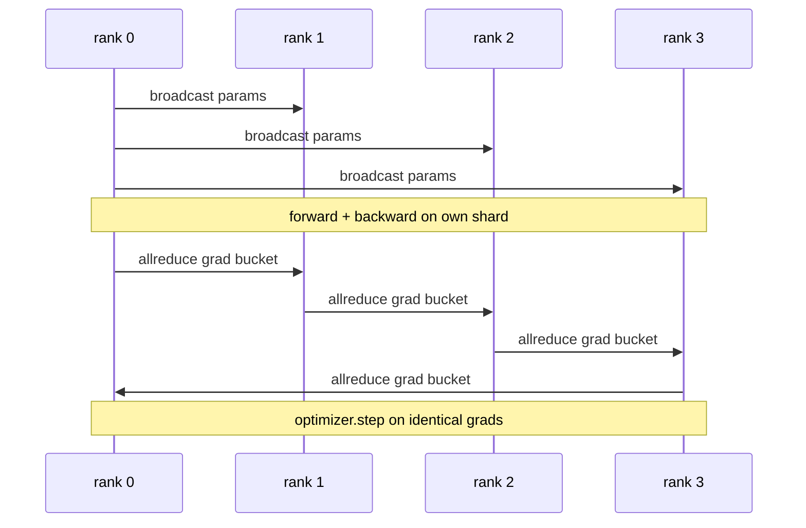

# 從零實作 Data Parallel DDP (Data Parallel DDP From Scratch)

> DistributedDataParallel 是 allreduce 之上的一個 hook。包住一個模型，從 rank 0 broadcast 初始參數，讓每個 rank 都從相同的起點出發，在每個參數上安裝 backward hook 發出 gradient 的 allreduce，其餘就是 gradient descent。整個模式約 200 行。

**Type:** Build
**Languages:** Python
**Prerequisites:** Phase 19 Track C lessons 42-49
**Time:** ~90 分鐘

## 學習目標 (Learning Objectives)

- 接上形狀類似 `DistributedDataParallel` 的 wrapper，它會 broadcast 初始參數，並在 backward 之後 allreduce gradient。
- 用 `torch.multiprocessing.spawn` 在 gloo backend 上，以檔案為基礎的 rendezvous，產生 N 個 CPU rank。
- 藉由在相同資料上循序訓練同一個模型，並展示逐步的參數等價性，證明 gradient 同步的正確性。
- 為使用 bucket（gradient 融合）與 overlap（backward 期間通訊）辯護，它們是把能運作的 DDP 變成正式環境 DDP 的兩項改變。

## 問題 (The Problem)

一個 10 億參數、12 GB activation 的模型，放不進一張消費級 GPU。即使放得進去，訓練也要好幾週。Data parallel 把 batch 分到 N 個 rank，每個 rank 對自己的分片計算 forward 與 backward，並在每一步把所有 rank 的 gradient 加總，使 N 份副本保持相同。加總後的 gradient 就是 optimizer 走的那一步所依據的。

沒有 gradient 同步，N 個副本在第 2 步就分歧了。模型不再是「用更多資料訓練的一個模型」，而是 N 個碰巧共享初始權重的獨立模型。Gradient 同步做得不好（每個參數一次 allreduce、沒有 overlap、沒有 bucket），網路就是瓶頸，GPU 閒置著等線路。DDP 的功夫在於讓 gradient 同步相對於運算幾乎是免費的。標準的 PyTorch DDP 透過 gradient 分 bucket、讓 allreduce 與下一層的 backward 重疊，以及在 NVLink 上使用 NCCL 來達成。我們可以在 CPU 上用 gloo 把這三件事都做到，並學到相同的課題。

## 核心概念 (The Concept)



### DDP 需要的三個操作 (The three operations DDP needs)

| 階段 | Collective | 原因 |
|------|-----------|------|
| 初始化 | 從 rank 0 broadcast | 每個 rank 都以相同的參數開始 |
| Backward 之後 | 每個 grad 的 allreduce | optimizer 走的那一步依據的是平均 gradient |
| 有時 | buffer 的 broadcast | Batchnorm 的 running stats 保持同步 |

### 為什麼是平均而不是加總 (Why mean and not sum)

Allreduce-SUM 除以 world_size 得到平均 gradient。平均對 world_size 是不變的：在一個 rank 上調好的 learning rate 在四個 rank 上也能用，因為每一步的 gradient 大小不變。不除的 Allreduce-SUM，會迫使你每次改變叢集大小就重新調整 learning rate。DDP 包住 SUM 再除；本課也這麼做。

### 為什麼要把 gradient 分 bucket (Why bucket gradients)

Transformer 有數千個參數 tensor。每個 tensor 一次 allreduce，會付數千次 gloo 延遲下限。DDP 把 gradient 分組成約 25 MB 的 bucket，每個 bucket 發出一次 allreduce。線路上移動的總 bytes 相同，但延遲被攤到整個 bucket。對於本課的小模型，我們把所有東西放進一個 bucket；能延續下去的是這個結構。

### 為什麼要固定 seed (Why pin the seed)

每個 rank 對於 shuffle 必須呼叫 `torch.manual_seed(seed + rank)`，但對於參數初始化則呼叫 `torch.manual_seed(seed)`。如果 shuffle 共用單一 seed，每個 rank 看到的 batch 順序都相同（讓 data parallel 失去意義）。對參數而言，建構時從 rank 0 的 broadcast，才是讓副本相同的原因，它會覆寫每個 rank 初始化的任何東西。共享的初始化 seed 是備援：如果 broadcast 被跳過或壞掉，各 rank 專屬的初始化會讓每個副本有不同的起始權重，光靠 gradient 同步永遠無法把它們拉回一致。把 seed 的模式做對，否則參數等價性的測試在第 1 步就會失敗。

```figure
ci-ddp-grad-sync
```

## 動手做 (Build It)

`code/main.py` 實作了：

- `MiniMLP`：3 層的 MLP，小到幾秒內就能收斂，又大到足以暴露接線。
- `DistributedDataParallel(model, world_size)`：在建構時 broadcast 參數，回傳一個 wrapper，其 `sync_grads` 把累積的 allreduce-sum 後 gradient 除以 world_size。
- `worker(rank, world_size, ...)`：完整的訓練迴圈，包含在 gloo 上初始化 `torch.distributed`、forward、backward、sync、step。
- `_reference_single_process_loop(...)`：在一個 rank 上對相同資料循序訓練同一個模型，測試用它來在每一步之後檢查逐位元組相等的參數等價性。

執行它：

```bash
python3 code/main.py
```

輸出：一張逐步的訓練表，比較單一 process 的 loss 與參數 checksum，以及 4 個 rank 上的 DDP run。兩條路徑產生的 loss 曲線在 float epsilon 內完全相同，證明 gradient 同步是正確的。

## 實務上的正式環境模式 (Production patterns in the wild)

有三個模式把 DDP 強化到足以發佈。

**找出未使用的參數。** 有些 forward 路徑會有條件地跳過參數（early exit、mixture-of-experts router）。被跳過的參數沒有 gradient，但 DDP 的 bucket-ready hook 仍然在等它們，allreduce 就會死鎖。`find_unused_parameters=True` 告訴 DDP 在 reduce 之前先看哪些參數拿到了 gradient。代價是每一步都要做一次圖走訪，所以除非你的 forward 有分支，否則請關掉。

**靜態圖最佳化。** 當 forward 在各步之間穩定時，`static_graph=True` 讓 DDP 預先計算 bucket 排程。這個最佳化在大規模時很重要：預先計算每一步省下幾毫秒，在 10000 步中會累積起來。

**Gradient 累積需要小心。** 在 K 個 microbatch 上累積 gradient，而不是每個 microbatch 都同步，是 10 倍的吞吐量提升。DDP 暴露 `no_sync()` 作為 context manager，暫停 backward 之後的 allreduce。忘了這個 manager，你就會白白 allreduce K 次；吞吐量掉到谷底。

## 實際使用 (Use It)

正式環境的做法：

- **PyTorch DDP。** 標準實作。`torch.nn.parallel.DistributedDataParallel(model)` 接上了 bucket、overlap 與 no_sync context。
- **HuggingFace Accelerate。** 加上處理 `torchrun` 環境變數與模型包裝的 launcher。底層是相同的 DDP。
- **Megatron-LM data parallel。** 為大型模型把 DDP 與 tensor parallel 結合；data-parallel 的部分是相同的「backward 後 allreduce」模式。

## 交付 (Ship It)

第 78 課 (ZeRO 分片) 把每個參數的 allreduce 換成 reduce_scatter，讓每個 rank 只儲存自己那份 optimizer 狀態的分片。第 81 課把 DDP 與 ZeRO 組合進端到端示範。

## 練習 (Exercises)

1. 新增大小可設定的 gradient bucket，並在更深的模型上量測相對於「每個參數一次 allreduce」的加速。
2. 實作 `no_sync()` 作為 context manager，並驗證 gradient 累積在 K 個 microbatch 上符合單一 process 的 baseline。
3. 新增 `find_unused_parameters` 模式，讓 forward 有時跳過 MLP 的某一層；沒有這個旗標時，run 應該會死鎖。
4. 把 gloo 換成只用 `torch.distributed.barrier()` 的同步，體會以 allreduce 為基礎與以 barrier 為基礎的同步有何不同。
5. 對 batch size 1、16、256，量測 gradient 同步額外開銷占 step 時間的比例，並解釋擴展關係。

## 關鍵術語 (Key Terms)

| 術語 | 一般說法 | 實際意義 |
|------|----------|----------|
| DDP | 「Data parallel」 | 每一步都 broadcast 參數並 allreduce grad 的 wrapper |
| Bucket | 「融合 grad」 | 把 N 個小的 allreduce 合併成一個大的 |
| Overlap | 「隱藏通訊」 | 在較後面的層還在計算 backward 時，就發出 allreduce |
| no_sync | 「累積」 | 為了 gradient 累積而跳過 backward 之後的 allreduce |
| find_unused | 「有分支的 forward」 | 在 reduce 之前偵測沒有 grad 的參數 |

## 延伸閱讀 (Further Reading)

- [PyTorch DistributedDataParallel docs](https://pytorch.org/docs/stable/generated/torch.nn.parallel.DistributedDataParallel.html)
- [PyTorch DDP internals tutorial](https://pytorch.org/tutorials/intermediate/ddp_tutorial.html)
- [Li et al, PyTorch Distributed: Experiences on Accelerating Data Parallel Training](https://arxiv.org/abs/2006.15704)
- Phase 19 Lesson 76 - DDP 所建立的 collective
- Phase 19 Lesson 78 - ZeRO 分片把每個參數的 allreduce 換成 reduce_scatter
