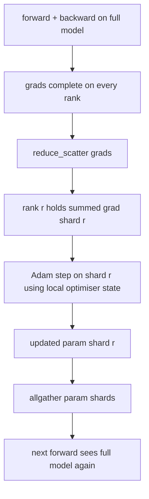

# ZeRO Optimizer 狀態分片 (ZeRO Optimizer State Sharding)

> Adam 為每個參數儲存兩個動量估計，兩者都是 float32。一個 7B 參數的模型帶有 56 GB 的 optimizer 狀態。ZeRO stage 1 把它分片到 N 個 rank；每個 rank 擁有 1/N 的 optimizer。本地 step 之後，更新後的參數分片會 broadcast 回去，每個 rank 重建完整模型，下一步開始。好處是訓練堆疊中最大的單一配置，記憶體線性下降。

**Type:** Build
**Languages:** Python
**Prerequisites:** Phase 19 Track C lessons 42-49
**Time:** ~90 分鐘

## 學習目標 (Learning Objectives)

- 把 optimizer 狀態（第一動量、第二動量、fp32 master 副本）分片到 N 個 rank，讓每個 rank 擁有 1/N。
- 用 reduce_scatter 只把各自分片的 gradient 加總交給每個 rank，再用 allgather 把更新後的參數分片 broadcast 回去。
- 計算 stage 1、stage 2、stage 3 相對於原版 DDP 的記憶體節省表。
- 依模型大小與頻寬預算，為選擇 stage 1、stage 2 或 stage 3 辯護。

## 問題 (The Problem)

原版 DDP 複製一切：參數、gradient 與 optimizer 狀態，在每個 rank 上都完整存在。對一個 fp16 的 7B 參數模型，這表示每個 rank 有 14 GB 的參數、14 GB 的 gradient，以及 56 GB 的 optimizer 狀態（兩個 float32 的 Adam 動量）。混合精度訓練還要在上面加上 28 GB 的 float32 權重 master 副本。Optimizer 狀態是最大的一項，也最容易分片，因為它只在 step 時被碰到，而不是在 forward 或 backward 期間。

ZeRO stage 1 對 optimizer 狀態分片。每個 rank 持有 1/N 的 Adam 動量。Backward 之後，ZeRO 不是 allreduce 完整的 gradient 再於本地 step，而是 reduce_scatter，讓每個 rank 只收到自己分片的加總 gradient。該 rank 對它那份 master 參數的分片套用 optimizer step。更新後的參數分片接著 allgather 回去，讓每個 rank 都有完整模型可供下一次 forward。Optimizer 記憶體降為 1/N。每一步線路上的流量與 DDP 相同：以頻寬計，一次 reduce_scatter 加一次 allgather 等於一次 allreduce。記憶體省下來了，吞吐量維持不變。

## 核心概念 (The Concept)



### ZeRO 的各個 stage (Stages of ZeRO)

| Stage | 分片了什麼 | 每個 rank 的記憶體 | 每一步的通訊 |
|-------|-----------|--------------------|--------------|
| DDP | 無 | params + grads + optim | 1x allreduce |
| ZeRO-1 | optimizer 狀態 | params + grads + optim/N | 1x reduce_scatter + 1x allgather |
| ZeRO-2 | optim + grads | params + grads/N + optim/N | 1x reduce_scatter + 1x allgather |
| ZeRO-3 | optim + grads + params | params/N + grads/N + optim/N | 每層 1x allgather + 每層 1x reduce_scatter |

Stage 1 是最便宜的勝利，因為 optimizer 狀態主導了預算。Stage 2 需要 gradient 分片累積的邏輯，但頻寬相同。Stage 3 (FSDP) 在每次 forward 與 backward 都要付每層的通訊，換取參數分片的記憶體下降。本課完整實作 stage 1。

### 記憶體算術，真實數字 (The memory math, real numbers)

對於以混合精度、使用 Adam 訓練、有 P 個參數的模型：

| 項目 | 原版 | ZeRO-1 | 原因 |
|------|------|--------|------|
| fp16 params | 2P bytes | 2P bytes | forward 需要 |
| fp16 grads | 2P bytes | 2P bytes | backward 需要 |
| fp32 master 副本 | 4P bytes | 4P/N bytes | 只有 optim 會用到 |
| fp32 第一動量 | 4P bytes | 4P/N bytes | 只有 optim 會用到 |
| fp32 第二動量 | 4P bytes | 4P/N bytes | 只有 optim 會用到 |
| 總計 | 16P bytes | 4P + 12P/N bytes |   |

在 N=8：原版 16P，ZeRO-1 為 5.5P，下降 65%。在 N=64：原版 16P，ZeRO-1 為 4.19P，下降 74%。

### 為什麼 reduce_scatter 勝過先 allreduce 再分片 (Why reduce_scatter beats allreduce-then-shard)

Allreduce 讓每個 rank 都拿到完整的加總 gradient。如果你只需要分片 r，那麼被 reduce 的 gradient 中 (N-1)/N 在 rank r 上都白費了。Reduce_scatter 剛好交付每個 rank 擁有的分片；每個 rank 的 bytes 與 allreduce 相同（因為 allreduce 就是 reduce_scatter + allgather），但後半被稍後的參數分片 allgather 取代。線路上的淨流量與 DDP 相同，記憶體則被除以 N。

```figure
cd-zero-shard
```

## 動手做 (Build It)

`code/main.py` 實作了：

- `flatten_params(module)` 與 `unflatten_into(module, flat)`，把模型的參數打包成一個連續的 tensor，再解包回去。扁平的版面，讓依 rank 分片變成簡單的切片。
- `ZeroOptimizer(model, world_size, rank, lr)`，擁有該 rank 的 master 副本與 Adam 動量分片。
- `step()`，對扁平的 gradient 執行 reduce_scatter、對該 rank 的分片套用 Adam，並把更新後的參數 allgather 回去。
- 一個示範，訓練 3 層 MLP 20 步，並在原版 DDP baseline 旁邊印出每一步的記憶體預算。

執行它：

```bash
python3 code/main.py
```

輸出：每一步的 loss，以及記憶體表，顯示 ZeRO-1 在每個 rank 上持有 1/N 的 optimizer 狀態，而 DDP 則是完整的副本。

## 實務上的正式環境模式 (Production patterns in the wild)

有三個模式把 ZeRO 強化到足以發佈。

**分片的 checkpoint 很重要。** ZeRO-1 的 optimizer 狀態被拆分到各個 rank；checkpoint 必須記錄誰擁有什麼。第 80 課建立分片 checkpoint manifest，可在相同的 world size 上恢復 ZeRO run。沒有它，儲存的狀態在重啟時是無法讀取的。

**混合精度才是重點。** ZeRO 是混合精度技術；被分片的是 fp32 master 副本。不用混合精度而執行 ZeRO，等於付了 fp32 master 的記憶體稅，卻沒有相對應的 fp16 forward 好處。正式環境的 run 總是把 ZeRO 與 autocast 或 bf16 權重搭配。

**Stage 1 幾乎是免費的勝利。** 以頻寬計，通訊與 DDP 相同。記憶體節省對 N 是線性的。唯一的代價是 optimizer 分片的記帳。除非 gradient 或參數記憶體也是問題，正式環境的堆疊預設用 stage 1。Stage 2 在不增加額外頻寬的情況下對 gradient 分片；只有 stage 3 對參數本身分片，並以每層通訊換取那份記憶體。

## 實際使用 (Use It)

正式環境的做法：

- **DeepSpeed ZeRO。** 參考實作。`deepspeed_config.json` 選擇 stage 1/2/3 與分區大小。
- **PyTorch FSDP。** PyTorch 原生的對應物。`ShardingStrategy.SHARD_GRAD_OP` 是 ZeRO-2；`FULL_SHARD` 是 ZeRO-3。
- **HuggingFace Accelerate。** 在統一的設定下包裝 DeepSpeed 與 FSDP。

## 交付 (Ship It)

第 79 課 (pipeline parallel) 是正交的分片軸：它不是在同一個模型上對 optimizer 狀態分片，而是把各層分片到不同 rank。第 81 課在端到端示範中組合 DDP + ZeRO。

## 練習 (Exercises)

1. 透過對 gradient 分片擴充到 ZeRO-2：每個 rank 只儲存它那份分片的 gradient，做法是在 backward 之後把非分片的部分歸零。
2. 新增記憶體 profiler，印出 rank 0 上實際的 fp32 byte 用量，並與公式預測比較。
3. 量測原版 DDP 與 ZeRO-1 每一步的牆上時間，並分解為 forward、backward、通訊。
4. 在 ZeRO-1 下實作 gradient clipping：L2 norm 必須透過對本地 norm 平方做 allreduce，跨所有分片計算。
5. 實作用 allreduce 而不是 reduce_scatter 的「天真 ZeRO」，量測線路時間的差異。用數字為選擇 reduce_scatter 辯護。

## 關鍵術語 (Key Terms)

| 術語 | 一般說法 | 實際意義 |
|------|----------|----------|
| ZeRO-1 | 「對 optimizer 分片」 | 每個 rank 持有 1/N 的 fp32 master + Adam 動量 |
| ZeRO-2 | 「連 grad 也分片」 | 每個 rank 在 reduce_scatter 之後也丟掉非分片的 gradient |
| ZeRO-3 | 「對 params 分片」 | 每個 rank 持有 1/N 的 fp16 params；forward 時每層做 allgather |
| Master copy | 「fp32 權重」 | optimizer 更新的高精度參數副本 |
| Reduce_scatter | 「把加總切開」 | 只把各自分片的加總 gradient 交給每個 rank |

## 延伸閱讀 (Further Reading)

- [Rajbhandari et al, ZeRO: Memory Optimizations Toward Training Trillion Parameter Models](https://arxiv.org/abs/1910.02054)
- [DeepSpeed ZeRO documentation](https://www.deepspeed.ai/tutorials/zero/)
- [PyTorch FSDP documentation](https://pytorch.org/docs/stable/fsdp.html)
- Phase 19 Lesson 76 - 本課所依賴的 reduce_scatter 與 allgather
- Phase 19 Lesson 80 - ZeRO 狀態必須使用的分片 checkpoint
