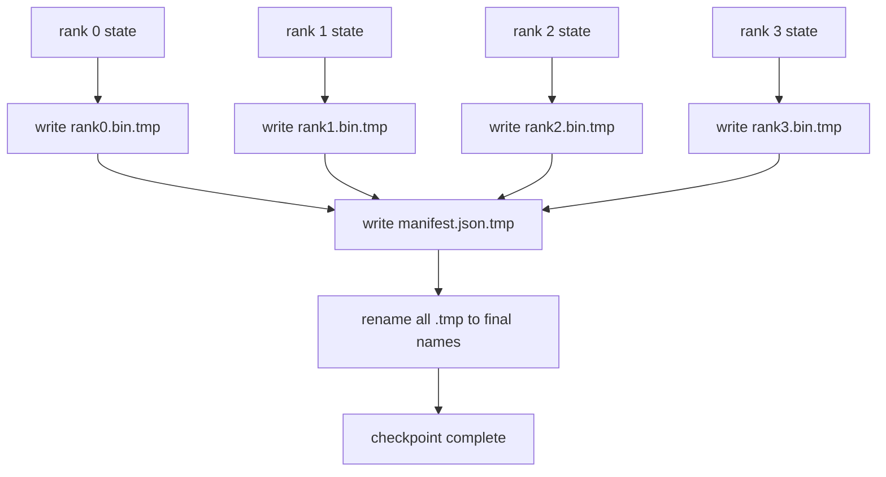

# 分片 Checkpoint 與原子式恢復 (Sharded Checkpoint and Atomic Resume)

> 一個 70B 參數的訓練工作，每隔幾個小時就會因節點故障而暫停。Checkpoint 的格式決定你損失的是 30 分鐘還是 30 小時。分片 checkpoint 平行寫入每個 rank 的分片，並把歸屬記錄在 manifest 中。恢復時從各自的檔案載入每個 rank 的分片，在相同的 world size 上重建狀態，optimizer 就像什麼事都沒發生一樣繼續 step。原子寫入則避免寫到一半的 checkpoint 毒害下一次恢復。

**Type:** Build
**Languages:** Python
**Prerequisites:** Phase 19 Track C lessons 42-49
**Time:** ~90 分鐘

## 學習目標 (Learning Objectives)

- 把多 rank 的 checkpoint 儲存成每個 rank 一個分片檔，外加記錄誰擁有什麼的 manifest。
- 使用原子寫入模式（寫到暫存路徑再 rename），讓寫入中途當機永遠不會產生寫到一半的 checkpoint。
- 從 manifest 恢復，並在每個 rank 上驗證 fp16 參數與 ZeRO optimizer 狀態的逐位元組相等狀態。
- 針對三種失敗模式為 manifest schema 辯護：world size 改變、分片數量不符，以及部分寫入。

## 問題 (The Problem)

原版 checkpoint 把所有參數和 optimizer 狀態讀進 rank 0、gather，然後寫成單一檔案。對 70B 的模型，這是 1.1 TB 的狀態經過一個 rank 的網路埠。寫入會擋住其他每個 rank，因為它們閒置著等 gather。IO 頻寬是最慢的那一張 GPU 的網路連結，而不是總和。在真實的叢集上，gather 再寫入的步驟可能比前一個小時的訓練還久，這表示工作每個訓練日產出不到一份 checkpoint。

分片 checkpoint 把模式反過來：每個 rank 平行地把自己的分片寫到自己的檔案。Manifest 記錄哪個 rank 擁有哪個分片，讓恢復時可以把每個分片放回它來的地方。總寫入頻寬隨叢集擴展。一個過去經由單一 rank 要 4 小時的 1 TB checkpoint，經過 64 個 rank 只要 4 分鐘。此外，manifest 還為不相容的恢復提供了契約：world size 改變可以偵測到，部分寫入可以偵測到，載入路徑可以大聲失敗，而不是默默使用過時的資料。

## 核心概念 (The Concept)



### Manifest schema

```json
{
  "world_size": 4,
  "step": 1234,
  "wall_clock_seconds": 4521,
  "shards": [
    {"rank": 0, "path": "rank0.bin", "sha256": "...", "param_shard_offset": 0, "param_shard_numel": 65536},
    {"rank": 1, "path": "rank1.bin", "sha256": "...", "param_shard_offset": 65536, "param_shard_numel": 65536}
  ],
  "schema_version": 1
}
```

三個欄位是承重的。`world_size` 讓在不同大小上恢復時大聲失敗，而不是默默損毀。每個分片的 `sha256` 抓出部分寫入或損毀的寫入。每個分片的 `param_shard_offset` 與 `param_shard_numel` 讓 loader 能在正確的位置重建扁平的參數 tensor。

### 原子寫入 (Atomic write)

標準模式：把每個分片寫到 `<name>.tmp`，把 manifest 寫到 `manifest.json.tmp`，各自 fsync，rename 分片，最後再 rename manifest。同一個檔案系統內的一次 POSIX rename 是原子的：要嘛新檔案完整存在，要嘛舊的還在。一組 rename 不是交易，所以 manifest 的 rename 才是 commit 點，而 loader 會對照 manifest 的雜湊檢查每個分片。把每個 checkpoint 寫進它自己的 step 目錄；這樣在 manifest rename 之前當機時，前一個 checkpoint 仍然是有效的那一份。重複使用同一個目錄會破壞這個保證，因為分片的 rename 會在新 manifest 落地之前取代舊分片。沒有原子寫入，當機可能留下一個部分寫入的分片，而 manifest 還存在並指向它，載入時就會在恢復時損毀 optimizer 狀態。

### schema 必須防禦的三種失敗模式 (Three failure modes the schema must defend against)

| 失敗 | 症狀 | 防禦 |
|------|------|------|
| World-size 改變 | 在 N=8 上恢復，但 manifest 來自 N=4 | manifest 中 world_size 不符，大聲失敗 |
| 分片數量不符 | 恢復時看到的 rank*.bin 檔案比 manifest 中的分片少 | 列舉分片，驗證每一個都存在 |
| 部分寫入 | 分片檔案在 flush 中途被截斷 | 載入時做 sha256 驗證 |

每一道防禦都及早拒絕壞的載入；另一種選擇是默默損毀，在 100 步之後 loss 變成 NaN 時才浮現。

### 為什麼是每個 rank 一個檔案，而不是一個大檔案 (Why per-rank files, not one big file)

透過 `O_APPEND` 對單一檔案並行寫入，在 POSIX 上對位元組對齊的寫入是可行的，但實務上一個分片內的位移橫跨 MB 大小的區域，鎖定會成為主導。每個 rank 一個檔案沒有競爭，而且當底層檔案系統是平行的 (Lustre、GPFS) 時，還能受益於 striping。正式環境的堆疊 (DeepSpeed、FSDP、NeMo) 都因為這個原因使用每個 rank 一個檔案。

```figure
ci-sharded-checkpoint
```

## 動手做 (Build It)

`code/main.py` 實作了：

- `ShardManifest` dataclass，具有上述 schema，另有 `to_json`/`from_json`。
- `save_sharded(state_dict_per_rank, dir, step)`，使用原子的「暫存再 rename」模式，把每個 rank 的二進位狀態寫到各自的檔案，然後寫入 manifest。
- `load_sharded(dir, expected_world_size)`，讀取 manifest、驗證每個分片的 sha256，並回傳每個 rank 的 state dict。
- 往返測試：建立每個 rank 的狀態、儲存、載入、斷言逐位元組相等。

執行它：

```bash
python3 code/main.py
```

輸出：寫出 4 個分片檔加上 manifest，然後重新載入並做逐位元組相等的驗證。

## 實務上的正式環境模式 (Production patterns in the wild)

有三個模式把 checkpoint 強化到足以發佈。

**非同步寫入。** 正式環境的堆疊在獨立的執行緒或 process 上發出 checkpoint 寫入，讓訓練可以繼續。屏障在下一次 checkpoint：在前一次完成之前，不要開始下一次儲存。DeepSpeed 的 `async_io` 旗標做的就是這件事。本課讓寫入保持同步，使步驟清楚可見。

**先寫本地快速磁碟，再非同步上傳。** 先寫到本地 NVMe（快），再非同步上傳到 S3 或 GCS。這種兩層模式讓叢集內的 checkpoint 對恢復保持快速，同時把一份持久的副本送到叢集外封存。Manifest 帶有本地路徑；上傳 manifest 帶有遠端路徑。

**輪替很重要。** 正式環境的 run 保留最後 K 份 checkpoint（通常 3-5 份），並輪替掉最舊的。沒有輪替，磁碟會在 run 中途被塞滿，下一次 checkpoint 就會失敗。有輪替的話，下一次儲存先刪除最舊的，釋放預算。

## 實際使用 (Use It)

正式環境的做法：

- **DeepSpeed checkpointing。** `deepspeed.save_checkpoint(tag=step)` 寫出每個 rank 的檔案，以及指向目前有效 tag 的 `latest` 檔。
- **PyTorch FSDP checkpointing。** `torch.distributed.checkpoint` 儲存分片狀態，並用 `Planner` 決定每個 rank 的版面。
- **NeMo。** 用統一的 `save_to_checkpoint` API 包裝 DeepSpeed 與 FSDP，並加上 metadata。

## 交付 (Ship It)

第 81 課儲存端到端 DDP+ZeRO run 的分片 checkpoint，並在相同的 world size 上重新載入，以證明恢復的契約成立。

## 練習 (Exercises)

1. 新增非同步寫入：在執行緒中啟動儲存，讓訓練繼續。在前一次完成之前，擋住下一次儲存。
2. 新增 `last_5_steps` 輪替：保留最近的 5 份 checkpoint，在儲存新的之前刪除最舊的。
3. 為內層迴圈的重新載入新增只用 CRC 的快速驗證路徑（輪替把一份 checkpoint 變成新的有效 checkpoint，而不做完整的 sha256）。
4. 新增跨 world-size 載入：透過讀取 manifest、串接、重新分片，把分片從 N=4 重新平衡到 N=8。
5. 新增上傳到假的 S3（第二個目錄），並寫出上傳 manifest。為兩層儲存政策辯護。

## 關鍵術語 (Key Terms)

| 術語 | 一般說法 | 實際意義 |
|------|----------|----------|
| Sharded checkpoint | 「每個 rank 各存一份」 | 每個 rank 平行寫入自己的分片檔 |
| Manifest | 「索引」 | 記錄分片路徑、位移與 sha256 的 JSON 檔 |
| Atomic write | 「先寫 tmp 再 rename」 | 寫到 .tmp 再做 POSIX rename，讓當機時前一個檔案仍然有效 |
| Partial write | 「被截斷的分片」 | 寫入期間當機產生損毀的分片；sha256 抓得出來 |
| Rotation | 「保留最後 K 份」 | 在寫入新的之前刪除最舊的 checkpoint，以限制磁碟使用量 |

## 延伸閱讀 (Further Reading)

- [DeepSpeed checkpointing](https://deepspeed.readthedocs.io/en/latest/model-checkpointing.html)
- [PyTorch torch.distributed.checkpoint](https://pytorch.org/docs/stable/distributed.checkpoint.html)
- [POSIX rename atomicity](https://pubs.opengroup.org/onlinepubs/9699919799/functions/rename.html)
- Phase 19 Lesson 78 - 本 checkpoint 所設計要儲存的 ZeRO 狀態
- Phase 19 Lesson 81 - 端到端示範會對儲存的狀態做往返
