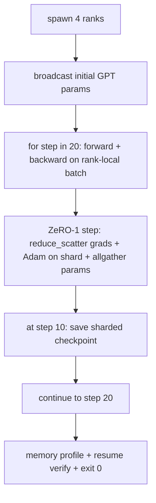

# 端到端分散式訓練 (End-to-End Distributed Training)

> 第 76 到 80 課各自建立了一塊。這裡是組裝：一個小型 GPT 在 4 個模擬 rank 上訓練，用 DDP 做 gradient 同步、ZeRO-1 做 optimizer 狀態分片，並在中間點存一份分片 checkpoint。示範執行 20 步，自行終止，印出 loss 曲線加上記憶體 profile，並寫出可恢復的 checkpoint。

**Type:** Build
**Languages:** Python
**Prerequisites:** Phase 19 Track C lessons 42-49
**Time:** ~90 分鐘

## 學習目標 (Learning Objectives)

- 把 DDP（第 77 課）加 ZeRO-1（第 78 課）加分片 checkpoint（第 80 課）組合成一個訓練迴圈。
- 在 4 個模擬 rank 上，用小型合成語料訓練 2 層 transformer 語言模型 20 步。
- 印出每一步的 loss 表、每個 rank 的記憶體 profile，以及可在相同 world size 上逐位元組相等恢復的 checkpoint manifest。
- 為這個組合辯護：每一塊在先前的課程中都可獨立測試，而本課證明它們可以組合。

## 問題 (The Problem)

Capstone 是各部件能組合在一起的證明。第 76 課實作了 collective。第 77 課把它們包成 DDP。第 78 課用 reduce_scatter 對 optimizer 狀態分片。第 79 課分析了 pipeline。第 80 課儲存了分片 checkpoint。每一課都各自獨立，有自己的測試。真實的訓練 run 會同時用到每個基本元件；如果組合錯誤，loss 會發散、checkpoint 拒絕恢復，或者每個 rank 的記憶體在應該縮小的時候反而成長。

本課執行端到端示範，並驗證四個不變量：(a) 在 20 步內，loss 在浮點雜訊範圍內單調下降，(b) 每個 rank 在每一步都持有相同的參數 norm，(c) 每個 rank 的 optimizer 記憶體等於 ZeRO-1 公式 12P/N bytes，以及 (d) 第 10 步的 checkpoint 在重啟時逐位元組相等地重新載入。示範會自行終止：20 步、單一指令、結束碼 0。

## 核心概念 (The Concept)



### 迷你 GPT (The mini GPT)

模型刻意做得很小：2 個 transformer block、embed 維度 32、4 個 attention head、vocab 64、序列長度 16、batch 4。幾千個參數。大到足以演練每個接線決策（multi-head attention 走標準的 masked 路徑；LayerNorm 有需要同步的權重；LM head 是回到 vocab 的獨立線性投影）。又小到 20 步在 4 個 CPU rank 上幾秒就能完成。

### 組合規則 (The composition rules)

| 課程的部件 | 它擁有什麼 | 它留給迴圈什麼 |
|------------|-----------|----------------|
| DDP broadcast | 初始參數同步 | 建構時呼叫一次 |
| ZeRO-1 step | Gradient 同步、master 副本更新、參數 broadcast | 每一步呼叫一次，取代 optimiser.step |
| 分片 checkpoint | 持久化每個 rank 的狀態、帶有 sha256 的 manifest | 在 rank 0 上呼叫，狀態透過 allgather 收集 |
| 訓練迴圈 | Forward、backward、loss 記錄 | 依序呼叫以上三者 |

迴圈不知道 reduce_scatter 或 rendezvous 檔案。ZeRO 與 checkpoint 模組暴露狹窄的介面，由迴圈組合。

### 為什麼是小型 GPT，而不只是 MLP (Why a tiny GPT and not just an MLP)

第 77 課的 MLP 足以驗證 gradient 同步。小型 GPT 多了三件事：一個獨立、涵蓋 vocab 的 LM head（本課為了清楚而不綁定；完整的 GPT 通常會把 head 與 token embedding 綁定）、以 softmax+cross-entropy 作為 loss（比 MSE 有更多數值上的邊界情況），以及非對稱的 forward（每一層先 embedding，再 attention，再 MLP）。Capstone 如果沿用 MLP，就會隱藏這個組合是否正確處理了 LayerNorm 或 embedding 層的 grad 形狀。

### 自行終止代表結束碼 0 (Self-terminating means exit 0)

迴圈執行固定的 20 步就結束。沒有 `while True`，沒有人為介入，沒有從外部狀態恢復。一個你可以放著無人看管、結束時找到完整日誌的 capstone，證明系統接線正確。如果任何一塊死鎖，示範永遠不會返回，而測試機制會抓到它。

```figure
ci-distributed-assembly
```

## 動手做 (Build It)

`code/main.py` 實作了：

- `MiniGPT`：2 層 transformer，具有 masked self-attention 與獨立的 LM head。
- `make_corpus(seed, total_tokens)`：確定性的 next-token 預測資料。
- `_train_worker`：每個 rank 產生一個；broadcast 初始參數、執行迴圈、呼叫 ZeRO step，並在第 10 步寫出分片 checkpoint。
- `verify_resume`：主要 run 結束後，在行程內重新載入第 10 步的 checkpoint，並斷言儲存的 master 分片與記憶體中的快照逐位元組相符。
- `main`：協調整個示範，印出 loss 表、記憶體 profile 與驗證結果。

執行它：

```bash
python3 code/main.py
```

輸出：一張 20 列的 loss 表、一張 4 列的每個 rank 記憶體 profile、一份 checkpoint manifest，以及成功時的「RESUME VERIFIED」一行。

## 實務上的正式環境模式 (Production patterns in the wild)

有三個模式為真實的 run 完成這個組合。

**每 K 分鐘做一次 checkpoint，而不是每 K 步。** Step 時間會隨序列長度與 microbatch 數量而變。每 10 分鐘一次的 checkpoint 節奏，無論模型多大，都涵蓋相同的運算量。本課為了簡單使用以 step 為基礎；正式環境使用以牆上時間為基礎。

**及早偵測發散。** 正式環境的 run 會在 backward 之後加上 NaN 防護與 loss 突波偵測器；如果 loss 在一步之內跳升超過 2 倍，就回滾到上一份 checkpoint，而不是讓 optimizer 走進退化的狀態。本課的 loss 曲線很平滑，所以防護沒有用上，但 hook 仍保留著。

**跨 rank 彙總記憶體 profile。** 真實 run 中各 rank 的記憶體不同（擁有最大 pipeline stage 的 rank 持有較多 activation）。正式環境記錄各 rank 的最大值加上平均；本課則逐 rank 印出，以顯示公式相符。

## 實際使用 (Use It)

正式環境的做法：

- **DeepSpeed。** 在一份設定下結合 DDP + ZeRO + pipeline + activation checkpointing。本課的組合就是 DeepSpeed 形狀的縮影。
- **PyTorch FSDP。** 原生的對應物。使用 `ShardingStrategy.SHARD_GRAD_OP` 的 `FullyShardedDataParallel` 就是 ZeRO-2。
- **NeMo 與 Megatron-LM。** 為最大型的模型加上 tensor parallel；除此之外，組合的形狀相同。

## 交付 (Ship It)

整個 track 到此結束。這 6 課合起來，就是真正的團隊在採用 DeepSpeed 之前會建立的分散式訓練子系統；抽象已經對照 gloo 驗證過，失敗模式也已經演練過。Phase 17（基礎設施與正式環境）是把它帶到真實叢集的地方。

## 練習 (Exercises)

1. 新增 attention head 的 tensor-parallel 切分，並驗證 loss 符合單一 rank 的 baseline。兩個 rank：每個 rank 一半的 head，對 attention 輸出做 allreduce。
2. 在 4 個 microbatch 之間加入 gradient 累積，並證明 gradient 等於一個大 batch 的 gradient。
3. 新增從第 10 步恢復的路徑，確實繼續訓練到第 20 步，並產生與原始 run 相同的最終 loss。
4. 新增指標匯出（loss、grad norm、step 時間）到 JSONL，讓 run 事後可以視覺化。
5. 新增 NaN 防護，在 loss 突波時回滾到上一份 checkpoint，並用單步的 LR 乘數強制製造突波，來演練回滾。

## 關鍵術語 (Key Terms)

| 術語 | 一般說法 | 實際意義 |
|------|----------|----------|
| End-to-end | 「全部接起來」 | 一次 run 就組合每一塊，而不是每塊各一個單元測試 |
| Memory profile | 「每個 rank 幾 GB」 | 每個 rank 上為 params、grads、optimizer 狀態所持有的 bytes |
| Resume contract | 「儲存與載入」 | checkpoint 往返之後，每個 rank 的狀態逐位元組相等 |
| Self-terminating | 「有界的 run」 | 固定的 step 數，完成時結束碼 0，沒有人在迴圈裡 |

## 延伸閱讀 (Further Reading)

- [DeepSpeed end-to-end training tutorial](https://www.deepspeed.ai/getting-started/)
- [PyTorch FSDP advanced tutorial](https://pytorch.org/tutorials/intermediate/FSDP_advanced_tutorial.html)
- [Megatron-LM training script reference](https://github.com/NVIDIA/Megatron-LM)
- Phase 19 Lessons 76-80 - 本課所組合的每一塊
- Phase 17 - 把這個組合搬到真實叢集
