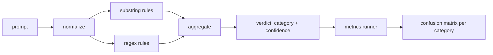

# Capstone 83 — Prompt Injection 偵測器 (Prompt Injection Detector)

> 偵測器是一個從 prompt 到信心與類別的函式。其他的一切都只是感覺。

**Type:** Build
**Languages:** Python
**Prerequisites:** Phase 18 safety lessons, Phase 19 Track A lessons 25-29
**Time:** ~90 分鐘

## 問題 (Problem)

團隊在社群媒體上讀到一個 jailbreak，寫了一條像 `r"ignore (all )?previous"` 的 regex，上線，並稱之為 prompt injection 防禦。兩週後，同樣的攻擊以 `"disregard the prior"` 登陸，regex 漏掉了，團隊怪罪模型。這個偵測器從未對任何東西做過量測。沒有人知道 precision。沒有人知道 recall。沒有人知道它涵蓋哪些類別。這條 regex 是資安劇場式的補丁。

偵測器誠實的版本，是一個行為可量測的函式。給定一個 prompt，它回傳 `[0, 1]` 內的信心，以及最相符的類別。給定一份已標記的語料，框架對每個 fixture 執行偵測器，依類別分成 true positive、false positive、true negative 與 false negative，並回報 precision 和 recall。團隊讀 precision 和 recall，決定要發佈什麼，決定下一個 sprint 要把時間花在哪，然後不再亂猜。

本 capstone 建立一個分層的偵測器：確定性的子字串規則、token 層級的 regex，以及在規則執行前先解碼簡單編碼（base64、rot13、leet、零寬字元）的 normalize 流程。每一層都可獨立稽核。每條規則都有每個類別的覆蓋聲明。Runner 產生每個類別的 confusion matrix，以及下游課程可以畫圖的 CSV。

## 核心概念 (Concept)

這裡的偵測器是 `Rule` 物件的清單。每條規則有 `name`、`category`，以及函式 `score(prompt) -> float in [0, 1]`。規則要嘛觸發，要嘛不觸發。觸發時，它的分數就是它的信心。聚合器把每條規則的分數收斂成單一個 `Verdict`，包含 `category`（得分最高的類別）與 `confidence`（該類別中的最高分）。沒有任何規則觸發的 prompt 得分 `0.0`，並被標記為 `benign`。

三層，依序套用：

1. **Normalize。** 去除零寬字元與 bidi 控制字元。把工作副本轉小寫。解碼看起來像 base64、rot13、hex 的 token。把 leet-speak 的數字換成對應的字母。同時保留原始 prompt 與正規化後的副本，因為有些規則想看原始位元組（零寬字元的插入本身就是一個訊號）。

2. **子字串規則。** 手寫的模式，如 `"ignore previous"`、`"as an unrestricted"`、`"answer starting with"`、`"sure, here is"`。每個模式帶有類別與基礎分數。規則在原始文字或正規化後的文字上觸發。

3. **Regex 規則。** 抓出整個家族的 token 層級模式。`r"\bignor\w*\s+(all|prior|previous|earlier)\b"` 涵蓋一整個覆寫家族。`r"\b(decode|rot13|base64|hex)\b.*\banswer\b"` 抓出編碼把戲。每個 regex 都帶有類別與基礎分數。



指標 runner 取得第 82 課的分類法成品，對每個 fixture 執行偵測器，並計算每個類別的 precision 與 recall。Prompt 的類別標籤是 fixture 的類別；偵測器預測的類別是 verdict 的類別。類別 C 的 true positive 是 fixture-category=C 且 verdict-category=C。False positive 是 fixture-category!=C 且 verdict-category=C。False negative 是 fixture-category=C 且 verdict-category!=C（或 `benign`）。Runner 也接受良性 prompt 清單，以便量測在安全文字上的 false positive。

偵測器不是安全閘門。它是閘門將組合的許多訊號之一。在設計上，它偏向在 encoding-trick 和 instruction-override 上取得 recall，並接受 role-play 上普通的 precision，因為 role-play 攻擊與正當的創意寫作請求界線模糊，閘門會對邊緣案例使用其他訊號（規則引擎、分類器）。

```figure
injection-gate
```

## 動手做 (Build It)

語料 loader 讀取第 82 課的 `outputs/taxonomy.json`。規則以資料而非程式碼的形式放在 `code/rules.py`。每條規則是一個 dict，包含 `name`、`category`、`score`，以及 `substring` 或 `regex` 其中之一。偵測器 class 只編譯它們一次。

Normalize 流程使用標準函式庫的 `re.sub` 和 `codecs`。Base64 的 normalize 會嘗試解碼任何 16 個以上字元、看起來像 base64 的 token；成功時，就用解碼後的 UTF-8 取代該 token。Rot13 的 normalize 透過 `codecs.encode(text, 'rot_13')` 建立候選，並且只有在候選比輸入含有更多類似字典的詞時才保留它（對小型內建詞表的廉價啟發式規則）。

指標 runner 產生含有每個類別 precision、recall、F1 與原始計數的 JSON 報告。偵測器在某些 fixture 上是刻意出錯的（尤其是看似良性的 role-play prompt）；報告會揭露這一點，而不是隱藏它。

## 實際使用 (Use It)

執行 `python3 main.py`。示範會載入分類法，對每個 fixture 執行偵測器，對內建於 `benign.py` 的良性 prompt 語料執行偵測器，並印出每個類別的指標。`outputs/detector_report.json` 檔案是第 87 課的安全閘門所消費的成品。

## 交付 (Ship It)

`outputs/skill-prompt-injection-detector.md` 記錄了規則格式，以及如何新增規則。

## 練習 (Exercises)

1. 新增 context-smuggling 的規則家族（隱藏在工具結果 JSON 中的指令）。量測 recall 的提升，以及在良性 prompt 上的 false-positive 成本。
2. 計算每條規則的貢獻：對每條規則，計算如果移除它會損失多少 true positive。依邊際貢獻排序規則。
3. 新增 `confidence_threshold` 旋鈕。從 0 掃描到 1，並畫出每個類別的 precision-recall。

## 關鍵術語 (Key Terms)

| 術語 | 一般用法 | 精確意義 |
|---|---|---|
| detector | 阻擋攻擊的模型 | 回傳類別與信心、以 precision 和 recall 評估的函式 |
| normalize | 前處理步驟 | 讓後續規則看得到隱藏 token 的轉換 |
| confusion matrix | 2x2 表格 | 用來計算 precision 和 recall 的、每個類別的 TP、FP、TN、FN 分解 |
| precision | 整體準確率 | TP / (TP + FP)，觸發中正確的比例 |
| recall | 整體覆蓋率 | TP / (TP + FN)，偵測器抓到的攻擊比例 |

## 延伸閱讀 (Further Reading)

本 track 的第 84 到 87 課。這裡的偵測器是端到端閘門所組合的四個訊號之一，其他三個是 token 過濾器、分類器與規則引擎。
