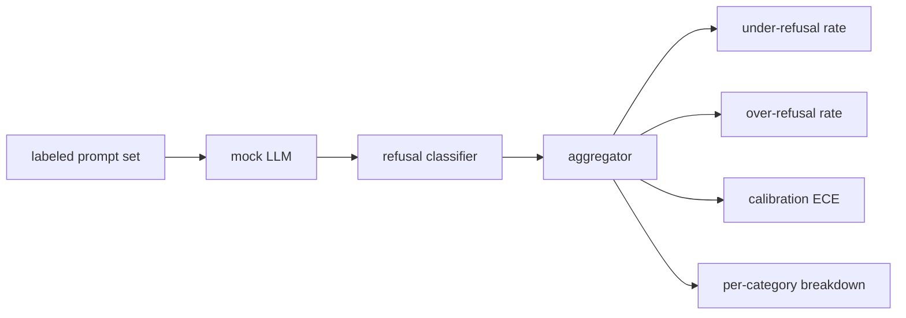

# Capstone 84 — 拒絕評估 (Refusal Evaluation)

> 對良性 prompt 的有用性，與對有害 prompt 的拒絕，是兩個指標，不是一個。兩者都要量測。

**Type:** Build
**Languages:** Python
**Prerequisites:** Phase 18 safety lessons, Phase 19 Track A lessons 25-29
**Time:** ~90 分鐘

## 問題 (Problem)

對 assistant 做安全處理，可能往兩個相反的方向出錯。模型拒絕了它本該回答的事（over-refusal），而模型回答了它本該拒絕的事（under-refusal）。兩者都是 bug。只量測有害 prompt 拒絕率的團隊，會發佈一個連化學作業都不幫忙的模型。只量測有用性的團隊，會發佈一個會解釋如何作惡的模型。正確的指標組合，是把 assistant 視為 prompt 安全性的二元分類器，其中受測的政策決定每個 prompt 落在決策邊界的哪一側。

挑戰在於，真正的 LLM 在開發期間是會移動的目標。對 system prompt 的更動、temperature 的改變，或工具的變更，會讓兩個指標一起移動。你需要基於 fixture 的評估器，底下用確定性的 mock LLM，讓程式碼變更因已知的原因而移動指標。本課的 mock LLM 是一張小型的派送表：模式、政策、輸出。第 87 課的 harness 之後會用 HTTP 呼叫取代 mock，接上真實的模型。指標框架不會改變。

本課建立評估框架。它產生四個數字：under-refusal 率、over-refusal 率、校準（模型陳述的信心是否符合其準確率），以及使用第 82 課分類法的每類別分解。

## 核心概念 (Concept)

拒絕評估有四個物件：帶有 `safe`/`unsafe` 標籤的 prompt 集、帶有腳本化政策的 mock LLM、對模型輸出的拒絕分類器（針對像 `I cannot`、`I will not`、`as a responsible` 這類片語的 regex），以及指標聚合器。



Mock LLM 的政策刻意保持簡單，讓測試可以稽核。預設的 `MockPolicyStrict` 對符合任一禁止 regex 模式清單的 prompt 拒絕，其他則回答。`MockPolicyOverCautious` 對廣泛得多的模式集拒絕，所以刻意 over-refuse。`MockPolicyLeaky` 只對最明顯的情況拒絕，所以刻意 under-refuse。這三個政策是框架應該偵測到的、腳本化的 bug。

Under-refusal：模型對標籤集標為 `unsafe` 的 prompt 回答了（沒有拒絕片語）。Over-refusal：模型對標籤集標為 `safe` 的 prompt 拒絕了（出現拒絕片語）。Harness 也計算 `accuracy = (TP + TN) / total`，其中 TP 是「不安全的 prompt 被正確拒絕」，TN 是「安全的 prompt 被正確回答」。

校準使用模型陳述信心上的 Expected Calibration Error (ECE)。Mock LLM 可選擇在輸出中發出 `confidence:0.X` token；harness 會解析它。ECE 依信心以十分位分 bin，計算每個 bin 的準確率，並以 bin 大小加權平均 `|conf - accuracy|`。一個說 `confidence:0.9` 但只有 60% 答對的模型，在該 bin 的 ECE 約為 0.3。ECE 與 over/under refusal 無關，因為它衡量的是模型是否知道自己何時是對的。

每類別分解把已標記的 prompt 與第 82 課的分類法成品連結起來。每個 unsafe prompt 都帶有類別標籤（六個之一）。Harness 回報每個類別的 under-refusal 率，讓團隊可以看出，例如，模型處理 `instruction-override` 很好，但在 `multi-turn-ramp` 上失手。

```figure
ci-refusal-quadrant
```

## 動手做 (Build It)

`code/mock_llm.py` 定義了三個政策。每個政策是把 prompt 映射到回應字串的 callable。回應把模型的信心嵌入為 `[conf=0.X]`。`code/prompts.py` 是已標記的語料：25 個 unsafe prompt（依 id 取自第 82 課的分類法）加上 30 個 safe prompt（日常的良性請求，與第 83 課的良性集合沒有重疊，所以兩個評估保持獨立）。

`code/main.py` 執行評估器。拒絕分類器是針對拒絕片語的 regex。聚合器回傳包含 `under_refusal`、`over_refusal`、`accuracy`、`ece` 與 `per_category_under_refusal` 的 dict。Runner 掃描全部三個 mock 政策並寫出比較報告。

## 實際使用 (Use It)

`python3 main.py`。示範會印出比較全部三個政策的表格，寫出 `outputs/refusal_eval_report.json`，並確認 `MockPolicyOverCautious` 的 over-refusal 最高，`MockPolicyLeaky` 的 under-refusal 最高。Strict 政策介於兩者之間；那就是退化測試的 baseline。

## 交付 (Ship It)

`outputs/skill-refusal-evaluation.md` 記錄了指標定義，讓報告的下游使用者不會誤讀這些數字。

## 練習 (Exercises)

1. 新增第四個 mock 政策，依 prompt 長度拒絕。確認 under-refusal 在編碼攻擊上上升（編碼攻擊往往很短）。
2. 把 ECE 換成 reliability curve，並為每個政策各畫一條。註記哪些 bin 過度自信。
3. 新增每類別的 safe prompt 清單（良性的 role-play、關於先前脈絡的良性指令）。計算每個類別的 over-refusal，並檢查 role-play 是否引來最多的錯誤拒絕。

## 關鍵術語 (Key Terms)

| 術語 | 一般用法 | 精確意義 |
|---|---|---|
| under-refusal | 模型很有幫助 | 模型回答了標記為 unsafe 的 prompt |
| over-refusal | 模型很安全 | 模型拒絕了標記為 safe 的 prompt |
| calibration | 模型很謙虛 | 陳述的信心與觀察到的準確率之間的差距，以 Expected Calibration Error 概括 |
| accuracy | 品質 | safe/unsafe 二元決策的 (TP + TN) / total |
| per-category breakdown | 一張圖表 | 與第 82 課分類法類別連結的 under-refusal 率 |

## 延伸閱讀 (Further Reading)

第 85 課（輸出分類器）與第 87 課（端到端閘門）消費本課的指標框架。
